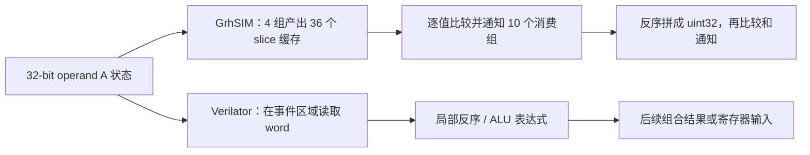

# TNO0013：从执行边界和数据表示解释 GrhSIM / Verilator 差距

## 结论与范围

当前差距应按两个结构问题处理：**GrhSIM 的组合数据流被细粒度活动边界切开，因而需要缓存、比较、传播大量中间值；当前 CV32 输入转换又提前丢失了数组、word 和控制结构。** 前一问题对应相同归一化 RTL 上仍有约 1.40 倍差距，后一问题解释为何原始 RTL Verilator 又比归一化版本明显更快。两者相互放大，但不能混为 emitter 一项问题。

本轮新增只读结构审计，复用已有 trace、逐值计数和源映射，没有新建候选、改变生产默认值或新增跑分。分析对象是默认 GrhSIM `9642e07f…`、归一化 Verilator `53961069…`、原始 Verilator `6b90343c…`。TNO0012 的 shared-deferred 候选尚未提升为默认；它只合并部分通知 OR，未改变下面这些边界。

关键新证据：

- 每周期 **543.047** 次 scalar old/new 比较中，**534.772 次（98.48%）**对应仅跨 compute 组、没有直接 commit/output/event 用途的中间值。
- 沿实际参与调度的 def-use 继续向后追，**578 个被跟踪值**最终只到达同一个 commit 组（68，门控时钟上升沿或复位下降沿）。它们贡献 **343.489 次比较/周期（63.25%）**。
- 当前有 **65 个 compute supernode**，每周期实际进入 **52.875** 次。30 组的执行率至少 0.9 次/周期，其中包含低、高相位都执行的时钟门控组；除该组外为 29 组。这些高执行率组贡献 303.054 次比较/周期。
- 一条 ALU word 路径中，32 位操作数被物化为 36 个 slice 值，跨 4 个生产组和 10 个消费组；仅这些 slice 每周期比较 31.563 次，变化 5.953 次。Verilator 对应计算保留 word 源和函数局部表达式。

这些是工作量来源和结构范围，**不是时间占比分解，也不是能直接删去 63.25% 比较的正确性证明**。

## 1. 执行区域的定义不同

GrhSIM 的 [eval](../../build/cv32e40p/shared-equality-validated/grhsim_shared_equality/grhsim_Cv32Bench_eval.cpp:42) 每轮依次调用 9 个 compute batch 和 1 个 commit batch。batch 内仍逐 supernode 检查活动 bit；生产值变化后激活其读者，commit 写状态后重新激活读者，必要时再迭代。

归一化 Verilator 的 [事件检测](../../build/cv32e40p/run2/verilator/VCv32Bench___024root__0.cpp:94) 主要构造外部时钟、复位和门控时钟的 trigger；[NBA body](../../build/cv32e40p/run2/verilator/VCv32Bench___024root__1.cpp:5327) 用这些 trigger 调用几个顺序/组合代码区。区内大部分 wire 计算直接按依赖顺序执行，不为每条组合边建立独立的 old/new 值比较。

| 项目 | 当前 GrhSIM | 归一化 RTL Verilator |
| --- | --- | --- |
| 主执行边界 | 65 个 compute supernode + 4 个 commit supernode，包装成 10 个 batch | 按 event trigger 运行 NBA 顺序/组合代码区 |
| 每周期外层推进 | 2 次 eval、约 3 轮 fixed-point | 也有 ICO/ACT/NBA 的收敛检查 |
| 真正的数据通路进入次数 | compute 组合计 52.875 次；只有门控组在高低相位都进入 | 6 个主要 NBA 顺序/组合代码区各约 1 次 |
| 组合边界是否需要旧值 | 跨组值通常需要，以决定是否激活 reader | 执行区内部局部值通常不需要 |
| 不变输入带来的收益 | 可跳过 consumer 组计算 | 通常重算已触发区域中的组合逻辑 |
| 为跳过工作付出的成本 | 旧值读取、比较、缓存写回、fanout 合并和活动 mask 更新 | 主要在事件/区域入口检查 trigger |

不能把 GrhSIM 三轮解释为“全电路算三遍”。低相位几乎只有门控相关计算；高相位两轮用于状态提交和后续可见值收敛。原始 Verilator 的某些 ACT/NBA 入口次数更多，却更快，也说明入口次数不是实际计算量。结构差异主要藏在 compute 内部，`eval()` 独占采样只有约 4.38% 并不能排除调度表示带来的成本。

## 2. 边界如何变成额外机器工作

当前 [ActivityScheduleOptions](../../wolvrix/include/transform/activity_schedule.hpp:31) 的 compute supernode op 上限为 128。冻结 schedule 的 6,582 个 compute 侧 op 分成 65 组，组大小 30–128，12 组恰好达到 128。这里的 op 数含 source/constant，不能看作等成本的 Host 指令数。

[调度构造](../../wolvrix/docs/transform/activity-schedule.md) 从 commit 输入和输出根回追，遇到已有 owner、共享 producer、容量等边界就切开；随后 coarsen 和连续分段的成本主要是 `incoming_boundary_activation_edges + 1`。这已考虑跨边数量，但不等价于目标 CPU 上“多算一个廉价表达式”与“保存并维护一个缓存值”的成本，更没有按事件区域决定哪些边根本不需要增量缓存。

在 emitter 中，`value_fanout` 先过滤出 compute 读者形成 [boundaryFanoutByValue](../../wolvrix/lib/emit/grhsim_cpp.cpp:13681)，随后将这些值标为 [persistent](../../wolvrix/lib/emit/grhsim_cpp.cpp:13786)。[valueNeedsChangeDetect](../../wolvrix/lib/emit/grhsim_cpp.cpp:7959) 因其存在 compute fanout 而要求变化检测。

于是一个组合结果不再只是局部表达式，而成为：

```cpp
next = expression(inputs);
changed = cached_value != next;
cached_value = next;
reader_groups_changed |= changed;  // 最终写 activity mask
```

这种表示同时延长值的存活期、增加状态访问和比较，并把 producer/consumer 放到不同控制流、甚至不同 C++ 翻译单元。Clang 可以优化表达式内部的 cast/mask，也可能消掉部分存取，但无法随意删除跨 eval/组存活的缓存和活动语义。Verilator 在更大的执行区内使用局部值，C++ 编译器更容易做值传播、公共子表达式消除和寄存器分配。

这不是说 GrhSIM 把所有值都物化：非边界值已经走 local/inlining，当前大量 read-port 也直接 alias 到状态。剩下的问题正是**边界选择仍使许多本可局部的数据流变成持久值**。生成 header 中有 1,282 个标量中间槽（1,038 bool、102 u8、8 u16、128 u32、6 u64），不含真实硬件状态、RAM 和 cache 字段。

| 当前 scalar 比较分类 | 不同值 | 运行时比较/周期 | 变化/周期 |
| --- | ---: | ---: | ---: |
| 全部 | 990 | 543.047 | 96.145 |
| 仅跨 compute 边界，无直接 commit/output/event use | 982 | 534.772 | 90.973 |
| 一位值 | 867 | 439.225 | 44.585 |
| 所有 compute 读者都在同一个 C++ batch 内 | 41 | 34.513 | 8.868 |

源代码中的 comparison statement 共 1,698 处，因为共享译码的初始化、clear、set 分支可能各检查同一值；不能把 1,698 当成不同值数量，也不能重复累计动态计数。

“同 batch”只有约 6.36% 动态比较属于此处定义的全内含边。因此单纯增大 C++ 文件或 batch、减少函数调用仍不足以解决主体；必须改变实际求值边界及值的生命周期。

## 3. 一条 ALU 数据通路的完整对照

`core$_11281_` 是 32 位 ALU operand A 状态。其 [commit](../../build/cv32e40p/shared-equality-validated/grhsim_shared_equality/grhsim_Cv32Bench_sched_9.cpp:1899) 已经是 uint32 更新；问题发生在后续组合使用路径。



具体链条：

1. [sched_1:94](../../build/cv32e40p/shared-equality-validated/grhsim_shared_equality/grhsim_Cv32Bench_sched_1.cpp:94) 从 uint32 状态抽出 bit 19，比较 `value_bool_slots_[754]`，累计 group 9 的多个 changed 标志，再写回 bool。其他位分布于 group 2/7/9/10。这些 36 个 slice 不是 36 位硬件寄存器，而是同一 32 位状态的多个位/片段视图。
2. [sched_2:3070](../../build/cv32e40p/shared-equality-validated/grhsim_shared_equality/grhsim_Cv32Bench_sched_2.cpp:3070) 的 `_val_17841` 在 group 23 中把 32 个 bool 重新拼成反序 word，再做一次 old/new 比较并存入 `value_u32_slots_[94]`。该值每周期比较 0.702 次，改变 0.631 次，还要通知 batch 6 的 group 49。
3. 同一归一化输入的 [Verilator root_0:3286](../../build/cv32e40p/run2/verilator/VCv32Bench___024root__0.cpp:3286) 从 `_11281_` 直接做 mask/shift/OR，结果放进函数局部 `__VdfgRegularize_h6e95ff9d_0_314`（[声明](../../build/cv32e40p/run2/verilator/VCv32Bench___024root__0.cpp:707)）。不需要上述跨组 bool 缓存和逐位变化传播。
4. [原始 RTL Verilator](../../build/cv32e40p/run2/verilator-original/VCv32Bench___024root__0.cpp:3996) 对应 `operand_a_rev` 同样是 word 源和函数局部计算。

反序本身是所需逻辑，两侧都有位操作；差别不是 GrhSIM 多做了 RTL 不要求的反序，而是先把 word 拆成可独立调度的缓存值，随后再拼回 word。此前 concat-slice 合并只恢复同源、连续、正确位序的片段；反序 concat 不能直接化简成原 word。它仍应能作为 word 的局部位变换/视图，未必需要每位独立缓存。

这条路径说明需要同时考虑 word 表示和执行区域，仅优化某个 memcpy、OR 或 pack helper 会保留大部分结构成本。

## 4. 可优先研究的区域有多大

对所有 scalar 变化检测值沿**实际参与调度的** def-use 追到 commit/output/effect 终点，得到如下最大集合：

| 终点集合 | 被跟踪值 | 比较/周期 | 占全部比较 |
| --- | ---: | ---: | ---: |
| 只有 commit group 68 | 578 | 343.489 | 63.25% |
| group 66/68 与 instruction bus 输出 | 340 | 137.056 | 25.24% |

Group 68 的 140 个 register-write op 都使用同一事件签名：`posedge core$core_i.cs_registers_i.clk` 或 `negedge rst_ni`。其他 commit 区域分别是外部 clock 的 RAM 写、外部 clock/reset 的状态写、时钟门控 latch。完整列表见 [report.json](../../build/cv32e40p/structure-v2/report.json)。

因此可以把下一步结构设计收敛为：**保留事件/状态/副作用边界，在经证明的同事件纯组合区域内部，按拓扑顺序使用局部 word/表达式求值；只对区域外可见结果保留缓存和变化传播。** 这改变的是执行契约和中间值生命期，而不只是扩大一个 batch。

现有数据还不能证明这会省下多少时间：region 可能重算原本被跳过的逻辑、增大活跃变量集合、增加 spill；高执行率统计也没有提供两组在同一周期共同执行的相关性。578 个值的单一终点只是确定研究范围，不足以证明所有值可以立即取消缓存。需要处理以下语义条件：

- 所有区域输入属于同一可见状态快照；先求 next-state，再提交，不能边写旧状态边继续读取它。
- 保留 reset、门控 clock/latch、异步输入和组合循环的收敛语义。
- shared producer 被区域外消费者、public output、event 或 effect 使用时，仍保留对应边界。
- 通用 SCC/event analysis 决定哪些区域可采用直线执行，其他部分继续走现有 activity 路径。

这是一种面向单线程同步区域的通用 lowering 方向，不按 CV32 信号名或本次 profile 排名写特例，也不是关闭全部 activity schedule 或盲目调大 128 上限。

## 5. 原始 Verilator 的另一层优势：高层结构没有先被打散

原始 RTL → GrhSIM 当前必须经过兼容转换，见 [TNO0001](./TNO0001_reproduction_and_compute_cost_20261114.md)。冻结 [normalize.ys](../../build/cv32e40p/run2/normalize.ys) 运行 `proc; pmuxtree; flatten; opt -full; splitnets; opt_clean`。这是 sv2v **加 Yosys** 的转换路径，不应简称为 sv2v 的单独损失。

| 结构 | 原始 RTL Verilator | 当前归一化路径的后果 |
| --- | --- | --- |
| 寄存器堆 / CSR 数组 | 持久数组或 word bank，按地址索引 | concat/动态 slice；已修复部分，但 CSR 的宽 padding 仍在 |
| 子字段写入 | 直接 word/field 更新 | 1024-bit shift/mask/mux 后才 slice 出 16 bit |
| word 位变换 | 基于一个 word 的局部表达式 | splitnets/SSA/调度可进一步形成跨组 bit 缓存 |
| 条件和控制流 | 可保留条件赋值与局部表达式 | dataflow mux 网络；已提前求值的分支不能靠把 helper 换成 `?:` 恢复惰性求值 |

具体 CSR 读取和写入证据见 [TNO0009](./TNO0009_post_decode_code_shape_gap_20261115.md)。归一化 Verilator 也受到宽 padding/更新形态影响，但在同一归一化 RTL 上仍能比 GrhSIM 生成更集中的局部计算。这同时证明“全是前端问题”和“全是 emitter 问题”都不成立。

既有同场测量为 GrhSIM/V-normal **1.4015**、GrhSIM/V-original **2.9932**，其比值约 **2.14**。因此即使解决同归一化输入上的 1.40 倍后端差距，仍未达到原始 Verilator 路径。直接导入原始 CV32 所需的 enum、packed struct、generate symbol 和 mixed-driver 支持，以及 typed array/word/field 语义保留，应作为独立主线，而非继续在展开后的宽 shift/mask 末端逐个修补。

## 6. 对 XiangShan 的意义与边界

事件区内局部求值、word/slice 视图、避免为内部 wire 建立持久缓存，都可能惠及 XiangShan。此前已经发现其 Chisel 字段/Vec 的拆位形态。但 XiangShan 的多分区通信边界、reg-to-mem 和 memory intent 不能被本地 region 融合跨越；多时钟、DPI、副作用等仍应成为显式屏障。

因此可复用的是执行区域和数据表示的机制，不是 CV32 的组 ID、128 参数的新取值或预计收益。此次没有重建或测量 XiangShan。

## 复现、验收与限制

```sh
python3 scripts/cv32e40p_structure.py --output build/cv32e40p/structure-reproduce
PYTHONPATH=scripts python3 -m unittest test_cv32e40p_structure
python3 -m py_compile scripts/cv32e40p_structure.py scripts/test_cv32e40p_structure.py
```

分析器只读冻结输入并写新目录，校验三份 binary/源文件、counter 构建与 trace 身份，逐 op 校验映射和当前 scheduled graph 一致，并核对逐值计数和 aggregate 之和。3 项回归覆盖边界去重与 event/commit/output 保护、共享译码多分支比较计数、组合终点传播和 cycle 拒绝。

- [机器汇总](../../build/cv32e40p/structure-v2/report.json)、[输入身份](../../build/cv32e40p/structure-v2/inputs.json)
- [逐值边界、终点和动态计数](../../build/cv32e40p/structure-v2/comparisons.json)、[逐组统计](../../build/cv32e40p/structure-v2/groups.json)、[ALU 路径](../../build/cv32e40p/structure-v2/alu-case.json)
- [分析器](../../scripts/cv32e40p_structure.py)、[回归测试](../../scripts/test_cv32e40p_structure.py)

计数只覆盖既有 probe 的 scalar checks，不含所有 event/commit/cache guard；不会将 comparison 数当作 Host 指令数或 walltime 占比。IR 中未参与 schedule 的 dead/alias users 不计入实际终点，完整 graph op 总数也不当作执行工作量。Verilator root 字段包含状态与中间值、且表数组另计，不能把字段数量直接与 GrhSIM value slots 相减估算收益。本轮输出是结构定位及可验证的设计方向，没有新增速度结论。
