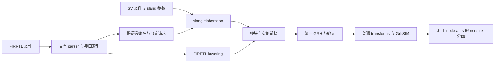

# FIRRTL ingest 架构与合约

本文定义拟实现的接口与行为。它与 [steps.md](steps.md) 配套，阶段是否完成
以 [index.md](index.md) 的看板和实际验证记录为准。

## 1. 当前基础与目标

当前 [SV ingest](../../wolvrix/lib/ingest/sv.cpp) 从 slang elaborated AST
构建普通 GRH；[Python 读取动作](../../wolvrix/app/pybind/native/actions/ingest.cpp)
负责请求转换、诊断和 session 插入；slang 驱动已迁入 SV 前端。香山流程随后
执行结构恢复、写归一化、
flatten、simplify，再进入统一 GRH 上的 GrhSIM。

[nonsink 分图](../../wolvrix/lib/transform/grhsim/partition-nonsink.cpp)
当前从 op 图逆向吸收纯计算，以预算限制工作节点，再进行 coarsen 和拓扑区间
分段。`semantic-nodes` 保护声明锚点，未携带 FIRRTL 的表达式归属。
新增前端的关键交付是让这层源结构到达分图，并实际改变候选分组和成本决策。

本地 `ptmp/xs/rtl/rtl/SimTop.fir` 文件头为 FIRRTL 6.0.0，文件约 1.6 GiB，
现已由 F03 的 [inputs.json](inputs.json) 冻结为语法与接口验收输入，连同
生成 SV 的内容清单和生成日志校验。F00 仍需补齐整机依赖、工具链和正确性/
性能基线；F03 通过不代表混合链接或 FIRRTL/SV 行为等价已经验收。

正式 FIRRTL 路线自行解析和 lowering，不链接 MLIR/CIRCT、不调用 firtool，
不先把 FIRRTL 转成 SV 再交给 slang。现有 slang 继续处理真正的 SV 源码；
内部数值操作可以复用项目已有任意精度位向量设施。

## 2. 源码与头文件组织

```text
wolvrix/
  include/ingest/
    ingest.hpp             # 语言无关的请求、结果、模块绑定和 driver
    sv.hpp                 # 现有 ConvertDriver/Options 与 SV 专用接口
    firrtl.hpp             # FIRRTL 配置、接口扫描和 lowering 入口
    node_attributes.hpp    # 不依赖 parser/slang AST 的属性读写与合并合约
  lib/ingest/
    sv.cpp                 # 原 lib/core/ingest.cpp，第一步只迁移
    firrtl.cpp             # FIRRTL 前端入口
    driver.cpp             # 混合源编排、specialization、链接和事务
    node_attributes.cpp    # 属性验证、重定向、合并及实例限定
    firrtl/                # 私有 lexer/parser/type/lowering 实现，按阶段拆分
  tests/ingest/
    data/firrtl/
    data/mixed/
```

第一步保持现有 `wolvrix::lib::ingest` 命名空间和 SV 公共类型，更新 CMake
源文件列表，并将全部调用方迁移到 `ingest/sv.hpp`，删除旧
`include/core/ingest.hpp`。测试、Python 绑定及文档示例同步更新 include 路径。
机械迁移与 SV 行为修改分别提交。语言无关头不暴露
`slang::ast::Compilation`、FIRRTL AST 或第三方
前端的 SourceManager；SV 专用类型只出现在 `sv.hpp`。

共享层负责输入、模块接口、源位置、链接及属性工具，不把 SV 的 LoweringPlan
强行变成两种语言的共同 AST。两个前端以现有 GRH 类型和 op 合约会合。
完整 node CSE 的分析和变换放在 `lib/transform/grhsim/node-cse.cpp`，公开
pass 入口放在 `include/transform/grhsim/node-cse.hpp`，不塞进前端 parser。

## 3. 一次事务中的混合读取



新增语言无关 `IngestRequest`，包含有序 source 列表、显式 top 列表、SV 参数、
FIRRTL 版本/语义选项、外部模块绑定和顶层可观察性配置。路径和参数纳入输入
身份；相对路径以请求指定的输入根目录解析，不依赖碰巧所在的工作目录。

Python 拟提供如下入口；字段在 F07 实现时与 C++ 请求逐项对应：

```python
session.read_sources(
    sources=[
        {"language": "firrtl", "path": "ptmp/inputs/SimTop.fir"},
        {"language": "systemverilog", "path": "testcase/bridge/Helper.sv"},
    ],
    tops=["SimTop"],
    slang_args=["-Itestcase/bridge/include", "-DVERILATOR"],
    firrtl_options={"node_annotations": True},
    external_bindings=[],
    out_design="design.main",
)
```

`Session.read_firrtl(path, ..., sv_sources=..., slang_args=...)` 是该入口的便利
封装。现有 `read_sv(path, out_design, slang_args, replace, log_level)` 保持
调用兼容；纯 SV 请求不要求提供 FIRRTL 配置。`replace=False` 的冲突行为
沿用现有 session 约定，不通过连续读取同名 design 来实现链接。

解析、elaboration、链接和验证全部在暂存结果上完成，成功才发布 design；
失败不覆盖原 session 内容。F01 的 DesignHandle 已使用 SourceOwners 集合，
SV owner 同时持有 compilation 及拥有 SourceManager 的 slang driver，克隆
共享全部 owner。后续 SV specialization 与 FIRRTL 源索引沿用该集合。
读取诊断使用拥有文本的文件/行列位置；FIRRTL 不伪造 slang SourceLocation。
F07 在混合链接时扩展后续 transform 的多 owner 诊断解析，不能仅取第一个
SourceManager 解释来自其他 compilation 的位置。

## 4. 混合 elaboration 与链接

跨语言模块引用必须在 elaboration 前可见，链接后再运行任何会删除未驱动值、
传播常量或展开实例的 pass。处理顺序如下：

1. 扫描所有 FIRRTL 模块、extmodule、端口类型及绑定参数，建立接口索引。
   需要暴露给 SV 的接口必须完成位宽与 Reset 类型解析。
2. 模块注册表区分语言、逻辑名称和 specialization。FIRRTL extmodule 的实现
   名按 `defname`，无 `defname` 时按模块名查找；同名不意味着直接覆盖。
3. FIRRTL → SV：按实现名称与**有类型的参数值**请求 slang specialization。
   一个 SV 模块的不同参数组生成独立 GRH 图。保留整数位宽/符号、字符串和
   实数参数差异，不能把所有参数拼成无类型十进制字符串。
4. SV → FIRRTL：向 slang 提供由已解析 FIRRTL 接口生成的签名声明，使 SV
   实例可以完成 elaboration。声明仅用于接口；链接时替换为真实 FIRRTL 图。
5. slang 没有适用的直接 specialization 入口时，driver 可生成小型 SV 调用
   包装模块。包装层只声明接口、传参和实例化真实模块，不翻译 FIRRTL 行为。
   它们使用专有名字并标识为内部产物，不成为用户 top 或未解析黑盒。
6. 遍历实际实例依赖，解析 FIRRTL → SV → FIRRTL 等交替引用；以 specialization
   key 去重，检测递归实例化和未收敛请求，不能只解决一层 extmodule。
7. 将两个前端的图、实例和端口映射合并到同一 Design，验证后才允许 flatten。

签名声明标记为 `ingest.link.kind="declaration"`，绝不能当作零输出实现。
SV 前端通过模块注册表识别这些声明，保留待绑定的实例调用，不对其空主体
执行普通模块 lowering 或未驱动输出简化。
最终可执行设计不得残留这类声明。缺失模块、重复真实定义、参数不匹配、
方向/位宽/shape 不兼容，必须在绑定位置诊断。输出依赖文件列出实际使用的
SV include、宏、FIRRTL 单元及 specialization，供增量构建和基线身份检查。

SV 实现来源同时覆盖显式 source 清单，以及目标输入实际使用的 blackbox
annotation 文件/资源/内嵌文本。driver 在 elaboration 前将其归一化为带原始
来源和内容 hash 的 SV 单元；内嵌源码落到 `ptmp/firrtl-ingest/` 的事务目录，
资源按显式 resource root 解析。相关 annotation 可来自伴随 JSON，不能只
查看 `.fir` 文本就认定依赖完整。F00 确认实际类名及参数格式，F07 实现对应
提取和依赖追踪；相同实现去重，冲突定义诊断。

### 4.1 边界 ABI 与绑定

内部统一用字段拆分、数组保留的 GRH 接口。对外需要独立描述源端口与 GRH
叶子端口的映射，包含名称、field path、方向、shape、位宽、符号及位布局。
不把 FIRRTL ABI 的下划线名称等同于内部 `__DOT__` 名称。

默认按明确的 FIRRTL/SV ABI 和精确签名绑定：支持目标输入所用的扁平端口
ABI，以及保留聚合端口的 ABI；差异通过显式 adapter 处理。adapter 可以执行
字段拆装、规范索引转换和位布局转换，不可静默截断、符号扩展或改变状态。
Bundle 的 flip 逐路径累计，决定叶子方向；顶层 input Bundle 不代表全部叶子
都是输入。模拟双向/Analog 不在已有 GRH 合约内时明确拒绝。

显式 `external_bindings` 允许指定逻辑模块、SV 实现、参数和端口映射，解决
非标准库边界。host C++/DPI 实现须绑定到有签名与效果合约的现有调用机制，
不能因存在外部源码文件就宣称模块已完成解析。

## 5. FIRRTL 语义与 GRH lowering

以输入声明版本对应的 FIRRTL 规范为准。F00 固定目标版本和特性矩阵；未知
版本或不支持的有效构造给出明确错误，不通过删行、替零或跳过 block 接受。

| 范围 | lowering 与验收约束 |
| --- | --- |
| 解析 | 支持缩进块、注释、source info、转义/字符串、常量和版本门控；错误保留文件及行列 |
| 类型 | UInt/SInt、Clock、Reset/AsyncReset、Bundle/Vector；先推导位宽、符号及 flow，再生成 GRH |
| 原语 | 显式实现各操作的结果宽度、符号规则、截断、扩展和位布局；不套用 SV 表达式规则 |
| connect/when | 解析作用域、字段 flow、条件与最后连接优先级；先建连接意图，再统一产生组合值和写端口 |
| node | 命名表达式只从定义取得值；记录表达式所属 node、结果根及源身份，引用已有 node 不复制其定义 |
| register | 复用 register/read/write 族；clock、reset、init 和旧值读取显式化 |
| 数组 | 元素/子数组使用多索引端口或 kSliceArray；不先展开成逐槽 eq/mux 后再恢复 |
| memory | 显式处理端口、读写延迟、mask、read-under-write、时钟与冲突语义；落到数组状态及必要流水状态 |
| 效果 | printf/stop/assert 等映射到已有系统任务/效果机制，保留 clock、enable、次数和顺序 |

位宽推导使用可诊断的约束求解，报告无解、未定宽、零宽和溢出位置。
支持范围内的零宽中间项按规范消除；不把零宽 value 或非法 shape 直接放入
GRH。公开跨语言接口仍必须具有可物化的完整签名。

`invalid`、未初始化值及未定义 memory 行为采用明确的仿真策略，写入输入
身份。与现有 SV TwoState 路线对照时固定同一策略；不能仅因 FIRRTL 来源
就全程宣布 TwoState 并绕过 SV 四态处理。混合图先保留正确逻辑域，再由
现有 `grh-to-grhsim` 执行显式投影。Reset/AsyncReset 不靠名称判断。

### 5.1 有序动态写示例

```firrtl
reg table : UInt<8>[32], clock
when en0 :
  connect table[addr0], data0
when en1 :
  connect table[addr1], data1
```

lowering 为一个带 `shape=[32]` 的 kRegister 和两个索引写端口。基础 GRH
`kRegisterWriteArrayPort` operands 为
`[enable, index0, ..., indexK, data, event0, ...]`；`regSymbol` 指向声明，
`eventEdge` 与 event operands 一一对应。这里分别是
`[en0, addr0, data0, clock]` 和 `[en1, addr1, data1, clock]`，边沿为 posedge。
后一个 connect 对同地址具有更高优先级。

写数据和索引必须在修改旧状态前采样；例如 `data1=table[addr0]` 仍读旧值，
不能把上述规则实现为边写边读取 current。复位与整数组写同样参与优先级
归一化。该文本优先级用于 register/connect，不能推导为任意独立 memory
端口写冲突的优先级；后者严格依据 memory 契约处理。

### 5.2 memory 与验证构造

CHIRRTL 的 cmem/smem/mport 先推导端口方向、clock 和 enable，转换为前端
内部明确 memory 描述；标准 mem 直接进入该描述。同步读以独立流水状态
表示，结构化 mask 逐字段/叶子展开。mask 粒度、越界、同时读写和多端口
碰撞分别测试，不用一个通用 mux 模式代替所有 read-under-write 选项。

layer/layerblock、intrinsic、Probe/引用与 annotation 根据 F00 清单逐项支持。
验证层采用显式启用配置，保留原条件和效果；不能照搬“所有 layer 无条件
展开”的兼容捷径。影响初始化、memory、外部实现或可观察性的 annotation
必须解释或报错；已确认仅用于物理实现的 annotation 可按白名单忽略并记录。

## 6. Bundle 展平、Vector 保留

复用 [SV 聚合规范](../../wolvrix/docs/ingest/aggregate-types.md) 的 GRH 终态：
Bundle/struct 不成为 GRH value，递归拆成叶子；外层 Vector 和字段内部的
Vector 维度按外到内迁移到叶子 shape。叶子 UInt/SInt 的位宽为 element
width，GRH width 为 element width × 各维 extent。

```firrtl
input packet : { valid : UInt<1>, data : UInt<32>[4] }[8]
```

| GRH 叶子 | element width | shape | 总 width |
| --- | ---: | --- | ---: |
| `packet__DOT__valid` | 1 | `[8]` | 8 |
| `packet__DOT__data` | 32 | `[8,4]` | 1024 |

`packet[i].data[j]` 直接对应第二个叶子的索引 `[i,j]`。整体连接、mux、相等
及初始化按字段展开，部分索引产生子数组。Vector 的 source 索引顺序显式
映射到 GRH 低元素优先顺序；整体位转换按 FIRRTL 布局重建，不能直接把
SV packed struct 布局当成 FIRRTL Bundle 布局。涉及 flip 的非法整体操作
由类型/flow 检查拒绝。

FIRRTL 6 的 primitive operands 必须是 ground type。上面的聚合相等、构造
和位布局转换通过合法的字段/元素连接、ground `eq` 及 `cat` 表达；不扩展
出 `eq(Bundle,Bundle)` 或 `asUInt(Vector)` 语法。F04 验收同时检查这些
非法 aggregate primitive 被拒绝和合法字段/元素形式的执行结果。

数组长度 1、1-bit 叶子、嵌套 Bundle/Vector、动态索引和跨语言端口都须覆盖。
若复用 SV 的小数组标量存储优化，必须保留源几何及正确访问映射，不能为了
共用阈值而丢失 FIRRTL 的数组访问语义。

## 7. node attribute schema v1

所有记录放在现有 op attrs 中，使用现有 `AttributeValue`，不增加独立 node
IR 或 JSON 方言。带这些属性的 Graph 记录
`metadata["firrtl.nodeSchema"]=1`。中间分析可将字符串 intern 成稠密索引，
该索引不持久化、不进入 source identity。

| 属性 | 类型 | 定义 |
| --- | --- | --- |
| `firrtl.node.members` | `vector<string>` | 此 op 所属的源 node 叶子表达式；整体 node 合并后可包含多个源身份，不含仅引用该结果的消费者 node |
| `firrtl.node.roots` | `vector<string>` | 此 op 的哪些结果提供对应源 node 叶子的输出边界 |
| `firrtl.node.rootResults` | `vector<int64_t>` | 与 roots 等长；每项为当前 op 的零起算 result 序号 |
| `firrtl.node.origins` | `vector<string>` | 历史来源集合；可用于诊断，不能直接作为归组依据 |

一个 node 叶子 key 是以下元组的 canonical 紧凑 JSON 字符串：
`[sourceUnit,circuit,module,instancePath,nodeName,fieldPath]`。sourceUnit 是
输入清单内稳定的逻辑单元名；instancePath 和 fieldPath 用字符串数组，避免
转义名称及 `__DOT__` 冲突。key 不包含裸实体 ID、绝对工作路径或随机计数。
module 级图的 instancePath 为空，flatten 后换成实际实例路径。

同一 node 的不同 Bundle 叶子使用不同 fieldPath；保留 Vector shape，不为
每个数组元素产生 node key。可通过前五项识别原始 node 家族，但不强迫所有
字段共同激活。members/origins 排序去重；roots 按 `(key,resultIndex)` 排序
去重，rootResults 同步排列。验证器检查类型、配对长度和结果序号范围。

属性同时决定分图前 op 级 CSE 的合法作用域。不同源 node 的内部计算保持
独立；只有第 8 节的完整 node 合并可以将相应成员身份联合起来。members
出现多个 key 时必须能追溯到合法整体合并或显式变换，不能作为允许任意
跨 node primitive 共享的通行证。

### 7.1 标注示例

```firrtl
node n = and(eq(a, b), or(c, d))
node y = mux(n, x, z)
```

用 `N`、`Y` 简写两个完整 key，得到如下关系：

| op | members | roots / rootResults |
| --- | --- | --- |
| `eq(a,b)` | `[N]` | 无 |
| `or(c,d)` | `[N]` | 无 |
| `and(eq,or)` | `[N]` | `[N] / [0]` |
| `mux(n,x,z)` | `[Y]` | `[Y] / [0]` |

`eq/or/and` 是一个候选表达式区域；mux 引用 `n`，不因此把 N 的内部 op
标成 Y。输入、状态读和效果是其外部依赖，不能由 node 标签改变其执行阶段。
当前阶段已被归到 writer 私有参数锥的表达式保持其归属，只有留下的 nonsink
部分进入 node 分图覆盖率统计。
未被显式 node 包住的组合逻辑沿用当前图分析，可选生成前端表达式分组，但
必须与真实源 node 分开统计。

`node n = input` 等别名没有计算区域。若根无法迁移到有定义的结果，保留一个
可消除的 kAssign 属性载体到分图分析；不为它制造 activity bit 或值复制。
常量、死 node 和别名可以折叠，必要时保留来源，不能为了完整保留源名字
而阻止 DCE 或把所有 node 当作 DontTouch/声明锚点。

## 8. GSIM 模式 CSE 与属性传递

参考本地 GSIM `a3ecb26` 的
[commonExpr.cpp](../../reference/gsim/src/commonExpr.cpp)：`Node::keyHash()`
遍历 assignTree，`checkNodeEq()` 逐树比较内部 ENode，再由 `commonExpr()`
按门槛选择整体 node 合并。该 pass 没有遍历所有内部子树并抽取跨 node 公共
primitive；[main.cpp](../../reference/gsim/src/main.cpp) 在表达式/常量/别名
优化后、graphPartition 前调用它。新方案采用这个优化粒度与先后关系。

### 8.1 局部简化和完整 node 合并

分图前的 primitive op 级 CSE 限制在同一 node 表达式内。常量折叠、别名
传播、死代码删除和 `mux(c,x,x) → x` 等局部变换继续执行，保持结果根映射。
共享不可变字面常量不形成新的活动计算节点，可以去重。

跨 node 的 CSE 以完整表达式为候选：从所有有效结果根重建内部纯计算的
结构视图，引用其他 node 时停在引用边界，使用其规范等价类。视图是对 GRH
的临时分析，不复制独立的可执行 IR，也不持久化 AST。内部局部 CSE 可能
产生 DAG，用 memoization 比较其表达式结构，避免展开造成指数级复制。

```firrtl
node n1 = xor(and(a, b), c)
node n2 = or(and(a, b), d)
```

上述两个完整表达式不同，分图前各自保留 `and(a,b)` 的内部计算。若之后
位于同一执行 leaf，叶内 CSE 可共享该 op；若位于不同超节点，不能预先
制造一个公共 producer 和新的激活/发布边界。

首版完整 node CSE 候选限定为有输入依赖、边界可验证、单个标量 Logic 结果
的纯组合 node。数组结果、状态声明/写、DPI/效果、跨阶段或来源不完整区域
明确跳过并报告。Bundle 拆分后的合格标量叶子分别参与；保留 Vector shape，
不为了进入 CSE 把数组逐元素展开。该范围与 GSIM 排除 array/非普通组合
Node 的做法一致，后续扩展另列语义与性能证据。

### 8.2 判等与实际共享分离

拟新增普通 GRH 仿真 pass `grhsim-node-cse`，执行以下步骤：

1. 按依赖拓扑遍历候选 node，计算完整表达式的结构 hash。
2. 同 hash 仅产生候选，继续精确比较 op kind、结果完整类型、功能 attrs、
   常量和有序 operands/子树。来源名字、调度标签不参与功能判等；不同输入
   或状态引用只有被证明等价才可视为同一边界，不做无依据的代数等价推断。
3. 建立规范等价类。两个 node 即使最终保持独立计算，其等价事实仍可用于
   下游完整表达式判等，对应 GSIM 的 realValueMap。等价类不是共享 owner，
   不因判等就重接引用或合并 members。
4. 根据实际 node DAG 的后继与等价组规模，决定哪些完整 node 共享计算。
   选择稳定代表，将被消除 node 的结果引用重定向，并清理不再使用的内部 op。
   对匹配成员及根合并源身份；保留活跃声明/观察别名，不能误删独立观测需求。

首版门槛固定为本地 GSIM 的值，三个条件满足其一即可合并：

| 条件 | 初始门槛 |
| --- | --- |
| 完整表达式等价组规模 | ≥5 个 node |
| node 标量结果位宽 | >256 bit，对应本地 GSIM 的 BASIC_WIDTH |
| 等价组中某个 node 的不同后继数 | >1 |

后继按活跃 node DAG 的不同消费节点计数，同一消费节点的重复 operand
只计一次；writer、Output 等实际消费边界作为具名终点，常量/source attrs
不计后继。小型、低扇出、组规模不足的重复 node 保留各自内部计算。
这些是共享启发式，不是等价证明，也不是由 Clang 的 64-bit 容器阈值推导。
初值、变更及命中/拒绝统计进入配置、报告和 generation identity。

### 8.3 生产 pass 的作用域和顺序

新增 `firrtl-node-cse=off|gsim`；`off` 仅关闭完整 node 合并，仍保持 node
内部的作用域隔离，用于单独测量 node CSE 收益。`gsim` 启用上述门槛。
有 node attrs 的生产路线采用该作用域规则，从 ingest 后第一次 simplify
起生效。无注解的原生 SV 区域继续现有规则，但不能与受保护 node 的内部
op 跨边界 CSE；失去部分属性的 FIRRTL 片段不得被误当成普通无注解 SV。

表达式语义键与 CSE 合法作用域分别处理。普通 simplify 和 GrhSIM `cseKey`
的功能判等可排除已定义的非功能 node attrs，但查找表还必须按 node 计算
单元隔离；完整 node 合并采用独立的全表达式判等入口。不能只删除语义键
里的 node attrs，就恢复全图 primitive CSE。

在现有共享 flow 的 `converted` 阶段接入如下顺序：

```text
ingest / 普通 GRH transforms / flatten / simplify（node 作用域从源头生效）
→ grh-to-grhsim
→ grhsim-simplify / bit packing / masked-OR（保持 node 作用域）
→ grhsim-node-cse（完整表达式判等及有门槛合并）
→ split-event-and-output → split-nonsink-and-sink
→ partition-nonsink → simplify（限同一执行 leaf）→ partition-sink
```

完整 node CSE 在 writer 私有参数锥和 nonsink 分离之前执行，防止提前分散
完整表达式；之后只分析留下的 nonsink 区域。分图后的 op 级 CSE 限于相同
执行 leaf，不跨 owner 或重新引入跨超节点共享。bounded clone 在分图后按
真实边界收益保留已有预算约束。

graph metadata 记录 `firrtl.nodeOptimization="gsim-v1"` 和 node CSE 配置，
与 schema 一并往返。checkpoint 明确标识 node CSE 已执行的 revision/配置；
重新读取时验证或重建 analysis，不能在不同 pass 阶段重复物理合并，也不能
在已做全局 primitive CSE 的旧图上仅补 attrs 宣称符合新策略。

### 8.4 跨 pass 属性传递

属性工具定义 copy、union、root 重定向、result 映射、实例限定和失效处理。
逐个审计生产重写入口，并验证作用域，不能仅在 clone 时复制 attrs。

| 变换 | 必须遵循的规则 |
| --- | --- |
| 原样保留、store/load、clone Design | 完整保留 schema、优化策略及根/作用域信息 |
| node 内 op 级 CSE | 仅同一计算单元，保留成员身份并重定向结果根 |
| 完整 node CSE | 精确判等并通过门槛后才共享；合并匹配成员与根的源身份 |
| 常量去重、别名传播 | 允许消除纯别名和重复字面常量；保留可用根，不能顺带共享其他内部计算 |
| 同 node 内替换/折叠 | 新 op 继承成员，根迁移到等价输出，重建 result 序号 |
| 跨 node 重关联/融合 | 分图前禁止抽取公共内部计算；必须保留引用边界，origins 合并不授予变换许可 |
| 根变成 input/外部值 | 使用透明属性载体或明确根映射，不错误迁移到无关 producer |
| DCE | 移除死计算和无用 node；保留活跃根，不把 source node 当作 DontTouch |
| hier-flatten | 为每个实例复制限定 key，不把两实例的相同源名字当成相同边界 |
| XMR/端口/类型 adapter | 保留来源及根；adapter 不自动并入被引用 node 的内部作用域 |
| grh-to-grhsim、phase/sink split | 保留计算 attrs；writer/effect 不因标签改变执行阶段 |
| bit packing、masked-OR、显式语义拆分 | 按新结果重建根与成员，保留片段隔离；不得隐式跨 node 抽取子表达式 |
| 分图与 bounded clone、叶内 CSE | 遵循最终执行 owner；合法复制保留来源，CSE 不跨 leaf |

分图前只有通过完整 node 合并的多个源身份，才能代表同一份已共享表达式；
分图后同一执行 leaf 内的 op 级 CSE 可合并对应来源，不能据此扩大共享范围。
历史 origins 不参与这项判定。遇到无法证明归属的片段，保留作用域屏障并
报告拒绝原因，不能删除标签以绕过 CSE 限制，也不能强制收缩破坏 DAG。

每个主要 checkpoint 区分合法删除、常量化、别名化、整体合并、显式分裂和
意外丢失。报告可用 node、保留重复计算和新增共享边界；属性不能变成无界
上游来源闭包，预期传递模式由 fixture 固定。

## 9. nonsink 如何利用 node

新增 `firrtl-nodes=off|prefer|auto`，与现有 `semantic-nodes` 分开。
该选项只控制分图：`off` 使用原分图算法，仍执行配置要求的 node 作用域和
完整 node CSE；`prefer` 使用优化后 node；`auto` 在 schema/优化策略有效时
启用，否则回退。原型期显式 opt-in；F11 验收后决定是否采用 auto 默认。
选项进入 FlowOptions、Python、Make、checkpoint 配置及 generation identity。
不无版本地改写现有八项 positional `grhsim.nonsinkConfig`。

利用过程包括以下步骤：

1. **读取优化后的 node DAG。** 在 nonsink 集合内，从有效根和成员恢复完整
   node 区域。整体 CSE 合并的代表只计一份计算，未满足门槛的等价 node 仍
   独立；不能重新按内部 op 相等把它们提前合并。
2. **处理显式分裂和边界。** 字段/位等已证明语义的拆分形成可验证新片段；
   跨阶段、effect、状态/输入和其他 node 引用仍为边界。异常非封闭区域保留
   屏障并诊断，收缩必须保持 quotient DAG 无环。
3. **形成初始工作节点。** 完整优化后 node 作为初始单位，内部无需发布的值
   保持局部，不因逆向吸收或预算填充任意切开；超预算的完整 node 可单独
   成组并报告。未标注 SV 区域沿用现有算法，显式片段保留各自边界。
   所有 op 恰好一个 owner，引用 node 不复制其内部计算。
4. **在 node DAG 上合并超节点。** 使用真实输入集合、共享 fanout、相依边和
   工作预算评估 chain/input/sibling 合并。源根是候选边界，可以被有收益的
   合并消除；不能把每个 source node 固定成一个 activity supernode。
5. **评估发布和额外重算。** 成本同时考虑边界持久化/比较/激活、固定调度及
   合并后新增求值。源 node 不是“这些 op 必然同活动”的证明；缺少 activity
   观测时使用可复现的静态估计，不凭 node 名称推定概率。
6. **协调复制和最终简化。** 形成 owner 后复用 bounded clone 的纯度/fanout/
   预算检查，并在同一执行 leaf 内做 op 级 CSE/简化；不跨 owner 提取内部
   子表达式。保留 mux 需求求值、效果顺序及 writer prerequisite。

`max-node-work`、`max-supernode-work` 继续按当前 op/位宽工作量计价，不能把
大表达式因为叫一个 node 就按一个 op 计价。合并预算约束完整 node 的组合，
不隐式切开 node；需要拆分时先经过有根映射的显式语义变换。分图结束发布现有
`[general,nonsink,sn_<key>,node_<key>]` attrs；FIRRTL 信息继续保留以便检查。
code map、函数 chunk 和 TU 大小仍由 emitter 控制。

报告至少包含完整表达式等价组、实际合并/保留数、三个门槛命中数，以及
源 node/叶子数、完整候选、显式片段/别名/常量数、拒绝原因、实际使用的
表达式区域、工作节点与超节点数、超预算独立 node、跨 owner 值及字节、
克隆数量、预算分布、节点覆盖率和分析耗时。诊断模式增加激活/执行及边界
发布计数；正式计时关闭额外计数。报告必须能证明 prefer 模式实际消费了
属性，不能只把新标签写进最终 JSON。

## 10. 正确性和性能验收

两条前端最终都进入现有统一 GRH → GrhSIM → C++ 后端。已有纯 SV 用例
保持可运行；新增 fixture 覆盖两种语言交替实例化、参数 specialization、
Bundle/Vector 端口、错误绑定及读取失败回滚。FIRRTL parser 无需依赖 GSIM
或 CIRCT，GSIM 仅可作为独立对照，不能充当新前端的 parser。

node 传递测试要包括同模块两实例、整体 node 合并的多源身份、根常量化、
根指向输入、多结果映射、片段化、JSON 往返、ID 重排和混合语言 flatten。分图需要以
小电路参考解释器或明确记分板检查可观察结果，并验证 owner 唯一、拓扑无环、
激活完整、effects/旧值/写优先级不变。不能只断言某种节点数量。

GSIM 模式的定向回归同时检查计算结果与优化边界：

| 场景 | 分图前预期 |
| --- | --- |
| 完整表达式不同，但内部有相同 and/add | 各自保留内部计算，不新增公共活动 producer |
| 2–4 个小型等价 node，各只有一个后继 | 判等成功，保留独立计算 |
| 等价组规模 4 与 5 | 分别不合并/合并，其他条件保持不命中 |
| 结果位宽 256 与 257 | 分别不合并/合并，其他条件保持不命中 |
| 某成员不同后继数 1 与 2 | 分别不合并/合并，同一消费者重复引用不充数 |
| 上游 node 等价但因门槛未共享 | 下游完整表达式仍能利用等价类判等 |
| hash 碰撞、类型/常量/功能 attrs/输入不同 | 精确比较拒绝合并 |
| 根是数组、状态或效果 | 不进入普通组合 node 合并 |
| 后端分到不同 owner / 相同执行 leaf | 前者不跨边界 CSE，后者允许叶内 CSE |

性能使用四个配置，额外选择性测试无注解读取的存储成本：

| 配置 | 输入与分图 | 用途 |
| --- | --- | --- |
| A | 冻结 SV 输入，现有 nonsink 分图 | 当前路线对照 |
| B | FIRRTL + 必要 SV，保留作用域，`firrtl-node-cse=gsim`，`firrtl-nodes=off` | 输入路线及分图前 node 优化对照 |
| C | 与 B 相同输入、attrs 和 node CSE，`firrtl-nodes=prefer` | 单独测利用 node 的分图收益 |
| D | 与 C 相同输入、attrs 和分图，`firrtl-node-cse=off` | 单独测完整 node CSE 的收益 |

B/C 共用分图前 checkpoint、后端源码、其他 pass、编译选项和 workload，
分别记录 pass 结果及生成模型，唯一主动改变的变量是 node 分图模式。
C/D 从 node CSE 前的共同 checkpoint 分叉，均保持 node 作用域，唯一主动
改变的是完整 node CSE 开关，其后图结构与分图差异计入该策略的整体效果。
A/B 包含输入及分图前优化差异，不能全部归因于解析格式；如另测
`node_annotations=False`，应单独记录，不能混入 B/C 或 C/D 的归因。

报告输入生成、parse/elaborate、GRH pass、分图、emit、模型编译和链接各阶段
wall/RSS，并记录生成代码及 text 大小。运行固定单线程、无 PGO、相同 CPU
绑定、初始化 seed、NEMU、CoreMark100k 和效果配置，区分仿真与构建耗时。
100k 是固定周期窗口，不宣称完整 CoreMark 完成。

正式运行对 A/B/C/D 各测三次，轮换顺序，保存所有 Host time、正确性日志和
输入/编译器/二进制身份。分图收益为 `sum(B_time)/sum(C_time)-1`，完整 node
CSE 收益为 `sum(D_time)/sum(C_time)-1`，总收益为 `sum(A_time)/sum(C_time)-1`。
图更小、边界更少不直接作为性能成功证据；
不预设未授权的硬性收益阈值，默认切换须有可重复的运行收益和可接受构建成本。

## 11. 文档与规范来源

实现时固定规范修订身份，版本门控以输入为准，不追随未固定的 main 分支。

- [FIRRTL 规范](https://github.com/chipsalliance/firrtl-spec/blob/main/spec.md)：语言和版本语义。
- [FIRRTL ABI](https://github.com/chipsalliance/firrtl-spec/blob/main/abi.md)：跨语言模块与端口边界。
- [GRH 类型与操作](../../wolvrix/docs/grh/grh-ir.md)、[JSON 合约](../../wolvrix/docs/grh/grh-json-spec.md)。
- [SV 聚合类型](../../wolvrix/docs/ingest/aggregate-types.md)、[GrhSIM transforms](../../wolvrix/docs/transform/grhsim-transforms.md)。
- [当前 XS 入口](../../scripts/wolvrix_xs_grhsim.py)、[当前共享仿真流程](../../scripts/grhsim_flow.py)。
- [GSIM 完整 node CSE](../../reference/gsim/src/commonExpr.cpp)、[局部树优化](../../reference/gsim/src/exprOpt.cpp)、[pass 顺序](../../reference/gsim/src/main.cpp)、[宽度门槛](../../reference/gsim/include/common.h)：本地 `a3ecb26`，仅作实现参照，不成为依赖。

正式功能文档在对应实施阶段写入 `wolvrix/docs/ingest/`、
`wolvrix/docs/transform/` 和 Python API 文档；本目录保留实施进度与设计决策。
