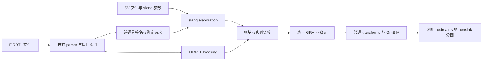

# FIRRTL ingest 架构与合约

本文定义接口与行为。它与 [steps.md](steps.md) 配套，阶段是否完成
以 [index.md](index.md) 的看板和实际验证记录为准。
2026-10-31 最新决定：普通 simplify 后，有 FIRRTL 提示按提示形成 node，
无提示按 MFFC 形成 node；supernode 在统一 Node DAG 上按 node 数量分组。
源注解仍是可丢弃的非功能信息，不限制 simplify。F09 已修订 F02/F08 的
source-node 隔离；设计见
[F09-plan.md](F09-plan.md)，实际验收见 [F09-acceptance.md](F09-acceptance.md)。
F09.6 的两层分图已实现，验收见 [F09.6-acceptance.md](F09.6-acceptance.md)，取代前次“单 node 超 work 预算豁免”的规划。
下文区分当前 F09.6 与历史 F09 v2。simplify 透明性继续适用。

## 1. 当前基础与目标

当前 [SV ingest](../../wolvrix/lib/ingest/sv.cpp) 从 slang elaborated AST
构建普通 GRH；[Python 读取动作](../../wolvrix/app/pybind/native/actions/ingest.cpp)
负责请求转换、诊断和 session 插入；slang 驱动已迁入 SV 前端。香山流程随后
执行结构恢复、写归一化、
flatten、simplify，再进入统一 GRH 上的 GrhSIM。

[nonsink 分图](../../wolvrix/lib/transform/grhsim/partition-nonsink.cpp)
历史 v2 从 op 图按 work cap 逆向吸收计算，再 coarsen/segment，FIRRTL
关联只用于择优。当前 F09.6 已改为先完成统一 node 构建，再按 node 个数形成 SN；
op work 不再用于决定 node 边界或 SN 容量，详见第 9 节。

本地 `ptmp/xs/rtl/rtl/SimTop.fir` 文件头为 FIRRTL 6.0.0，文件约 1.6 GiB，
现已由 F03 的 [inputs.json](inputs.json) 冻结为语法与接口验收输入，连同
生成 SV 的内容清单和生成日志校验。F00 仍需补齐整机依赖、工具链和正确性/
性能基线；F03 通过不代表混合链接或 FIRRTL/SV 行为等价已经验收。

正式 FIRRTL 路线自行解析和 lowering，不链接 MLIR/CIRCT、不调用 firtool，
不先把 FIRRTL 转成 SV 再交给 slang。现有 slang 继续处理真正的 SV 源码；
内部数值操作可以复用项目已有任意精度位向量设施。

## 2. 源码与头文件组织

```text
wolvrix/
  include/ingest/
    ingest.hpp             # 语言无关的请求、结果、模块绑定和 driver
    sv.hpp                 # 现有 ConvertDriver/Options 与 SV 专用接口
    firrtl.hpp             # FIRRTL 配置、接口扫描和 lowering 入口
    node_attributes.hpp    # 不依赖 parser/slang AST 的属性读写与合并合约
  lib/ingest/
    sv.cpp                 # 原 lib/core/ingest.cpp，第一步只迁移
    firrtl.cpp             # FIRRTL 前端入口
    driver.cpp             # 公共入口及语言分派
    mixed.cpp              # 混合源编排、specialization、链接和事务
    node_attributes.cpp    # 属性验证、重定向、合并及实例限定
    firrtl/                # 私有 lexer/parser/type/lowering 实现，按阶段拆分
  tests/ingest/
    data/firrtl/
    data/mixed/
```

第一步保持现有 `wolvrix::lib::ingest` 命名空间和 SV 公共类型，更新 CMake
源文件列表，并将全部调用方迁移到 `ingest/sv.hpp`，删除旧
`include/core/ingest.hpp`。测试、Python 绑定及文档示例同步更新 include 路径。
机械迁移与 SV 行为修改分别提交。语言无关头不暴露
`slang::ast::Compilation`、FIRRTL AST 或第三方
前端的 SourceManager；SV 专用类型只出现在 `sv.hpp`。

共享层负责输入、模块接口、源位置、链接及属性工具，不把 SV 的 LoweringPlan
强行变成两种语言的共同 AST。两个前端以现有 GRH 类型和 op 合约会合。

## 3. 一次事务中的混合读取



新增语言无关 `IngestRequest`，包含有序 source 列表、显式 top 列表、SV 参数、
FIRRTL 版本/语义选项、外部模块绑定和顶层可观察性配置。路径和参数纳入输入
身份；相对路径以请求指定的输入根目录解析，不依赖碰巧所在的工作目录。

Python 提供如下入口；字段与 C++ 请求逐项对应，实际合约见
[mixed.md](../../wolvrix/docs/ingest/mixed.md)：

```python
session.read_sources(
    sources=[
        {"language": "firrtl", "path": "ptmp/inputs/SimTop.fir"},
        {"language": "systemverilog", "path": "testcase/bridge/Helper.sv"},
    ],
    tops=["SimTop"],
    slang_args=["-Itestcase/bridge/include", "-DVERILATOR"],
    firrtl_options={"node_annotations": True},
    external_bindings=[],
    out_design="design.main",
)
```

`Session.read_firrtl(path, ..., sv_sources=..., slang_args=...)` 是该入口的便利
封装。现有 `read_sv(path, out_design, slang_args, replace, log_level)` 保持
调用兼容；纯 SV 请求不要求提供 FIRRTL 配置。`replace=False` 的冲突行为
沿用现有 session 约定，不通过连续读取同名 design 来实现链接。

解析、elaboration、链接和验证全部在暂存结果上完成，成功才发布 design；
失败不覆盖原 session 内容。F01 的 DesignHandle 已使用 SourceOwners 集合，
SV owner 同时持有 compilation 及拥有 SourceManager 的 slang driver，克隆
共享全部 owner。后续 SV specialization 与 FIRRTL 源索引沿用该集合。
读取诊断使用拥有文本的文件/行列位置；FIRRTL 不伪造 slang SourceLocation。
混合 transform 诊断使用 GRH 自有 filename/line/column；多个 owner 的
SourceManager 不混用 buffer ID。读取诊断保留自有源码片段。

### 3.1 有界功能 bringup 配置

FIRRTL 源 node 注解默认开启：Python 的 `node_annotations` 默认 `True`，
香山 Make 入口的 `XS_FIRRTL_NODE_ANNOTATIONS` 默认 `on`，输入 manifest
记录实际布尔值。显式 `off` 关闭可选的源 node 关联及对应的策略、inventory
与 retention 元数据；BlackBox 等外部实现 annotation、源位置、类型/链接/
语义检查仍按原合约处理。它不改变 FIRRTL 的功能语义。

默认 `XS_GRHSIM_PIPELINE_PROFILE=full` 保留现有完整普通 GRH 流程；
`XS_GRHSIM_FIRRTL_NODES=auto`。先验证功能链路时，可显式选择以下配置，
并为该次尝试使用独立输出目录：

```sh
XS_GRHSIM_PIPELINE_PROFILE=bringup make xs_firrtl_grhsim \
  XS_FIRRTL_INPUT=ptmp/xs/rtl/rtl/SimTop.fir \
  XS_FIRRTL_BUILD=ptmp/firrtl-ingest/functional-bringup \
  XS_FIRRTL_NODE_ANNOTATIONS=off \
  XS_GRHSIM_FIRRTL_NODES=off \
  XS_GRHSIM_CLONE_SHARED_COMPUTE=0 XS_GRHSIM_ROUNDTRIP_VERIFY=0
```

输入、SV 资源、include 和 harness 配置仍需与该次冻结输入匹配。这里的
两个下游 `off` 分别关闭源 node 整体 CSE 和 nonsink 的源提示消费；不能
仅设置上游注解开关，就把本次配置记成同一消融实验。

`bringup` 普通 GRH 原恢复七阶段，依次为 `xmr-resolve`、`multidriven-guard`、
`blackbox-guard`、`latch-transparent-read`、`hier-flatten`、
`comb-loop-elim`、`memory-init-check`；随后在消环后插入 `split-static-array`，再由共享
仿真流程在 `grh-to-grhsim` 前执行
`dead-code-elim → expr-opt → used-bits → split-nodes → dead-code-elim →
constant-analysis → dead-code-elim → alias-analysis → pattern-detect →
common-expr → dead-code-elim`。
full33 曾试加一次 raw DCE，但整机
未按预算完成，现已撤回。此 profile 省去普通 GRH `simplify` 及包围它
的两次显式 `grh.verify`；`grh-to-grhsim` 在转换前后执行的完整结构验证
继续保留，后续 GrhSIM 优化、分图和 emit 仍走共享流程。
上例另显式关闭分图后的 clone；仅选择 GRH bringup profile 本身不会关闭
这些优化。
`ROUNDTRIP_VERIFY=0` 只省去 emit 后额外 JSON 重载/重建 schedule/重存比较，
不跳过转换的结构验证或首次分图/SinkSchedule 构建。上述开关均保留原默认值。

`xs_firrtl_grhsim` 对整个 FIRRTL→C++ producer 使用
`timeout --signal=KILL 14m`。历史 GSIM 778.590 s 的 1.1 倍为 856.449 s，
但其旧输入已不可用；14m 是当前同输入基线完成前的保守探索截止。
从 producer 启动起，读取 FIRRTL、ingest、所有 GRH pass、checkpoint、转换、
分图和 C++ emit 共用同一个 14 分钟预算；到时立即 SIGKILL，checkpoint
或 profile 均不重置预算。Make 父进程以 `scope=run` 保存开始、退出状态及耗时，
即使子进程被 SIGKILL 也保留终态。正式同输入测量与质量门见
[F24](F24-xs-firrtl-grhsim.md)。
此配置是功能 bringup 的使用方式，不表示整机生成、仿真或等价验收已完成。
保留注解的原 `full`/`prefer` 验收及正式性能消融仍须分别完成。

2026-11-01 的 full30 实测仍未跑通：mixed ingest 388057 ms、flatten
218300 ms、comb-loop-elim 37757 ms、flat checkpoint 保存 97076 ms、
`grh-to-grhsim` 38041 ms；已发布 flat GRH 为 34,973,290,367 bytes。
该 pass 尚未完成即在 07:04:29 UTC 被完整 producer 的 20 分钟
SIGKILL 终止，Make 报 Error 137；没有整机 C++、emu 或运行结果。
full31 已按上例显式关闭 backend 可选优化。shared flow 5 项、workflow
56 项，以及 backend optimized/bringup × annotations on/off 四组模型的
实际 C++ 编译执行通过；四组各 4608 次独立 rename scoreboard，实际输出
逐字节一致。四组都采用 GRH 七阶段 bringup，这些结果不代表默认 full/
prefer 或整机通过。full31 于 07:06:55 UTC 从同一 frozen FIRRTL/full27
harness 在新目录重新开始，单次 20 分钟 SIGKILL 硬截止约为 07:26:56 UTC；
实际配置、输入和库冻结已独立核对。两个必要拆分阶段分别耗时 151669 和
147814 ms；到时在 nonsink 分区被 SIGKILL，Make 报 Error 137，外层于
07:26:58 UTC 返回。无整机 C++、emu 或运行结果，不续跑 checkpoint。
后续可显式设置 `XS_GRHSIM_STORE_GRH_CHECKPOINTS=0` 省略自动 flat/final
JSON，同时须有 C++ 输出目录及关闭 JSON roundtrip；显式 dump 不受影响。
设置 `XS_GRHSIM_READABLE_DUMP=0` 只省略额外整图文本导出。上述默认均保持。
full32 已显式关闭这些导出以及 source comments，保留默认 readable names/
frames；在 81/81 native、5 项 shared flow、57 项 workflow 和四组实际
rename 模型回归通过后，于 07:33:11 UTC 从原始冻结 FIRRTL 完整重跑。
mixed ingest 389656 ms、flatten 251875 ms、comb-loop-elim 37792 ms、
memory-init-check 7373 ms、转换 39590 ms，两个拆分分别为 149841 和
108937 ms。52 个 flatten 假环全部修复，无真环。nonsink 分区运行约
205 秒以上仍未完成，约 07:53:12 UTC 达到同一个 20 分钟 SIGKILL 硬截止；
内部 Error 137，外层于 07:53:14 UTC 返回 2。无自动 flat/final/text，
无整机 C++、emu 或运行结果。

full33 仅在显式 bringup 的 `comb-loop-elim` 后、`memory-init-check` 前
增加一次既有 `dead-code-elim`，保持声明符号保护、所有 guard 及后续验证；
默认 full 不变，也不启用完整 simplify。先完成包含该顺序的状态模型执行
回归：shared flow 5 项、workflow 57 项及四组 rename 各 4608 次检查通过，
实际 trace 一致。此次没有原生实现改动或新安装。随后于 07:54:34 UTC
从冻结 FIRRTL/full27 harness 在 `full33/` 新目录完整重跑，启动前已冻结
生产源码/库，其余 flags 同 full32；单次 20 分钟硬截止约 08:14:35 UTC，
不恢复 checkpoint。本轮 mixed ingest 389466 ms、flatten 224039 ms、
comb-loop-elim 37602 ms、raw DCE 126359 ms、memory-init-check 24460 ms、
转换 37413 ms，两个拆分为 134398 和 100509 ms。转换计数为 401484
operations、169336 states，并非全图规模；52 个 flatten 假环全部修复。
该轮仍在 nonsink 分区未完成时达到 20 分钟硬截止，内部 Error 137，外层
08:14:36 UTC 返回 2；无自动 flat/final/text、整机 C++、emu 或运行结果。

raw DCE 未改善总进度，因此撤回为上述七阶段。full34 的 shared flow
5 项、workflow 57 项及 backend default/skip/one-round × annotations on/off
六组实际编译状态模型回归已通过；各组 4608 次检查，五次 trace 比较一致。
六组仍共同采用 raw GRH bringup，不构成默认 full/prefer 验收；原生库未变。
full34 于 08:16:37 UTC 从冻结 FIRRTL/full27 harness 在新目录完整启动，
同 full33，默认 full 不变。实际 mixed ingest 385066 ms、flatten 217892 ms、
comb-loop-elim 37667 ms、memory-init-check 18687 ms、转换 48030 ms；
单轮 simplify 总计 233906 ms，round 为 213082 ms、fold/share 181695 ms，
`changed=1` 并按限制报告尚未收敛。两个拆分为 48482 和 36201 ms，nonsink
分区完成 108280 ms，随后 sink 分区未完成即被 20 分钟 SIGKILL；内部
Error 137，外层于 08:36:39 UTC 返回 2。52 个 flatten 假环全部修复。
无自动 flat/final/text、整机 C++、emu 或运行结果。

full35 只选择现有 `XS_GRHSIM_COST_MODEL=bytes` 和
`XS_GRHSIM_READABLE_NAMES=0`，保留七阶段 raw GRH、converted 单轮
simplify 及 full34 其它 flags，readable frames 保持默认，不新增原生优化。
生产原生实现/库未改变。shared flow 5 项、workflow 57 项及 default/skip/
one-round/one-round-bytes × annotations on/off 八组编译状态回归通过，
每组 4608 次检查、七次实际 trace 比较一致；bytes/short-names CLI 无自动
checkpoint 也完成生成、编译和 256 输入执行检查。八组都采用 raw GRH
bringup，不能当作默认 full/prefer 或整机验收。
full35 外层于 08:39:21 UTC 启动，08:57:33 UTC 主动 SIGINT 中断，退出
130；不是超时。最后进入 sink 分区，无整机 C++ 或执行结果。用户已明确
拒绝减少 simplify 轮次、关闭优化的取舍；上述 bringup/单轮/skip 尝试均
只保留历史记录。当前只优化实现，保留完整默认 pass、轮次和校验。
单次 FIRRTL→C++ 继续共用 20 分钟硬截止，到时立即 SIGKILL，不恢复
checkpoint 或拆分重置预算。
保留完整优化的 full36 于 09:43:49–10:03:49 UTC 按预算 SIGKILL，退出
137：ingest 516.645 秒，flatten 396.894 秒，完成阶段合计 1171.053 秒，
停于普通 simplify 之前的 grh.verify，尚无整机 C++。
实现加速、严格等价对照及完整计时见
[pass-optimization-20261101.md](pass-optimization-20261101.md)，不据 fixture
提速声称整机达标。
阶段记录和证据见 [F10-plan.md](F10-plan.md) 及
`ptmp/firrtl-ingest/F10/full30-stop-reason.txt`、`full31-stop-reason.txt`、
`full32-stop-reason.txt`、`full33-stop-reason.txt` 和 `full34-stop-reason.txt`。

## 4. 混合 elaboration 与链接

跨语言模块引用必须在 elaboration 前可见，链接后再运行任何会删除未驱动值、
传播常量或展开实例的 pass。处理顺序如下：

1. 扫描所有 FIRRTL 模块、extmodule、端口类型及绑定参数，建立接口索引。
   需要暴露给 SV 的接口必须完成位宽与 Reset 类型解析。
2. 模块注册表区分语言、逻辑名称和 specialization。FIRRTL extmodule 的实现
   名按 `defname`，无 `defname` 时按模块名查找；同名不意味着直接覆盖。
3. FIRRTL → SV：按实现名称与**有类型的参数值**请求 slang specialization。
   一个 SV 模块的不同参数组生成独立 GRH 图。保留整数位宽/符号、字符串和
   实数参数差异，不能把所有参数拼成无类型十进制字符串。
4. SV → FIRRTL：向 slang 提供由已解析 FIRRTL 接口生成的签名声明，使 SV
   实例可以完成 elaboration。声明仅用于接口；链接时替换为真实 FIRRTL 图。
5. slang 没有适用的直接 specialization 入口时，driver 可生成小型 SV 调用
   包装模块。包装层只声明接口、传参和实例化真实模块，不翻译 FIRRTL 行为。
   它们使用专有名字并标识为内部产物，不成为用户 top 或未解析黑盒。
6. 遍历实际实例依赖，解析 FIRRTL → SV → FIRRTL 等交替引用；以 specialization
   key 去重，检测递归实例化和未收敛请求，不能只解决一层 extmodule。
7. 将两个前端的图、实例和端口映射合并到同一 Design，验证后才允许 flatten。

签名声明标记为 `ingest.link.kind="declaration"`，绝不能当作零输出实现。
SV 前端通过模块注册表识别这些声明，保留待绑定的实例调用，不对其空主体
执行普通模块 lowering 或未驱动输出简化。
最终可执行设计不得残留这类声明。缺失模块、重复真实定义、参数不匹配、
方向/位宽/shape 不兼容，必须在绑定位置诊断。输出依赖文件列出实际使用的
SV include、宏、FIRRTL 单元及 specialization，供增量构建和基线身份检查。

SV 实现来源同时覆盖显式 source 清单，以及目标输入实际使用的 blackbox
annotation 文件/资源/内嵌文本。driver 在 elaboration 前将其归一化为带原始
来源和内容 hash 的 SV 单元；内嵌源码落到 `ptmp/firrtl-ingest/` 的事务目录，
资源按显式 resource root 解析。相关 annotation 可来自伴随 JSON，不能只
查看 `.fir` 文本就认定依赖完整。F00 确认实际类名及参数格式，F07 实现对应
提取和依赖追踪；相同实现去重，冲突定义诊断。

### 4.1 边界 ABI 与绑定

内部统一用字段拆分、数组保留的 GRH 接口。对外需要独立描述源端口与 GRH
叶子端口的映射，包含名称、field path、方向、shape、位宽、符号及位布局。
不把 FIRRTL ABI 的下划线名称等同于内部 `__DOT__` 名称。

默认按明确的 FIRRTL/SV ABI 和精确签名绑定：支持目标输入所用的扁平端口
ABI，以及保留聚合端口的 ABI；差异通过显式 adapter 处理。adapter 可以执行
字段拆装、规范索引转换和位布局转换，不可静默截断、符号扩展或改变状态。
Bundle 的 flip 逐路径累计，决定叶子方向；顶层 input Bundle 不代表全部叶子
都是输入。模拟双向/Analog 不在已有 GRH 合约内时明确拒绝。

显式 `external_bindings` 允许指定逻辑模块、SV 实现、参数和端口映射，解决
非标准库边界。host C++/DPI 实现须绑定到有签名与效果合约的现有调用机制，
不能因存在外部源码文件就宣称模块已完成解析。

## 5. FIRRTL 语义与 GRH lowering

以输入声明版本对应的 FIRRTL 规范为准。F00 固定目标版本和特性矩阵；未知
版本或不支持的有效构造给出明确错误，不通过删行、替零或跳过 block 接受。

| 范围 | lowering 与验收约束 |
| --- | --- |
| 解析 | 支持缩进块、注释、source info、转义/字符串、常量和版本门控；错误保留文件及行列 |
| 类型 | UInt/SInt、Clock、Reset/AsyncReset、Bundle/Vector；先推导位宽、符号及 flow，再生成 GRH |
| 原语 | 显式实现各操作的结果宽度、符号规则、截断、扩展和位布局；不套用 SV 表达式规则 |
| connect/when | 解析作用域、字段 flow、条件与最后连接优先级；先建连接意图，再统一产生组合值和写端口 |
| node | 命名表达式只从定义取得值；记录表达式所属 node、结果根及源身份，引用已有 node 不复制其定义 |
| register | 复用 register/read/write 族；clock、reset、init 和旧值读取显式化 |
| 数组 | 元素/子数组使用多索引端口或 kSliceArray；不先展开成逐槽 eq/mux 后再恢复 |
| memory | 显式处理端口、读写延迟、mask、read-under-write、时钟与冲突语义；落到数组状态及必要流水状态 |
| 效果 | printf/stop/assert 等映射到已有系统任务/效果机制，保留 clock、enable、次数和顺序 |

lowering 的执行成本目标是减少最终 C++ 仿真器在固定工作负载中实际执行的
指令、分支和访存。
保留数组、索引和精确的局部更新语义，使后端能够消除重复的宽值选择、
拼装及复制。比较实现方案时核对生成 C++、必要的机器码和固定输入执行
证据；IR 节点数、C++ 行数或源码循环数减少不能单独作为优化成功判据。
机器码静态计数与实际执行计数分别记录；静态合计没有活动频率权重，
不能替代动态指令、分支、访存或吞吐测量。正式构建与吞吐消融按 F11 记录。

位宽推导使用可诊断的约束求解，报告无解、未定宽、零宽和溢出位置。
支持范围内的零宽中间项按规范消除；不把零宽 value 或非法 shape 直接放入
GRH。公开跨语言接口仍必须具有可物化的完整签名。

`invalid`、未初始化值及未定义 memory 行为采用明确的仿真策略，写入输入
身份。与现有 SV TwoState 路线对照时固定同一策略；不能仅因 FIRRTL 来源
就全程宣布 TwoState 并绕过 SV 四态处理。混合图先保留正确逻辑域，再由
现有 `grh-to-grhsim` 执行显式投影。Reset/AsyncReset 不靠名称判断。

F05 已实现独立的 `FirrtlInitPolicy::{Unknown,Zero}`，默认 Unknown，记录为
`firrtl.initPolicy`。每个状态叶子有显式 Constant InitSpec；regreset 的 reset
value 不充当启动值。`FirrtlInvalidPolicy` 单独控制 invalid/OOB 读等；两者都
不改变初始 FourState 域，也不修改 SV 的读取策略。C++ 请求已提供这些配置，
Python FIRRTL 入口及混合链接已在 F07 实现，实际支持范围见 mixed.md。

### 5.1 有序动态写示例

```firrtl
reg table : UInt<8>[32], clock
when en0 :
  connect table[addr0], data0
when en1 :
  connect table[addr1], data1
```

lowering 为一个带 `shape=[32]` 的 kRegister 和两个索引写端口。基础 GRH
`kRegisterWriteArrayPort` operands 为
`[enable, index0, ..., indexK, data, event0, ...]`；`regSymbol` 指向声明，
`eventEdge` 与 event operands 一一对应。这里分别是
`[en0, addr0, data0, clock]` 和 `[en1, addr1, data1, clock]`，边沿为 posedge。
后一个 connect 对同地址具有更高优先级。

写数据和索引必须在修改旧状态前采样；例如 `data1=table[addr0]` 仍读旧值，
不能把上述规则实现为边写边读取 current。复位与整数组写同样参与优先级
归一化。该文本优先级用于 register/connect，不能推导为任意独立 memory
端口写冲突的优先级；后者严格依据 memory 契约处理。

F05 的普通写都带 `!reset` 使能，reset 另生成最后一个 whole-state writer。
同步 reset 的所有 writer 事件为 `[clock]`；异步 reset 的所有 writer 事件
统一为 `[clock,reset]`，边沿为 `[posedge,posedge]`。reset 断言立即复位，
reset 解除不触发正常写；索引/使能/data/reset data 均采样旧状态。
`when` 不门控硬件声明，仅 destination 声明与 connect 之间的 interleaving
conditions 门控写；寄存器未连接时保持旧值。

### 5.2 memory 与验证构造

CHIRRTL 的 cmem/smem/mport 先推导端口方向、clock 和 enable，转换为前端
内部明确 memory 描述；标准 mem 直接进入该描述。同步读以独立流水状态
表示，结构化 mask 逐字段/叶子展开。mask 粒度、越界、同时读写和多端口
碰撞分别测试，不用一个通用 mux 模式代替所有 read-under-write 选项。

layer/layerblock、intrinsic、Probe/引用与 annotation 根据 F00 清单逐项支持。
验证层采用显式启用配置，保留原条件和效果；不能照搬“所有 layer 无条件
展开”的兼容捷径。影响初始化、memory、外部实现或可观察性的 annotation
必须解释或报错；已确认仅用于物理实现的 annotation 可按白名单忽略并记录。

F06 的具体合约见 [firrtl-memory.md](../../wolvrix/docs/ingest/firrtl-memory.md)
和 [firrtl-effects.md](../../wolvrix/docs/ingest/firrtl-effects.md)。标准 mem 与
CHIRRTL 先进入同一内部 Memory/MemoryPort 描述，再复用普通 GRH kRegister、
kRegisterReadArrayPort 和 kRegisterWriteArrayMaskPort；不新增 backend
memory opcode。写端口 operands 为 `[enable,address,data,bitmask,clock]`，
eventEdge 为 posedge，regSymbol 关联数组状态；Bundle 按字段拆开，depth
作为 shape 最外层。latency 上限 1024，超限明确报错。

old 延迟读数据，new 延迟地址/使能再读当前存储；undefined 只延迟地址，
采用 new-value 碰撞行为，不为读结果额外延迟 enable。独立时钟复用相同的
组合方式，时钟保持高电平不重复触发。存储及流水使用 initPolicy；显式
old/new 的禁用/OOB 读使用 invalidPolicy，undefined 的禁用/OOB 读由后端
安全数组读取结果确定，不再生成 history/collision 状态。
node/wire 时钟别名归一后判断同钟；CHIRRTL rdwr 的写模式跨 Bundle
全部叶子统一，部分写 mask 仍只更新被写字段。

验证层使用 `FirrtlOptions.enabledLayers` 的完整路径，选子层隐含选祖先；
配置入 JSON metadata。define 不受 when 条件限制，Probe 按叶子/数组位
检查唯一、完整定义。
connect 不允许通过聚合类型绕过 Probe 限制；invalidate 忽略 Probe，
不替代 define。接口签名仍保留 Probe/RWProbe 和 ABI 待解析标记。
效果沿现有 SystemTask 调度实现旧值采样和源顺序；cover 采用 hit trace
并发出非 formal coverage 警告。annotation 使用冻结
输入五类严格 schema 白名单；DontTouch 锚定符号，其余优化来源及 inline SV
payload 保留 metadata，未知初始化/随机化请求报错。实例引用报告具名链接/
外部绑定请求，保留接口、defname 和参数，不发布伪 blackbox 可执行设计。

## 6. Bundle 展平、Vector 保留

复用 [SV 聚合规范](../../wolvrix/docs/ingest/aggregate-types.md) 的 GRH 终态：
Bundle/struct 不成为 GRH value，递归拆成叶子；外层 Vector 和字段内部的
Vector 维度按外到内迁移到叶子 shape。叶子 UInt/SInt 的位宽为 element
width，GRH width 为 element width × 各维 extent。

```firrtl
input packet : { valid : UInt<1>, data : UInt<32>[4] }[8]
```

| GRH 叶子 | element width | shape | 总 width |
| --- | ---: | --- | ---: |
| `packet__DOT__valid` | 1 | `[8]` | 8 |
| `packet__DOT__data` | 32 | `[8,4]` | 1024 |

`packet[i].data[j]` 直接对应第二个叶子的索引 `[i,j]`。整体连接、mux、相等
及初始化按字段展开，部分索引产生子数组。Vector 的 source 索引顺序显式
映射到 GRH 低元素优先顺序；整体位转换按 FIRRTL 布局重建，不能直接把
SV packed struct 布局当成 FIRRTL Bundle 布局。涉及 flip 的非法整体操作
由类型/flow 检查拒绝。

FIRRTL 6 的 primitive operands 必须是 ground type。上面的聚合相等、构造
和位布局转换通过合法的字段/元素连接、ground `eq` 及 `cat` 表达；不扩展
出 `eq(Bundle,Bundle)` 或 `asUInt(Vector)` 语法。F04 验收同时检查这些
非法 aggregate primitive 被拒绝和合法字段/元素形式的执行结果。

数组长度 1、1-bit 叶子、嵌套 Bundle/Vector、动态索引和跨语言端口都须覆盖。
若复用 SV 的小数组标量存储优化，必须保留源几何及正确访问映射，不能为了
共用阈值而丢失 FIRRTL 的数组访问语义。

## 7. node attribute schema v2

所有记录放在现有 op attrs 中，使用现有 `AttributeValue`，不增加独立 node
IR 或 JSON 方言。带这些属性的 Graph 记录
`metadata["firrtl.nodeSchema"]=2` 和 `firrtl.nodeScopePolicy=soft-node-v2`。中间分析可将字符串 intern 成稠密索引，
该索引不持久化、不进入 source identity。

| 属性 | 类型 | 定义 |
| --- | --- | --- |
| `firrtl.node.members` | `vector<string>` | 此 op 与哪些源 node 叶子表达式相关；普通 CSE/融合后可多对多关联，不递归包含仅引用结果的消费者/producer 来源 |
| `firrtl.node.roots` | `vector<string>` | 仍可准确追踪时，此 op 哪些结果对应源 node 叶子的结果；可缺失，不构成保留要求 |
| `firrtl.node.rootResults` | `vector<int64_t>` | 与 roots 等长；每项为当前 op 的零起算 result 序号 |
| `firrtl.node.origins` | `vector<string>` | 历史来源集合；可用于诊断，不能直接作为归组依据 |

一个 node 叶子 key 是以下元组的 canonical 紧凑 JSON 字符串：
`[sourceUnit,circuit,module,instancePath,nodeName,fieldPath]`。sourceUnit 是
输入清单内稳定的逻辑单元名；instancePath 和 fieldPath 用字符串数组，避免
转义名称及 `__DOT__` 冲突。key 不包含裸实体 ID、绝对工作路径或随机计数。
module 级图的 instancePath 为空，flatten 后换成实际实例路径。

同一 node 的不同 Bundle 叶子使用不同 fieldPath；保留 Vector shape，不为
每个数组元素产生 node key。前五项识别源 node 家族；F09.6 构建时不把
fieldPath 或数组元素数当作 op 容量切分依据，真实语义冲突另行处理。
members/origins 排序去重；roots 按 `(key,resultIndex)` 排序
去重，rootResults 同步排列。验证器检查类型、配对长度和结果序号范围。

F09 复用 F02/F08 的存储字段，但已版本化为新的可选关联语义。每 op 的
members/roots/origins 分别最多 64 项，超限清除可选属性并累计
firrtl.nodeHintDegraded；不能拒绝变换。旧 schema 1 要求重新 ingest。
属性不参与功能等价判断，也不增加 CSE、inline、重关联或 DCE 的屏障。
普通合法 CSE 就可以合并不同源 node 的 members；多成员不意味着独占
归属或强制同组。roots 无法准确保留时允许清除并报告，不能创建执行
载体或拒绝变换。origins 只用于诊断，不用来补齐分组关系。

### 7.1 标注示例

```firrtl
node n = and(eq(a, b), or(c, d))
node y = mux(n, x, z)
```

用 `N`、`Y` 简写两个完整 key，得到如下关系：

| op | members | roots / rootResults |
| --- | --- | --- |
| `eq(a,b)` | `[N]` | 无 |
| `or(c,d)` | `[N]` | 无 |
| `and(eq,or)` | `[N]` | `[N] / [0]` |
| `mux(n,x,z)` | `[Y]` | `[Y] / [0]` |

`eq/or/and` 是一个可参考的关联集合；mux 引用 `n`，不因此把 N 的内部 op
标成 Y。输入、状态读和效果是其外部依赖，不能由 node 标签改变其执行阶段。
当前阶段已被归到 writer 私有参数锥的表达式保持其归属，只有留下的 nonsink
部分进入 node 分图覆盖率统计。
未被显式 node 包住或丢失可用提示的组合逻辑按 MFFC 构建统一 node，
与提示构建的 node 使用相同分图语义，来源分别统计。

`node n = input` 等别名没有计算区域；允许没有 op 上的结果根映射。
不为了保留提示引入 kAssign 属性载体、activity bit 或值复制。
常量、死 node 和别名可以折叠，必要时保留来源，不能为了完整保留源名字
而阻止 DCE 或把所有 node 当作 DontTouch/声明锚点。

## 8. simplify 与 node 提示传递

### 8.1 标注对普通优化透明

node 属性只表达来源关联。分图前普通 CSE 可以共享不同 node 的公共内部
op，也可以共享 SV/FIRRTL 来源的等价 op；执行既有功能、类型、状态/效果
及实际 owner 约束，不增加 source-node 作用域。内联、重关联、常量折叠、
别名传播、mux/bit packing/写归一化和 DCE 同样不能因 node 标注而停止。

例如两个源 node 分别计算 xor(and(a,b),c) 和 or(and(a,b),d)，普通 CSE
可以共享 and(a,b)，该 op 的 members 为两个 node key。提示集合此时重叠，
不证明两个完整表达式等价，也不强制它们进入同一个执行分区。

功能签名排除 node 非功能 attrs；CSE 查找表、inline 判断、重写入口和
DCE 活跃性也不得隐式使用这些 attrs 作为门槛。移除 node 根时准确更新
结果映射；不能准确维护提示则降级/清除，不增加 kAssign 或强迫保留计算。
检查必须覆盖“有/无标注、关闭独立提示消费者时普通优化结构一致”，仅
结果等价不足以证明标注没有阻碍 simplify。

### 8.2 F08 的 GSIM 策略与迁移

F08 参照本地 GSIM a3ecb26 的 commonExpr：比较完整 assignTree，按等价组
≥5、结果 >256 bit 或多后继门槛决定整体共享，并在普通 pass 中隔离不同
source-node。该版本已经实现和验收，证据见
[F08-acceptance.md](F08-acceptance.md)。该历史策略由 F09 修订；

最新决定撤销 source-node 作为普通优化屏障。GSIM 门槛可以用于独立的
额外共享启发式，不能限制普通 primitive CSE，也不能为保留整体候选冻结
前序 simplify。可选整体分析只处理优化后仍能证明的表达式，hash 后精确
核对功能、类型、常量及有序依赖；members/origins 相同不是等价证明。

gsim 只处理仍可证明的候选，不完整/重叠依赖候选跳过。新优化策略为
gsim-soft-v2，配置为 v2/<mode>/5/256/1。旧的
source-node-v1、gsim-v1、根唯一性和 retention 完整性规则已迁移，
不静默重解释旧 checkpoint；从旧路线产生的图也不能补标签后宣称是新基线。

### 8.3 生产 pass 和阶段顺序

当前路线顺序为：

~~~text
ingest / 普通 GRH transforms / hier-flatten / comb-loop-elim
→ split-static-array（静态组合数组按需成员化）
→ 普通 GRH 收尾 passes
→ dead-code-elim（独立一次，含 SemanticTree 回收）
→ expr-opt → used-bits → split-nodes → dead-code-elim
→ constant-analysis → dead-code-elim
→ alias-analysis → pattern-detect → common-expr → dead-code-elim → grh-to-grhsim
  bit packing / masked-OR
→ 可选整体 node 分析/额外优化（只消费现存可验证信息）
→ split-event-and-output → split-nonsink-and-sink
→ partition-nonsink（F09.6：先提示/MFFC node，再按 node 数形成 SN）
→ simplify（遵循实际 leaf owner）→ partition-sink
~~~

静态数组拆分与独立 DCE 沿用 op/value 分析，默认不把声明锚点作为保活根；显式
`keep_declared_symbols=True` 仍可恢复保护，其他 pass 的默认声明行为不变。拆分通过静态读按需选择元素，
不引入 GSIM 式 Node/ENode 活跃性分析。删除电路后，仅回收不再被任何存活 op/value 引用的 SemanticTree 完整分支；直接引用节点的祖先和
实例 Module/Declaration 关联保留，无定义 op 的存活 input 等边界来源不因“零 op”而误删。
批量重编号不改变存活路径、列表顺序或重复项，SemanticId 不反向保活电路。

全过程没有由 source node 新增的 CSE/inline 边界。phase、state/effects 和实际
execution owner 的现有约束继续生效；声明锚点仅在显式开启保护时作为保活根。
同 source key 不授权跨 owner 共享，不同 source key 也不在同 owner 内新增隔离。
新 schema/policy、算法和选项进入 checkpoint/generation identity；旧强隔离
checkpoint 要求重新 ingest，不能重用其优化历史。

### 8.4 属性随变换维护，不能反过来阻止变换

| 变换 | 提示维护 |
| --- | --- |
| store/load、clone Design | 保留合法 attrs 及版本；来源不作为可执行 IR |
| primitive CSE | 代表 op 合并直接关联并去重，允许不同 node/SV 来源共享 |
| 常量折叠、别名传播 | 准确则迁移根；不能保留则清除/降级，不加属性载体 |
| 内联、重关联、mux/bit packing/写归一化 | 对参与重写的 op 有界传播；不确定关联降级为诊断，不跳过优化 |
| 分裂/克隆 | 复制适用关联，根按准确结果映射更新；不要求为提示保留完整源表达式 |
| DCE | 按真实消费者删除；inventory 和 source root 不保活 op |
| hier-flatten | 限定实例 key；不同实例不按名字混同 |
| XMR、端口及类型 adapter | 能追踪则保留，不能追踪则降级；引用结果不递归传播上游来源 |
| phase/sink split | 按真实语义分离，提示可以部分留在 nonsink，不把 sink 私有锥拉回 |
| 分图、bounded clone、叶内 CSE | 最终 owner 由分图决定，node 关联不限制合法重写 |

允许多对多关联、共享 op、无根和非闭合集合。只维护当前直接关联，不建立
无界上游 origins 闭包；设置有界元数据预算，超限降级并报告，不能阻止
变换或截断成虚假的完整表达式。格式类型/版本/result 范围仍验证，正常
优化造成的提示消失、合并和根不可追踪不再触发语义失败。

## 9. 先构建 node，再划分 supernode

当前设计见 [F09-plan.md](F09-plan.md)，F09.6 已实现。它取代历史 v2
的 op-work 切分/提示 tie-break，也取代上次“单 node 超 work 预算豁免”。

~~~text
普通 simplify 后的实际 nonsink op DAG
→ 有可用 FIRRTL 提示：按提示构建 node
  无可用提示：按 MFFC 构建 node
→ 统一 Node DAG（每 node 容量权重为 1）
→ 按 node 数划分 supernode
→ node 内 simplify → partition-sink / SinkSchedule → emit
~~~

### 9.1 node 是统一的分图单位

提示区域依据当前 members 构建；根可缺失，不恢复被优化掉的计算。无提示
区域按 MFFC（最大无扇出锥）构建：纳入根的上游组合计算，仍有锥外消费者
的 producer 保持为共享边界。纯 SV、FIRRTL 未显式标注的逻辑、提示丢失
区域及混合 glue 使用同一规则。两种方式产出的 node 具有相同的分图语义，
均不按内部 op 数、位宽 work 或 max-node-work 再切片。

普通 CSE 形成的多成员共享，在构建层规范化为唯一执行归属与真实共享边，
不撤销 CSE、不为恢复源表达式自动复制、不按提示相交传递 union。非凸、
跨 phase/state/effects 等结构冲突在此解决，无法采用的提示部分按 MFFC
处理并报告。node 构建完成后，上层不再读取 source members 重划内部。

source association、统一 node 和 supernode 分开：注解可多对多，统一
node 具有唯一 op 归属，supernode 是若干完整 node 的执行组。根不强制
发布；多个真实输出/消费者均可形成边界，按实际依赖验证 quotient 无环。
Bundle 依既有规则展平、Vector 保留 shape，不按字段/元素数量换算 op 容量。

### 9.2 supernode 只按 node 数量限制容量

新配置为 max-supernode-nodes。每个统一 node 计 1，内部有 1 个或 180 个
ops 都一样。上限 K 允许最多 K 个完整 node，不切开第 K+1 个 node 来填满
剩余容量。node 来自 FIRRTL 提示还是 MFFC 对此无影响。

移除 max-node-work 对 node 大小的控制，max-supernode-work 需要显式退出
新流程，不能沿用旧数值换单位。没有“单 node 超 op-work 预算”的例外。
旧 bytes 模型的 firing×op-work 项也不再决定新 SN 分组；op/work 只能用于
诊断。可参考 Node DAG 拓扑/边界开销，但容量不访问 node 内部 op 复杂度。
后端的分文件/分函数源码尺寸限制独立处理，不改变执行 node/SN 分图。

### 9.3 owner、配置与验收

最终 leaf/node owner 表示统一 node，SN owner 表示其执行组。SN 分组不
隐含 node 融合；旧 fuse-leaves 与 work cap 已移除。
无 clone 基线已验收；可选 clone 进入既有目的 node，不增加 node 数；新执行 node 按新增 node 计数，
node 内局部重写不因 op 数变化改变容量。effects、旧值、writer prerequisites
和最终 SinkSchedule 继续验证。空 node 删除后重新核对 node 数。

off 模式全部按 MFFC 形成 node；prefer/auto 有提示按提示，其余按 MFFC，
不再只是同成本 tie-break。新构建策略、node-count 容量和选项使用新的
config/checkpoint v3 / hint-mffc-v1，默认 auto/legacy/128 nodes；旧 v2 结果要求重新分图，不静默折算旧 work cap。

报告区分 FIRRTL node、MFFC node、共享/冲突降级及各 SN 的 node 数，另记
边界和运行计数；op/work 是诊断项。来源属性的 64 项资源限制不能变成
执行 node 的 op 数限制。simplify 透明性、K/K+1 容量、大/小 node 同权、
混合输入、恢复与真实模块回归共同构成 F09.6 验收。

## 10. 正确性和性能验收

两条前端最终都进入现有统一 GRH → GrhSIM → C++ 后端。已有纯 SV 用例
保持可运行；新增 fixture 覆盖两种语言交替实例化、参数 specialization、
Bundle/Vector 端口、错误绑定及读取失败回滚。FIRRTL parser 无需依赖 GSIM
或 CIRCT，GSIM 仅可作为独立对照，不能充当新前端的 parser。

node 传递测试要包括同模块两实例、整体 node 合并的多源身份、根常量化、
根指向输入、多结果映射、片段化、JSON 往返、ID 重排和混合语言 flatten。分图需要以
小电路参考解释器或明确记分板检查可观察结果，并验证 owner 唯一、拓扑无环、
激活完整、effects/旧值/写优先级不变。不能只断言某种节点数量。

新两层分图策略的定向回归同时检查计算结果和普通优化的透明性：

| 场景 | 预期 |
| --- | --- |
| 有/无 node 标注，关闭独立提示消费者 | 普通 simplify 的规范化计算结构相同，结果一致 |
| 完整表达式不同，但内部有相同 and/add | 普通 CSE 可共享并合并直接关联，node 不增加限制 |
| 相同表达式来自 SV/FIRRTL 或不同实例 | 按真实 operands、类型和功能判等；不同来源不阻止优化 |
| 等价组 4/5、位宽 256/257、单/多后继 | 不作为 primitive CSE 门槛；独立额外策略若保留，另测其作用 |
| 内联、重关联、mux/bit packing/写归一化 | 不因带 node attrs 跳过，提示维护失败可降级 |
| 根折叠为输入/常量，计算变死 | 无属性载体或提示保活，允许根/关联消失 |
| 共享 op 导致提示重叠，或提示非凸/不完整 | 作为可选局部关联，不强制 union 或整体收缩 |
| FIRRTL 提示区域与无提示区域 | 分别按提示/MFFC 构建统一 node，不按 op 数/work 截断，F09.6 已验证 |
| node 内部 op 数变化、SN 容量 K/K+1 | 每 node 容量贡献均为 1，SN 只按 node 数限制容量，不拆内部 ops |
| hash 碰撞、类型/常量/功能 attrs/输入不同 | 精确比较拒绝不合法共享，提示不构成等价证明 |
| 数组、状态、效果、phase 和实际 owner | 保留普通语义边界；不因 source key 相同越界共享 |
| 同一 supernode 内多个 node | 保留各 node owner；上层分组不隐含 node 融合或 op 重划 |

性能主对照使用三个配置，可选增加独立整体优化对照：

| 配置 | 输入与分图 | 用途 |
| --- | --- | --- |
| A | 冻结 SV 输入，普通 simplify，MFFC 构建 node | SV 路线对照 |
| B | FIRRTL + 必要 SV，普通 simplify，忽略 attrs、全部 MFFC 成 node | FIRRTL 路线的 MFFC 对照 |
| C | 与 B 相同输入/优化图/attrs，有提示按提示、其余 MFFC 成 node | 单独测提示指导 node 构建的收益 |
| D（可选） | 若保留额外整体 node 优化，与 C 对照其独立开关，其余策略相同 | 测该额外优化，不恢复 source-node 屏障 |

B/C 共用分图前 checkpoint、后端源码、其他 pass、编译选项和 workload，
分别记录 node 构建、SN 分组及生成模型，唯一主动改变的变量是 node 构建
模式。SN 分组策略、max-supernode-nodes 和其他设置相同，基线不含融合
或 clone；后续额外优化另行消融。两者保留相同 attrs；测试中移除 attrs 只用于前述
普通优化透明性检查或独立元数据成本实验，不混入分图收益。
若存在 D，则从额外整体优化前的共同 checkpoint 分叉并记录该开关；
不能以冻结 primitive CSE 制造该优化收益。若独立选项废弃，D 不再必测。
A/B 包含输入和前端 lowering/普通优化后图差异，不全部归因于解析格式。
F08 的 source-node-v1 历史模型不能作为 B 直接复用。

报告输入生成、parse/elaborate、GRH pass、分图、emit、模型编译和链接各阶段
wall/RSS，并记录生成代码及 text 大小。运行固定单线程、无 PGO、相同 CPU
绑定、初始化 seed、NEMU、CoreMark100k 和效果配置，区分仿真与构建耗时。
100k 是固定周期窗口，不宣称完整 CoreMark 完成。

正式运行对 A/B/C 及适用的 D 各测三次，轮换顺序，保存所有 Host time、
正确性日志和输入/编译器/二进制身份。分图收益为
`sum(B_time)/sum(C_time)-1`，总收益为 `sum(A_time)/sum(C_time)-1`。
独立整体优化若保留，按明确的 on/off 样本另报收益，不与提示收益混算。
图更小、边界更少不直接作为性能成功证据；
不预设未授权的硬性收益阈值，默认切换须有可重复的运行收益和可接受构建成本。

## 11. 文档与规范来源

实现时固定规范修订身份，版本门控以输入为准，不追随未固定的 main 分支。

- [FIRRTL 规范](https://github.com/chipsalliance/firrtl-spec/blob/main/spec.md)：语言和版本语义。
- [FIRRTL ABI](https://github.com/chipsalliance/firrtl-spec/blob/main/abi.md)：跨语言模块与端口边界。
- [GRH 类型与操作](../../wolvrix/docs/grh/grh-ir.md)、[JSON 合约](../../wolvrix/docs/grh/grh-json-spec.md)。
- [SV 聚合类型](../../wolvrix/docs/ingest/aggregate-types.md)、[GrhSIM transforms](../../wolvrix/docs/transform/grhsim-transforms.md)。
- [当前 XS 入口](../../scripts/wolvrix_xs_grhsim.py)、[当前共享仿真流程](../../scripts/grhsim_flow.py)。
- [GSIM 完整 node CSE](../../reference/gsim/src/commonExpr.cpp)、[局部树优化](../../reference/gsim/src/exprOpt.cpp)、[pass 顺序](../../reference/gsim/src/main.cpp)、[宽度门槛](../../reference/gsim/include/common.h)：本地 `a3ecb26`，仅作实现参照，不成为依赖。

正式功能文档在对应实施阶段写入 `wolvrix/docs/ingest/`、
`wolvrix/docs/transform/` 和 Python API 文档；本目录保留实施进度与设计决策。
