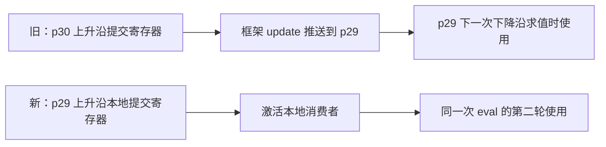

# TNO0337 GrhSIM 执行成本与划分体系重设计（2026-10-13）

## 1. 目标、依据和范围

用户授权从体系层面重新检查 GrhSIM 的成本表示、RepCut 超图构造和划分算法，并要求将
规划集中记录，供后续查阅。本议题的实现、诊断和性能结果继续追加到本文，避免每个动作
另开文档。前一阶段见 [TNO0336](./TNO0336_grhsim_existing_asc_balance_20261013.md)。

目标是降低完整仿真的 walltime。保持 N=K=32、原有 Verilator 划分算法与默认路径独立。
不按模块名、信号名或分区编号选择优化对象；不将 XiangShan 的分区耗时回填为权重。
暂不采用编译后反馈，实测和 perf 只用于诊断机制与验收。当前没有第二个完整 workload，
因此必须用通用小图覆盖机制边界，不能把单 workload 的收益称为跨设计泛化证明。

TNO0336 最后两轮共 16 对 fresh AB/BA 中，阶段 refinement 的 eval 配对中位数
改善约 2.397%，update 增加约 6.943%，Host 仅改善约 0.401%。p5 的实际写回字节
反而减少约 0.594%。这支持重新审视成本和目标，但尚未证明缓存争用是 update 退化根因。

目前的结构性缺口是：

1. 单算子固定权重不包含实际激活条件、共同激活关系与执行阶段。
2. 共享 piece 预先分摊为 ASC 权重，只是求解器的投影；真实分区成本取决于共享集合的并集。
3. 共享计算的复制关系和有方向的状态通信关系不是同一张图；总 KM1 不能约束每个发送者的尾部。
4. boundary bundle、memory 后处理、activity schedule 和中间值布局在划分之后才具体化。
5. 原算法的有界单 ASC refinement 不能代表从完整 ASC 集合重新搜索的潜力。
6. ASC 的部分强制合并来自当前 storage/effect 实现限制，需要与不可违反的 RTL 语义区分。

## 2. 调研及适用边界

以下链接均为论文、作者页面或作者提供的源码；论文收益不作为本工程预期收益。

| 工作 | 采用的启发 | 边界 |
| --- | --- | --- |
| [RepCut，ASPLOS 2023](https://escholarship.org/uc/item/1345b80b) | 组合复制打断周期内依赖；显式分离状态读取与提交；按写者组织状态布局 | 实验关闭 ESSENT 活动跳过；成本使用低层 FIRRTL 特征及线性回归；公平分摊仍不能精确表示复制后的每分区负载 |
| [ESSENT，DAC 2020](https://escholarship.org/uc/item/64x147r1) | 将变化检测、激活和计算分组纳入成本，减少不活跃逻辑执行 | 活动分组会改变成本，不能只累加 RTL 算子；其分组不等于 RepCut 的线程分区 |
| [Parendi，ASPLOS 2025](https://mayyemami.com/parendi_asplos25_paper.pdf) | 用共享计算集合的并集直接评价合并，按最慢执行成本控制合并；分层处理通信 | 面向 IPU；文中直接合并与 RepCut 超图方法各有优势，不承诺某一种普遍更好 |
| [UMPa](https://sites.cc.gatech.edu/dimacs10/papers/%5B09%5D-UMPa-AMultiobjectiveMultilevelPartitionerForCommunicationMinimization.pdf) | 有方向的通信图，同时考虑最大发送量、最大收发量和总量 | 通信字节模型不直接等同 CPU 上的 compare/copy、缓存所有权和 dirty 标记成本 |
| [多约束 Mt-KaHyPar，ESA 2026](https://arxiv.org/abs/2605.28333) | 多维平衡；允许暂时不平衡再恢复约束，扩大搜索空间 | 当前工程内 2026-03 版本没有这套支持；研究分支仍使用可相加的顶点向量，不能直接解决归属相关的集合成本 |
| [BSP 调度，SPAA 2024](https://arxiv.org/abs/2404.15246) | 按各阶段的最大计算、最大通信和同步开销评价总完成时间 | 参考目标函数与局部搜索，不对 30 万 ASC 直接运行完整整数规划 |
| [SimPart，Euro-Par 2025](https://tsung-wei-huang.github.io/papers/2025-EuroPar-SimPart.pdf) | 直接构造复制分区，探索有限复制与分阶段执行的组合 | GPU 执行模型不同，作为后续架构方向，不直接移植性能结论 |

## 3. 新体系的设计

### 3.1 分离四种对象

- **语义原子**：当前先以完整 ASC 作为可移动单位，保存强制合并的原因。状态写者和有副作用操作
  有唯一归属；不允许用重复执行 DPI 或改变写冲突顺序来换取并行度。
- **计算片段**：保存 ASC 到 piece 的稀疏引用。一个 piece 在同一分区只计算一次，在多个分区
  则分别承担成本。增删 ASC 的边际成本通过占用计数决定，不用永久分摊权重替代。
- **事件与执行计划**：表示事件根、边沿、使能及未知来源，逐步复用 GrhSIM 的 lowering、
  activity schedule、materialization 和 commit 规则。第一阶段的操作计价仍是明确标注的近似，
  不把结构特征冒充纳秒预测；不知道的活动不随意赋概率。
- **有向状态传输**：保存 writer、reader 集合、宽度和实际 bundle 规划。分别统计发送方、
  接收方、64-byte compare/copy 块、尾部、dirty 标记与存储范围。输入传播的阶段延迟按当前
  runtime 语义处理。实际变化次数和缓存流量继续用诊断核验，不从静态宽度直接推出。

模型构建器与 assignment 评价器分开：前者提供后端特征与语义关系，后者按一整套 assignment
重新计算集合占用和通信计划。后端用版本化适配器扩展；已有标量 cost-model 接口与默认值保留。

### 3.2 优化目标

实际运行的近似目标是：

```text
sum over steps [max_part(eval(step, part)) + max_part(update(step, part))
                + dispatch/barrier/Host overhead]
```

静态优化用事件场景近似这一目标。上、下沿分别处理；未知活动是场景的不确定部分，不能
当作第三个实际执行阶段相加，也不能忽略。共享成本按集合并集计算，通信按实际 writer/reader
归属与 bundle 规划计算。代码和数据规模、复制总量是独立约束和诊断项。

第一阶段先输出可核验的特征向量与 Pareto 比较，不把未经验证的 eval/update 单位相加成
“预测 walltime”。通用系数必须有后端执行机制依据；如不能解释已有 assignment 的退化，
继续补机制而不通过调整个别分区系数制造排序。

### 3.3 搜索路线

在相同评价器上保留两个初解来源：现有 Mt-KaHyPar 的投影解，以及从完整 ASC 集合出发的
直接集合成本分配。直接分配先放置昂贵原子，再按新增共享集合与有向通信的边际成本选择
目的地；稳定 ID 仅用于同分决策，不承担工作量先验。后续引入具有共享关系的分组合并、
交换和带回滚的多步搜索，允许跳出只接受单步改善的局部最优。

新算法在 GrhSIM 专用实验入口中验证，不替换 Verilator 的 solver、HGR 或后处理。是否采用
多约束 Mt-KaHyPar 研究分支要由统一模型上的对照决定，不先升级公共依赖。

### 3.4 后续架构方向

先规划边界传输与布局，再生成复制代码；评估按写者组织和隔离缓存行的布局。进一步研究
共享只读状态快照与延迟提交，以减少端口副本维护，并判断哪些 memory 共置约束可以解除。
这一层单独对照，不与第一版划分器同时改变，避免性能归因和语义验证混杂。

## 4. 实施次序与验收

| 阶段 | 产出 | 通过条件 |
| --- | --- | --- |
| A：表示与评价器 | 集合占用、有向传输、事件维度和一致性检查；通用小图测试 | 完整重算和增量结果一致；生成后的通信计划可对账；未知项显式暴露 |
| B：现有三种划分审计 | 旧 assignment、GrhSIM 标量 assignment、阶段 refinement 的相同口径报告 | 区分已解释和未解释项，检查分阶段负载及 update 尾部，不以单一相关系数通过 |
| C：从头分配 | 独立直接集合算法、现有算法的同模型对照、确定性 assignment | 保持 ASC 和正确性边界；新模型下无被现有候选支配的明显退化；完整重建对账 |
| D：生成与性能 | 同 emitter/选项生成，功能验证，fresh AB/BA，阶段和 walltime 报告 | 正确性通过且最终 walltime 有可复现收益；否则保持实验选项 |
| E：解除架构约束 | ASC 合并原因审计、状态共享/布局单因素试验 | 逐项证明状态时序与副作用语义；不把“当前不可拆”直接当作物理下界 |

小图至少覆盖：共享菱形及多消费者去重；同一 piece 的首个/最后一个引用移动；单写者多读者；
同分区读取零外部传输；存储宽度 1/8/16/32/64/65 位及 64-byte 边界；多个独立事件域；
本地/远端状态阶段差异；未知激活与互斥关系；静态总量相近但 sender 最大值不同；非法归属、
整数溢出和确定性。涉及 lowering 的后续接口另验证 dry-run 与实际 emit 计划一致。

静态分析与测试可在本地运行。所有仿真性能测试仅在 node030 CPU96--127/NUMA1，
N=K=32、all-spin、Host CPU105/lane9、Clang23 O3/native、64B 代码对齐、ASLR off、
核验代码 THP，C=100000。每轮两侧重新采样 AB/BA，不拿历史计时作 baseline；不做严格
空闲率筛选。诊断插桩不混入正式 walltime；没有第二个 workload 时如实限制泛化结论。

## 5. 基线与实现状态

原始输入继续使用 TNO0336 冻结 GRH，SHA256：
`c7b8b36adaf98f8bd794593f0d2f5c18e418f6566dae48edc5fabfb5f8d56e8e`。
三份已有 assignment 和运行记录来自
[`build/repcut_grhsim_balance_20261013`](../../build/repcut_grhsim_balance_20261013/)。
旧历史 G binary 含生成后原型，不能声称新生成模型与其字节相同；性能对照必须保持两侧
同一冻结 emitter 和相同最佳保留选项，完整记录身份。

本文建立时完成设计与调研归档，开始阶段 A。下方追加经过验证的实现和审计结果；
不预先宣称新模型、从头分配算法或共享状态方案已经带来性能收益。

## 6. 增量实现：集合与有向传输评价器

本轮完成阶段 A 的结构计账底座，并完成阶段 B 的三份 assignment 结构审计。
事件传播、后端执行组及时间目标尚未完成，不能将整个阶段 A 或新划分体系称为已完成。

仓库新增独立实验 API：

- [repcut_assignment_model.hpp](../../wolvrix/include/transform/repcut_assignment_model.hpp)：
  语义原子、计算 piece、具名特征向量、有向状态值、传输计划和 assignment 状态。
- [repcut_assignment_model.cpp](../../wolvrix/lib/transform/repcut_assignment_model.cpp)：
  完整重算、按首个/最后一个引用增量更新 piece 成本，以及按 writer/destination 集合重新规划 bundle。
- [接口说明](../../wolvrix/docs/transform/repcut_assignment_model.md)和
  [通用测试](../../wolvrix/tests/transform/test_repcut_assignment_model.cpp)。

计算模型以版本化 adapter 提供具名特征；传输计价是独立的版本化回调，初版为
`grhsim-copy-v1`。没有把全部后端固定为同一种标量，也没有改动已有 cost-model 的默认值。
已有 RepCut pass 不调用这个实验 API，`repcut.cpp` 与本轮开始时完全相同，SHA256 仍为
`614dee77bb6f55a1de4abb467d44d2c05eac046908fbb36edd7af19503eb25d2`。

明确处理的规则包括：

1. 同一 piece 在一个分区只计一次，跨分区复制才重复计价；无实际操作的占位 piece 不计工作。
2. 一个值的多个 reader ASC 落在同一分区时，只保留一个目的地；本地读取不产生外部传输。
3. 相同 writer 分区和完整 reader 分区集合的值重新合并为 bundle，按稳定 value ID 排列成员，
   再按 GrhSIM 的标量/64-bit word 存储规则取整。不能先对每个原始寄存器独立取整后相加。
4. 无写者的 register/latch 单独保存所有读用户的 ASC 集合，重现 Phase E 的归属投票：
   每个用户操作在每个分区计一票，最高票获胜，同票取最小分区 ID。所有 read port 共享这一归属。
   它随 assignment 改变，不能伪造一个固定 writer ASC。
5. 顶层 IO 与线程间传输分开；直接输出到 Host 的状态值不会凭空多出一个分区接收者。

传输报告中的“64-byte block”是生成 helper 的比较/拷贝分组，**不是物理缓存行数**；
checked bytes 是比较范围，**不是实际写回量**。发送与接收统计描述同一份传输，不能相加。
通信部分当前仍完整重建，作为之后增量通信搜索的正确性参照，尚不适合直接用于大规模搜索内环。

## 7. 三种已有划分的完整对账

原始输入保持第 5 节的冻结 GRH。诊断工具复用原有 ASC 构建器，未生成新 C++ 或读取性能数据
来产生预测。提取到 301,184 个 ASC、1,320,667 个 piece、313,645 个状态/效果结果值；
其中有 1 个被使用的只读状态值，已按上述归属规则覆盖。

三个标签分别是：

- `old`：`default_line_ab_20260924/default_noenv` 的旧 assignment，对账包为
  `repcut_grhsim_balance_20261013/baseline/package`。
- `scalar`：`repcut_grhsim_balance_20261013/boundary/candidate` 的 GrhSIM 标量划分。
- `stage`：`repcut_grhsim_balance_20261013/stage/candidate` 的 32 次整 ASC 阶段 refinement。

计算列统一按 `grhsim-v1` 重算，**仅用于兼容性对账，不是本轮提出的新时间模型**。
下表传输统计针对一次 update，即当前一次半周期 step，不是整个 cycle。

| 结构指标 | old | scalar | stage |
| --- | ---: | ---: | ---: |
| 精确集合计算量之和 | 13,348,142 | 13,276,069 | 13,307,659 |
| 最大分区集合计算量 | 812,163 | 812,163 | 812,163 |
| 外部传输 group 数，含单成员 | 1,814 | 1,397 | 1,424 |
| 拷贝调用数/step，按目的地计 | 5,286 | 3,987 | 4,094 |
| checked bytes/step | 463,243 | 501,927 | 502,379 |
| 完整 64-byte 比较块/step | 6,654 | 7,302 | 7,298 |
| 尾部比较调用数/step | 1,042 | 1,022 | 1,047 |
| 带输入变化标记的拷贝调用数/step | 78 | 70 | 77 |

每份划分的 32 个分区均逐项对账。发送侧 7 项 helper 特征、发送/接收 peer、接收 calls/bytes、
tracked calls/bytes 共 13 项，三份划分合计 **1,248 项全部相等**，不是只核对全局总数。
tracked 资格由审计脚本根据现有 emitter 的通用规则推算：至少 128 个 64-bit word、唯一内部
全宽 writer、没有端口别名；本批 Phase E 的边界端口满足后两个条件。它还不是实际 dirty 写入次数。

计算量同时与原有 `evaluateClosureAssignment` 的每分区结果相等。
scalar→stage 的 32 次实际 ASC 移动逐步验证：每移动一次，增量状态与完整重算的全部
计算特征、传输 group、成员位偏移和收发指标都相等。

验证还包括：256 次固定种子的随机移动、共享菱形、重复消费者、首个/最后一个引用、
同总量但不同 sender 最大值、1/8/16/32/64/65-bit 与 64-byte 边界、只读状态归属变化、
后端回调替换、非法输入及溢出回滚；普通构建和 ASan/UBSan 均通过。
独立 GRH 提取 fixture 覆盖了直接顶层输出和无写者寄存器。
新增对象链接到冻结库后，原有 `transform-repcut-cost-model` 与 `transform-repcut` 也通过。
控制重链接与原冻结库逐字节相同，确认保留的 emitter、scheduler 和原有 RepCut 对象未被替换。

## 8. 这次审计说明了什么

这一步证明：**共享集合和真实边界打包的结构成本可以在生成分区 C++ 之前评价**，不需要
编译后反馈。但准确预计生成结构，不代表已经准确预计执行时间。

用 TNO0336 已有、同一诊断窗口的 scalar/stage 数据核查，分区 update 均值与发送字节数的
Pearson 相关系数仅为 0.419/0.399；与发送调用数为 0.600/0.596，与尾部调用数为
0.581/0.602。这里没有重新采样 walltime，也没有将这些系数用于成本拟合。

此前 p5 的具体结构变化现在可以提前算出：

| p5 指标 | scalar | stage |
| --- | ---: | ---: |
| 拷贝调用数/step | 225 | 229 |
| checked bytes/step | 27,305 | 26,920 |
| 完整 64-byte 比较块/step | 385 | 380 |
| 尾部比较调用数/step | 72 | 75 |
| tracked 拷贝调用数/step | 1 | 3 |
| tracked 拷贝覆盖字节/step | 18,968 | 20,144 |
| 已有诊断 trace 的 update 均值，µs | 6.848 | 7.680 |

虽然总 checked bytes 减少，bundle 形态和执行 helper 已经变化；但这些变化还不足以证明
p5 退化的因果关系，尤其不能直接断言 dirty 标记或缓存争用就是根因。
另一个反例是 stage 的 p19：checked bytes 为 54,586，约为 p5 的两倍，已有 update 均值
却只有 1.505 µs，而 p5 为 7.680 µs。按字节数重新平衡依然会选错主要目标。

因此下一项工作仍是第 3 节的**事件与执行计划模型**：保留共同激活的工作组、当前/延迟阶段、
不确定活动，以及 compare/条件写回/dirty 传播的区别；逐步共享后端 lowering 和 activity
planner 的规则。先用通用小图和已有三份 assignment 验证，再让同一评价器驱动从完整 ASC
集合出发的分配。暂不根据上述相关系数给 p5 或任何分区拟合专属权重，也不先用旧标量直接
替换求解器后宣称体系重设计已完成。

本轮没有改划分默认值，没有新生成仿真候选，也没有新增 walltime 收益结论。
后续新候选仍按第 4 节在 node030 CPU96--127 做 fresh AB/BA。

## 9. 复现入口与产物

本轮审计集中在
[`build/repcut_grhsim_balance_20261013/redesign`](../../build/repcut_grhsim_balance_20261013/redesign/)：

- `build_probe.py`、`assignment_probe.cpp`：只读 GRH 提取器和冻结库的独立构建。
- `probe-build.json`：提取器、核心接口/实现及 binary 身份；`probe-fixture.log` 为小图验证。
- `audit/model.txtdata`：版本化原始模型缓存，供后续算法实验重用，避免重复读取完整 RTL。
- `audit/{old,scalar,stage}.parts.csv`、`*.transfers.csv`：每分区特征和 bundle/成员位偏移。
- `audit/model.txt`、`audit.log`：三组原有 closure 指标及 32 次增量/完整重算的一致性检查。
- `audit_report.py`、`report.json`：对独立生成 wrapper 的 1,248 项对账，以及已有诊断数据的相关性。

重新检查生成结构的命令：

```sh
python3 build/repcut_grhsim_balance_20261013/redesign/audit_report.py
```

这些是静态审计和功能验证产物，不作为任何一轮新候选的 AB/BA baseline 计时。

## 10. 增量：复用真实执行计划与按位范围的事件模型

本次继续实现第 8 节的下一项，新增两个独立接口：

- `EmitGrhSimCpp::analyzeExecutionPlan`：走正常 emitter 的 model builder、分组和 batch planner，
  在任何输出文件创建、清理或 C++ 正文生成前返回。导出实际 compute/commit group、active ID、
  batch/word/helper 归属、输入及内部边界的激活目标、状态读取者、事件操作数和部分存储元数据。
- `analyzeGrhSimActivity`：以调用者指定的事件场景传播“可能变化”的范围，再使用上述真实激活
  目标计算“哪个计算组可能执行”。未知活动始终单列；普通生成入口不调用此分析。

实现和接口说明见
[GrhSIM execution-plan analysis](../../wolvrix/docs/emit/grhsim_execution_plan.md)。
这里的 execution plan 是 **dispatch/activation skeleton**，不是已完成的全部后端 lowering
成本 manifest。`estimatedLines` 只是原 emitter 的分 batch 启发式，不能换名当成执行时间。

### 10.1 为什么要保留位范围

RepCut 会把若干状态值合成一个边界总线。若把整条总线只记为一个“可能变化”标签，所有
字段的时钟沿和未知来源会混在一起；之后再 slice 其中一位，也会继承整条总线的活动。

本次用以下通用表示保留不同字段：

```text
130-bit 输入： [0,64) -> A 上沿；[64,128) -> B 下沿；[128,130) -> 未知
slice bit 0：只保留 A 上沿
slice [63,66)：保留 A 上沿和 B 下沿；不加入 [128,130) 的未知来源
```

范围能穿过 concat、静态 slice 和等宽 assign/not；其他算子保守合并操作数来源。
同时直接复用后端 `buildInputBitActivationMasks` 的结果，让分区输入的激活范围与实际生成
规则一致。内部中间值若仍采用整值变化检测，就保留其较宽的激活范围，不能擅自假设后端
也对它做了按位激活。提供 whole-value 控制模式，以相同图、相同 schedule 和相同计价核验
仅改变范围精度的影响。

### 10.2 值变化与整组执行是两个量

同一组里，`qA` 的结果只可能在 A 上沿变化，`qB` 只可能在 B 下沿变化；但任意一路唤醒该组，
其中普通组合操作都可能被执行。报告同时保留值/操作来源和计算组活动，不能继续用前者
冒充后者。event-qualified payload 另按原始事件守卫统计；commit guard/dispatch 本身的
固定访问、使能抑制及一次 eval 中多轮求值尚未计成时间。

核心接口支持多组独立的事件场景；1-bit assign/not/logic-not 别名可解析，反相会交换
posedge/negedge，未证明的门控/生成时钟保持未知。它不自动选“主时钟”或把其他域强行同步。
当前香山审计由调用者明确指定现有 harness 的 `clock` 交替上、下沿；普通跨分区状态发布
在下一半步到达，result-producing effect 则遵循 wrapper 的 early publication。
这个交换上、下沿的映射仅属于该 harness，不能当成通用多时钟语义。

无写者状态没有 recurring change；缺失的外部输入活动则是未知，二者不能混淆。未知标记
不是概率、不是零成本，也不是一个额外执行阶段。状态写的 event 只表示可能触发，不能
静态推出使能为真、数据真的改变或实际拷贝次数。

### 10.3 已完成的通用验证

独立测试覆盖了两个独立时钟、反相和门控时钟、跨 64-bit 边界的范围、concat/slice 还原、
unknown 保留、同组附带执行、显式远端到达、whole/range 控制、非法范围及失败输出清空。
普通测试和新增活动分析的 ASan/UBSan 均通过。

保留生成器与新生成器对同一通用 fixture 生成的 **20 个文件逐字节相同**；分析前后再次
生成也相同，调用分析不修改已有产物。原有 `DIRECT_HOT_INPUT_EVENT`、`COMMIT_EXACT_EVENT`
和 `INPUT_BIT_ACTIVATION` 回归通过，包括原测试中的生成后语义验证。

产物集中在
[`redesign/execution_plan`](../../build/repcut_grhsim_balance_20261013/redesign/execution_plan/)；
`verification.json` 是生成一致性与已有回归结果，`sanitize-test.log` 是 sanitizer 验证。
现有 Verilator 划分路径与默认值没有变化；本次接口也未接入默认 GrhSIM 划分器。

## 11. 三份真实划分的执行计划对账与相关性

### 11.1 完整结构对账

仍使用第 7 节的 old/scalar/stage 三份 assignment，以及各自冻结的 post-pass GRH 和相同
最佳 emitter 选项。分析不生成 C++，也不读取已有 C++ 来构造计划；独立核验脚本再读取
原包内的 `eval_compute_batch_*` / `eval_commit_batch_*`，逐 batch 对比 group 集合和
active word 归属。

| 划分 | compute groups | commit groups | batches | 结果 |
| --- | ---: | ---: | ---: | --- |
| old | 54,439 | 573 | 6,994 | 32 个分区全部一致 |
| scalar | 54,878 | 577 | 7,043 | 32 个分区全部一致 |
| stage | 55,056 | 577 | 7,066 | 32 个分区全部一致 |

合计 **96 个分区、21,103 个 batch、166,100 项 group 归属全部一致**。这些计数包含
compute/commit；它们不是执行次数。whole/range 活动传播均到达固定点，old 为 3 轮，
scalar/stage 为 2 轮；这里的轮数是静态跨分区分析迭代数，不是仿真 delta round。

### 11.2 位范围消除了部分标签混入，但不是时间模型的全部答案

为单独检查活动表示，本节暂用同一个旧 `grhsim-v1` 相对工作量作为统一量尺，排除常量、
声明及 assign/register-read/latch-read 的 recurring 工作。这只是控制变量，**没有把旧计价
函数重新包装成“新的成本模型”**；百分比也不是运行时间占比。

| 划分 | whole-value 中带 unknown 的工作量占比 | 保留范围后 | 保留范围后仅 unknown、无已知沿的占比 |
| --- | ---: | ---: | ---: |
| old | 82.76% | 72.55% | 4.09% |
| scalar | 81.93% | 73.01% | 4.01% |
| stage | 81.96% | 73.02% | 4.01% |

大部分 unknown 与已知沿重叠，并不是有约 73% 的逻辑只能归为未知。范围细化删除了某些
错误混入的已知沿时，少量节点会由“已知沿 + unknown”转为“仅 unknown”；因此后一个
比例略增不代表精度倒退，也不能把前一个比例当成无法分析的逻辑比例。

把实际分组带来的附带执行纳入同一量尺后，scalar 上沿的可能工作量比逐值估计多 **15.73%**，
下沿多 **9.68%**；stage 分别为 15.69% / 9.65%，old 为 16.64% / 9.27%。
这是“可能被执行的范围扩大”，不是已测到这些额外操作每步都执行，也不是吞吐损失百分比。

### 11.3 对已有 trace 的验证：改进有限，而且不同沿表现不同

下面为 32 个分区的分沿 eval 均值与静态工作量的 Pearson 相关系数。old 使用已有
old/scalar 诊断窗口；scalar/stage 使用已有 scalar/stage 窗口。每一行的三种静态表示对应
**同一份测量数据**；不跨窗口比较 walltime，不把旧测量作为下一轮 AB/BA 的 baseline。

| 划分、沿 | whole-value、逐操作 | bit-range、逐操作 | bit-range、计入组内附带执行 |
| --- | ---: | ---: | ---: |
| old 上沿 | 0.6672 | 0.6667 | 0.6992 |
| old 下沿 | 0.6516 | 0.6607 | 0.5944 |
| scalar 上沿 | 0.6739 | 0.6722 | 0.6873 |
| scalar 下沿 | 0.7375 | 0.7484 | 0.6611 |
| stage 上沿 | 0.6744 | 0.6727 | 0.6822 |
| stage 下沿 | 0.7242 | 0.7366 | 0.6352 |

保留范围对下沿有小幅改善，但上沿没有改善；全量计入可能附带执行在上沿略好、下沿反而
更差。这个结果否定了“只要按组把所有可能工作量加起来，就足以预测时间”的简化方案。
旧算子权重、实际激活次数、事件/使能守卫和后端 lowering 仍然混在一起。

同一 scalar/stage 诊断窗口还有一个直观反例：scalar 的 p16 上沿组工作量为 526,789，
p2 为 398,568；但已有 eval 均值分别是 **17.224 µs 与 29.957 µs**。即便分组已精确复现，
旧标量仍然把较快的 p16 排在较慢的 p2 前面。不能据此把 p16 当成必须优先搬走工作的分区。

本轮没有产生新 assignment、没有运行新的性能 AB/BA，也没有新增 walltime 收益结论。
下一步应继续把剩余事件来源及 event-qualified/enable-qualified 工作分开，接入与真实
lowering 共用的后端特征，再由这些机制明确的特征驱动完整 ASC 分配。不能把可能性当概率，
也不根据上述相关系数拟合某个分区专用系数。

### 11.4 产物与复现

本轮文件继续集中在 `build/repcut_grhsim_balance_20261013/redesign`，没有拆出新记录文档：

- `build_execution_plan.py`：与冻结库隔离的构建；不替换公共 build 的库或已有仿真 binary。
- `run_execution_plan.py old|scalar|stage`：以 GRH、冻结选项和显式 clock 场景生成静态报告。
- `execution_plan/{old,scalar,stage}/batch_groups.csv`、`groups.csv`、`input_masks.csv`、`summary.csv`：
  实际分组、按位激活掩码和 whole/range 特征；同目录 identity 记录输入和工具身份。
- `execution_plan_report.py`：独立读取生成 C++ 验证结构，随后用已有 trace 检查相关性。
- `combine_execution_plan.py`：核对并汇总已完成的三份报告；
  [`execution_plan/report.json`](../../build/repcut_grhsim_balance_20261013/redesign/execution_plan/report.json)
  含完整三份数据、两个诊断窗口、每分区指标和 96 分区对账统计。
- `verify_execution_plan.py`、`sanitize_execution_plan.py`：新旧生成一致性、已有回归和 sanitizer。

模型依然是静态检查和研究接口：一次暂定划分会改变后端分组，不能把这份后验分组冻结成
每个 ASC 的永久权重。下一阶段搜索要区分快速 proposal 评价和针对暂定 assignment 的
精确静态重建；这不依赖编译后反馈。

## 12. 剩余 unknown 的来源：复合事件不能等同于持续负载

继续对 scalar 的原始 post-pass GRH 做独立事件来源审计，不运行 activity-schedule，也不读
生成代码来构造事件列表。按当前 GRH 的 event operand 位置规则提取，再与实际 execution
plan 逐分区对账：32 个分区的事件值数、未解析引用数共 **64 项全部相等**。

| 指标 | 结果 |
| --- | ---: |
| 按分区去重的 event value 数 | 503 |
| 可通过 1-bit 别名解析到指定主时钟的 event value 数 | 32 |
| 其余 event value 数 | 471 |
| 全部静态 event operand 引用数 | 416,048 |
| 不能按上述别名规则解析的引用数 | 116,720 |
| 其中与已解析主时钟共同出现在同一事件操作中的引用数 | 101,465，约 86.93% |
| 未解析引用的边沿 | 全部是 posedge |

这里的 471 **不是 471 个独立时钟**：同一个全局来源会在多个分区复制。引用数是静态
使用点的计数，也不是运行时触发次数。

按 event value 的定义算子分，未解析引用中 `kOr` 占 96,222，`kAssign` 占 20,474，
其余只有 24。名称仅作诊断线索时，40 个包含 `reset` 的分区内 event value 覆盖 104,117 个
引用，约 89.20%；**这个名称统计不是优化规则，也不构成这些信号运行时不变化的证明**。

代表性核查是 scalar p9：它有主 clock 和一个由 OR 组合得到的 core reset 事件值；后者
被引用 41 次，41 次都与主 clock 一起出现。GRH 的二事件守卫在原生成代码中对应
`hot_event_posedge_ || reset_event_is_posedge`。其中 reset 值来自边界总线的两个字段，
不是另一个自由运行的时钟；OR 不是当前直接/反相别名证明的一部分，因此被保守保留为
unknown。其他多个分区中同类 core reset 来源有数千到一万余个引用，造成标签大范围传播。

这说明剩余 unknown 不能只解读为“有大量数据完全不可预测”。当前模型把**尚未证明事件
来源/触发条件**汇总成一个不确定标记，其中包含复位网络、状态产生的事件和其他复合表达式。
如果进一步把这一标记当成每个半步都发生的工作量，会过度估计；但直接删掉它也不安全。

下一步的模型分解应明确为：

1. 固定的 dispatch、事件检查和比较工作。
2. 由具体事件和 enable 守卫控制的 payload；保留事件族及布尔条件，不把全部“可能执行”
   视作同一时刻必然发生。
3. 值确实变化后的 store、读者唤醒和跨分区发布；继续区分检查范围与实际写入。

普通时钟场景与初始化/复位场景的分离，必须来自显式 harness 输入约束或通用静态证明，
不能根据 `reset` 字符串或某个分区 ID 直接赋零权重。后端运算特征也仍需与真实 lowering
共享；上述来源审计本身不提供活动概率，更没有新增 walltime 改善结论。

产物为 `redesign/event_source_probe.cpp`、`event_source_report.py`，以及
[`execution_plan/event_source_report.json`](../../build/repcut_grhsim_balance_20261013/redesign/execution_plan/event_source_report.json)。
报告保存全部 503 个分区内来源、独立核验和输入/工具身份；`event_sources_scalar.tsv` 提供
可直接筛选的表格。这里的符号名只用于追踪和解释来源，核心分析与划分代码没有加入名称匹配。

## 13. 复合事件与写入守卫分层（增量实现）

### 13.1 不再把每个未识别表达式虚构成独立 unknown 来源

新增 `GrhSimActivityOptions` 显式入口，保留旧 bool 入口作为 V1 控制组。复合表达式的边沿
必须以表达式值变化为前提，因此可以随值、状态和跨分区边界一起传播，而不是遇到 OR、
多级别名等表达式就立即注入 unknown。例：`qA` 只可能在场景 A 改变、`qB` 只可能在 B 改变，
则 `posedge(qA | qB)` 的可能来源属于 A 或 B。这里不能证明实际发生哪个极性的边沿，
所以非别名表达式的 posedge/negedge 都保守使用其值变化集合。

直接或反相的已知根仍使用原本精确的沿映射；确实未约束的外部输入仍为 unknown。
工作队列同时迭代“事件 → 写状态 → 读状态 → 表达式 → 事件”的反馈，求有限场景集合的固定点。
常量或调用者明确声明保持不变的输入，不会凭空产生 recurring edge。本模型明确排除启动过程，
假设进入已稳定状态；它不是分析启动激励、自激振荡或精确 delta 次数的引擎。

### 13.2 事件、使能与实际改变不能合并成一个量

execution-plan 的每个 writer 新增 enable/mask 值 ID、数据位宽及后端常量非零证明，复用
`constLogicValue`，不另写一套字面量解释器。寄存器/latch 写的操作数是
`[enable, data, mask, events...]`；memory 写是 `[enable, address, data, mask, events...]`；
memory fill 是 `[enable, data, events...]`，其 mask 隐式全开。

报告分开保存 `eventMasks` 与 `writeMasks`：

- 时钟事件可能发生，但 enable 被证明为 0 或整个 mask 被证明为 0：事件集合保留，可能写入集合为 0。
- enable 的值未知但不变化：不能因此把写入关掉，因为它可能一直为 1。
- mask 的非零检查跨全部机器字；130-bit mask 的高位非零不会因低 64-bit 为 0 而误判。
- X/Z 字面量和动态条件属于未证明，不冒充 false；多写者状态合并各自剩余的可能写入集合。

这些仍然不是执行次数或数据改变概率。零写入集合不能拿来删除固定的事件检查；非零集合也
不能证明实际 store、激活读者或产生跨分区传输。动态使能、地址有效性和新旧数据比较尚未
转化为概率模型。当前没有改变 emitter 的生成语义，也没有改 GrhSIM/Verilator 的默认划分。

### 13.3 通用测试与下一层 lowering 边界

新增 `emit-grhsim-guard-activity` 覆盖复合正/负沿、真实 unknown 根、稳定但值未知的 enable、
常量零 enable/mask、X enable、多写者、事件/状态反馈、130-bit mask 和 memory fill。
普通测试及新增活动传播的 ASan/UBSan 通过；旧 execution-plan 测试仍通过。保留生成器与当前
生成器的通用 fixture **20 个文件逐字节相同**，原有三项 emitter 回归继续通过。

此外，代码核查确认 `buildCommitWriteGuardGroups` 会在同一 exact-event 的连续 write run 内，
把 `condExpr` 相同的写口合并检查；其后还有 ordered-memory/lockstep 等 lowering。
因此“静态有多少个写口”并不等于“生成代码独立检查多少次 enable”。下一层成本必须复用这些
实际分组/合并计划，而不能仅给原始写口个数换一个标量系数。本轮新增字段保留了条件身份，
但**尚未导出这部分 late lowering 的完整成本**。

本轮真实 GRH 审计继续采用“仅指定主 clock，其他外部根未知”的相同约束，不按 reset 名称
排除负载。检查 harness 可知 UART 会由 `step_uart()` 更新；perf clean/dump 会由 warmup、
周期统计或结束 dump 更新。即使后续加入显式稳态输入约束，也不能把所有非 clock 输入一概
视为不变，更不能把顶层 reset 稳定推成内部所有 reset 都不会再变化。

### 13.4 三套划分完成对账：来源更完整，不等于时间预测更准

old/scalar/stage 全部跑完，共 **96 个分区**。新版的 V1 range 控制分支与第 11 节每分区的
全部旧特征逐项相同；三份 `batch_groups.csv`、`input_masks.csv` 与上轮逐字节相同。
因此仍对应先前已对账的 21,103 个 batch / 166,100 项 group 归属，差异不是重新分组造成的。
输入 GRH、后端选项和分析工具的 SHA256 均核验。新版三份活动分析都在 3 轮跨分区迭代后稳定。

下表仍以同一旧 `grhsim-v1` 工作量作为量尺，不是耗时比例：

| 划分 | V1 仅 unknown | 新版仅 unknown | V1 带 unknown（含与已知沿重叠） | 新版带 unknown |
| --- | ---: | ---: | ---: | ---: |
| old | 4.0910% | 0.1126% | 72.5495% | 72.5428% |
| scalar | 4.0128% | 0.1044% | 73.0079% | 73.0012% |
| stage | 4.0052% | 0.1043% | 73.0206% | 73.0140% |

主要变化是把原来“只知道未知”的部分追溯到了可能的已知沿，**不是消除了约 4% 的逻辑，
也不是消除了大部分 unknown**。scalar 的 116,720 个复合事件引用中，仍有 116,501 个
带 unknown，仅 219 个不再带它。保守输入约束下，确实未约束的根不能通过展开表达式消失。

scalar/stage 各有 298,578 个写口：73,676 个 enable 被证明非零，24 个被证明为零，
224,878 个（75.316%）未被当前字面量规则证明。所有 mask 被证明非零。因此本轮静态写入
抑制只覆盖 24 个写口（0.0080%），不能指望靠清理常量 false 解决主体计价问题。
这里的 75.316% 是静态证明覆盖率的补集，不是 enable 运行时为真的概率。

若仍然将每个已知沿里的 **may-execute** 工作量全部相加，Pearson 反而显著下降。
下表使用与第 11.3 节完全相同的诊断窗口、32 个分区、逐操作相对工作量；没有重新采样或拟合：

| 划分、沿 | V1 range | 复合事件追溯后，仍按全部可能工作累加 |
| --- | ---: | ---: |
| old 上沿 | 0.6667 | 0.2727 |
| old 下沿 | 0.6607 | 0.0761 |
| scalar 上沿 | 0.6722 | 0.3800 |
| scalar 下沿 | 0.7484 | 0.2674 |
| stage 上沿 | 0.6727 | 0.4022 |
| stage 下沿 | 0.7366 | 0.2443 |

**这不是运行性能倒退，而是一个不适合作时间预测的累加方法被更完整的可能性分析暴露了。**
新旧分析没有修改任何仿真 binary。含组内附带执行的指标也没有解决问题：scalar 上沿
0.6873→0.4453，下沿 0.6611→0.2630。

最直观的反例是同一 scalar/stage 诊断窗口的 scalar p9：

| p9 | V1 逐操作可能工作量 | 新版逐操作可能工作量 | 同一份已有 eval 均值 |
| --- | ---: | ---: | ---: |
| 上沿 | 281 | 402,758 | 0.723 µs |
| 下沿 | 406,524 | 406,781 | 32.601 µs |

第 12 节已经确认 p9 的额外事件来自复合 reset。静态追溯只能说明这些来源**可能在某个沿变化**，
不能说明它们在每个该沿都触发。一旦丢掉“确实发生这个派生事件”的条件，把允许发生的来源
直接扩展成整片逻辑的每步负载，就会把实际上很轻的上沿估成与下沿几乎一样重。
不能通过恢复不完整的来源分析或给 p9 加特殊系数来掩盖这一点。

### 13.5 阶段结论、下一步与复现

本轮保留的是通过通用测试的**来源和守卫表示能力**，不采用“全量可能工作累加”为新划分权重。
阶段 A/B 还没有完成一个足够可信的执行成本模型，暂不据此生成新 assignment 或宣称 walltime 收益。

下一步优先形成带条件的后端成本项，而不是继续微调单算子标量：

1. 保留 `事件条件 × enable 条件 × 数据变化条件` 的身份，不在映射到上/下沿时就丢掉它们。
   ordinary clock 路径和附带条件的派生事件路径分开报告；未知触发次数不能当作每步一次。
2. 从实际 lowering 导出共享 event/enable 检查、写入正文、比较与 activation 的分组/特征，
   将固定检查成本和条件正文分开。复用 `buildCommitWriteGuardGroups` 等通用机制，不按名字判断冷热。
3. 先要求该表示解释 p9 这类“两沿高度不对称”的通用机制，并继续用两份诊断窗口独立验证；
   不从窗口反推分区专用系数。条件强度无法静态证明的部分，保留区间/独立场景，不伪造精确频率。
4. 完成这层后，再接入完整 ASC 的集合/通信评价器做从头分配；有可用候选才运行新的同轮 AB/BA。

实现接口见 [execution-plan 与活动模型说明](../../wolvrix/docs/emit/grhsim_execution_plan.md)。
本轮产物独立放在 [`redesign/guard_model`](../../build/repcut_grhsim_balance_20261013/redesign/guard_model/)，
未覆盖第 11 节结果；[完整报告](../../build/repcut_grhsim_balance_20261013/redesign/guard_model/report.json)
包含三份划分的来源身份、控制分支一致性、每分区特征、全部相关系数及既有 trace 哈希。

复现脚本均位于 `build/repcut_grhsim_balance_20261013/redesign`：

- `build_guard_model.py`、`sanitize_guard_model.py`：隔离构建、通用测试和 sanitizer。
- `guard_model_probe.cpp`、`run_guard_model.py old|scalar|stage`：共享 V1 的实际 planner 与边界映射，
  对照 V1 range 和新的事件/守卫传播。为复用审计，`summary.csv` 的 `whole` 标签代表 **V1 range 控制**，
  `range` 标签代表 **新版分层模型**；不是再次比较 whole-value 与 bit-range。
- `guard_model_report.py`：输入哈希、全特征控制对账、结构哈希和已有 trace 的独立核验。
- `guard_features.csv`：明确以 `control` / `factored` 标记事件/写入特征；
  `verification.json`、`test-guard.log`、`sanitize-test.log` 保存通过的验证结果。

原有 RepCut `repcut.cpp` 哈希仍与第 6 节相同，Verilator 划分路径和生产默认值未改动。

## 14. 保留触发条件，并复用实际共享检查/写入分组

### 14.1 条件切片，不是按名字删除派生事件

新增 `GrhSimUnseededEvents::SeededRootsOnly` 作为**条件切片**：只令可解析到调用者明确指定
事件根的事件分支参与本次传播。其余事件仍保留在原始 plan 中，并单独计入 residual；完整
`ValueDependencies` 分析仍覆盖它们可能导致的工作。两种模式各自跨分区迭代到固定点。

例如 `posedge clock OR posedge derived` 的写者，在指定 clock 的切片里保留 clock 分支；
需要 derived 事件才会出现的额外工作单列，不再因为 derived “可能在某沿变化”就直接把
全部正文计入那个沿的日常工作。对同一操作/执行组采用集合差描述额外可达范围，不能把
两个有重叠的集合相加后重复收费。

这**没有证明派生事件不发生或很少发生**，也不是可单独使用的完整活动上界。未指定的独立
时钟、门控时钟、内部 reset 都可能属于条件残余，不能一律归零。切片内部还保留使能未知、
新旧数据可能相同、同组附带执行等保守项，因此它也不是耗时下界。完整模型不能为追求
相关系数而被删除；下一层成本项必须保留这些条件及未知强度。

### 14.2 实际后端共享规则进入只读计划

将后端原有的事件 word 分组、同事件 write run 边界和 enable 分组逻辑提为共享纯函数；
正常 emit 与只读分析调用同一实现。存储别名绑定也共享同一规则，避免分析端通过另一套
字符串规范化猜测哪些条件相同。没有新增按 module/signal/partition 名称识别冷热的规则。

`GrhSimExecutionPlan` 增加以下结构：

- `commitEventChecks`：每个 active word 里真正共享的事件表达式、掩码和 group 成员；
  这是固定检查**位置**，不是每 step 的访问次数。
- `commitWriteRuns`：同一 exact-event 的连续写口及 concat-cache 边界、是否已经由 dispatch
  处理事件、实际共享 enable 检查的分组和对应操作 ID。
- 每个 run 的正文形态：普通单写、共享一次变化比较的 lockstep、共享读者激活的 same-reader、
  有序 memory affine 循环；复用实际 lowering 的候选选择与优先级。

enable 分组是逻辑检查组，不等于机器分支数：常量条件可被折叠，有序 memory 写可把多个
逻辑检查放进同一个循环。`Single` 也不等于一个机器操作，内部仍可能有宽字或行循环。
写入正文受 event/enable 控制，实际 store 和 activation 还受数据变化控制；不能把全部
正文按固定调度成本计算。

混有产生结果的副作用操作、activation overlay 及保留的 shadow-compression 路径，若不能
在当前只读上下文精确建模，会写入 `unmodeledCommitWrites`，不默认为零成本。此接口目前
仍主要覆盖 commit 层的分组，尚未完整计价 compute 表达式、外部 DPI、指令布局和重复 delta。

新增/扩展通用测试已核验：指定时钟分支保留、额外事件只在完整模型中展开、残余条件不丢失，
以及每个测试写口在 enable/body 计划中恰好出现一次。普通测试与活动分析的 ASan/UBSan 通过；
生成对照的 **20 个文件逐字节一致**，原有三项 emitter 回归继续通过。测试过程不改变原有
Verilator 算法与默认 GrhSIM 流程，也没有采用编译后反馈生成成本。

### 14.3 三份真实划分：共享关系与生成代码逐项相同

三份划分共 **96 个分区**已完成；没有未覆盖的 commit writer。完整 `ValueDependencies`
分支与第 13 节逐分区的全部既有特征相同，batch/group 归属和输入激活掩码文件也逐字节相同。
新切片的上/下沿可达范围均包含在完整模型内，没有用删除完整结果来提高相关系数。

独立核验器读取冻结的 C++，检查事件表达式/active mask、使能表达式及其包含的写口、
普通/lockstep/same-reader 正文的具体成员。三份累计 **1,727 个事件分组、300,079 个 enable
分组、596,807 个写入正文组及 890,508 个写口归属全部一致**。这些是静态结构，不是运行次数。
本批真实 GRH 没有使用 ordered-memory affine 分组；另用通用 16-writer memory 小图验证
“16 个逻辑 enable 组 → 1 个 affine 正文组”，普通测试与 sanitizer 均通过。

| 静态结构 | old | scalar | stage |
| --- | ---: | ---: | ---: |
| commit 写口 | 293,352 | 298,578 | 298,578 |
| 实际 enable 组 | 93,953 | 103,061 | 103,065 |
| dispatch 事件检查位点，不含恒真组 | 559 | 565 | 565 |
| 额外内部事件检查位点 | 2 | 2 | 2 |
| lockstep 组 / 覆盖写口 | 2,533 / 13,830 | 2,619 / 14,192 | 2,619 / 14,192 |
| same-reader 组 / 覆盖写口 | 28,014 / 111,473 | 28,352 / 116,294 | 28,182 / 116,039 |
| 普通单写正文 | 168,049 | 168,092 | 168,347 |

scalar 的 enable 组数比写口数少 **65.48%**，但这是后端原本就有的共享，不是本轮令运行
时间降低了 65.48%。lockstep 共享一次数据变化判断；same-reader 仍分别比较各状态，只
共享读者激活。这两种组不能合并成同一个折扣系数，更不能把每组都当作一条机器指令。

以 p9 为例，原生成代码中 5 个写口共用一次 enable 检查，其中 4 个 bool 写口又构成一个
lockstep 组。新静态计划准确恢复为 46 个总写口、42 个 enable 组、42 个普通正文和 1 个
四写口 lockstep 正文。这说明其层次关系可以在不写出/编译 C++ 的分析阶段得到。

另一个与重新划分直接相关的观察：scalar 和 stage 写口总数相同，但 stage 的 same-reader
共享覆盖净减少 255 个写口，普通单写正文正好净增加 255。即使仅移动完整 ASC，**实际
lowering 成本也依赖同分区的组合关系**，不是每个 ASC 永久不变的可加标量。该观察只证明
commit 结构改变，不能据此将此前的跨分区 update 回退归因于这些组。

### 14.4 p9 两沿分解与相关性边界

仍使用同一旧相对工作量作为量尺，以及第 13 节同一份已有 trace。scalar p9 的逐操作结果为：

| 沿 | 指定根事件切片 | 还需额外事件条件的可达增量 | 完整 may 集合 | 已有 eval 均值 |
| --- | ---: | ---: | ---: | ---: |
| 上沿 | 281 | 402,477 | 402,758 | 0.723 µs |
| 下沿 | 406,524 | 257 | 406,781 | 32.601 µs |

上沿的大块工作现在被明确留在“需要额外派生事件”的项下，不再混入指定 clock 的路径；
**没有把这 402,477 项额外可达工作删除或证明为零概率**。该分解解决了第 13 节直接累加时
把两个沿估成一样重的表示问题，但这些数字仍不是准确耗时预测。

scalar/stage 诊断窗口中，scalar 逐操作工作量与 eval 均值的 Pearson：上沿由完整 may
全量累加的 0.3800 恢复至切片的 **0.6722**，下沿由 0.2674 恢复至 **0.7484**。
**这基本恢复了 V1 range 的水平，并非超越 V1 的新预测精度提升**；有意义的新进展是完整
残余条件没有丢、共享 lowering 可精确对账，能够继续构建分层计价，而不依赖不完整来源
分析偶然得到较好的相关系数。两个诊断窗口和全部三份划分数据均保存在报告中，没有做拟合。

### 14.5 下一步与复现边界

下一步把当前分组转换成具名的、带条件的成本特征：检查、数据准备/比较、条件 store、
读者激活分别记录，先覆盖 scalar/wide/memory 的不同正文，并接入 compute 表达式实际
lowering。用机制确定共享去重与位宽成本，不给每个分区拟合系数。以这个评价器审核已有
assignment 后，再进行完整 ASC 的从头分配和同轮性能 AB/BA；不能把本轮切片直接当成已
完成的新 solver。本轮没有新 assignment、性能测量或 walltime 收益，生产默认未改变。

产物保存在 [`redesign/conditioned_model`](../../build/repcut_grhsim_balance_20261013/redesign/conditioned_model/)，
[完整报告](../../build/repcut_grhsim_balance_20261013/redesign/conditioned_model/report.json)
保存三份逐分区数据、完整模型控制对账、源码身份、C++ 独立核验及已有 trace 的哈希。

- `build_conditioned_model.py` / `run_conditioned_model.py`：隔离构建并运行静态审计。
- `conditioned_model_probe.cpp`：复用冻结的 `execution_plan_probe.cpp`，导出共享检查、正文及活动。
- `conditioned_code_audit.py`：仅在验证阶段读取原 C++，核对实际成员关系，结果为各目录 `code_audit.json`。
- `conditioned_model_report.py`：完整模型一致性、切片包含关系、结构与相关性报告。
- `commit_checks.csv`、`commit_runs.csv`、`commit_enables.csv`、`commit_bodies.csv`、`lowering_summary.csv`：
  原始结构数据。`summary.csv` 中沿用工具标签 `whole` 表示指定根条件切片，`range` 表示完整 may；
  这不是 whole-value/bit-range 对照，具体映射同时保存在 identity 中。

feature 文档继续维护在 [execution-plan 说明](../../wolvrix/docs/emit/grhsim_execution_plan.md)。

## 15. 增量更新：带条件的正文工作特征与首批 compute lowering（2026-10-13）

本轮将第 14 节的共享关系进一步转换为具体工作特征，完成三套划分、96 个分区的重新分析
及独立 C++ 对账。**这是静态评价器建设，不是新的仿真优化或新的 assignment**；没有新
walltime 测量，也没有用已有耗时拟合系数。Verilator、生产 RepCut 与默认 GrhSIM 流程未改。

### 15.1 实现：不再把“正文执行”和“状态变化”混为一谈

`CommitWriteBody` 新增 `enabledWork` / `changedWork`。前者在事件、使能满足后发生，后者
还需要状态变化；内容包括标量准备/比较、宽字比较上界、mask 合并、memory 地址与行循环、
store、读者激活和 producer-dirty bank 更新。沿用后端实际 write/mask/storage 计划，
没有按模块、变量或分区名称选择优化。

几个必须保留的区别：

- **lockstep**：多个同步一致的标量寄存器只准备和比较一次，变化后仍分别写入。
- **same-reader**：每个成员仍分别准备、比较；任意成员变化后写入整个组，共享读者激活。
  不能把同组比较数也折为一次，不能假设只写发生变化的成员。
- **宽字 helper**：`assign_words` / masked-in-place 对各 live word 的写入不受最终
  `changed` 布尔值控制；即使未变化，也存在这些源代码级 store。它们属于 enabled 工作，
  不是 changed 工作。某些比较会短路，因此宽字比较项明确是上界。
- **memory fill**：按行数展开工作量；packed fill 另算逐行切片。普通重复行值不算 packed
  fill。有序多写者还保留优先级、逐写者 enable 和去重后 changed-row 激活上界。
- **零 mask**：memory 有后端直接省略正文的分支；register 的源代码路径仍可能保留合并、
  比较，尽管静态活动模型已证明不可能改状态。编译器还可能进一步消去这些表达式。
  因此不能用 `writeMasks=0` 抹掉全部 enabled 工作。

读者激活项是语义调用数/目标成员数，不冒充实际 bitmap 写次数或跨分区通信字节；传输
代价仍由第 6–9 节的独立 packing 评价器负责。正文计数是一次计划遍历中的结构展开，
不是每个仿真 step 必然执行的次数，也不是 native 指令数。

新增 `summarizeGrhSimWork(plan, activity)`，把固定 dispatch 清单、内部事件检查、动态
enable 检查、enabled 正文、changed 工作与 compute 工作分开。输出保留联合 may mask、
unknown 位和零 mask，不虚构事件/使能/翻转概率。内部事件检查的访问条件使用其所在
调度组的事件集合，而不是被检查的事件自身。指定根切片和完整 envelope 继续分别计算。

计算阶段新增 `computeLowering`，直接调用实际的局部排序、priority mux、bool producer
reduce 计划；bool reduce 的计划构建被提取为正常生成和只读分析共用的函数。已识别的项
包括长选择链吸收、常量 bitmap/table、归约循环生产者、直接反相状态视图及 bypass。
布尔归约每个生产者仍有一次比较、一次无条件写和两个生产者内部 OR；这不包含 helper
调用及外层归约合并开销。选择链分支/bitmap 数为最坏路径，不能当作每次全部执行。

`genericOperations` 保留尚未详细计价的普通表达式；其位宽/落地结果数量只是描述性特征。
`unmodeledWork` 记录 eager-scalar 等尚未支持的变体；其为空也**不表示全仿真工作已覆盖**。
非写入型 commit 副作用、DPI、启动、重复 delta、发布、同步与代码布局仍不是这些项的
完整计价对象。API 的范围和字段单位见 [feature 文档](../../wolvrix/docs/emit/grhsim_execution_plan.md)。

### 15.2 三套划分的具体结构计数

以下是所有分区的源代码级结构清单，尚未乘任何运行次数/概率。其中比较、写入位置包含
memory fill 行循环展开；“条件 store 上界”不是实际发生的 store 次数。

| 特征 | old | scalar | stage |
| --- | ---: | ---: | ---: |
| 原始 commit 写口 | 293,352 | 298,578 | 298,578 |
| 标量 next-value 准备 / 比较 | 293,123 | 288,865 | 288,865 |
| 变化后标量 store 位置上界 | 304,420 | 300,438 | 300,438 |
| enabled 下宽字无条件 store | 13,088 | 13,058 | 13,058 |
| fill 行循环迭代清单 | 14,390 | 5,146 | 5,146 |
| reader 激活语义调用上界 | 199,834 | 200,577 | 200,662 |
| producer-dirty bank OR 位点 | 95,428 | 96,160 | 96,128 |

这些数展示了原始 node/写口数不能替代 lowering 工作量：scalar 相对 old 写口增加
**1.78%**，但标量比较清单减少 **1.45%**、条件标量 store 位置上界减少 **1.31%**。
这既不是 walltime 收益，也不表示这些正文在每一步都活跃；共享关系与行循环展开共同
改变了结构计数。scalar→stage 的比较/store 不变，而 reader 调用净增 85、dirty bank
位点净减 32，进一步说明它们不应该被捆成同一项折扣。

三套均有 **128 条长选择链**（96 条分支链、32 条常量 bitmap 链），合计 **57,864 个条件
项**；常量部分有 152 个 bitmap 组、8,520 个 table entry。三套均有 **96 个布尔归约区域**，
覆盖 **49,239 个生产者迭代**。这些共享 lowering 的总数在三套中相同，不能据此解释它们
之间的 walltime 差异，但现在可以逐分区、逐活动条件保留，而不是继续按原始操作收费。

独立验证读取的是冻结的旧 C++，不是成本模型输入：逐分区/调度组核对选择链根/条件项/
bitmap/table、归约区域/生产者/根、反相状态视图，并独立解析 commit 标量准备、比较、
store 及行循环。**96 个分区全部一致**。新的 commit 正文成员 CSV 也与第 14 节的已核验
版本逐字节一致；此前各项活动特征、batch 归属、input mask 均未改变。

### 15.3 相关性与剩余缺口：不能把特征向量提前称为时间模型

本轮没有把上述异质单位相加，也没有拟合一组系数。仅把各项单独与同一批已有 trace 比较。
以 scalar/stage 的旧诊断窗口中 scalar 为例，Pearson 为：

| 单独使用的指定根切片特征 | 上沿 eval | 下沿 eval |
| --- | ---: | ---: |
| enabled 标量比较 | 0.2698 | -0.0982 |
| 待计价普通计算操作数 | 0.6374 | 0.3060 |
| 普通计算的落地结果数 | 0.6605 | 0.5673 |

这些是各特征与**全 eval** 的相关性，不是对应子阶段真实耗时的准确率。commit 项主要在
一个沿有工作，不能单独解释另一个沿的计算。也没有证据表明新特征已超越第 14 节 V1
相对工作量的时间预测效果。完整的两窗口、三套结果和 trace 哈希均保存在报告里。

一个仍然成立的反例：scalar 上沿 p16 有 296,525 个 generic 操作、42,813 个落地结果，
eval 为 **17.224 µs**；p2 为 254,460 / 29,598，eval 却为 **29.957 µs**。仅按操作数、
字数或结果存储数量收费，仍会把两者排反。p9 上沿仅 169 个 generic 操作和 43 次标量
比较；下沿则有 102,649 个 generic 操作、21,131 个选择条件项、21,090 个归约生产者，
对应旧 eval 为 0.723 / 32.601 µs。该分解描述工作形态，不提供这些形态各占多少微秒。

覆盖边界也明确量化了：old/scalar/stage 的 scheduled compute 操作分别为
6,959,987 / 6,968,699 / 6,985,795；generic 项分别为
6,803,076 / 6,811,808 / 6,828,904，约占 **97.75%**。这是操作成员覆盖比例，不是耗时
比例。特化长链/归约虽只占部分操作，却可能是热点；大量普通表达式的实际展开仍未定价。
因此下一步应补齐它们，而不是根据本轮比较/激活项继续微调某个全局系数。

### 15.4 验证、产物与下一步

- 普通 execution-plan、guard/activity/work-feature 测试通过；补充了 packed/repeated fill、
  零 mask 两条不同路径、宽字无条件 store、有序 memory 行界、compute 成员守恒，以及
  不支持的 fullpass summary 拒绝测试。
- 活动求解器、特征汇总与 fixture 的 ASan/UBSan 通过；巨大 emitter 库未整体 sanitizer 化。
- 生成对照 20 个文件逐字节一致；DIRECT_HOT_INPUT_EVENT、COMMIT_EXACT_EVENT、
  INPUT_BIT_ACTIVATION、COMMIT_SAME_READERS、PRIORITY_MUX_CHAINS、BOOL_PRODUCER_REDUCE
  六项针对性生成/运行回归全部通过。新增特征断言覆盖 same-reader 不共享比较、选择链
  吸收/条件数守恒、bool producer 的比较和 store 不被错误删除。
- 三套真实 GRH 的完整/条件切片逐项与第 14 节一致；96 分区 compute 成员在特化/generic
  中恰好出现一次，当前使用的 commit/body 变体无遗漏。没有编译后反馈、模块名规则或
  分区专属系数，没有进行新的服务器性能试验。

产物在 [`redesign/work_features`](../../build/repcut_grhsim_balance_20261013/redesign/work_features/)，
[完整报告](../../build/repcut_grhsim_balance_20261013/redesign/work_features/report.json) 包含输入/
选项/源码/库/工具哈希、逐分区结构、独立 C++ 核验与旧 trace 的单项相关性。
`work_inventory.csv` 为结构清单，`work_conditional.csv` 保留联合活动 mask，
`compute_lowering.csv` 保留逐调度组特征。`whole` 仍指指定根条件切片，`range` 指完整 may；
不是精度高低的标签。构建/运行/核验入口为 `build_work_features.py`、`run_work_features.py`、
`work_features_probe.cpp`、`work_features_report.py`。大 GRH 运行时间是静态分析时间，
不作为仿真 walltime 数据。

下一步先从共同的标量赋值/表达式路径提取实际选择：哪些只留下别名，哪些被内联、复用，
哪些落地并执行变化判断，哪些触发发布；随后覆盖宽 concat/slice、动态索引等通用展开。
继续与普通源代码结构及通用小图对账，不用已有 trace 给某个分区定制权重。待核心 compute
成本覆盖足够后，接入前面的集合/通信评价器进行完整 ASC 的从头分配，再在
node030 CPU96–127 做同轮 fresh AB/BA。当前新接口仍是候选评价器的一部分，不替换默认
solver，也不宣称已完成新的平衡算法。

## 16. 增量更新：按实际后端 lowering 形态补齐 generic compute 分类（2026-10-14）

本轮继续第 15 节的 compute 工作，不做新的分区或仿真性能试验。目标不是给 generic
operation 乘一个统一系数，而是让静态评价器先回答“正常 emitter 最终选择了哪一种后端
形态”。分类器在每个 compute supernode 中重建 emitter 的局部上下文：storage alias、
局部 use-count、concat-prefix cache、demanded-bit、state-read alias，以及 materialized /
change-detect 判断；它复用 normal emitter 的 priority/bool-reduce 计划，但只读地记录
结果，不写 C++。因此不依赖模块名、信号名、分区编号或编译后 profile，也不改变
Verilator、RepCut 或默认 GrhSIM 生成路径。

### 16.1 覆盖的通用形态

普通 compute operation 仍保留在 `genericOperations` 中，新增的是互斥/可审计的形状标签：

- scalar：`scalar.inline`、`scalar.temporary`、`scalar.materialized`，以及实际
  `scalar.helper_expr` / `scalar.native_expr` / `scalar.byte_bool`；scalar concat 的
  reduction、staged/reduced value 单独记录。
- wide：结果 word 数、to-scalar、按 operation kind 的 helper，demanded-bit 及其 slice、
  packed-array lane concat/assign/slice、静态/动态 slice helper。
- wide concat：普通 `wide.concat_wordwise`、fallback `wide.concat_insert` 与
  `wide.concat_producer_dirty` 分开。后者对应 emitter 的 producer-dirty word dispatch，
  不能误算成普通一次性 wordwise store；两者另记录目标 word 数。
- state/memory：直接可见 state alias、wide state alias、state-read 的 changed/new/reuse
  路径，memory scalar/wide、地址是否需要 bounds check 及结果落地形态。
- 副作用：`side_effect.dpic_call`、`side_effect.system_task` 和
  `side_effect.system_function` 作为 schedule boundary；它们不再落入“scalar expression
  为空”的未建模兜底。

其中形状标签描述后端控制流和临时存储结构，不是 native 指令数、cache miss 或纳秒。标签
不会把一个 operation 从 generic 成员中删除，因此仍可用成员守恒检查：每个 compute op
恰好属于一个 lowered/generic 记录。`unmodeledWork` 继续用于真正没有覆盖的变体，而不是
把已知的 DPIC/SystemTask 误报成未知。

### 16.2 三份冻结划分的分类结果

三份输入仍是 old/scalar/stage 的 96 个分区；以下是结构总数，不是每 step 的执行次数：

| 形态 | old | scalar | stage |
| --- | ---: | ---: | ---: |
| generic operations | 6,803,076 | 6,811,808 | 6,828,904 |
| generic materialized results | 1,111,264 | 1,125,605 | 1,127,267 |
| scalar inline | 3,243,516 | 3,228,823 | 3,235,505 |
| scalar helper expression | 4,205,576 | 4,226,237 | 4,235,980 |
| scalar native expression | 280,357 | 272,900 | 274,126 |
| scalar concat reduction | 20,523 | 20,460 | 20,462 |
| wide result words | 57,361 | 56,855 | 56,862 |
| ordinary wordwise wide concat | 10,142 | 10,071 | 10,082 |
| producer-dirty wide concat | 413 | 382 | 384 |
| demanded-bit / packed-lane slice | 2,218 / 6,540 | 2,210 / 6,526 | 2,210 / 7,566 |
| static / dynamic wide-slice helper | 338,681 / 20,860 | 342,324 / 20,794 | 343,604 / 21,823 |
| direct visible state read | 0 | 7,235 | 7,235 |
| DPIC / system-task boundaries | 6,526 / 7,236 | 6,526 / 7,236 | 6,526 / 7,236 |
| unmodeled compute groups | **0** | **0** | **0** |

“unmodeled 为 0”只表示当前三份普通 compute 变体都能归入一个已知形态；它不表示所有
形态已经有时间系数。仍有约 97.75% 的 compute operation 属于 generic 成员，形状标签是
对其内部 lowering 的静态分解，不是已经完成的成本模型。

这轮还修正了一个审计边界：某些宽 concat 虽然生成 `concat_wordwise_*` 代码，却走的是
producer-dirty 分支，没有普通 `Wordwise wide concat` 注释。若把二者混为一个标签，独立
源码审计会把正确生成误判为分类错误。现在分类器与 emitter 的分支条件一致；生成代码的
独立 source audit、20 个文件 byte identity、96 个分区成员守恒均通过。报告最终状态为
`pass`，产物在 `redesign/work_features/report.json`。

### 16.3 与已有 eval trace 的关系

仍只做单特征诊断，不拟合系数。以 scalar 划分的两个旧窗口为例：

| 单项特征 | rising Pearson | falling Pearson |
| --- | ---: | ---: |
| scalar.inline | 0.588 | 0.285 |
| scalar.helper_expr | 0.653 | 0.366 |
| scalar.native_expr | 0.542 | 0.538 |
| generic materialized results | 0.667 | 0.574 |
| ordinary wordwise concat | 0.057 | -0.500 |
| wide result words | 0.110 | -0.471 |
| static slice helper | 0.248 | 0.061 |
| dynamic slice helper | 0.201 | -0.264 |

这些系数再次说明：普通 scalar 形态和 materialized result 对部分窗口有较强关系，但
wide word 数/wordwise concat 在下沿可以是负相关。原因是 wordwise/producer-dirty 是
“更高层优化已被选中”的形状，不是应当直接正向收费的工作量；它们与分区逻辑性质、活跃
窗口和替代路径一起变化。下一步应把 helper 内部的 operand 数、word/bit 片段数、分支/临时
声明及结果发布分别转成机制单位，再做组合评价；不能把这些标签简单相加当 walltime。

### 16.4 第一批机制单位

本轮又补充了不依赖计时的内部展开量：所有 compute operation 的 operand bit/word 总量，
scalar lowering 的 operand bits、helper 调用点和 ternary 项，wide lowering 的 operand
words、helper 输入 words，以及 concat 源 words。三份总量如下：

| 机制单位 | old | scalar | stage |
| --- | ---: | ---: | ---: |
| generic operand bits | 5,370,048,099 | 7,746,557,658 | 7,142,095,488 |
| generic operand words | 92,888,584 | 130,050,590 | 120,623,779 |
| scalar operand bits | 59,876,575 | 60,423,565 | 60,511,723 |
| scalar helper call sites | 866,978 | 876,270 | 877,821 |
| scalar ternary terms | 75,921 | 76,016 | 76,019 |
| wide operand words | 82,825,356 | 119,960,309 | 110,517,731 |
| wide helper input words | 81,966,071 | 119,096,721 | 109,592,815 |
| wide concat source words | 421,697 | 427,429 | 428,453 |

这些单位比单纯 operation 数更接近循环/位宽展开，但也暴露了不能直接相加的问题：
generic operand bits 受超宽中间值和路径组成影响很大，rising 窗口相关性约为 -0.02/0.01/-0.06；
scalar operand bits 在三个对应窗口约为 0.57/0.32/0.32，helper 调用点约为 0.31–0.41，
说明它们可能是更有用的子模型输入；concat source words 在 rising 约 0.50/0.20/0.18，
但 falling 约为 -0.25/-0.33/-0.32。后者再次表明 concat 形态与路径选择、活跃相位及替代
lowering 绑定，必须和结果发布/changed guard 一起分层计价，不能单独当作“字数越多越慢”。

分类器编译、三套静态分析、source audit、20 文件 byte identity、六项既有回归和
ASan/UBSan 均通过；本轮仍没有新 assignment 或 walltime。机制单位的下一步是与具体 helper
家族对应的循环/分支/存储事件一一对齐，再进入完整 ASC 评价，不直接将相关系数转成权重。

### 16.5 helper 家族的展开上界

继续沿用 emitter 中 helper 的实际循环结构，新增了几类更细的上界：helper 输出 words、
按输出/输入展开的 word iterations、动态/非对齐 slice 的跨 word merge、动态 index
normalization、宽归约的 word iterations，以及 replicate 的静态 lane 展开。三份总量为：

| helper 机制单位 | old | scalar | stage |
| --- | ---: | ---: | ---: |
| helper output words | 700,197 | 702,623 | 704,942 |
| helper word iterations | 81,042,392 | 118,275,832 | 108,767,901 |
| cross-word merge upper bound | 268,848 | 264,754 | 265,986 |
| dynamic index normalizations | 3,981 | 3,968 | 4,990 |
| wide reduction word iterations | 3,350 | 3,478 | 3,478 |
| replication lanes (static expansion) | 62,136 | 59,832 | 59,832 |

这几项不能被解释成同一种“循环次数”：`helper word iterations` 对 bitwise/mux 等 helper
近似结果 word 循环，对 scalar-result/wide-input 则按输入 words 计；replication lanes
描述模板展开规模，不等于运行时循环；cross-word merge 是 slice 的可能上界；dynamic
index normalization 包含 `grhsim_index_words` 的边界/宽索引路径。它们因此应在后续
backend cost adapter 中按 helper 家族分别处理。

在已有两个诊断窗口中，scalar 的 cross-word merge 与 rising eval 的 Pearson 约为
0.419/0.393，helper output words 约为 0.276/0.249；falling 窗口对应为 -0.132/-0.150
和 -0.176/-0.172。helper word iterations 在 falling 约 0.298/0.306，而 rising 接近
0，说明同一个静态展开量在不同 active phase 的含义不同。该结果支持“按 phase/路径条件
分层”而不是“一个全局 word 系数”，也说明目前还不足以直接启动重新分区。

另外将 rising/falling 合成了一个只读诊断：分别取两沿特征的 `max`，以及两沿特征和，
再与对应的 `max(eval)` / `sum(eval)` 对比。scalar 划分中，`generic_materialized_results`
与 max(eval) 的 Pearson 为 **0.597**，是目前最稳定的描述项之一；scalar operand bits
为 **0.277**，helper word iterations 为 **0.317**，cross-word merge 只有 **0.006**。
stage 中对应为 0.551、0.336、0.208、0.014。简单的相位取 max 并没有使 wide helper
变成稳定的单标量成本；发布/落地结果仍比单纯 word 展开更能解释瓶颈分区。这只是相位
聚合诊断，没有拟合或写入 solver；原始结果保存在
`redesign/work_features/phase_pair_report.json`，由 `phase_pair_report.py` 生成。

本轮没有新 assignment、walltime、编译后反馈或默认 solver 变更。下一步仍是用这些已对账
的形状构造通用的 backend cost adapter，再与集合/通信评价器组合，最后才在 node030
CPU96–127 上做 fresh AB/BA。

### 16.6 首个 backend cost adapter：保留场景条件并显式审计覆盖

本轮将上述原始特征接入了一个只读的结构适配器
`bucketizeGrhSimWork(const GrhSimWorkReport&)`，返回
`GrhSimBackendCostReport`。它不是新的权重公式，也不把静态计数直接解释成时间；目的
是先固定“后端机制类别”的表示边界，避免后续评价器把互相重叠的 feature 重复计价。

适配器做三件事：

1. `conditionalFeatures` 保留原来的 joint activity mask。mask 是场景/may-set，不被
   擅自命名为 rising/falling 或当作概率；由调用方决定场景位如何映射到具体 phase。
2. 每个原始 feature 进入且只进入一个互斥 family，同时保留 family 内的原始 feature
   名和数值。当前 family 包括 `commit.event/enable/enabled/changed`、
   `compute.scalar/state/memory/side_effect`、`compute.wide.slice/reduce/concat/
   replicate/wordwise/shape`、`compute.special/generic` 以及 dispatch/coverage。
   例如跨 word merge 和动态 index normalization 属于 `compute.wide.slice`，归约 word
   iteration 属于 `compute.wide.reduce`，普通 helper word iteration 属于
   `compute.wide.wordwise`。
3. 新增的、尚未有明确归类规则的 feature 进入 `unbucketedFeatures`，而不是默认为零或
   混进一个 catch-all；未归类项同样保留原始 mask。这样未来新增 lowering 形态会让审计
   失败，必须显式更新适配器，而且不会丢失它出现在哪个场景。

对 old/scalar/stage 三份冻结的 96 分区重新生成了 `backend_cost.csv`，并用原始
`work_conditional.csv` 做 `(part, precision, mask, feature)` 逐项守恒检查。三份结果均为
`status=pass`，`unbucketedFeatures` 均为空；条件 feature 行数分别为 **19,923 / 20,477 /
20,502**。以下是适配器按 family 汇总的几个主要项（只汇总 conditional rows，静态
dispatch/coverage copy 保持独立）：

| family | old | scalar | stage |
| --- | ---: | ---: | ---: |
| `compute.coverage` | 10,968,097,954 | 15,795,499,580 | 14,567,824,368 |
| `compute.wide.shape` | 495,039,052 | 718,040,026 | 661,149,230 |
| `compute.scalar` | 150,637,060 | 151,866,584 | 152,115,196 |
| `compute.generic` | 9,886,740 | 9,919,530 | 9,948,210 |
| `compute.state` | 2,818,518 | 2,858,842 | 2,859,086 |
| `compute.memory` | 126,008 | 72,802 | 72,874 |
| `compute.wide.slice` | 1,265,926 | 1,264,846 | 1,273,972 |
| `compute.wide.reduce` | 9,586 | 9,970 | 9,970 |

完整 family 汇总及逐 feature 对账保存在
`build/repcut_grhsim_balance_20261013/redesign/work_features/report.json`，每个变体的
明细在对应目录 `backend_cost.csv`。这次还通过了 synthetic fixture：已知的 scalar、wide
slice/reduce/shape、side-effect、commit-enabled feature 能保持 mask 并进入预期 family，
人为加入的 `compute.future_shape` 被正确报告为 unbucketed。

随后又把 `unbucketedFeatures` 改为 `(mask, feature)` 两级保存；未知项现在也不会丢失场景
条件。接口变更后的三套 probe 重新生成耗时 **913.433 / 842.927 / 996.114 s**（old /
scalar / stage），守恒审计仍为 pass，guard fixture 与 ASan/UBSan 也重新通过。由于真实
三套输入当前没有 unbucketed feature，family 数值和前一轮一致。

这一步仍没有把 family 乘系数、接入 RepCut/ASC、修改默认 solver，也没有新的 walltime 或
assignment 结果；它只是为下一步的 GrhSIM-specific mechanism cost（按 phase、helper
家族、发布/changed guard 分层）提供了可守恒、可扩展的输入接口。Verilator 路径和已有
GrhSIM 生成默认行为未改变。

### 16.7 机制单位投影与第一轮相关性诊断

在 family adapter 之上新增了 `projectGrhSimMechanismUnits()`。它不再只返回
`compute.wide.shape` 这种大类，而是把 raw feature 投影到可解释的机制单位，例如：

- dispatch batch/word slots；
- commit 的 predicate group、scalar/word prepare/compare、store、row/address check、
  reader target 和 producer-dirty activation 上界；
- scalar operand bits/helper calls；wide helper input/output words、word iterations、
  slice cross-word merge/index normalization、reduction iterations、replication lanes；
- state/memory/side-effect shape 以及 generic operation/result coverage。

每个单位继续保留 activity mask，并保留 unit→raw-feature 的 attribution；因此可以逐项
检查 `(mask, feature)` 守恒，而不是把多个可能重叠的 word 数相加成一个伪指令数。未知
机制项进入带 mask 的 `unmappedFeatures`。old/scalar/stage 三份重新生成的
`mechanism_cost.csv` 均通过 attribution 守恒与无 unmapped 审计，机制单位数（whole /
range）分别为 **151/153、156/157、156/157**；完整结果在
`redesign/work_features/mechanism_units_report.json`。

以完整 may-envelope 的 `range` 记录为例，几个总量如下（跨 32 分区及两个 clock mask
汇总；仍是结构上界，不是每 step 实际执行次数）：

| 机制单位 | old | scalar | stage |
| --- | ---: | ---: | ---: |
| scalar operand bits | 59,876,575 | 60,423,565 | 60,511,723 |
| scalar result change checks | 708,973 | 710,006 | 711,681 |
| generic materialized results | 1,111,264 | 1,125,605 | 1,127,267 |
| wide helper input words | 81,966,071 | 119,096,721 | 109,592,815 |
| wide helper output words | 700,197 | 702,623 | 704,942 |
| wide helper word iterations | 81,042,392 | 118,275,832 | 108,767,901 |
| wide cross-word merges | 289,339 | 285,187 | 287,448 |
| dynamic index normalizations | 3,981 | 3,968 | 4,990 |
| reduction word iterations | 3,350 | 3,478 | 3,478 |
| replication lanes | 62,136 | 59,832 | 59,832 |

随后用已有的 32 分区 eval trace 做只读相关性诊断，分别对 `whole`（seeded-root slice）
和 `range`（完整 may-envelope）计算 phase-pair 的 `max(eval)` 相关性；没有拟合系数，
也没有把结果写入 solver。`range` 的 Pearson 结果为：

| 单位 | old | scalar | stage |
| --- | ---: | ---: | ---: |
| scalar result change checks | 0.363 | 0.568 | 0.583 |
| generic materialized results | 0.265 | 0.440 | 0.412 |
| scalar operand bits | 0.225 | 0.151 | 0.220 |
| wide helper word iterations | 0.103 | 0.316 | 0.207 |
| wide helper output words | -0.101 | -0.176 | -0.197 |
| wide cross-word merges | -0.102 | -0.072 | -0.053 |
| changed scalar store slots | -0.022 | -0.350 | -0.394 |

`whole` 中 scalar/stage 的 result-change-check 相关性分别为 **0.665/0.665**，而
`range` 下降到 **0.568/0.583**；这说明 seeded-root 片段中的发布/变化判断更接近已观测
瓶颈，但不能直接当作全局成本。helper output words 在两个 envelope 中都接近零或负相关，
store/activation 单位在不同 phase 甚至变号。结论是：机制单位已经比 family 总量更适合做
分层诊断，但仍不能用一个全局正系数；下一步应以 phase-specific publication/change-guard
组合为候选，做小范围离线评分和跨窗口验证，再考虑接入 ASC。

本节新增脚本 `redesign/mechanism_units_report.py` 及产物
`redesign/work_features/mechanism_units_report.json`。本轮没有新 assignment、walltime
或默认行为变更，Verilator 路径保持不动。

### 16.8 跨变体稳定性筛选：保留 phase-specific 轴

为了避免从单个窗口挑出偶然相关项，又增加了一个六记录筛选（old/scalar/stage ×
whole/range），只比较每个单位和 `max(eval)` 的相关性，不把相关系数转成权重。按六条
记录的最小 Pearson 看，具有后端机制解释的候选中：

| 单位 | 六记录最小 Pearson | 六记录平均 Pearson | 备注 |
| --- | ---: | ---: | --- |
| `compute.scalar.result.change_detect` | 0.363 | 0.557 | 结果发布前的变化判断，解释明确 |
| `compute.generic.materialized_results` | 0.265 | 0.459 | 结果落地规模，仍是静态上界 |
| `compute.scalar.native_expr` | 0.402 | 0.514 | 形状标签，不能单独视为动态执行量 |
| `compute.generic.operation_sites.kLogicNot` | 0.406 | 0.473 | 仅是操作种类计数，不能据此认定逻辑非是瓶颈 |

后两项虽然在 `max(eval)` 上数值较高，但缺少稳定的机制因果含义；它们只保留为诊断，
不进入候选成本公式。更重要的是，前两项在 rising/falling 上仍会出现不同强度甚至变号：
例如 `result.change_detect` 在完整 envelope 的 rising 相关为
**-0.272/−0.080/−0.053**（old/scalar/stage），falling 为
**0.299/0.518/0.525**。因此“全局一个正系数”仍然不成立；即便最稳定的结果变化判断，
也必须拆成 phase-specific 轴。

当前筛选没有找到同时满足“强相关、跨变体稳定、两个 phase 同号”的单一机制单位。下一步
应保持至少两类独立输入：

1. compute 侧的 materialization/change-check 轴，描述表达式结果如何落地；
2. commit 侧的 enable/changed/store/activation 轴，描述落地后的发布路径；wide helper
   expansion 作为独立诊断轴，不与上述两类直接相加。

这三类输入可以先用于离线 Pareto/排序检查，再用新的窗口验证；只有在 phase 条件、原始
feature 守恒和跨变体稳定性同时满足后，才考虑转换成 ASC 的 GrhSIM-specific 代价。筛选
脚本和结果为 `redesign/mechanism_stability_report.py` 与
`redesign/work_features/mechanism_stability_report.json`，本轮仍没有 solver、assignment
或 walltime 变更。

## 17. 计划复盘与后续节奏（2026-10-14）

### 17.1 先重新划清目标和边界

本任务的最终目标始终是 **GrhSIM、N=K=32 下的完整 Host walltime**，而不是某个静态计数、
单个 eval 沿或最大 ASC。Verilator 的划分算法和默认路径保持不动；当前重设计接口只是
GrhSIM 的 opt-in 实验路径。没有第二个完整 workload 时，任何相关性和收益都只能称为
XiangShan 上的机制证据，不能称为泛化证明。

已有历史优化（all-spin、后端代码生成、reg-to-mem 等）属于性能基线背景；本 TNO 的新主线
从“重新设计 GrhSIM 成本/划分体系”开始，不能把旧候选的 walltime 直接当作新模型收益。
每个新候选必须重新生成同选项 baseline，并以 AB/BA 配对比较。

### 17.2 当前阶段盘点

原计划 A–E 的状态如下：

| 阶段 | 当前状态 | 还缺什么 |
| --- | --- | --- |
| A：表示与评价器 | **结构层基本完成**：集合/有向通信、execution plan、activity mask、条件 commit/compute 特征、backend family 和 mechanism unit adapter 均已实现并审计 | 仍没有活动频率、native 指令、缓存/同步和真实 update 执行时间模型 |
| B：已有 assignment 审计 | **完成**：old/scalar/stage 三套 96 分区逐项守恒，source/code identity、small fixture、sanitizer 通过 | 相关性只能作为诊断；不能把 XiangShan trace 拟合成通用系数 |
| C：完整 ASC 从头分配 | **尚未开始** | 需要先冻结 phase-specific 的评价向量和集合/通信增量接口，再实现独立、确定性的 opt-in allocator |
| D：代码生成与性能 | **新重设计尚未进入**；历史候选已有独立性能数据 | 需要小模型功能/生成审计后，才在 node030 CPU96–127 做 fresh C=100000 AB/BA |
| E：解除架构约束 | **尚未开始** | 只有当 C/D 证明划分模型不足，才单独研究共享状态、布局和 ASC 强制合并；不能与首个 allocator 同时改 |

因此当前不能直接进入“调权重”或“跑一轮新 walltime”。下一阶段应先把 A 的结构输出组织成
可供 C 使用的 phase-specific、非重复计价评价接口。

### 17.3 接下来的五个闸门

**闸门 0：冻结复现边界。** 固定现有 old/scalar/stage 输入、代码/库 identity、N=K=32、
all-spin、node030 CPU96–127、Clang23 O3/native、64B 对齐、ASLR off 和 C=100000 的正式
运行约定。静态 probe 可以继续使用缓存 GRH；性能 baseline 不复用本轮旧计时。

**闸门 1：完成评价向量。** 保留至少三条独立轴：

1. compute 结果 materialization/change-check；
2. commit enable/changed/store/reader activation；
3. wide helper expansion（input/output words、iterations、slice/reduce/replicate）。

每条轴都带 rising/falling mask、whole/range 标识和原始 attribution；未知项、重复计价、
zero-mask 语义必须在通用小图中失败显式暴露。这里不拟合系数、不求一个总分，先用 Pareto
支配和 phase-specific 排序检查候选是否合理。

**闸门 2：重放已有 assignment。** 用同一评价器完整重算 old/scalar/stage，检查集合占用、
有向通信、phase 轴和每分区/每 phase 的边界。若新向量无法解释已有 update 尾部，回到闸门 1
补机制；不得用某个分区的专属系数修补。

**闸门 3：实现独立 opt-in allocator。** 从完整 ASC 集合开始，先做确定性的放置/交换 proposal：
以最大 phase 负载和最大 update/通信尾部为主约束，集合并集和有向 sender/receiver 成本做
增量评价；保留当前 Mt-KaHyPar assignment 作为初解对照。第一版只改变 GrhSIM 实验入口，
不改 Verilator、公共默认 solver 或历史候选。

**闸门 4：生成与性能验收。** 通过小图功能、96 分区成员守恒、生成代码审计和 C 小规模 smoke
后，才生成正式候选。正式测量只在 node030 CPU96–127 进行，baseline/candidate 交错 AB/BA，
先 4 对观察方差，方向不稳再扩到 8 对。最终以 Host walltime 配对中位数和胜出比例为第一
门槛；最大 eval 改善但 Host 或 update 退化时不通过。通信量、分区 eval/update 和时空图用于
归因，不替代 walltime 门槛。

### 17.4 每轮工作的节奏和停止条件

后续每个迭代只引入一个可解释的假设，按以下顺序推进：

```text
通用小图/接口测试 → 三套静态对账 → 离线 Pareto/稳定性检查
→ 小规模生成 smoke → 正式 AB/BA → 归因与文档里程碑
```

静态阶段允许并行和长时间 probe；正式性能阶段不与其他大任务混跑，并且每轮重新采样
AB/BA。若某项只改善结构总量而没有稳定的 phase 解释，停在静态阶段；若只改善 eval 而
Host walltime 不改善，保留为诊断候选，不进入默认；若 update/通信尾部恶化且评价器无法
解释，退回闸门 1/2。未通过的临时候选不作为长期基线，只在当前工作目录保留必要审计产物。

当前下一步因此明确为：先把 mechanism units 组织成 phase-specific 的三轴 Pareto 输入，
用已有三套 assignment 做增量/完整重算一致性检查；只有该接口稳定后，才开始 C 阶段的
从头 ASC allocator。预计在获得第一个可生成候选前，不再进行新的 node030 walltime 测量。

## 18. 闸门 1–2：phase-specific 三轴 Pareto 与既有 assignment 重放（2026-10-14）

本轮先实现闸门 1–2 的离线部分，没有开始 allocator，也没有运行新的 node030 walltime。
`phase_pareto_report.py` 从 `mechanism_cost.csv` 重新读取每个分区、precision、activity
mask 和 unit，按原始 mask 分别展开 rising/falling/unknown；联合 mask 同时出现在相应的
phase 中，但不会把 unknown 当成第三个真实时钟阶段。

为了避免把互相重叠的静态量伪装成一个总分，三轴定义为互斥的表示层：

1. `compute_core`：普通 scalar、state/memory/special 及 generic materialized result；
   generic operand bits/words、operation sites、local/result word coverage 只保留为
   auxiliary，不进入三轴目标。
2. `commit_publish`：event/enable/enabled/changed 的检查、准备、store 和 reader/
   producer-dirty activation 上界。
3. `wide_helper`：所有 `compute.wide.*` 的 helper input/output words、iterations、
   slice/reduce/replicate 和 concat/结果形态。

dispatch/coverage 与 generic fallback 是 auxiliary。这个排除很重要：如果把 generic
operand bits 直接加入第一轴，old 会在所有 phase 伪 Pareto 支配 scalar/stage；但那只是
尚未定价的超宽表达式覆盖量，不是已证明的运行时间。`compute.generic.materialized_results`
仍保留，因为它在前面的 trace 中有独立、可解释的落地机制含义。

三套既有 assignment 的 `(max compute_core, max commit_publish, max wide_helper)` 向量如下，
数值是跨 32 分区的最大值，不是相加后的单一成本：

| precision / phase | old | scalar | stage |
| --- | --- | --- | --- |
| whole / rising | (3,004,636; 139,439; 119,288,820) | (3,653,324; 153,928; 240,679,562) | (3,656,087; 153,928; 199,419,137) |
| whole / falling | (5,347,277; 6; 125,371,972) | (5,087,626; 6; 249,174,532) | (5,086,599; 6; 204,676,397) |
| range / rising | (5,309,339; 139,627; 120,152,407) | (5,065,803; 154,269; 240,919,141) | (5,063,915; 154,269; 199,678,619) |
| range / falling | (5,350,480; 98,983; 125,394,220) | (5,091,625; 100,418; 249,179,198) | (5,090,594; 100,418; 204,681,090) |

因此结果不是“某个 assignment 全面最好”：whole/rising 的三轴向量中 old 同时较小；
range/rising 和两种 falling 中 old 与 stage 位于 Pareto frontier。scalar 的 compute
core 略低于 old，但 wide helper 和 commit publish 明显更高；stage 相对 scalar 减少了
wide helper 最大值，代价轴没有继续增加，但仍不能从结构向量直接推断 walltime。这个结果
正是后续 allocator 需要的多目标输入，而不是一个新的全局权重。

重放审计同时通过以下检查：

- `backend_cost.csv` → `mechanism_cost.csv` 的 `(part, precision, mask, feature)` 守恒；
- 每个 raw feature 恰好进入一个机制 unit，再进入一个三轴或 auxiliary 类别；
- 32 个分区完整存在，rising/falling/unknown mask 不被合并或丢弃；
- whole/range 两种切片均保留，phase 展开产生的 joint-mask 重复只用于相位视图，不反写
  原始计数。

产物为 `redesign/work_features/phase_pareto_report.json`，脚本为
`redesign/phase_pareto_report.py`。本轮确认了闸门 1–2 的表示和重放边界，但没有把 Pareto
向量接入 solver；下一步才是用这三个轴和独立通信报告实现一个确定性的 GrhSIM opt-in
proposal/交换评价器，先在通用小图和冻结 assignment 上验证，再生成候选。

## 19. 闸门 3 原型：GrhSIM proposal/交换评价器（2026-10-14）

在不触碰 production RepCut、Verilator 或默认 GrhSIM 路径的前提下，新增了独立的
`transform/grhsim_assignment_proposal.hpp/.cpp`。它把已有
`RepcutAssignmentReport` 映射成两个 phase 的三轴最大负载：
`{compute_core, commit_publish, wide_helper}`，同时保留每分区最大 sender/receiver
通信特征、peer 数和全局 transfer totals。

proposal 逻辑有三个刻意的限制：

1. phase 不相加；rising/falling 分开参与 Pareto 比较，unknown 不被伪造为第三个真实
   时钟阶段。
2. 通信的发送方、接收方和总量是独立分量，不把同一传输重复相加。
3. 先删除被 baseline 或其他候选逐分量支配的 move，再使用固定字典序选一个严格改善
   候选；没有任何拟合系数或 walltime 标量。

`proposeGrhSimMoves` 强制调用方显式给出 candidate atom 集合，当前每个单 atom move
   完整重算 assignment，复杂度是 `O(candidate_atoms × K × assignment_evaluation)`。
   这是安全的 proposal 原型，不是可直接扫描 XiangShan 全部 ASC 的搜索内环；在进入 C
   阶段大规模搜索前，必须先做增量通信/phase cache，或者把候选集合限制在明确的局部邻域。

通用五 atom fixture 已通过：phase maxima、transfer tail/max sender、Pareto dominance、
确定性选择、重复/越界 atom、缺失 feature 列和 `K=0` 输入均按预期处理。独立 CMake
构建（关闭可选 mt-kahypar/libfst 以缩短依赖）成功生成
`bin/transform-grhsim-assignment-proposal`；普通运行和 ASan/UBSan 均通过。
实现说明补充在 [`repcut_assignment_model.md`](../../wolvrix/docs/transform/repcut_assignment_model.md)。

本轮仍没有把 proposal 接入完整 XiangShan assignment、没有生成新的仿真候选，也没有
node030 walltime。下一步是把三套冻结 assignment 转换成 proposal model 的 phase columns，
先进行小规模局部邻域回放和增量/完整结果一致性检查；只有该检查通过，才允许扫描更大的
ASC 候选集合。

### 19.1 phase attribution 边界：不能把 partition 总量回填为 ASC 权重

继续尝试把冻结 assignment 接入 proposal 时发现一个必须保留的边界：当前
`mechanism_cost.csv` 是由已经划分的 32 个实例、实际 schedule、activity envelope 和
coactivation 关系生成的分区级结果；它没有记录每个 ASC/piece 对六个 phase 轴的独立
贡献。如果把某个分区的总量平均或按旧 piece weight 分摊回 ASC，再用这些量评价移动，
候选评价会循环依赖当前 assignment，不能称为新的划分成本模型。

因此补充了 `withGrhSimPhaseFeatures(base, pieceFeatures)` 作为明确适配边界：后端必须
提供与每个 semantic piece 一一对应的六列
`rising/falling.{compute_core,commit_publish,wide_helper}`，assignment evaluator 只做
piece 集合并集、phase 最大值和通信重算。该 API 保留现有 atoms/values/结构特征，并拒绝
piece 数不匹配或重复 phase 列；它不从 partition-level report 反推 piece 特征。

五 atom 通用 fixture 已覆盖：phase 列追加、layout 查找、phase maxima、proposal 选择及
通信指标仍可正常重算；正式 CMake target 和 ASan/UBSan 通过。当前 XiangShan proposal
尚不能进入完整扫描，缺口已经从“proposal 算法”具体化为“emitter attribution”：需要
在不绑定最终分区的前提下，把实际 lowering 的 compute/commit 机制量归属到 ASC/piece，
再由已有 proposal 层做移动评价。这是下一轮的唯一前置工作，避免用分区后统计伪造 ASC
权重。

## 20. 原始图 lowering 归因打通，以及固定 piece 权重的适用边界（2026-10-14）

本轮完成从**未划分 GRH → 实际 activity schedule / lowering → 操作来源 → 原始 piece**
的归因审计。它没有读取分区耗时或将 partition 总量回填为 ASC 权重，也没有运行新的
仿真性能实验。结论进一步细化了 19.1：保留操作来源是必要条件，但不是把实际后端成本
变成固定六列 piece 权重的充分条件；调度复制、共享组和阶段到达关系还必须随 assignment
处理。

### 20.1 代码与验证边界

在 `GrhSimExecutionPlan::ComputeLowering` 中新增 `sites`，保存每次 lowering 所消费的
操作集合与特征。普通操作和融合区域分别保留，所有 site 的特征和成员均与原 compute group
对账。新增 `attributeGrhSimWork(plan, activity)`，与原 `summarizeGrhSimWork` 共用条件
汇总路径，返回 compute、event/enable 检查、enabled/changed 写回体的操作集合、supernode
上下文及 activity mask。

共享写回体或检查不会被平均分摊给成员；zero/unknown mask 不丢弃；缺少 compute 来源的旧
plan 会显式返回 `unattributedFeatures`；部分、重复或不守恒的 compute 来源会报错。
静态 dispatch/coverage 仍在 summary 中，不伪装成可归属的动态工作。接口详见
[execution-plan 文档](../../wolvrix/docs/emit/grhsim_execution_plan.md#operation-provenance-before-partitioning)。

另一个已核实的边界是：activity-schedule 默认会复制常量、register/latch read 和部分
memory read，**scheduled operation ID 并不都存在于原始 ASC 图中**。静态探针在内存图上
附加明确的原始节点来源标记，利用 scheduler 的属性复制保存 ancestry；不按信号名、模块名
或表达式形状猜来源。这些副本单独归为 `scheduler_clone`：来源能指回原节点，但它们在
消费者调度上下文执行，不能直接向原状态写者所在的 ASC 收费。

通用小图覆盖了上述复制边界、共享 16 写者 memory body、零/未知 mask、缺失来源和非法
成员/特征，普通运行及 ASan/UBSan 通过。正常生成的 20 个 fixture 文件与冻结 reference
逐字节一致；`DIRECT_HOT_INPUT_EVENT`、`COMMIT_EXACT_EVENT`、`INPUT_BIT_ACTIVATION`
回归通过。`repcut.cpp` 的 SHA256 仍为第 6 节记录的 `614dee77...25d2`；没有修改原划分
算法或 Verilator 路径。

### 20.2 XiangShan 全量来源审计

输入仍为第 5 节 SHA256 `c7b8b36a...56e8e` 的未划分图，含 5,817,306 个原始操作、
301,184 个 ASC、1,320,667 个 piece。采用冻结 baseline 的后端选项；由于尚无 RepCut
边界，关闭 remote-input dirty tracking。这里也尚未执行分区后的 memory 后处理，不能
将这个原始图计划当作最终 32 分区计划。

实际计划含 55,810 个调度组；7,397,820 条条件归因记录全部完成 `(mask, feature)`
守恒，未归属特征和不支持的 compute/commit 项均为零。这里一条记录表示一个 lowering
或条件阶段的来源，**不等于一个 IR 操作、一条指令或一次动态执行**。

| 来源类别 | 记录数 | 含义 |
| --- | ---: | --- |
| compute，原始单 piece 来源 | 4,578,873 | 能指回一个原始 piece，但仍带调度上下文 |
| compute，scheduler 复制来源 | 2,231,375 | 必须区分消费者侧读取、常量和具体 lowering |
| enable 组，跨不同 ASC membership | 12,181 | 其中 11,772 个动态谓词、408 个字面真、1 个字面假；不是 12,181 次每步分支 |
| enabled 写回体，跨不同 ASC membership | 21,430 | 必须保留共享 body；changed 阶段另有同样 21,430 条记录，不能将两者当作双倍 body 数 |

复制来源占 compute **记录数**的 32.765%，不能据此推算时间占比。进一步分解为：

| 复制后的形态 | 记录数 |
| --- | ---: |
| scalar inline 常量 | 1,047,246 |
| 仅初始化的物化常量 | 13,656 |
| wide temporary 常量 | 7,600 |
| register/latch scalar untracked read | 1,160,927 |
| scalar / wide memory read | 1,475 / 471 |

前两类尤其不能按一条运行时操作计费。另有 11,709 条非复制 compute 记录，其原始 piece
没有 ASC 引用，同样不能因固定 piece 并集不包含它就直接推断后端成本为零。
activity 模型保留了 121,584 个 unresolved event 引用；它们是未知来源计数，不是新的
时钟域或动态发生频率。

### 20.3 共享项在已有 assignment 中的分布

用第 7 节相同的 piece membership cache 和三套冻结 assignment，检查一个共享归因项的
成员是否仍出现在相同的分区集合中。对 commit 写者而言，不同集合即成员被拆到不同分区：

| 跨 membership 的归因项 | old | scalar | stage |
| --- | ---: | ---: | ---: |
| enable 组：成员分区集合不同 | 531 | 500 | 502 |
| enabled 写回体：成员分区集合不同 | 2,751 | 1,288 | 1,288 |
| changed 写回体：成员分区集合不同 | 2,751 | 1,288 | 1,288 |

成员集合相同也**不证明**最终 lowering 不变：group 排序、物化、共同激活和新的相邻写者
仍可能改变共享规则。这份表只证明哪些共享关系已经不能作为完整原子直接搬运；它没有
重新生成三套计划，也不能解释为 scalar/stage 的 walltime 收益。

### 20.4 对下一步计划的具体修正

19.1 的操作来源缺口已经打通；下一步不应立刻将该 snapshot 固定为六列权重后扫描全体
ASC，而应给评价器补两类 assignment 派生项：

1. **消费者侧读取**：区分常量、local state read 与 remote input，以及对应的物化、变化
   检查和阶段到达；调度产生的复制按消费者上下文计账。
2. **共享 lowering**：enable、same-reader/lockstep body 等作为带成员集合的交互项。
   移动 ASC 时重算受影响组，不把现有组成本均摊给成员后永久冻结。

推进节奏为：先在通用小图做一次完整 ASC 移动，重建两侧分区 GRH，并用真实 planner
验证上述派生项；随后对有限 XiangShan 候选做完整重算对照，再考虑缓存/增量化和从头
allocator。已有集合/通信评价器与 proposal 原型继续作为底座，六列 adapter 只接受已经
证明在相应移动下稳定、或重算后的特征。本轮没有新 assignment、默认值或 walltime 收益。

复现产物集中在 `build/repcut_grhsim_balance_20261013/redesign/attribution/`：
`raw/report.json` 为汇总，`raw/sites.csv` 与 `raw/scope_features.csv` 为逐项来源和分类
特征，`raw/identity.json` 保存输入、探针、库和选项。完整成功分析耗时 747.53 s，这是
静态分析工具时间，**不是仿真 walltime**。入口为 `redesign/build_attribution.py`、
`redesign/run_attribution.py`、`redesign/attribution_report.py`；来源探针为
`redesign/lowering_piece_probe.cpp`。

## 21. 完整 ASC 移动后的读取、共享写回与边界重建（2026-10-14）

本轮完成第 20.4 节的通用小图验证：给定 ASC assignment，走实际 RepCut 重建与 GrhSIM
planner，重新取得消费者读取和共享写回的条件特征。这里的 assignment 是小图测试输入，
尚未产生新的 XiangShan 候选或仿真 walltime；也没有把 phase mask 当成动态执行频率。

### 21.1 实现边界

新增 C++ 实验入口 `partitioner="assignment-replay"`，由 session 的
`<path>.repcut.replay_assignment` 提供 `RepcutReplayAssignment`。它验证 ASC 标签数量和
分区范围，保留 Phase A–C 及正常 Phase E 重建，跳过求解和 closure refinement，防止
手工指定的实验 assignment 在重建前被悄悄调整。缺少或错误类型的输入会失败，不回退到
求解器。编号依赖同一份原始输入的 ASC 顺序，不能将另一个图的标签直接拿来用。

与第 20 节不同，本轮在 `repcut.cpp` 增加了上述**显式选择的重放分支**；普通 Mt-KaHyPar
路径、默认参数和原有 Verilator 划分规则保持原行为。没有新增默认 allocator。

新增 [GrhSimPartitionWork](../../wolvrix/include/emit/grhsim_partition_work.hpp)，对每份
重建并调度后的图保留以下视图：

- 常量、local state/memory read 指向其真实消费者调度上下文和已有 work site。
- 输入明确区分 primary、deferred state、early effect 和 unknown；保存 writer、位宽、
  arrival ranges、按位激活目标及直接 IR 使用者。缺少绑定保持 unknown，不猜测来源。
- 实际共享写回体保存成员集合、body 类型及 enabled/changed site；共享 enable 检查仍在
  原 attributed sites 中。视图引用原有记录，不为每个成员重复收费。

完整说明见 [assignment model 文档](../../wolvrix/docs/transform/repcut_assignment_model.md#replay-and-assignment-dependent-grhsim-work)。
本轮没有将这一接口接成大规模搜索内循环，也没有新增时间系数。

### 21.2 两类真实重建实验

第一类小图含四个独立 8-bit 寄存器及一个读取全部状态的输出 ASC，K=3。只把一个完整
写者 ASC 从 p0 移到 p1，真实后端的共享正文发生如下变化：

| 项目 | 移动前 | 移动后 |
| --- | --- | --- |
| p0 写回体 | 2 写者 same-reader 组 | 1 写者普通正文 |
| p1 写回体 | 2 写者 same-reader 组 | 3 写者 same-reader 组 |
| p0 / p1 enabled scalar comparison 特征 | 2 / 2 | 1 / 3 |
| p0 / p1 changed reader-activation 上界特征 | 1 / 1 | 1 / 1 |
| p2 的两路远程输入 | 16 bit + 16 bit | 8 bit + 24 bit |

same-reader 是后端将读取者集合相同的写者合成一个正文的规则。表中 comparison 和
activation 是条件结构特征，不能解释为每步必然发生的次数。总比较数没有改变，但组的
成员与共享方式改变了；固定地给每个写者分摊原 body 的成本不能表达这种变化。

**没有搬入或搬出 ASC 的 p2，生成 C++ 也发生了变化**：边界重新打包后，输入、取位和
组装方式改变。因此未来增量缓存的失效范围必须包含受影响的边界消费者，不能只更新
迁移的来源与目标分区。

第二类小图让 r1 的 next 值读取 r0，再将 r1 所在完整 ASC 从 r0 的分区移到另一个分区。
在明确的交替时钟场景下，远程 state 于相邻半步到达；数据/enable 作为稳定外部输入：

| 观察量 | 本地读取 | 移动后远程读取 |
| --- | --- | --- |
| 表达式值可能变化的阶段 | 上沿（mask=1） | 下沿（mask=2） |
| 该表达式所在真实 compute group 的可能执行阶段 | 上沿（mask=1） | 两沿（mask=3） |
| 读取者所在分区的远程输入数 | 0 | 1 |

组执行阶段变为两沿，是因为目的分区的同一调度组还包含上沿活跃的本地状态读取。表达式
自身只在下沿收到远程变化，不代表它所在正文只在下沿运行。这里采用的 1↔2 到达映射仅
适用于这个 register-only 测试场景；新接口由调用者提供场景，没有硬编码通用半周期延迟。

### 21.3 验证与下一步

正式 `emit-grhsim-partition-work` CMake/CTest 通过，覆盖完整写者归属、真实调度/生成、
条件特征守恒、相同 assignment 重复生成一致、非法重放和错误输入绑定。普通默认划分
另用真实 Mt-KaHyPar 编译运行既有 RepCut 测试，冻结 reference 与当前库各自从空产物目录
生成，**35 份 HGR/assignment 文件逐字节相同**。

新 partition-work 汇总器及测试 fixture 的 ASan/UBSan 检查通过；这里没有声称整个既有
共享库都已插桩。四种小图（共享组移动前/后、本地/远程读取）的实际生成模型均使用
Clang23 编译，分别完成 64 cycles、129 次稳定输出检查，与独立寄存器参考模型一致。
该功能 harness 在每个固定时钟电平做多轮 settle，用于核对状态语义，**不是正式 RepCut
单半步调度或性能测试**。

下一步以冻结 XiangShan 输入和少量明确列举的完整 ASC 迁移，建立“整图重建后重算”的
参考结果：同时比较来源/目标及边界消费者、共享组、阶段激活和通信。先用这一结果验证
候选评价正确性，再决定增量缓存和从头分配；不把本轮小图的结构变化宣传成性能收益。
正式性能实验仍须在 node030 CPU96–127、N=K=32 做 fresh C=100000 AB/BA。

复现入口为 `build/repcut_grhsim_balance_20261013/redesign/build_partition_work.py`，产物
位于同目录 `partition_work/`：`verification.json` 保存默认对照、源码和库身份，
`test-partition-work.log` 保存逐分区及阶段结果，`regression-artifacts/grhsim_partition_work/`
保存各小图的真实生成 C++ 和 `wiring.tsv`。
`sanitize_partition_work.py` 对应 `sanitizer_verification.json`；
`verify_partition_runtime.py <小图产物目录>` 对应产物目录内的
`runtime_verification.json`、四组编译/运行日志和功能测试可执行文件。

## 22. XiangShan 有限 ASC 迁移的完整重建对照（2026-10-14）

本轮将第 21 节的小图方法推进到完整 XiangShan：冻结 `scalar` assignment，分别移动
一个完整 ASC，再重建所有分区并运行真实 GrhSIM planner 和跨分区 activity 固定点。
结果确认：迁移影响不仅包含搬入/搬出的逻辑，也包括其他分区的 bundle、调度组、共享
写回体和阶段执行范围。与此同时，已经可以从集合/通信模型正确预测本轮两次迁移的
直接图重建范围，并将该规则实现为通用接口。

### 22.1 输入、对照与验证范围

原始输入保持第 5 节的 SHA256；对照取
`build/repcut_grhsim_balance_20261013/boundary/candidate/` 的冻结 `scalar` 划分。
这只是本轮静态对账的参考，不替换历史性能基线。后端选项复用冻结 `baseline/emit.json`，
分区后仍执行相同的 `memory-write-coalesce` 与
`reg-to-mem(intent=false, profitability_filter=verilator-v1)`。

诊断迁移来自已有 `stage_refine.json`：按原顺序选择前两个不同来源分区的首个迁移，
**各自独立地作用于 scalar**，不是累积移动，也不是按信号/模块名字筛选：

- A：ASC 119460，p9 → p6。
- B：ASC 90769，p26 → p20。

重放的 301,184 个标签与指定 assignment 完全一致；三组 HGR 逐字节相同。对照完整
重建并执行 memory 后处理后的 `partitioned.json` 共 3,642,848,250 字节，SHA256
`669375b79f819cbdefa6d823274158511ef94c2a5e6a29fc61b228947fe5281e`，与冻结 scalar
文件逐字节相同。其 `work_inventory.csv`、`work_conditional.csv`、`backend_cost.csv`、
`mechanism_cost.csv` 也分别复现了已有报告。

三组共 96 个分区全部完成 planner、`whole` 条件切片和 `range` 完整 may-envelope 分析，
归因覆盖无缺失。真实接口的 `(writer, reader 集合, width)` bundle 形状，以及逐分区
send/receive 的调用点、native storage bytes 和 peer 数，与原始集合/通信评价器全部
吻合。此次为 node029 上的静态分析，未生成新的 XiangShan 仿真 binary、执行正式仿真
或取得新的 walltime。

### 22.2 通信变化小，并不代表重建影响小

| 静态指标 | scalar 对照 | A：p9 → p6 | B：p26 → p20 |
| --- | ---: | ---: | ---: |
| 传输组数，含单值组 | 1,397 | 1,398 | 1,406 |
| 源到目的地 transfer 数 | 3,987 | 3,992（+5） | 4,048（+61） |
| transfer native storage bytes | 501,927 | 502,529（+602，+0.1199%） | 502,064（+137，+0.0273%） |
| 原有 bundle 被拆开的数量 | — | 2 | 11 |
| 端点改变的既有远程值 | — | 953 | 51 |
| 端点未变、但所在 bundle 重组的值 | — | 339 | 3,101 |
| 序列化分区图发生变化 | 0 | 6 | 14 |
| 后端条件工作量报告发生变化 | 0 | 5 | 14 |

这里的 transfer 数表示静态源/目的地传输项，bytes 是每项按后端类型取整后的检查/存储
容量，均不是每步实际写回次数或字节；发送和接收是同一份传输，不相加。B 的字节只增
0.0273%，transfer 数却增 **1.5300%**。两组均未改变 dirty-tracked 大输入的总量：仍为
70 个 transfer、361,648 字节，因此这里的增量不能归因于跨过该大输入跟踪门槛。

原因来自 Phase E 的通用打包规则：只有 **writer 分区和完整 reader 分区集合均相同**
的值才进入同一个 bundle。移动一个 reader ASC，就可能将原包的一部分值拆出去；其余
值的传输端点虽然不变，位位置和包边界仍会改变。这个效应必须按成员和布局重算，仅看
字节总量或迁移两端的成本会漏项。

实际变更范围如下，均包含迁移两端；括号中是额外受影响的第三方分区：

- A：p6/p8/p9/p10/p11/p22（p8/p10/p11/p22）。其中 p11 的接口布局改变，但汇总的后端
  条件特征相同，说明“需要重建”不等于“汇总成本一定增加”。
- B：p0/p3/p5/p6/p20/p22/p24/p25/p26/p27/p28/p29/p30/p31
  （除 p20/p26 外的 12 个分区）。

### 22.3 真实 lowering 如何变化

**A 的目的分区并不是只增加一个写者的成本。** 原始 piece 并集在 p9 减少 3,576 个操作、
在 p6 增加 14,316 个操作；共享的上游计算需要在新位置复制。真实调度后，p6 又新增
165 个 compute group，而 p9 仅减少 4 个。p6 的 same-reader 共享正文净减少 39 个，
其中成员净减少 110 个，普通单写者正文增加 111 个（含迁入的一个写者）；reader activation
调用点上界增加 72。原有写者的共享收益也被改变了，不能只给迁入 ASC 加一份固定费用。

**B 会改变第三方分区的共享组和执行阶段。** 逐项比较 body 类型和成员集合，
p0/p5/p6/p20/p24/p25/p26/p27/p28/p30/p31 共 11 个分区的共享正文成员确实发生变化，
不是仅由 body 编号或 phase 标签变化造成的差异。例如 p20 的 same-reader 成员净减少
43 个，单写者正文增加 44 个；p24 的 input activation targets 增加 476，boundary targets
减少 305，即使该分区没有 ASC 搬入或搬出，其激活结构仍被重新组织。

消费者读取的阶段分布也发生变化。在 `whole` 条件切片里，p31 的“状态值仅上沿活跃、
但读取所在组两沿均可执行”记录增加 122 条，执行组仅上沿活跃的记录相应减少 122 条；
p24 的这两类记录则分别减少/增加 78 条。这些是来源记录与 may-mask 的分布变化，不能
当作每步动态读取次数。它说明固定地把本地 read 或同一原始表达式绑定到一个阶段会漏掉
重建后的共同激活关系。

本轮所有实际图、共享组、读取和条件特征变化均落在上述 6/14 分区集合内，未观察到进一步
向外的 phase 扩散。这是本轮两个场景的验证结果，不是一般性的传播上界证明。三条机制
轴仍不等于时间：A 的两沿各轴最大值没有下降；B 的 `whole` compute-core 上沿最大值
3,653,324 → 3,655,928，下沿 5,087,626 → 5,086,341，方向并不一致。此处不据此宣布
任何 walltime 收益。

### 22.4 新接口、测试与下一步

[repcutAssignmentDirectImpact](../../wolvrix/include/transform/repcut_assignment_model.hpp)
已经实现到仓库，输入同一原始模型的前后 assignment 和评价报告，返回排序后的直接影响
分区集合：迁移两端，加上存在性、位宽、成员或位偏移发生变化的 bundle 的全部发送者和
接收者。即使 byte/call 总量相同，成员替换仍会使接收者进入集合。它不依赖 GrhSIM 时间
系数，也不被普通 RepCut solver 调用；本轮没有继续修改默认 solver 或 Verilator 路径。

正式 assignment-model/proposal CMake/CTest 通过。新用例覆盖第三方接收者、无关链路、
等字节 payload 替换、纯本地迁移、无变化/报告顺序改变和非法输入；assignment evaluator、
新 helper 及 fixture 的 ASan/UBSan 通过。新接口在两份真实 assignment 上返回的 6/14
分区集合与整图重建逐字节比较结果完全相同。

接下来应实现分层复用，并继续以本轮完整结果为 oracle：

1. 集合/通信层先确定直接影响集合，仅对其中的图重做 planner/共享 lowering 分析；缓存
   必须绑定自己的图与 plan 身份，不能跨图 ID 直接搬用原 plan。
2. activity 层单独传播变化的输出到达范围，直到固定点；图未变不能自动推出 activity
   不变，也不能把直接影响集合当成固定的 phase 传播终点。
3. 通过“缓存评价与整图重算完全一致”的验证后，再扩展有限候选 proposal。正式候选仍需
   生成/功能验证，并在 node030 CPU96–127 做 fresh C=100000 AB/BA。

复现入口集中在 `build/repcut_grhsim_balance_20261013/redesign/`：
`finite_replay.py`（prepare/run/build-analyzer/analyze/assignments/sanitize-assignment）、
`replay_xiangshan.cpp`、`finite_assignment.cpp`、`finite_context_hooks.hpp` 和
`finite_replay_report.py`。产物在 `finite_replay/`；`plan.json` 保存三组输入与身份，
`report.json` 保存接口守恒、影响集合、逐分区/逐阶段差分与图 SHA，`assignment_identity.json`
和 `assignment_sanitizer.json` 保存通用接口验证。各子目录保留重建 GRH、精确 assignment、
planner 报告、输入/读取/共享正文明细及成功日志。重建/静态分析耗时记录在各自 JSON 中，
不得将这些工具耗时当作仿真 walltime。

## 23. 首个成组 ASC 候选：先完成搜索到性能的闭环（2026-10-14）

按本轮“先完成再完美”的要求，暂不扩大静态模型和审计范围。第一版采用有限搜索：从现有
`scalar` 划分出发，以真实后端 `whole` compute-core 上/下沿最大分区作为搬出来源，将
引用同一计算 piece 的完整 ASC 成组移动；所有语义 ASC 保持完整，不匹配模块或信号名。
这仍是 warm-start refinement，**不是已经完成的从头 allocator**。

候选生成与验收分开：原始集合模型的 recurring work 只用于采样/粗筛；重建后的真实
GrhSIM planner、activity 固定点和三轴报告才用于检查候选；最终以 fresh AB/BA Host
walltime 判断。粗筛暂时按原始工作量的增减比例估计迁移两端负担，不将该比例称为新的
GrhSIM 时间模型，也不把它接入公共默认 solver。

本轮搜索固定为每个来源最多 96 个共享 ASC 集合（每组 2–512 个 ASC）、8 个较轻的目标
分区、最多 24 次完整通信评价。通信约束为全局 calls/bytes 不超过 baseline 的 101%，
最大 sender/receiver calls/bytes 不超过 103%；复制 recurring work 增量不超过总量的
0.3%。这些是有限探索的搜索预算和保护边界，不是经过拟合的时间系数。

### 23.1 已生成的具体候选

候选将 **416 个完整 ASC 从 p27 搬到 p8**。初解和后处理与第 22 节一致，仍使用冻结
`scalar` assignment，以及相同的 memory-write-coalesce 和带筛选 reg-to-mem。
下表是原始集合/有向通信评价器的精确结构结果，不是运行时间：

| 指标 | scalar | 成组迁移候选 | 变化 |
| --- | ---: | ---: | ---: |
| p27 recurring work | 401,334 | 386,433 | −3.7129% |
| p8 recurring work | 381,991 | 397,308 | +4.0098% |
| 全局 recurring work | 12,969,981 | 12,970,397 | +416，+0.00321% |
| 全局原始 operation copies | 5,207,571 | 5,207,675 | +104，+0.00200% |
| transfer calls | 3,987 | 4,017 | +30，+0.7524% |
| transfer native storage bytes | 501,927 | 502,003 | +76，+0.01514% |
| 最大 send calls / bytes | 343 / 54,586 | 343 / 54,586 | 不变 |
| 最大 receive calls / bytes | 273 / 247,816 | 273 / 247,826 | calls 不变，bytes +10 |

所选 block 的 first/last occupancy 增量在全部四个原始 feature 上与完整 assignment 重算
相同。直接重建影响集合为 p0/p6/p8/p20/p22/p24/p25/p26/p27/p30，共 10 个分区；后端
activity 仍需重新传播到固定点，不能只重算迁移两端。成组搬动使 p27 释放 14,901 单位
原始 recurring work，而 p8 增加 15,317，说明这一候选对共享逻辑的额外复制较小。

第一版缓存只在进程内复用不可变 graph/plan；cache key 包含分区图 SHA 和远程输入角色，
复用对象保留原所属 Design，避免跨图 ValueID/OperationID 搬用。每个 assignment 从空的
跨分区 activity 状态重新求固定点，按精确输入 range/event seed 记忆 activity 结果。
不做持久缓存、动态依赖队列或局部回滚；先与第 22 节 control/A 的完整报告核对一次，
然后直接评测本候选，不继续扩大审计矩阵。

复现入口集中在 `redesign/cluster_proposals.cpp`、`cached_candidate_probe.cpp` 和
`cluster_experiment.py`，产物集中在 `redesign/cluster_search/`。本节后续记录实际后端
核对与性能结果；此处结构百分比不得当作仿真加速比。

### 23.2 缓存核对与真实后端结果

缓存版在第 22 节 control/A 上的 `work_conditional.csv` 和 `mechanism_cost.csv` 按完整
行键逐项相等；包括 `whole` 和 `range`，不是只比较汇总最大值。control 首次建立 32 份
plan；A 复用 26 份、重建 6 份，160 次 activity 请求中精确命中 131 次、重算 29 次。
新成组候选复用 22 份 plan、重建 10 份，activity 命中 117 次、重算 43 次。三种情况
`whole` 均在第 2 轮、`range` 均在第 3 轮达到固定点。

新候选完整重建耗时 425.65 s，图 SHA 变化集合与 23.1 的 10 分区预测完全相同。实际
后端变化如下；单位仍为机制计数，不能解释为微秒：

| `whole` 机制轴 | scalar 最大值 | 候选最大值 | 变化 |
| --- | ---: | ---: | ---: |
| rising compute-core | 3,653,324 | 3,655,152 | +0.0500% |
| falling compute-core | 5,087,626 | 5,053,942 | −0.6621% |
| rising commit-publish | 153,928 | 153,928 | 不变 |
| falling commit-publish | 6 | 6 | 不变 |
| rising wide-helper | 240,679,562 | 240,678,453 | −0.00046% |
| falling wide-helper | 249,174,532 | 249,173,330 | −0.00048% |

p27 自身 rising compute-core 从 3,571,505 降至 3,531,829（−1.1109%），falling 如上表；
p8 对应从 873,131 / 871,284 变为 875,975 / 907,283（+0.3257% / +4.1317%）。因此原始
recurring work 的 −3.71% 不能直接迁移到后端计数，更不能当作运行时间降幅。上沿最大值
略增、下沿略降，是 tradeoff，不是相对 baseline 的严格 Pareto 改善。本轮保留这一
有界候选进入性能验证，以完成首个闭环；没有将它自动选为新默认。

### 23.3 fresh C=100000 八对 AB/BA

baseline 是本节冻结的 **scalar 划分**；candidate 是其上的 416-ASC 成组迁移。两边
均重新生成并编译，使用同一冻结库、完全相同的 26 项保留后端选项。没有复用历史计时，
也没有把原始默认 Verilator-v1 assignment 或前一轮其它候选的时间混入对照。

测试全部在 **node030 CPU96–127**，N=K=32、all-spin、Clang 23 `-O3 -march=native`、
64 B compute 入口对齐、ASLR off、NUMA node 1。两组均使用同一外部 THP mapper，关闭
重复的内部 code mapping。20 次运行（4 次 C100 smoke + 16 次 C100000 正式运行）均通过
功能签名检查，16 次正式运行均启用 Difftest；两组每次均有 80 MiB 代码映射完成 THP。

首先跑 4 对，Host 两胜两负、配对中位数 +0.6371%；按预定规则补 4 对新的 AB/BA。
两批都重新运行 baseline/candidate，合计保留全部 8 对；没有按空闲率、性能好坏、顺序
或离群值删除样本，也没有继续无限重试。

| 指标 | baseline 样本中位数 | candidate 样本中位数 | 逐对变化的中位数 | candidate 胜出 |
| --- | ---: | ---: | ---: | ---: |
| Host | 10.7955 s | 11.0200 s | **+1.7988%** | 2/8 |
| 进程 walltime | 10.8700 s | 11.0950 s | **+1.7861%** | 2/8 |
| 全局 eval / step | 42.7205 µs | 42.8665 µs | +0.2767% | 4/8 |
| 全局 update / step | 7.7915 µs | 8.6885 µs | **+10.8181%** | 2/8 |
| 最大分区平均 eval / step | 27.7510 µs | 27.8105 µs | −0.3392% | 4/8 |

“逐对变化”定义为每对 `(candidate / baseline - 1) × 100%` 后取中位数，**不是**前两列
样本中位数的比值。Host 的 8 个配对变化依次为 −1.2775%、−1.2381%、+2.5123%、
+5.1807%、+2.9994%、+1.2886%、+2.3091%、+1.1943%；AB 子集的中位数 +2.4107%，
BA 子集 +1.2415%，不能用其中顺序或最好的两对宣布收益。

局部 eval 确有变化，但没有转化成完整 Host 收益：

| 分区与指标 | baseline 中位数 | candidate 中位数 | 逐对变化中位数 |
| --- | ---: | ---: | ---: |
| p27 eval / step | 16.7335 µs | 16.4155 µs | −1.3350% |
| p8 eval / step | 12.7550 µs | 13.0010 µs | +1.9450% |
| p2 eval / step | 27.7510 µs | 27.8105 µs | −0.3392% |
| p5 update-push / step | 6.1565 µs | 7.1685 µs | +15.4688% |

16 次正式运行的最大**平均** eval 分区始终是 p2；这不等于 p2 每一步都是关键路径，
也不能从本轮平均值推导逐步瓶颈次数。p27 是本轮静态 falling compute-core 最大分区，
并不是最大平均 eval 分区，说明仅按这一静态轴选择搬出来源有明显局限。

update 回退同样不能归结为“多了 0.75% 的通信调用”这么简单。最大平均 update-push
仍在 p5，而 p5 的原始/重建图、静态传输容量都未变；其 268 份分区 C++/header 源文件
也逐字节相同。由此可见，接口容量保护没有约束住实际通信尾部；本轮尚未区分 native
布局、数据地址/缓存一致性、频率或同步相互影响，**不据此指定某一个根因**。

生成与编译也已完成：baseline/candidate 的生成时间分别为 674.09 / 627.94 s，模型编译
302.81 / 301.34 s，含 harness 的总 build 时间 307.22 / 305.50 s；共 7,504 / 7,506 个
编译单元，6,905 / 6,907 个 compute 入口全部 64 B 对齐。这些是构建耗时，不属于上述
Host/walltime。

### 23.4 本轮结论与后续节奏

**首个“搜索 → 精确重建 → 后端评价 → 生成/编译 → 功能检查 → fresh AB/BA”闭环已经完成，
但此候选没有性能收益，不进入默认或替换保留性能基线。** 本轮没有修改公共默认 solver
或 Verilator 路径。完成的是 opt-in 成组 refinement 的首轮实验，不宣称已完成从头
ASC allocator、时间模型或多 workload 泛化。

后续不再继续增加缓存/守恒审计。先用本轮两份固定 binary 对 update 尾部做一次有边界的
定位，再调整候选生成的覆盖面：覆盖不同后端机制重的来源及成组交换，避免只围绕静态
compute-core 的两个最大分区搜索；继续以同一完整闭环和新 AB/BA 做取舍。不要用 p2、
p5 或任何模块/信号名写特判，也不要把本轮时间拟合为分区专属权重。

完整汇总在 `redesign/cluster_search/result.json`；`selection.json` 保存后端向量与选择
规则，`cache_verification.json` 保存完整 oracle 对账，`candidate_1/` 保存重建与 assignment。
`runtime/ab_ba_thp/` 和 `runtime/ab_ba_thp_extension/` 保存两批 fresh 原始样本、功能
签名及 THP 检查。入口 `cluster_experiment.py` 支持 `rebuild`、`verify-cache`、`select`、
`emit`、`build`、`compare [extension]`、`report`；编译/性能入口强制 node030，性能命令
固定绑核 96–127。实验产物保留用于复核，不作为通过性能验收的发布候选。

## 24. 从原始 ASC 重新分配的首个完整闭环（2026-10-14）

第 23 节仍是在旧 assignment 上移动 ASC。为回答“是否应从头重新分配逻辑锥”，本节
从原始未划分 GRH 重新生成 32 个分区：不读取旧 assignment 的分区标签，也不以某个
分区、模块或信号名作为种子。求解器仍使用生产的普通 RepCut 路径，输入为
`xs_wolf_mem_to_reg.json`，`mt-kahypar=quality`、32 个求解线程、完整 ASC 不拆分；
采用 `closure-aware` 的 piece 权重、GrhSIM-v1 成本模型和 `imbalance_factor=0.05`。
求解结束后继续执行与现有 scalar 对照相同的 memory-write-coalesce 和
`reg-to-mem(intent=false, profitability_filter=verilator-v1)` 后处理。这个实验只增加了
build 目录下的独立 driver，没有改变公共默认 solver、Verilator 路径或默认 imbalance
参数。

候选生成记录为
`build/repcut_grhsim_balance_20261013/redesign/from_scratch/solver_grhsim_005/`，求解本身
耗时约 342.249 s，最终 301,184 个 ASC 全部获得新标签。对照是同一 frozen scalar
`partitioned.json` 的重新打包版本；两边使用同一后端库、emitter 选项和运行时配置。

### 24.1 从头分配的结构结果

| 指标 | scalar 对照 | from-scratch candidate | 变化 |
| --- | ---: | ---: | ---: |
| recurring work 总和 | 12,969,981 | 13,007,743 | +0.291% |
| 最大 recurring work | 780,154 | 780,154 | 不变 |
| raw operation 总和 | 5,207,571 | 5,239,876 | +0.620% |
| 最大 raw operation | 270,247 | 270,247 | 不变 |
| send/receive calls | 3,987 / 3,987 | 3,378 / 3,378 | −15.27% |
| send/receive bytes | 501,927 / 501,927 | 426,453 / 426,453 | −15.04% |
| 最大 send calls / bytes | 343 / 54,586 | 296 / 45,035 | −13.70% / −17.50% |
| 最大 receive calls / bytes | 273 / 247,816 | 212 / 189,985 | −22.34% / −23.34% |

这里的最大 recurring work 仍相同，而通信项显著减少；这说明 ASC 级别的“计算量平衡”和
有向边界压缩可以同时改善，但两者不是同一目标。`grhsim-v1` 只参与本候选的求解权重，
表中的 recurring/raw/通信数字是精确重算结果，不是把运行时间直接回填成权重。

完整 backend planner/activity 分析也已通过：candidate 32 个 plan 全部生成，`whole` 和
`range` 条件切片均在固定点收敛（分别 3 轮），没有 activity 或归因缺失。与 scalar
相比，`whole` 机制轴的最大值如下：

| `whole` 机制轴 | scalar | from-scratch candidate | 变化 |
| --- | ---: | ---: | ---: |
| falling compute-core | 5,087,626 | 4,727,693 | −7.07% |
| rising compute-core | 3,653,324 | 3,692,470 | +1.07% |
| falling wide-helper | 249,174,532 | 128,067,001 | −48.60% |
| rising wide-helper | 240,679,562 | 121,188,283 | −49.65% |
| rising commit-publish | 153,928 | 159,527 | +3.64% |

这比第 23 节的单向成组移动更接近真正的全局重分配：主要宽 helper 和 falling
compute-core 的静态峰值同时下降，但 rising compute 与 commit 有小幅上升。机制计数仍然
不是微秒，后续必须经过真实生成和运行时验证。

**静态对照配置勘误（2026-10-15）**：第 27.1 节复核发现，上表采用的
`solver_grhsim_005/analysis/` 未开启 producer-dirty、wordwise concat、bool-producer-reduce
等保留优化，而 scalar 静态参考开启了这些优化。例如在图未变的 p3 中，前者没有
`changed.producer_dirty_bank_or_sites` 项，同配置新分析却有该项。因而上表及第 25.1 节
引用的旧 backend 比率混有配置差异，不能全部解释为划分收益；结构/通信对账不受此影响。
第 24.2 节 runtime 两边的 `emit.json` 则记录了相同优化选项和库 SHA，因此其 8 对 fresh
AB/BA 实测仍有效。本轮将以同一配置重算静态参考，并在第 27 节补充校正结果；后续 backend
gate 必须核对生成选项和库 SHA。

### 24.2 生成、编译和 fresh AB/BA

两份模型均重新生成并编译，使用 Clang 23.1.2、`-O3 -march=native`、N=K=32、all-spin、
ASLR off、NUMA node 1、node030 CPU96–127，compute entry 保持 64 B 对齐。baseline 和
candidate 的 compute 入口数分别为 6,905 和 6,855，编译对象数分别为 7,504 和 7,452；
生成代码规模和编译耗时不是仿真 walltime，不能据此替代运行时结论。两边的 C=100 smoke
以及 16 次 C=100000 正式运行均通过 Difftest，THP 检查也通过。

下表来自同一 binary 的 8 对 fresh AB/BA；每个“逐对变化”先按同一对计算
`candidate / baseline - 1`，再取 8 对中位数：

| 指标 | scalar 对照中位数 | from-scratch candidate 中位数 | 逐对变化中位数 | candidate 胜出 |
| --- | ---: | ---: | ---: | ---: |
| Host | 11.072 s | 10.9075 s | **−1.468%** | 5/8 |
| 进程 elapsed walltime | 11.145 s | 10.980 s | **−1.418%** | 4/8 |
| step time | 10.777367 s | 10.568447 s | −1.913% | 6/8 |
| 全局 eval / step | 42.6255 µs | 43.7180 µs | **+2.418%** | 0/8 |
| 全局 update / step | 8.9095 µs | 7.1535 µs | **−17.647%** | 8/8 |
| 最大分区平均 eval / step | 27.5915 µs | 28.0095 µs | +1.745% | 1/8 |
| 分区 eval 总和 / step | 444.5420 µs | 427.4905 µs | −3.863% | 8/8 |
| 最大分区 update-push / step | 7.3395 µs | 5.8230 µs | −18.299% | 8/8 |
| 分区 update-push 总和 / step | 74.4275 µs | 67.8400 µs | −8.563% | 8/8 |

这次候选的 Host 中位数确实比 scalar 好约 1.47%，但全局 eval 变慢、AB/BA 仍有明显
顺序差异，因此不能把它称为稳定收益或直接改默认。收益主要来自 update：候选的最大和
总 update-push 都在 8/8 对中下降；eval 总和也下降，但 eval 的关键路径发生了重排。

运行时平均 eval 的最大分区从 scalar 的 `part_2` 转为 candidate 的 `part_11`。scalar
的 p2 中位数为 27.5915 µs，而 candidate p11 为 28.0095 µs；candidate p11 相对 scalar
同编号的 eval 反而增加 18.305%。相反，candidate 的 p2 已降至 16.7585 µs。由于从头
分配改变了分区标签，p2/p11 只是运行时分区编号，不能解释成相同 RTL 模块；这个结果
说明静态机制峰值下降并没有直接预测 eval 关键路径，尤其没有覆盖 activation、阶段分布、
缓存/同步和分区间调度尾部。

### 24.3 结论与下一步

本轮首次完成了“原始 ASC → 全新 32 分区 assignment → 精确通信/后端重算 → 代码生成与
编译 → 功能检查 → 8 对 fresh AB/BA”的完整闭环。它证明从头分配不是只能做局部微调：
通信和主要静态宽 helper 峰值可以同时下降，最终 Host 也出现约 1.47% 的中位数改善。
但 `eval` 关键路径转移到新 p11 且全局 eval 上升 2.42%，收益尚不足以进入默认。

当前最有价值的后续方向是对 candidate 的新 eval 瓶颈做统一机制归因：对新旧两份 binary
在活跃 batch 内比较 p11/p2 的 compute、activation、读写和同步尾部，检查为什么后端机制
计数下降却没有降低 eval 关键路径；同时以“关键路径 + update 尾部 + 有向通信”三项联合
目标生成少量新的从头候选。仍保持完整 ASC、不按模块/信号特判，不修改 Verilator 划分
算法；只有在独立 fresh AB/BA 重复确认后才考虑默认化。

复现入口为
`build/repcut_grhsim_balance_20261013/redesign/from_scratch_repcut.cpp` 和
`from_scratch_perf/from_scratch_perf.py`；静态/后端产物分别位于 `from_scratch/solver_grhsim_005/`
和 `from_scratch_perf/`，总结果在 `from_scratch_perf/result.json`。

## 25. 将从头分配设为首道筛选（2026-10-15）

本轮把流程调整为两层。第一层始终从原始 GRH 重新划分全部 ASC；只有新 assignment 通过
结构和后端的廉价筛选，才允许进入局部 ASC 调整、代码生成和 node030 walltime。局部调整
不能反过来修补一个从头分配已经失衡的结果，因为每次调整都要重建共享组、activity 和
生成代码，代价高，且第 23 节与本轮的结果都显示收益容易在关键路径重排中消失。

当前首道 gate 已实现为
`build/repcut_grhsim_balance_20261013/redesign/from_scratch_gate.py`，只读取精确的
`expected.parts.csv/exact.parts.csv` 与 `mechanism_cost.csv`，不读运行时计时，也不修改
生产 RepCut。通过条件是：

1. 最大 recurring work 不超过对照；总 recurring 增长不超过 0.5%，raw operation 总量
   增长不超过 1%。
2. 每个方向的通信总 calls/bytes 增长不超过 0.5%，各分区最大通信峰值增长不超过 1%。
3. `whole/range` 的各 backend 机制轴最大值不超过对照的 1.05 倍。这个条件只是防止出现
   静态爆炸，允许 compute、wide-helper 和 commit 之间存在小幅 trade-off。

通过首道 gate 后，第二层才做完整 planner/activity 固定点和后端机制比较；只有目标轴有
可辨认的改善，才值得生成和编译。当前使用的实际停止线是目标最大轴改善至少约 0.5%，
同时不能破坏首道 gate；它是节省实验时间的筛选阈值，不是拟合出来的仿真时间系数。

### 25.1 当前 from-scratch candidate 的 gate 结果

对照仍是 fresh scalar assignment，候选为第 24 节的
`closure-aware + grhsim-v1 + imbalance_factor=0.05`：

| 指标 | candidate / scalar |
| --- | ---: |
| recurring 总量 | 1.002911 |
| raw operation 总量 | 1.006203 |
| send calls / bytes 总量 | 0.847254 / 0.849632 |
| 最大 send calls / bytes | 0.862974 / 0.825028 |
| 最大 receive calls / bytes | 0.776557 / 0.766637 |
| whole rising compute-core 最大值 | 1.010715 |
| whole falling compute-core 最大值 | 0.929253 |
| whole rising wide-helper 最大值 | 0.503525 |
| whole rising commit-publish 最大值 | 1.036374 |

所有 gate 均通过，结果写入
`from_scratch/solver_grhsim_005/head_gate.json`，因此它才进入第 24 节的完整生成和
fresh AB/BA。注意 gate 通过不等于 walltime 通过：本候选的实际全局 eval 仍上升 2.418%，
这正是第二层 runtime 验证不可省略的原因。

### 25.2 从头候选上的局部调整试验

在 candidate 自身上用通用成组 ASC 移动器做了一次静态筛选。局部搜索没有复用 scalar 的
来源分区，而是以 candidate 的 rising/falling compute 负载重新选择来源和轻分区目标；
候选 assignment 仍保持完整 ASC，不按模块或信号匹配。两个单步候选均满足通信 guard，
但合并调整不再满足 guard，因此没有进入生成/编译。

通信增量更小的单步候选完成了完整 partition rebuild、memory-write-coalesce、筛选版
reg-to-mem 和 32 分区 planner/activity 分析。相对 from-scratch candidate，falling
compute-core 最大值只下降 **0.021%**，rising compute-core、wide-helper 和
commit-publish 最大值均不变，compute 总量还增加约 0.021%；没有达到 0.5% 的局部停止线，
所以不再为它编译或测 walltime。完整静态产物保留在
`from_scratch/refine_candidate_1/` 供复核，但不作为性能候选。

这一结果支持新的节奏：先用从头分配跨越主要结构差异，再只对通过 gate 且有明确后端改善
的少数候选做昂贵工作；如果局部调整只改变百分之几百以内的机制计数，就在静态层结束，
把时间用于下一个从头权重/目标组合或新 workload 的验证。

## 26. 通信标量强调的边界：总量下降仍可能放大接收端尾部（2026-10-15）

为验证“当前 GrhSIM 权重是否低估了通信”这一假设，给 RepCut 增加了一个通用的、显式
可选的 `communication_weight_scale`。它统一放大所有通信超边的 proxy weight，参与
hypergraph cut 和 closure-aware refine；不匹配模块、信号或分区，默认值为 `1`，因此
默认 Verilator/GrhSIM 路径行为保持不变。C++ CLI、Python binding、manifest 和测试均已
接入，`wolvrix_python` 及 RepCut 两个 C++ 测试通过。

在同一 raw GRH、同一 `closure-aware + grhsim-v1`、`imbalance_factor=0.05`、32 分区上
只将该因子设为 `2`。从头生成和精确 assignment 对账成功，但首道结构 gate 在进入
backend/activity 或编译前停止：recurring/raw 总量分别为对照的 `0.9983/0.9989`，
send calls/bytes 为 `0.9250/0.8711`，而最大 receive calls 为 `1.0623`；其余通信峰值
均未超过门槛。因此本候选没有生成、编译或 node030 runtime 数据，也没有进入默认配置。
产物在 `from_scratch/solver_grhsim_comm2/`，gate 结果为其 `head_gate.json`。

这次实验说明把所有通信超边乘同一个系数只能降低总 cut 代理，不能控制“某一个接收分区
聚集了多少跨分区输入”的尾部；它甚至可能把总量换成更集中的接收端负载。下一步应在
从头分配的第二个结构目标中显式加入 receiver-side incident/call tail（或等价的有向
通信拥塞代理），并继续沿用本节的首道 gate。只有该代理同时改善最大接收尾部和后端关键
路径，才值得进入昂贵的生成、编译和 AB/BA。

### 26.1 接收暴露量作为 node weight 或局部 refine 的边界

随后做了两种通用探针，均使用正确的 `xs_wolf_mem_to_reg.json`（301,184 ASC）和同一
精确 assignment evaluator，没有进入 backend 或 runtime：

* 把每个 ASC 的潜在接收暴露量直接加到 node weight。原始暴露量的 scale=16 使一个分区
  的 recurring 达到对照的 10.61 倍；scale=1 仍使最大 recurring 为 1.664 倍。把暴露量
  做对数尾部压缩后再乘 16，最大 recurring 仍为对照的 `1.242` 倍，且
  receive bytes 峰值为 1.281 倍。三者都在首道 gate 停止。
* 保持原有 node weight 不变，只在 closure refine 中以接收暴露的最大分区负载作为第二
  个单调目标；分别用 64-bit word 和近似 storage byte 统计。两者都令最大 recurring
  降到对照的 `0.7099`、receive calls 降到约 `0.71`，但 recurring/raw 总和分别增加约
  `1.45%/1.89%`，receive bytes 峰值增加到 `1.254` 倍，因此同样被 gate 拒绝。

这组结果区分了两个问题：接收端确实能解释“某些分区反复成为瓶颈”的一部分，但把它
当作每个 ASC 的可加权工作量会扰乱计算平衡；局部移动又无法同时控制总复制、bytes tail
和关键路径。下一步不再扫这个标量，而是建立有向消费者关系：为每个跨分区值保留 owner
和 reader 集合，在全局 proposal/partition objective 中显式计价接收 bytes/calls 的
最大值或高分位，并把 recurring/复制总量作为硬约束。这样接收端目标才和真实通信方向
一致，也不会把一个接收热点错误地当成该 ASC 的计算时间。

## 27. 有向 sender/receiver proposal 的首个闭环（2026-10-15）

本轮把第 26.1 节的有向关系落成了独立 proposal 探针。它从已经通过首道 gate 的 raw
`solver_grhsim_005` assignment 开始，读取精确的 writer/reader 集合，只对宽值的实际消费
ASC 组构造移动候选；每个候选都重新计算完整 assignment，并同时执行 recurring、raw
operation、send/receive calls 和 bytes 的总量及最大值硬约束。候选排序优先降低 receiver
峰值，再降低 sender 峰值，最后才看计算量，未把任何 runtime 微秒回填到 ASC 权重。

探针找到了一个通用的单 ASC proposal（source 16 → destination 22，宽度 528），结构 gate
和 backend mechanism gate 均通过：receiver bytes 峰值从 `189985` 降至 `189697`，
`whole/rising` 和 `whole/falling` wide-helper 峰值分别降至对照的 `0.996853/0.996861`；
recurring/raw 总量只增加约 `0.002%/0.0024%`，双向通信硬约束保持满足。完整 partition
rebuild、32 分区 activity/planner 对账已经完成，尚未生成 C++ 或运行 node030 AB/BA。

receiver 峰值改善仍低于当前 `0.5%` 的昂贵阶段停止线，因此没有把这个 proposal 送入编译
和 runtime。后续应继续扩展同一有向评价器的成组/交换搜索，只有出现超过停止线且保持双向
硬约束的 raw candidate，才进入完整生成和性能闭环。新增的 value-reader 超边和 receiver
refine 选项均保持显式 opt-in、默认值不变；Verilator 划分路径没有改动。

### 27.1 接收热点的实际来源与搜索覆盖修正（2026-10-15）

对上一节的覆盖范围复核后，发现“只搜索单个宽于 64 bit 的值”漏掉了接收尾部的主体。
`solver_grhsim_005` 的最大接收分区 p16 有 51 个输入 bundle：其成员累计位宽为
1,519,176 bit，其中单个值不超过 64 bit 的成员占 1,502,543 bit（约 98.91%）。这些
窄值在 Phase E 按 owner 和相同目的集合拼成大包；不能因为原始值窄，就忽略其累积通信。

按“同一来源分区内的实际 reader ASC 集合”重新聚合后，p16 中找到 26 个单 ASC 组，
各组远端输入至少 20,000 bit，合计 1,430,592 bit。因此这一接收热点并非被一个不可拆 ASC
整体锁定。探针同时修正了两个搜索问题：目标分区从轻接收端选择；组合预算从排序后的
高收益组中分配，并给单组和双组候选各保留一半预算。新候选还必须严格优于原 assignment，
再接受完整集合成本及双向通信约束。由两个 32-bit 输入组成的小例子验证了窄值组覆盖，
两个消费者一起迁移后，原先的远端 bundle 正确消失。

本轮选择的两个完整 ASC 为 272480 和 272485，均由 p16 移到 p4。它们的终点分别为
`kSystemTask(fwrite)`，各有 2,004 个操作数；来源为 `LogPerfEndpoint.sv` 的 51882 和
55440 行。这里列源位置仅用于解释，不参与候选生成或筛选。两者闭包的 recurring work
分别只有 23 和 79，但远端输入为 63,040 和 63,104 bit。打印受
`PRINTF_COND_ & io_logEnable & io_dump & ~reset` 控制；不能把全部输入大小当作每步必然
执行的格式化工作，也不能把它们的低计算权重直接判为算术成本估计错误。

这一区分对后续从头分配很重要：计算、无条件边界维护、受条件控制的消费者工作应保留
各自的语义。接收 bytes 峰值可作为结构约束，但还不能单独充当运行时间目标。历史同批
运行数据中，这份 assignment 的 p16 平均 eval 中位数为 12.293 µs，真正最慢的 p11 为
28.0095 µs；这些历史数字只用于定位，不作为本轮 AB/BA 的 baseline。

本轮仍是对目标函数的有限验证，不宣称完成了新的从头 allocator。保持第 25 节的顺序：
从头候选先过首道 gate，再做少量有明确机制依据的调整；不继续扩展无边界的局部搜索。
复现探针为 `redesign/directed_tail_proposals.cpp`、`directed_group_audit.cpp`，本轮闭环入口
为 `redesign/directed_group_experiment.py`，均位于
`build/repcut_grhsim_balance_20261013/` 下。

本节的 receive/send bytes 是 assignment 对应边界包的静态存储尺寸总和，不能解释为
每步实测复制的字节数。生产者 dirty-word 检查、消费者 activation 和打印 enable 会影响
实际执行量；这也是“接收尺寸峰值下降”和“eval/walltime 下降”之间仍需运行时验证的原因。

### 27.2 同配置静态参考与本轮增量验证口径（2026-10-15）

已用相同的冻结库、保留优化选项和 `cached-probe` 重算 `solver_grhsim_005`，输出在
`redesign/directed_group_reference/`；原始图、选项、库与探针 SHA 都有记录。全体 32 个 plan
成功，whole/range 活动传播均在第三轮收敛。新比较器先核对选项和库 SHA，再比较机制轴。
校正后的主要峰值如下；这些是静态机制计数，仍不表示运行时间：

| 机制轴最大值 | scalar 参考 | 同配置从头划分参考 | 两 ASC 成组迁移 | 本次迁移变化 |
| --- | ---: | ---: | ---: | ---: |
| whole rising compute-core | 3,653,324 | 3,580,553 | 3,580,553 | 0 |
| whole falling compute-core | 5,087,626 | 4,727,693 | 4,727,693 | 0 |
| whole rising wide-helper | 240,679,562 | 121,205,053 | 110,251,538 | −9.037% |
| whole falling wide-helper | 249,174,532 | 128,083,052 | 116,954,362 | −8.689% |
| whole rising commit-publish | 153,928 | 150,031 | 150,031 | 0 |
| range falling commit-publish | 100,418 | 114,867 | 114,867 | 0 |

这也校正了第 25.1 节“所有 gate 通过”的适用结论：从头划分参考在真实保留配置下，
`range/falling/commit-publish` 比 scalar 高 14.389%，并不满足原 5% 的绝对预筛阈值。
这项差异已经存在于第 24.2 节跑过 8 对 AB/BA 的从头划分版本中；本次迁移没有新增该差异。
本轮因此明确按**已测版本的局部增量验证**推进，不宣称又得到一个通过 scalar 全部绝对
门槛的新从头分配。全新 allocator 的原 gate 不变；本轮局部候选仍须通过双方结构约束、
相对从头参考的 backend 约束，并要求任何继承的 scalar 超限轴都不得进一步增加。

精确结构对账中，最大接收存储量 `189985 → 174217`（−8.300%），通信总存储量
`426453 → 426453` 不变，调用数 `3378 → 3388`（+0.296%）；最大 send bytes/calls 和
receive calls 不变。recurring 总量只增加 15，raw operation 总量只增加 8。完整重建保持
相同 ASC assignment，13 个分区因边界包重组而改变。这里只生成这一个候选，后续性能比较
以同配置从头版本为 baseline，双方均重新运行，不复用第 24 节的历史计时。

### 27.3 全位宽 reader 分组的 fresh AB/BA 闭环（2026-10-15）

候选已完成生成、编译和 8 对 fresh AB/BA。对照是第 24 节的从头划分版本
`solver_grhsim_005`，候选只改变第 27.1 节自动选出的两个 ASC 的归属；并非与 scalar
或第 27 节早先的单 ASC proposal 比较。两边的生成库和优化选项一致，编译器均为
Clang 23.1.2，`-O3 -march=native`，保留 64 B compute 入口对齐。测试全部在 node030
CPU96–127 上，N=K=32、all-spin、ASLR off、NUMA node 1、外部 THP，C=100000。
两个 C=100 smoke、16 次正式运行的功能签名及 Difftest、THP 检查均通过，binary、输入和
NEMU 的 SHA 在测量前后不变；无负载门槛或按耗时剔除样本。

下表的两列时间各取 8 次中位数；“逐对变化”是先对每一对计算
`candidate / baseline - 1`，再取中位数，因此不能用两列中位数的比值替代它。

| 指标 | 本轮对照中位数 | 本轮候选中位数 | 逐对变化中位数 | 候选胜出 |
| --- | ---: | ---: | ---: | ---: |
| Host | 12.9050 s | 12.8125 s | **−0.952%** | 7/8 |
| 进程 elapsed walltime | 12.990 s | 12.895 s | **−1.004%** | 7/8 |
| step time | 12.518312 s | 12.417195 s | −1.080% | 7/8 |
| 全局 eval / step | 51.614 µs | 51.330 µs | −0.629% | 5/8 |
| 全局 update / step | 8.6630 µs | 8.5355 µs | −1.451% | 6/8 |
| 最大分区平均 eval / step | 32.771 µs | 32.612 µs | −0.761% | 7/8 |
| 分区 update-push 总和 / step | 80.3435 µs | 78.3815 µs | −2.266% | 8/8 |

p16 的 eval 中位数 `15.6325 → 15.3240 µs`，逐对变化 −1.868%；接收两个 ASC 的 p4
为 `14.318 → 14.690 µs`，逐对变化 +2.337%。最大平均 eval 仍在 p11；该分区的 292 个
相关生成文件逐字节相同，不能把其微小计时变化解释成计算算法改变。整体更一致的改善在
update-push 总和，8/8 对均下降；静态接收峰值 −8.30%、wide-helper 峰值约 −9%，并未
转化为同等比例的 eval 或 Host 改善。

Host 的 AB 顺序变化中位数为 −0.201%，BA 为 −1.388%，全部逐对变化范围为
−1.431% 到 +0.376%。因此本轮结论是**有小幅收益的候选**，仍存在顺序差异，暂不修改
生产默认。它证明全位宽 reader 关系具有搜索价值，也同时说明仅压低静态接收容量不够。
下一轮应回到初始分配，把有向 reader 需求与分阶段计算／写回约束一起使用；受 dump
控制的消费者保留独立语义，不把全部日志参数当作每步必然执行的计算，也不继续无限扩展
局部移动或交换扫描。

候选生成用时 565.42 s，编译和链接 282.30 s，7,457 个对象、6,860 个 compute 入口对齐
检查通过。对照 binary 复用既有构建，但全部运行时间重新测量。完整可复核结果为
`redesign/directed_group_perf/result.json` 及 `ab_ba_thp/`；原始输入、搜索、结构对账、
backend 及重建产物在 `redesign/directed_group_probe_005/`，同配置静态参考在
`redesign/directed_group_reference/`。这些路径均相对于
`build/repcut_grhsim_balance_20261013/`。

## 28. 从初始分配处理终端 reader（2026-10-15）

承接第 27.3 节，本轮把全位宽 reader 关系用于初始分配，先实现一个可完整验证的两阶段
构造器。输入只有原始 ASC/piece/value 模型和原始 HGR；不读取上一份 assignment 的标签，
不先完成全部划分再移动终端消费者。旧方案的汇总指标只用于固定计算、复制和通信预算。

先从头求解核心 ASC，再为尚未分配的、通信需求占主导的终端消费者选择初始归属。所有
状态或 value 写者、含 state-write 的 ASC、无写者状态的 owner 投票者都保留在核心中。
其余终端 ASC 只有在输入至少 128 个 64-bit 字、且输入字数大于 standalone recurring
特征数时才推迟放置。这里是显式的第一版结构筛选，并非时间预测：计算量与接收容量仍
分别计账，未把日志参数字节数加进每步计算权重。筛选不使用模块、信号、分区名称或运行时间。

原始图共有 11,810 个终端消费者；其中不少包含较多计算及共享 piece，不适合全部独立
放置。上述筛选留下 34 个 ASC，standalone recurring 合计 10,790，输入合计 1,962,880
bit；输入门槛改为 256 或 512 个字时仍是同一集合。这 34 个 ASC 从核心超图中暂时移除，
共享 piece 在剩余核心 ASC 间重新分摊求解器投影权重，核心超边保留原始闭包关系。

放置终端 reader 时直接计算目的地新增 piece 并集、真实 writer/reader 目的集合和 bundle
重组，覆盖窄值拼接、标量到宽值的存储取整、本地读、广播以及发送方开销。已分配的写者和
owner 投票不变；每个终端 ASC 只做一次初始归属决定。receiver 上限采用至多六次有界
构造尝试，固定 recurring、复制总量、调用数以及双向通信约束，不开展完成后搬移扫描。

本轮节奏为：先用通用小图与完整重算核对增量记账；再检查完整初解的结构约束；仅将有
明确改善的合格初解送入同配置 backend 分阶段分析、生成及 fresh AB/BA。新的从头候选
继续使用原绝对 gate，不能沿用第 27.2 节专属于已测局部候选的继承例外。分阶段成本目前
仍在 backend gate 中检查，尚未进入核心求解器，不能称为完整的联合阶段成本划分器。

本轮入口为 `redesign/initial_reader_allocator.cpp`，位于
`build/repcut_grhsim_balance_20261013/` 下；原有 Verilator 路径和生产默认不变。

### 28.1 完整初解与固定参考（2026-10-15）

两阶段初解已生成。核心包含 301,150 个 ASC，使用原始超图重新求解；34 个终端 reader
随后分配到 12 个分区。27 种小图组合覆盖共享 piece、窄值拼包、标量/宽值取整、本地读及
多目的广播，均与完整评价器一致；301,184 个 ASC 的最终 assignment 也通过完整重算。
通信调用及容量随目的集合重组并非单调，因此构造中只提前硬剪枝单调增加的计算量，
通信约束在完整放置后严格验收。未放置完的通信超限不能直接等同最终超限。

本轮继续使用第 25 节的 **scalar 固定参考**作为新初解的绝对 gate。上一轮最佳候选用于
报告取舍与 fresh AB/BA，不要求每一个结构轴都支配它，也不使用第 27.2 节的继承例外。
因此以下调用数增长被完整呈现，但不是放宽原来的 scalar 门槛。所有 scalar 结构约束
均通过；backend 分阶段门槛仍须另行验证。

| 精确结构指标 | 上轮 reader-group 候选 | 两阶段初解 | 相对变化 |
| --- | ---: | ---: | ---: |
| recurring 总量 | 13,007,758 | 12,898,727 | −0.838% |
| recurring 最大值 | 780,154 | 780,154 | 0 |
| raw operation 总量 | 5,239,884 | 5,188,050 | −0.989% |
| 通信调用总数 | 3,388 | 3,437 | +1.446% |
| 通信总存储量，byte | 426,453 | 382,831 | −10.229% |
| 最大发送调用数 | 296 | 303 | +2.365% |
| 最大发送存储量，byte | 45,035 | 39,137 | −13.096% |
| 最大接收调用数 | 212 | 224 | +5.660% |
| 最大接收存储量，byte | 174,217 | 44,343 | −74.547% |

这些是 assignment 的静态容量及计算特征，尚不能据此推算 walltime。新的核心也从头
重排过，因此不能把全部差异归于终端 reader 的放置；分区编号也不再一一对应旧分区。
完整闭环入口为 `redesign/initial_reader_experiment.py`，初解及精确报告在
`redesign/initial_reader_005/`，均相对于前述 build 目录。

### 28.2 静态门槛的适用边界与有界运行诊断（2026-10-15）

初解已完成 32 个 backend plan 和两种活动模式的三轮固定点传播，生成配置及库 SHA 与
scalar、上一轮候选一致。从原始图独立重做核心求解和终端放置后，核心标签、最终标签与
allocation 元数据逐字节一致。当前结果仍不自动进入默认；本轮新增一个仅用于检验静态
筛选有效性的运行诊断分支，保留原 gate 的结果，不把例外伪装成通过。

原因是静态筛选的语义需要进一步核实。`compute_core` 汇总中还含
`compute.scalar.operand_bits`；它记录操作数位数，不能直接表示 32/64-bit CPU 标量操作的
执行次数或成本。这个量可以主导轴的最大值，尤其在重新组合位宽分布不同的 ASC 后，
“机制量相加”的峰值变化未必意味着执行工作同比例变化。另一个关注项是派生事件触发下的
写回条件上界：`whole` 在本系列 probe 中代表 `SeededRootsOnly` 条件切片，`range` 代表
`ValueDependencies` 完整覆盖，沿用第 14 节的标签；两者都不是实测执行频率。

本轮因此不调整原 gate 的阈值，也不删除原始特征，而是对这一份已经通过结构、完整重建和
身份检查的初解做一次 8 对 fresh AB/BA，直接检验“静态未通过是否对应实际 walltime 退化”。
运行结果作为成本模型与筛选器的校准证据，不回填 ASC 权重，不据此自动打开生产选项。
诊断范围及原始 gate 状态分别保存在 `diagnostic_scope.json`、`backend_gate.json`。

结构归因另确认，新 p26 的 23,338 个状态写入来自旧 p3/p2/p0 等分区中的许多独立 ASC，
其中单个 ASC 最多一个状态写入；这不是一个不可再分的大 ASC 锁定的写回规模。p2、p26
也都没有接收本轮延后放置的 34 个终端消费者。后续核心分配需要同时考虑写回分组与触发
条件，不能只依据 recurring 并集或通信容量。这里的分区编号只用于诊断，不参与分配规则。

### 28.3 两阶段初解的 fresh AB/BA 与筛选器核验（2026-10-15）

本轮已完成完整性能闭环。对照为第 27.3 节的 reader-group 候选，新的两阶段初解为候选；
对照 binary 复用，双方时间全部重新测量。测试固定 node030 CPU96–127、NUMA1、N=K=32、
all-spin、Clang23 O3/native、64 B compute 入口对齐、ASLR off、外部 THP，C=100000。
两次 C=100 初始化检查、16 次正式 Difftest、生成库/选项/编译器身份及测量前后输入身份、
18 次运行的大页检查全部通过。保留全部成功样本，没有负载筛选或按耗时剔除。

以下时间列各取 8 次中位数；配对变化先对每对计算 `candidate / baseline - 1`，再取中位数，
因此不能用两个时间列的比值代替配对结果。

| 指标 | 本轮对照中位数 | 两阶段初解中位数 | 配对变化中位数 | 候选胜出 |
| --- | ---: | ---: | ---: | ---: |
| Host | 12.7335 s | 11.9790 s | **−5.549%** | 8/8 |
| 进程 elapsed walltime | 12.810 s | 12.055 s | **−5.532%** | 8/8 |
| step time | 12.336440 s | 11.678141 s | −4.931% | 8/8 |
| 全局 eval / step | 51.8085 µs | 50.3890 µs | −2.655% | 8/8 |
| 全局 update / step | 7.6705 µs | 5.9875 µs | **−22.319%** | 8/8 |
| 最大分区平均 eval / step | 33.0225 µs | 33.0945 µs | +0.961% | 3/8 |
| 分区 eval 总和 / step | 514.6155 µs | 496.9195 µs | −3.654% | 8/8 |
| 最大分区 update-push / step | 6.1960 µs | 4.0865 µs | −33.996% | 8/8 |
| 分区 update-push 总和 / step | 70.2260 µs | 55.6810 µs | −21.046% | 8/8 |

Host 的 AB、BA 配对中位数分别为 −5.192%、−6.259%，全部配对范围为 −7.114% 到
−4.609%。本批次改善方向一致，主要来自 update；最大平均 eval 并未随通信容量峰值一起
下降。输入应用也有局部代价：分区 input-apply 总和中位数 `4.5385 → 4.9330 µs`，配对
变化 +11.288%，8/8 对增加，未掩盖这项回退。它尚未抵消 update-push 的改善。

这轮实测也验证了第 28.2 节进行一次有界诊断的必要性。原 backend gate 仍记录为
`reject`，本轮不能称为“通过原静态门槛的候选”：上升沿 compute-core 汇总峰值相对上一轮
增加 21.892%，完整事件覆盖下的下降沿 commit-publish 上界增加 37.416%，但完整 walltime
在 8/8 对中改善。原 gate 因而不是 walltime 改善的必要条件，不能继续把它当作未经校准的
自动否决器，也不能事后修改阈值把本轮包装成原 gate 通过。

进一步对照显示，candidate 中上升沿静态 compute 峰值 p2 的平均 eval 中位数为
17.4245 µs，完整覆盖的下降沿 commit 峰值 p26 为 10.6790 µs；最大完整 ASC 所在 p17 为
16.4545 µs。真正的最大分区**平均** eval 在本轮 8 次运行中均为 p24，33.0945 µs；其次
p14 为 30.5200 µs。对照的最大平均 eval 则一直是 p11，33.0225 µs。这不是逐 step 的
瓶颈次数统计，也不能用同编号分区作同一 RTL 工作的前后比较；它表明单一最大 ASC 和
当前静态机制峰值仍不足以识别实际 eval 尾部。

补充 ASC 归属核验：p24 包含 5,559 个 ASC，按现有 recurring 特征，最大单 ASC 为
30,178，整个分区并集为 400,789；p14 包含 9,625 个 ASC，最大单 ASC 为 27,968，分区
并集为 450,310。这些估计不等于真实热点耗时，但至少当前平均 eval 尾部并非原来那个
最大完整 ASC 所在分区。下一步仍需结合活跃路径判断共享计算与多个 ASC 聚集的代价。

保留该两阶段初解及 binary 作为后续实验对照，生产默认和 Verilator 路径不变。本轮仍是
初始分配原型，固定 scalar 预算用于实验比较，不应将这份 workload 的具体预算数值写进
通用算法。后续按以下顺序推进：

1. 将已验证的“核心从头求解 → 终端 reader 初始放置 → 精确集合/通信核验”整理为独立
   GrhSIM 构造器，预算由调用方或原图基准推导，保留原分配路径作回退。
2. 修正筛选器的量纲与条件表达：operand bits 保留为容量诊断；固定执行位置、依赖 enable
   的正文和派生事件残余分开。结构合法性、复制爆炸仍是硬约束，未验证的机制混合总量
   先用于候选排序和风险说明，以小批 fresh AB/BA 校验，避免再次漏掉有效方案。
3. 在新初解上检查 p24/p14 的实际活跃计算与活动分布，再把可解释的计算、写回约束接入
   核心初始分配。优先改善初解，不继续无限压低接收容量，也不按 p24/p14 编号或信号名
   写分配规则；最终仍以全局阶段和 walltime 验收。

候选生成耗时 606.89 s，编译与链接记录为 285.32 s，共 7,458 个对象，6,860 个 compute
入口对齐检查通过。完整结果位于 `redesign/initial_reader_perf/result.json` 与
`ab_ba_thp/`；原 gate、诊断范围、独立从头复现及 backend 身份在
`redesign/initial_reader_005/`，均相对于 `build/repcut_grhsim_balance_20261013/`。

### 28.4 生产入口接入、配置边界与回归（2026-10-15）

第 28.3 节计划中的第一项已接入 Wolvrix RepCut pass，不再需要外部脚本手动替换标签。
新增 `transform/repcut_initial_assignment.hpp/.cpp` 独立构造器，由 Phase A/B 的原始 ASC、
piece、storage writer/reader 和归属投票信息直接建立模型。CLI、Python binding、香山脚本
及 Make 均提供 `initial-assignment=grhsim-terminal-v1`（Python 为下划线名称），核心求解
不平衡因子为 `initial-core-imbalance-factor=0.05`。

流程是“普通 solver/refine 产生预算参考与回退 → 从原始超图独立求解核心 → 精确放置终端
reader → 完整核算 → 重建”。参考标签不参与核心标签初始化，也没有把本 workload 的
固定预算数值写进代码。预算从当前输入的参考分配推导：recurring 峰值不增加，总 recurring
及通信调用/容量允许 0.5% 余量，总 operation 数及单端发送/接收峰值允许 1% 余量。
终端筛选仍为至少 128 个输入 word 且输入 word 数超过其 recurring 工作；不匹配任何
模块名、信号名或分区编号。当前支持 K≤64，模型不支持、求解失败或约束未通过时保留完整
参考方案，记录原因，不接受部分标签。

生产入口第一次在完整香山原始输入上复现得到：34 个延后 reader、6 次上限尝试、接收
cap 44,463 byte、核心 solver 34.052 s。最终标签与 `initial_reader_005/assignment.part32`
逐字节相同；在保持已测优化链的前提下，完整重建及优化后的 `partitioned.json` 也逐字节
相同，SHA-256 为 `f62cf4dd9ba69e3a9534397760b9b044aac6dc6e64760b7bc12c777ea6d2df5c`。
该次输入读取、分区、后处理及落盘合计 717.37 s；这不是仿真 walltime，也不是新增性能
样本。第 28.3 节的 8 对 fresh AB/BA 仍是本方案的性能证据。

接入复核还修正两项实现问题。其一，遍历临时 `Operation` 的 `results()` 会保留已失效的
span，现改为先持有 `Operation` 再遍历；其二，初解替换标签后，原 closure/refine 报告仍
属于参考方案，不能继续作为最终分区的权重。现在独立重算 `final_assignment_metrics`，
最终 closure 汇总及各分区的 exact weight 均取该结果；参考 refine 的 before/after
保留，并标注 `assignment_scope=solver_reference`，方便审计。

隔离构建与回归通过：构造器小图组合、共享 closure/精确通信核算、现有 RepCut 测试、
Python 参数校验（10 项）、后端路由及真实 Make 参数展开（7 项）。新增生产入口小图
实际分配 6 个宽输入终端 reader，然后独立 replay 最终标签，对账最终 closure 总量、
峰值和逐分区权重；两者一致。原有 Verilator 默认配置、生成后优化 pass 和初始分配路由
均保留。

**默认配置边界**：通用 API、香山脚本和 Make 仍默认 `initial-assignment=solver`；当前
优化验证线显式使用新构造器。启用新模式时，脚本及 Make 将未显式指定的 cost model
选为 `grhsim-v1`，并要求 closure-aware。没有直接切换普通 GrhSIM 构建默认，是因为已测
优化线的 `reg-to-mem` 使用 `profitability_filter=verilator-v1`，而普通 GrhSIM 入口默认
为 `none`，且 emitter 配置也须保持身份一致。不能用前者的 AB/BA 宣称后者全部默认配置
已经验证；以后收敛默认时应整体对齐这条最佳验证线，再做 fresh AB/BA。

后续不再围绕 reader 接收上限继续小步搜索。先按第 28.3 节第二、三项，拆开静态筛选中
不同量纲和条件的特征，并检查新初解 p24/p14 的实际活跃路径；将可解释的计算和写回
约束用于核心的首次分配。分区编号仅作诊断定位，算法仍面向通用结构。核心初解有明确
改善后再考虑少量后续修整，最终仍在 node030 CPU96–127 进行双方 fresh AB/BA。

接口说明在 `wolvrix/docs/transform/repcut.md`；隔离构建、测试及完整复现入口为
`redesign/initial_assignment_integration.py`，产物集中在 `redesign/initial_integration/`，
均相对于前述 build 目录。

同日完整复核已通过，最终记录为
`redesign/initial_integration/candidate_final_stats/partition.json`：参考标签、最终标签和
完整优化后图均与前述候选一致，`final_statistics_consistent=true`。此次构建流程用时
747.21 s，核心 solver 32.873 s。最终 closure 总量为 **13,198,609**，峰值仍为 812,163；
最终各分区权重与该标签对应。第一次生产复现 `candidate/partition.json` 中的 closure
总量 13,276,069 及逐分区 exact weight 属于参考方案，后续应使用本次修正后的记录。
这是生产报告接线的修正，不改变分区标签、优化后图或第 28.3 节性能数据；它也不改变
独立精确评价器此前记录的 recurring 总量 12,898,727，两者特征口径不同。

### 28.5 新初解的 eval 尾部、半周期聚集与划分前代理（2026-10-15）

本轮完成第 28.4 节的热点诊断，不把诊断运行当作新方案的 walltime 对照。对象仍为
`initial_reader_005`，运行固定 node030 CPU96–127、C=100000、N=K=32、all-spin、
Clang23 O3/native、64 B compute 入口对齐、ASLR off、NUMA1 和外部 THP。两次完整
cycle trace 均通过 Difftest 签名、大页及 200,102 step 完整性核验；分析排除 reset，
保留 200,002 step，上升沿、下降沿各 100,001 个。

诊断 binary 仅替换四个包装层对象，模型等其余 7,454 个 archive member 逐字节不变；
复用包装层原有时钟读数记录各分区 input-apply/eval/update-push。插桩仍可能影响布局和
运行时间，因此这些数据用于分阶段归因，不能和第 28.3 节的普通 binary 做收益比较。
以下给出两次诊断运行的范围，而不是挑选其中一次：

| 新分区 | 上升沿平均 eval | 下降沿平均 eval | 最长分区 step 数 | 这些最长时长的累加 |
| --- | ---: | ---: | ---: | ---: |
| p4 | 0.436–0.460 µs | **37.066–38.445 µs** | 44,610–49,213 | **2.845–3.242 s** |
| p24 | 33.100–34.485 µs | 31.687–33.215 µs | 37,229–49,513 | 1.729–2.416 s |
| p14 | 32.927–34.031 µs | 26.850–27.525 µs | 30,353–37,645 | 1.577–1.999 s |
| p31 | 24.914–24.928 µs | 24.913–25.020 µs | 24,945–25,618 | 1.197–1.230 s |
| p17 | 14.499–14.605 µs | 19.250–19.292 µs | 20,392–20,577 | 0.273–0.286 s |

“最长”定义为同一 step 中各分区 eval 持续时间的 argmax，持平时取编号最小者；这不等于
最后到达 barrier 的线程，也不等于它的耗时可以全部被消除。各列范围也不一定来自同一
次运行。p17 的约 2 万次主要集中于开始的低工作量窗口，因而次数多却只贡献约 0.28 s。
相反，p4 的两沿合并平均只有约 19 µs，但工作几乎集中于下降沿，其最长时长的累加在两次
运行中都排第一。仅按平均 eval 排序会漏掉它。

这进一步区分了三类问题：p24 两沿均重，p14 更偏上升沿，p4 存在明显半周期聚集。分区
平均值的最大值不能代替每个 step 最大值的平均；后续核心初解需要保留场景/半周期轴。
本轮下降沿全局 eval 平均为 53.64–54.59 µs，同 step 最大分区 eval 平均为
51.95–52.97 µs；上升沿分别为 46.73–46.82 µs 和 44.99–45.18 µs。两者的差额包含
派发和同步等时间，本轮不把该差额归入具体 ASC。

补充原始 ASC 归属核验：p4 只有 39 个 ASC，各含一个 state write，最大 standalone
recurring 为 31,504，整个分区并集 recurring 为 388,891。p14 的 9,625 个 ASC 中最大
standalone recurring 为 27,968，并集为 450,310；p24 的 5,559 个 ASC 中最大为
30,178，并集为 400,789。这里均是静态结构特征。至少这些尾部没有被一个与整个分区同等
规模的不可拆 ASC 锁住；已有 ASC 的聚集及共享闭包的取舍仍有调整空间，但不能据此承诺
在固定复制和通信预算内一定可以任意拆散。

99 Hz `cycles:u` 的 self sample 也支持优先检查 compute 计算分布：直接识别的 compute /
commit batch 样本分别为 p24 `480 / 18`、p14 `425 / 48`；其最热单个具名 compute batch
分别仅占这些 compute 样本的 `16/480`、`10/425`。p4、p31 另外有可见的通用 bool-reduce
helper 开销。这是低频采样的定性证据，尚不足以认定某条指令或缓存层次是根因；也不能
把 all-spin 的等待样本计入逻辑计算成本。

**先修正筛选器的表达。** 对 32 个分区，以第 28.3 节各自 8 次普通运行的 eval 中位数
作为诊断目标，当前 closure 权重的 Pearson 相关系数为 `0.221`，raw operation 数为
`0.263`，后端标量原生表达式数为 `0.598`，标量结果变化检测数为 `0.518`。若拆开半周期，
在已知根事件条件切片 `whole` 中，变化检测数与上升沿/下降沿 eval 的相关系数分别为
`0.626 / 0.796`；把派生事件完整依赖覆盖 `range` 当作每步实际执行量时，相应数字为
`0.052 / 0.733`。特别是 p4 的已知根上升沿标量变化检测数为零，完整 may 覆盖却包含
51,539 个，实际上升沿只有约 0.45 µs。完整 may 上界仍应保留作风险说明，但不能直接
等同每个半周期的必然工作。

`whole`、`range` 的完整操作库存逐项守恒，只是活动 mask 归属不同，不能把两套库存
相加当作更多执行次数。标量 operand bits、通信 byte、表达式 site、变化检测 site 也各有
量纲；本轮不再用它们未经校准的混合总和自动否决候选。

**再验证划分前是否能获得有用特征。** 新的只读 raw probe 从原始 GRH 重新建立 ASC 和
piece，按 def-use/位宽提取结构特征，不调用 emitter、不读取生成 C++、不读取运行时间。
它独立 replay 新旧两份标签，closure 总量分别复现 `13,302,480 / 13,198,609`，确保
piece/ASC 编号和并集口径与已有模型一致。主要结果为：

| 划分前特征 vs 分区平均 eval | 上轮 reader-group 分法 | 当前两阶段初解 |
| --- | ---: | ---: |
| 原 closure work | 0.318 | 0.221 |
| 标量计算结果 site 数 | 0.578 | 0.534 |
| 标量计算结果 site + 标量多使用者结果 site | **0.632** | **0.595** |

标量计算结果 site 指非恒定、非状态读取的组合操作中，结果及各操作数均为 1–64 bit
Logic 的结果位置；每个结果记一次。多使用者 site 在其中按不同使用者操作数大于一
计数，表示可能需要存储/变化检测的结果位置，不能称为精确的后端 materialization 数。
在当前初解中，该计数与后端标量变化检测数的相关系数为 `0.843`；按操作种类/位宽定义的
原生表达式代理与后端原生表达式数的相关系数为 `0.719`。因此划分前确实可以获得比
现有单一 word-work 更贴近后端的结构信息，但仍会受到内联、融合、分组、活动条件和
分区后 pass 的影响。

这些相关系数是诊断，不是时间模型，也不是泛化验证。两份 assignment 仍来自同一
workload；本轮没有拟合系数、回填计时或引入模块/信号/分区名称匹配规则。

后续实现节奏据此收敛为：

1. 在初始核心分配中保留 raw word-work/复制与精确通信预算，另外引入可在划分前计算的
   标量计算/潜在存储轴；明确区分原始特征、求解器的一维投影和最终独立验收指标。
2. 增加调用方声明的事件场景，区分 commit 所在半周期与状态可见后激活计算的半周期。
   其他/派生事件保留 uncertainty，不把本香山 harness 的两沿延迟置换硬写成通用多时钟
   规则；不能直接把当前 backend may 上界搬回原始图当作精确权重。
3. 只对有结构改善且满足预算的少量从头候选做完整生成及同配置 fresh AB/BA；每轮对照
   重新测量。先完成一个可运行闭环，再完善更细粒度的调度/活动模型，不开展无界系数搜索。

当前生产选项和 Verilator 路径没有因本诊断改变。成功诊断入口为
`redesign/initial_eval_diagnosis.py`、`redesign/initial_raw_shape_probe.cpp`；完整报告在
`redesign/initial_eval_diagnosis/report.json`，原始特征、两次 trace、采样归因及构建身份
集中在同目录，均相对于 `build/repcut_grhsim_balance_20261013/`。

### 28.6 划分前场景与标量特征驱动的核心初解（2026-10-15）

本轮完成第 28.5 节规划的首个闭环：从原始 GRH 提取场景/标量特征，从头求解核心 ASC，
初始放置终端 reader，经独立精确核算后完整重建、生成、编译，并与当前最佳
`initial_reader_005` 的 binary 做 **8 对 fresh AB/BA**。没有读取实测时间来决定 ASC
去向，也没有从旧标签开始移动。旧标签的 replay 只提供总体特征上限与诊断参考。

**已实现的通用分析。** 新增
[`analyzeRepcutGrhsimScenarios()`](../../wolvrix/include/transform/repcut_grhsim_scenarios.hpp)，
调用方声明输入变化场景、已知根事件，以及 commit 后状态对后续计算可见的场景。
接口仅穿透一位 assign/not/logic-not 时钟别名并处理极性，分别记录写入事件 mask 和
后续计算 mask；未声明输入、派生事件及未声明的可见性保留 unknown。unknown 是
不确定性标记，不是一个额外的实际执行场景，也不能用来证明某个已知场景不活跃。
接口本身不假定单时钟或交替两沿；本次香山 probe 由调用方显式指定 `clock`，声明两沿
交替及 commit 的后续可见性。没有模块、寄存器或分区名称筛选规则。

标量特征沿用第 28.5 节定义：标量结果 site 数加标量多使用者结果 site 数。提取不需要
分区、activity schedule、生成 C++ 或编译后反馈，且对原始 piece/ASC 并集重新记账。
此次完整提取用时 167.68 s，worklist 访问 8,319,622 次，有 121,584 个事件引用无法按
已知根/纯别名解析。通用 fixture 覆盖 commit/compute 分离、反相别名、独立多时钟、
场景并集、memory write/fill 的事件位置及未知输入/事件/可见性；普通测试与
ASan/UBSan（含 leak 检查）通过。

**核心初解的两个变化。** 保留第 28 节的两阶段结构与精确通信评价器，仍延后放置
34 个宽输入终端 reader。对其余 301,150 个 ASC，从空分配求解：

1. 节点平衡投影在原 closure 上增加标量压力：每个 piece 使用
   `max(scalar_falling, scalar_unknown) + scalar_rising`，将其总量归一到核心 closure
   总量后，与 closure 一起按共享者分摊到 ASC。取 max 避免在投影中把 unknown 与
   falling 的重叠简单相加；这仍是结构投影，不是微秒换算或精确场景并集。
2. 除原有 296,525 条 piece 超边外，增加 284,879 条 value 超边，连接该 value 的
   writer 与核心 readers，每条权重为 1。底层仍是无向 KM1 代理，并非已实现了精确的
   有向通信求解器；sender/receiver、存储 byte 及调用数由独立评价器验收。

求解使用 deterministic-quality、32 threads、seed=0、imbalance=0.05。有限候选序列的
第一个 value 权重即通过，不开展系数扫描。核心求解后不移动核心 ASC；终端 reader
按已有精确构造器完成初始放置。原始 recurring/operation 总量、通信总量和逐端点预算
仍来自固定 scalar 参考；新增 scalar falling/unknown 与 word 场景峰值不超过当前最佳
初解的对应上限。上升沿 scalar 覆盖很少，保留诊断而不作为硬门槛。

相对当前最佳初解，最终独立记账结果为：

| 静态指标 | 当前最佳初解 | 本轮候选 | 变化 |
| --- | ---: | ---: | ---: |
| recurring 总量 | 12,898,727 | 12,951,681 | +0.411% |
| recurring 最大值 | 780,154 | 780,154 | 不变 |
| raw operation 总量 | 5,188,050 | 5,195,654 | +0.147% |
| 通信调用条目数 | 3,437 | 2,322 | −32.44% |
| 通信存储 byte 总量 | 382,831 | 344,294 | −10.07% |
| 最大 sender 调用条目数 | 303 | 232 | 下降 |
| 最大 receiver 调用条目数 | 224 | 183 | 下降 |
| 最大 receiver 存储 byte | 44,343 | 44,687 | +0.776% |

通信 byte 和调用条目均是静态表口径，不是实测动态流量。改善也不是所有轴同步下降：
排序后的第二大 scalar site 为 213,927→198,711，但第二大 recurring 为
450,310→531,020；最大 state-write 数为 26,485→33,432。最大 scalar/word 场景值
均保持上限，并不保证其他尾部不变，因此仍必须以运行结果判断。

**同配置完整运行结果。** 两侧均使用冻结的同一 emitter 和生成选项，保留
memory-write-coalesce、reg-to-mem `intent=false, filter=verilator-v1`。性能运行固定
node030 CPU96–127、NUMA1、N=K=32、all-spin、C=100000、Clang23 O3/native、
64 B compute 入口对齐、ASLR off 和外部 THP。两侧均在本轮重新运行；没有使用
第 28.3 节的旧基线时间，也没有按负载或离群值筛选成功样本。

| 运行指标 | 本轮 baseline 中位数 | 本轮 candidate 中位数 | 配对变化中位数 | candidate 更快 |
| --- | ---: | ---: | ---: | ---: |
| Host walltime | 12.8465 s | 12.2575 s | **−4.590%** | 8/8 |
| 进程 elapsed walltime | 12.9250 s | 12.3300 s | −4.514% | 8/8 |
| step 累计时间 | 12.5266 s | 11.8339 s | −5.544% | 8/8 |
| 全局 eval 平均 | 54.2165 µs | 51.4875 µs | **−5.091%** | 8/8 |
| 全局 update 平均 | 6.2895 µs | 5.6295 µs | **−10.099%** | 8/8 |
| 最大分区平均 eval | 35.8300 µs | 34.4215 µs | −3.809% | 7/8 |
| 各分区平均 eval 之和 | 539.2100 µs | 524.9080 µs | −2.618% | 8/8 |
| 最大分区平均 update-push | 4.2015 µs | 3.3765 µs | −19.778% | 8/8 |
| 各分区平均 update-push 之和 | 57.6675 µs | 45.1175 µs | −21.670% | 8/8 |

“配对变化”按每对 `candidate / baseline - 1` 计算后取 8 对中位数，不是两列中位数
直接相除。Host 各对降幅范围为 2.424%–6.579%，AB 与 BA 各 4 对的降幅中位数分别为
3.877% / 5.092%。最大分区平均 eval 仍不是逐 step 最大值的平均，也不能代替 barrier
关键路径。本轮不把 eval 改善直接归因为已证明半周期尾部平衡。

两侧 C100 校验及 16 次 C100000 Difftest 均通过；后者每次 200,102 step，功能签名、
输入/binary 前后身份及运行配置一致。18 次进程均通过 THP 核验，所声明代码区完整覆盖
大页。候选模型编译/归档约 276.09 s，build.json 记录的总构建 281.10 s；7,231 个对象、
6,646 个 compute 入口对齐检查通过。完整重建 344.51 s，生成 529.69 s。

**相关性与结论边界。** 使用本轮每分区 8 次 eval 的中位数，对各自 assignment 的
32 个 raw 特征并集计算 Pearson：

| 特征 vs 分区平均 eval | 本轮 baseline | 本轮 candidate |
| --- | ---: | ---: |
| closure | 0.236 | 0.295 |
| scalar site | 0.598 | 0.542 |
| scalar falling | 0.664 | 0.635 |
| scalar unknown | 0.557 | 0.401 |

标量特征在两份分法中仍比原 closure 更有解释力，但相关性没有全面提升；这些计数还
不能作为准确的时间模型。均衡本身也会改变特征的分布，相关系数不能单独充当收益指标。
本轮同时改变平衡投影和 value 超边，只证明这个组合构造器的收益，尚不能分离两项
各自的贡献，更未完成第二个 workload 的泛化验证。

本轮保留为新的实验候选；生产 `grhsim-terminal-v1` 构造器、普通默认入口和 Verilator
权重/划分路线没有切换到此原型。下一步优先做有限的机制消融，区分 value 局部性与
标量投影的贡献，再决定接口化接入；事件场景继续以显式 unknown 为边界，不通过
填入实测时间或按模块/信号名称修补覆盖。

后续性能探索以 `initial_scenario_perf/candidate/emu` 作为本轮已验证的最佳对照 binary；
每轮仍重新运行对照与新候选，不能复用本节的计时数值作为下一轮 baseline。

成功入口与数据均在 `build/repcut_grhsim_balance_20261013/redesign/` 下：

- `initial_scenario_experiment.py`：构建、提取、初始分配、完整重建、生成、编译、对照与报告入口。
- `initial_scenario_probe.cpp`、`initial_scenario_allocator.cpp`：划分前特征及独立初解原型。
- `initial_scenarios/`：piece 特征、参考并集、输入/库身份、单元测试及提取记录。
- `initial_scenarios/candidate/`：精确核算、预算验收、最终标签及重建图；标签 SHA256 为
  `ace8bcc65ea34b6dd98fdb4fd3b0856b38b43e4e801a1a05e2fc24e83bab7eda`。
- `initial_scenario_perf/candidate/`：package、编译记录与 binary，ELF SHA256 为
  `9ea29c742ce5e2a9fb0fa95aca881768525171124842d3263d85038387531db6`。
- `initial_scenario_perf/ab_ba_thp/`：完整 fresh AB/BA、逐分区数据和 THP/功能核验。
- `initial_scenario_perf/feature_runtime_report.{json,csv}`：64 行特征/实测对齐表和相关性报告。

### 28.7 标量投影与 value 超边的移除消融（2026-10-15）

本轮沿第 28.6 节的计划，分别移除完整方案中的一个机制。完整方案使用
`initial_scenario_perf/candidate/emu`，ELF SHA256 为
`9ea29c742ce5e2a9fb0fa95aca881768525171124842d3263d85038387531db6`。
对照的标签、原始特征并集和独立精确记账，均由同一个消融程序重放并与第 28.6 节
逐字节核对一致。原有实验源码、最佳 binary 及其生成库保留不动。

| 组别 | 标量/场景平衡投影 | writer/readers value 超边 | 原生产预算验收 |
| --- | --- | --- | --- |
| 完整方案 | 开 | 开 | 通过；每轮重新测量的 baseline |
| `projection-only`（仅投影） | 开 | 关 | 单 sender 调用上限超出；仅作诊断对照 |
| `value-only`（仅超边） | 关 | 开 | 通过 |

两项开关之外，ASC/piece 输入、34 个终端 reader 分类、原始预算及场景峰值上限、
deterministic-quality、32 threads、seed=0、imbalance=0.05、KM1 和 value 权重 1
均相同。仍从空分配求解核心，再初始放置终端 reader；没有后移核心 ASC、读取实测
时间或按模块/信号名称选择对象。这里度量保留另一机制时移除本机制的条件影响，
重新分区带来的共享、通信、后处理和生成代码变化都包含在结果中。

**诊断组的验收边界。** 仅投影组按原规则完成全部终端 reader 放置后，最终 sender
调用数为 362，高于原构造器上限 346；其他结构检查通过。为了测量这个反事实，工具
仅在最终拒绝处保存原本将被丢弃的完整 assignment，再独立核算并完整重建。
放置时的 budget、排序和选择规则原样保留，最终拒绝结果也保留在
`eligibility.json` 中。其 `production_eligible=false`，运行通过表示诊断模型可运行，
不表示它通过了原生产候选门槛。完整方案的逐字节重放仍通过。

静态结果如下。各指标均为同一原始 ASC 模型的精确并集/通信表口径：

| 指标 | 完整方案 | 仅投影 | 仅超边 |
| --- | ---: | ---: | ---: |
| recurring 总量 | 12,951,681 | 12,918,168 | 12,921,631 |
| recurring 最大值 | 780,154 | 780,154 | 780,154 |
| 通信调用条目数 | 2,322 | 3,764 | 2,476 |
| 通信存储 byte | 344,294 | 399,772 | 358,549 |
| 最大 sender 调用条目数 | 232 | 362 | 239 |
| 最大 receiver 存储 byte | 44,687 | 82,107 | 40,701 |
| 第二大分区 scalar site 数 | 198,711 | 190,157 | 240,727 |

移除 value 超边使通信条目增加约 62.10%，同时第二大 scalar site 更低；移除投影使
第二大 scalar site 增加约 21.14%，同时 recurring 总量和最大 receiver byte 更低。
因此静态轴之间确有取舍，仍以实际 Host walltime 判断组合是否值得保留。

**投影表达的补充审计。** 对全部 1,320,667 个原始 piece 的唯一库存，不乘各分区
复制次数，`max(scalar_falling, scalar_unknown) + scalar_rising` 合计 5,253,331，
原 scalar site 合计 5,259,292，相差约 0.113%。其中已知上升沿项仅 848，约占前者
0.016%；unknown 超出 falling 的增量为 178,033，涉及 6,844 个 piece。这是原始
库存审计，包含非 ASC piece，并非求解器核心投影的精确归一后总量。投影按核心库存
总量比例缩放、逐 piece 向上取整后分摊到 ASC，也不是微秒计价。

这说明当前投影在总体上很接近标量库存。后续即便确认其性能收益，也应先归为标量
规模信息的收益；已知根事件、派生事件、分组共同激活及两沿工作量仍需要进一步建模。
原始审计在 `scenario_ablation/feature_audit.json`。

运行对照沿用 node030 CPU96–127、NUMA1、N=K=32、all-spin、C=100000、
Clang23 O3/native、64 B compute 入口对齐、ASLR off 和外部 THP。两组消融各自与
完整方案做 8 对 fresh AB/BA，每组两侧都重新测量。两组生成库与完整方案的 emitter
SHA256、生成选项相同，保留 memory-write-coalesce 和 reg-to-mem
`intent=false, filter=verilator-v1`。

**两组完整运行结果。** 全部 16 对已完成；每组含 4 对 AB、4 对 BA。下表的变化均为
每对 `ablation / full - 1` 后取 8 对中位数，正号表示移除该机制后变慢。

| 移除的机制 | 本组 full Host 中位数 | 消融 Host 中位数 | Host 配对变化 | 全局 eval 配对变化 | 全局 update 配对变化 | full 的 Host 更快 |
| --- | ---: | ---: | ---: | ---: | ---: | ---: |
| value 超边，得到仅投影组 | 12.1200 s | 12.3510 s | **+1.884%** | −2.675% | **+41.869%** | 8/8 |
| 标量/场景投影，得到仅超边组 | 12.1580 s | 12.7530 s | **+4.630%** | +0.575% | **+44.786%** | 8/8 |

两列 Host 中位数直接相除与配对变化并不严格相等；两组 full 也来自各自重新运行的
8 个样本，不能跨组拼接或者引用第 28.6 节的旧时间作为 baseline。仅投影组 Host 各对
变化范围为 +1.495%–+7.677%，AB/BA 中位数为 +1.904%/+1.884%；仅超边组相应为
+3.579%–+6.240%、+4.911%/+4.630%。全部功能成功样本均保留，没有按负载或离群值
剔除其中任何一对。

阶段绝对值也支持上述取舍：仅投影组的全局 eval 为 49.8920→48.6055 µs，update 为
6.1515→8.6795 µs；仅超边组为 50.1365→50.7585 µs、6.2240→8.9610 µs。
两种移除均放大 update，前者同时改善 eval，后者的全局 eval 净变化较小。

| 其他配对指标 | 仅投影相对本组 full | 仅超边相对本组 full |
| --- | ---: | ---: |
| 进程 elapsed walltime | +1.922% | +4.606% |
| step 累计时间 | +1.842% | +5.169% |
| 最大分区平均 eval | −3.096% | −8.550% |
| 各分区平均 eval 之和 | −2.648% | +0.387% |
| 最大分区平均 update-push | +90.887% | +80.413% |
| 各分区平均 update-push 之和 | +50.150% | +37.541% |

最大分区平均 eval 在两种消融中反而更小，仍不能据此推导每个 step 的最大 eval 更小，
也不能推导最终 walltime 更好。当前完整方案在本 workload、seed=0 的两项条件消融中
都取得一致的 Host 收益；本轮决定保留两项机制，不将任一消融替换为最佳对照。

**update 的代码边界与初步归因。** 进一步检查实际生成的包装层：
`run_eval_part_*()` 计时包住 adapter 的 `eval()/eval_tracked()`，模型求值及其内部
状态提交在这个调用中完成；`run_update_final_part_*()` 的 update-push 区间仅包含
跨分区端口比较/复制、顶层输出赋值和 `input_changes_` 标记。全局 update 还包含
派发与阶段同步。因此本轮新增的 update 尾部位于框架推送路径，不能将其标为模型
commit 时间。

三个 package 的全部 96 个分区发送函数均已做 source audit：实际 scalar、wide 和
tracked-wide 复制调用位置之和分别为 2,322 / 3,764 / 2,476，逐分区与独立评价器的
send_calls 完全一致。已有 helper 每次比较 source/destination，wide 按 64 B 块检查，
块内任一 word 改变即复制整个块，tracked 路径另外发布输入变化标记。

两组各自最慢的 update-push 发送 lane 为：

| 运行角色 | 发送 lane | 平均 update-push 中位数 | 静态发送调用 | 静态发送 byte | 目标 peer 数 |
| --- | ---: | ---: | ---: | ---: | ---: |
| 仅投影对照中的 full | p24 | 3.5870 µs | 127 | 17,721 | 22 |
| 仅投影消融 | p10 | 6.8440 µs | 135 | 29,886 | 22 |
| 仅超边对照中的 full | p24 | 3.6285 µs | 127 | 17,721 | 22 |
| 仅超边消融 | p24 | 6.5755 µs | 145 | 24,271 | 25 |

不同 assignment 的编号不代表同一组 RTL；表中对照的是各自最慢发送 lane 的形态。
仅超边组总 byte 比 full 只多约 4.14%，总调用多约 6.63%，且最大 receiver byte 更低，
全局 update 却多约 44.79%，最慢发送 lane 的平均推送时间多约 80.41%。静态通信
总量和 receiver 峰值因而仍不足以解释实际推送成本。实际改变的块/尾部、目标内存
访问与缓存迁移、sender 的活跃周期和阶段到达差异是待核实的机制；当前审计尚未
对这些动态量计数，不能认定其中任何一项已经是根因。

这也修正了对标量投影收益的解释：它在组合构造器中有明确的 Host 净收益，但本轮
移除后主要退化在端口推送，不能直接宣称已经证明其改善了 eval 均衡。重新求解会同时
改变计算和通信形态，投影的条件收益包含这些连带变化。

**相关性诊断。** 同一轮各分区 8 次 eval 中位数与 32 个 raw 特征并集的 Pearson 为：

| 特征 | 仅投影组的 full | 仅投影消融 | 仅超边组的 full | 仅超边消融 |
| --- | ---: | ---: | ---: | ---: |
| closure | 0.294 | 0.241 | 0.297 | 0.350 |
| scalar site | 0.541 | 0.414 | 0.546 | 0.533 |
| scalar falling | 0.639 | 0.521 | 0.643 | 0.634 |

这些是各自分法内部的诊断。仅超边组的 closure/eval 相关系数更高，却具有更差的 Host
walltime；现阶段仍须同时评价计算、通信及阶段尾部，不能只围绕某一相关系数优化。

4 次 C100 初始化校验和 32 次 C100000 均通过，后者均开启 Difftest、完成 200,102
step，功能签名与输入/binary 前后身份核验通过；全部 36 次进程的声明代码区均完整
覆盖 THP。仅投影/仅超边模型编译及归档分别为 296.23/267.81 s，build.json 的总构建
为 301.09/272.65 s，对象数 7,369/7,277，对齐核验的 compute 入口为 6,770/6,691。
两组候选 ELF SHA256 分别为
`9b55974c0770206933e4c14da14d2d332c1eccf5e074bc2d1c96da3e3ed2b6c5`、
`f97798472192d97079a548c5fbfcb7775315e44380d89c0f6528f39426160a10`。

本轮仍保留第 28.6 节的完整组合方案作为最佳实验对照，生产默认和 Verilator 路线
没有切换。接下来的节奏收敛为：先对本轮推送尾部做一次有限的动态通信诊断，核实
比较/变化块数、目标端点与阶段尾部的关系；再用一次纯 scalar-site 库存投影对照检验
是否可以移除当前 harness 场景假设，随后将经验证的通用规则接口化。诊断用于验证
成本机制，不把实测时间或具名分区统计回填 ASC 权重；不扩大为比例系数扫描。

成功入口与产物仍相对于 `build/repcut_grhsim_balance_20261013/redesign/`：

- `initial_scenario_ablation.py`：两开关消融、完整方案复现、诊断分配捕获、完整生成及
  fresh AB/BA、特征对齐和通信 source audit。
- `scenario_ablation/preparation.json`：完整方案三份逐字节对账、原预算和消融角色。
- `scenario_ablation/{projection-only,value-only}/candidate/`：完整 assignment、精确统计、
  预算验收、重建图及库身份；仅投影保留原最终验收拒绝和诊断资格。
- `scenario_ablation_perf/{projection-only,value-only}/`：各自的 package、构建记录、
  8 对 fresh AB/BA、功能/THP 核验及每份 64 行的特征/实测对齐表。
- `scenario_ablation_perf/result.json`：两组条件消融结果；`communication_report.json`
  记录全部 96 个发送函数的 source audit 和各组最慢发送 lane 的对齐数据。

### 28.8 动态推送、缓存域与一次固定模型的映射对照（2026-10-15）

本轮完成第 28.7 节安排的有限动态通信诊断。结论是：**通信代价不仅取决于总 byte，
还取决于活跃工作集中在哪个 sender、发生在哪个半周期，以及接收端位于哪个缓存域。**
仅超边组相对完整方案的推送退化，主要落在逐步最慢 sender；全局共享缓存行数量没有
增加，不能把整体退化简单归结为 false sharing 增多。硬件拓扑是此前未纳入评价的
一个实际因素，同 binary、同 ASC 的映射对照取得一致收益。

**探针与统计边界。** 冻结第 28.7 节的 full、projection-only、value-only 三份模型。
每份构建两个私有探针：timing 仅记录逐 step 的 load/eval/update 时长；traffic 保留
原 helper 的 scalar、64 B 块及尾部比较/复制语义，增加改变块、实际复制 payload、
端点地址与共享缓存行活动计数。每份归档只替换四个包装层对象，其余
7,227 / 7,365 / 7,273 个对象分别与原归档逐成员 SHA256 一致。

两类探针各按 full→projection-only→value-only、再反向运行，合计 12 次 C100000。
全部完成 200,102 step，Difftest、功能签名、运行配置、大页覆盖和原始 binary/archive/
image/NEMU 身份检查通过。诊断表只排除 reset，保留 200,002 step，clock=0/1 各
100,001 step；每份分法的两次逐边动态计数完全相同。计数和 trace 会改变包装层的
代码、访存和阶段尾部，**这些时间不作为新的构造器收益比较**。尤其仅投影组的
timing 探针 update 明显高于第 28.7 节普通运行，不用它替换原 fresh AB/BA 结论。

下表均按每个非 reset step 计，两个半周期分开计步；byte 是十进制字节。
“跨 L3”指 sender 与 receiver 固定 CPU 的 L3 域不同，统计发往该端点的 helper
实际复制 payload，**不是硬件缓存行、互连总线或 DRAM 流量的计数**。

| 全部 sender 合计 | 完整方案 | 仅投影 | 仅超边 |
| --- | ---: | ---: | ---: |
| 每步必扫描的静态 payload byte | 344,294 | 399,772 | 358,549 |
| 每步实际改变的调用条目 | 233.09 | 297.26 | 219.04 |
| 每步实际复制 payload byte | 33,450.00 | 39,235.24 | 36,260.15 |
| 其中发往不同 L3 域的 payload byte | 12,025.33 | 26,551.87 | 29,352.75 |
| 不同 L3 域占实际复制 byte 比例 | 35.95% | 67.67% | 80.95% |
| 每步被写入的多 sender 共用目标缓存行数 | 99.92 | 143.81 | 98.31 |
| 其中同一步由多个 sender 实际写入的行数 | 35.29 | 45.18 | 34.61 |

静态 scan/call 数逐项对回原精确通信表，三组分别为
2,322/3,764/2,476 条。所有目标写入范围互不重叠；共享行来自相邻但不同的端口，
并非多个 sender 写同一目标端口。tracked 的变化标记另外核查：三组分别落在
64/71/70 条缓存行，没有任一标记行由多个 sender 负责。共享行活动是潜在一致性
开销的软件指标，不等于测得 HITM 或实际缓存迁移次数。

仅超边组实际复制 byte 总量只增加 8.40%，改变调用总数反而下降约 6.03%；但发往
不同 L3 域的 byte 增加 **144.09%**。因此，总量更接近并不表示实际端点访问形态
接近。node030 的 CPU96–103 / 104–111 / 112–119 / 120–127 分别共享 L3 id
16 / 20 / 24 / 18；四组均在 socket1、NUMA1。原运行将 part p 固定在 CPU96+p，
此前的静态通信表未表达这四个缓存域。

**逐步尾部与热点 sender。** timing 探针的两个样本均值中，完整方案的全局 update
为 6.0251 µs，逐步最大分区 update-push 的平均为 3.8897 µs；仅超边组分别为
9.0159/6.5669 µs。全局增量 2.9908 µs 中，最大推送增量为 2.6772 µs，占约
89.52%。其余是派发、到达偏差、同步和探针记录等剩余部分，不能把它全部解释成
纯 barrier 时间。这是区间分解，不是严格的因果贡献率。

仅超边组 p24 在两次 trace 中分别占最慢推送 step 的 95.59%/94.16%，平均约
94.87%。不同分法的 p24 不代表同一组 RTL；下表比较各自最慢 sender 的形态：

| sender 指标，每 step | 完整方案 p24 | 仅投影 p10 | 仅超边 p24 |
| --- | ---: | ---: | ---: |
| 静态发送 payload byte | 17,721 | 29,886 | 24,271 |
| 实际改变的调用条目 | 16.32 | 18.51 | 26.80 |
| 实际复制 payload byte | 4,436.53 | 6,684.17 | 5,480.90 |
| 其中发往不同 L3 域的 payload byte | 1,822.15 | 6,463.27 | 4,926.45 |
| 实际写入的多 sender 共用目标行 | 8.38 | 8.61 | 14.06 |

仅超边组这个 sender 的总写入增加 23.54%，改变调用增加 64.20%，跨 L3 端点写入
增加约 170.36%。完整方案 p24 的大头为同域 p26，另有跨域 p1；仅超边 p24 的
最大目标是跨域 p6，其次为跨域 p5。三种热点 sender 在 clock=0 时均无 payload
改变，却仍完整扫描全部端口；clock=1 的实际复制量分别为
8,873.05 / 13,368.33 / 10,961.80 byte/step。仅超边 p24 在两个半周期的推送时间
都高于完整方案 p24，不能仅按改变 byte 计价，也不能将其解释成模型 commit 增多。

**原始 binary 的 PMU 核查。** 另外对原 full/value-only ELF 做 full→value-only→
value-only→full 的四次 C100000，保持代码及输入不变；三事件各 199 Hz 的 user
self samples 全部保留。Difftest、完整 THP、签名与身份检查均通过。只统计各自
p24 线程中 `run_update_final_part_*`、`copy_changed_*`、`copy_tracked_*` 的
weighted period，将 spin、模型和未能归属阶段的 libc 分开：

| p24 推送 self-sample 估计，每 step | 完整方案 | 仅超边 |
| --- | ---: | ---: |
| cycles | 10,269.94 | 19,066.41 |
| instructions | 3,452.40 | 5,495.46 |
| cache-misses 事件 | 184.45 | 404.48 |

对应约 +85.65% / +59.18% / +119.28%。两次 full 的 cycle/instruction/cache 样本数
合计为 278/233/457，两次消融为 517/225/286；这些是采样估计，不是逐区间 enable/
disable 的精确事件计数。普通 PMU 有 skid，`cache-misses` 也不能在这里直接标成
某级 cache miss 或 DRAM 访问。因此它支持“更多比较/复制指令，同时缓存访问更贵”，
尚不足以把剩余延迟在 false sharing、接收端所有权和其他 cache miss 之间精确拆分。

反汇编还确认一个通用实现问题：64 B `values` 临时数组的 `memcpy` 被 Clang23
降为 `vextracti64x4`、`valignq`、`vpermq`、`vextracti32x4` 加 8+32+16+8 B
四次 store。完整方案的 804-word helper 和消融的 1117-word helper 均存在；样本
集中在比较结果检查和分拆 store 附近。这是可独立验证的包装层生成改进点，本轮
没有将它修改进生产代码，也未宣称其已经带来收益。

**固定模型的拓扑反事实。** 为进一步区分相关性与实际映射影响，只在冻结的
value-only 诊断模型上做一次有限实验，不移动 ASC，不重建模型，不读取动态计数
或实测时间选择映射。根据该分法原有精确静态 transfer byte 矩阵，把 32 个分区
映射到四个各含 8 核的 L3 域；从原映射出发，每次执行严格降低跨域静态 byte 的
最佳两分区位置交换，7 次后停止，Host lane9 始终在 CPU105。

只替换一份 startup common 包装层对象，其他 7,276 个归档成员保持 SHA256
一致。identity/static 两种模式用**同一个 ELF**，区别仅为启动时核映射；循环、
模型、端口布局、计时与 all-spin 不变。source binary/archive 保留原状。新增包装层
没有热路径探针，不在两个运行角色之间更换代码布局。

静态跨域 payload 从 248,460 降至 130,311 byte；将此前已记录的确定性逐边活动投影
到新映射后，跨域实际复制 payload 从 29,352.75 降至 14,428.87 byte/step。这是
已记录活动在新映射下的重算，仍不是硬件总线流量测量。此映射也没有消除全部关键
路径：p24→p6 仍跨域，不能据此认为静态 byte 目标已充分表达活跃通信。

在 node030 CPU96–127 做 2 次 C100 校验和 **4 对 fresh AB/BA**；原映射和新映射
每对都重新运行，没有复用先前消融时间。原核验器只为本次私有对照将期望 CPU
列表改为映射表，其余签名、Host、线程、模式和配置核验保留；实际 affinity 必须
逐 lane 一致，且仍只使用预留 32 核。十次功能/THP 检查全部通过。

| 指标 | 原映射中位数 | 静态映射中位数 | 四对配对变化中位数 |
| --- | ---: | ---: | ---: |
| Host walltime | 12.3460 s | 12.0985 s | **−2.191%**，4/4 更快 |
| 进程 elapsed walltime | 12.4250 s | 12.1750 s | −2.173% |
| 全局 eval | 49.0185 µs | 48.9655 µs | −0.157%，2/4 更快 |
| 全局 update | 8.8015 µs | 7.4700 µs | **−15.238%**，4/4 更快 |
| 最大分区平均 update-push | 6.4665 µs | 5.2325 µs | −18.765% |
| 各分区平均 update-push 之和 | 64.6185 µs | 51.0305 µs | −20.978% |

Host 配对变化范围为 −3.520% 至 −1.154%，AB/BA 中位数分别为
−1.318%/−3.210%；update 四对范围为 −16.127% 至 −14.446%。四对全部保留。
这证明物理映射对推送尾部存在实际影响，并没有证明仅超边分法优于当前最佳完整
方案；这里的原映射对照是同一份冻结消融模型，不能与其他轮次 full 的时间拼接。
映射同时改变同域计算/数据共享环境，也不能据此精确量化 L3 一项占总退化的比例。

**对后续计划的影响。** 保留完整组合为当前最佳实验对照，生产默认与 Verilator
划分仍不切换。仍先完成第 28.7 节的一个纯 scalar-site 库存投影对照，保持 value
超边和其余生成选项相同，再以当前最佳方案的 fresh AB/BA 决定是否接口化；不要把
本轮 perf 或逐分区时间回填 ASC 权重。两份构造器比较采用同一物理映射策略，避免
将构造器收益和映射收益混在一起。

同时，后续体系须明确区分 ASC 计算特征、通信端点/块形态和硬件资源层次。最终的
初始分配可以考虑缓存域层次，分区到 lane 的映射也应成为显式、可复现的独立输入；
不要将 node030 的 CPU 范围、缓存域 id 或本轮具名分区固化成 GrhSIM 权重规则。
本次交换只是诊断，不替代用户要求的“初始分配先把关”。64 B 复制的生成问题作为
另一个独立单变量候选验证，避免和库存投影实验同时叠加。

本轮入口与产物相对于 `build/repcut_grhsim_balance_20261013/redesign/`：

- `communication_diagnosis.{py,hpp}`：wrapper-only 探针、动态流量核验、原始 ELF
  PMU 采样和对账；Python 分析依赖仅在忽略目录 `_pydeps` 中安装 NumPy。
- `communication_diagnosis/{full,projection-only,value-only}/{timing,traffic}/`：探针、
  四包装层替换及其余归档成员身份记录。
- `communication_diagnosis/runs/`：12 次日志、逐步时间、逐边四种 clock/reset
  状态计数及共享行统计；`report.json`、`parts.csv`、`summary.json` 为汇总入口。
- `communication_diagnosis/perf/`：原始 ELF 的四次采样、功能签名、归类报告及两份
  最热 helper 的反汇编记录；保留未归属 libc，不将 spin 算作推送。
- `communication_topology_control.py` 及 `communication_diagnosis/topology_control/`：
  静态输入、四域资源表、7 次交换、同 ELF 两种模式、4 对 fresh AB/BA、全部十次
  affinity/功能/THP 与前后身份核验记录。

### 28.9 用纯标量库存替换场景投影的单变量对照（2026-10-15）

本轮继续第 28.7–28.8 节的既定安排，检验求解器的标量平衡投影能否去掉当前
两沿 harness 的场景组合方式。对照保留第 28.6 节完整组合，其 binary SHA256 为
`9ea29c742ce5e2a9fb0fa95aca881768525171124842d3263d85038387531db6`，
候选只更换投影分子及其归一化总量：

| 项目 | 场景投影对照 | 纯库存候选 |
| --- | --- | --- |
| piece 的标量项 | `max(scalar_falling, scalar_unknown) + scalar_rising` | `scalar_sites` |
| 归一化 | 各自标量项总量归一到同一核心 closure 总量 | 同左 |
| 形成 piece 的平衡 work | 原 closure + 向上取整后的标量投影 | 同左 |
| 共享 piece 分摊到核心 ASC | 原整数公平分摊规则 | 相同 |

`scalar_sites` 沿用第 28.5 节定义：符合条件的 1–64 bit 标量组合结果各记一次；
其中由多个不同操作使用的结果再记一次，表达潜在的保存/变化检测需求。这是原始
GRH 上可提取的结构库存，不是精确 C++ 表达式/存储数，也不是微秒换算。

为保持单变量，writer/readers value 超边、piece 超边、核心与终端 reader 分类、
原始独立预算、已有场景峰值验收全部保持相同。**本轮只测试投影是否需要场景信息；
场景分析仍用于相同的验收项和诊断，不能将通过解释为已移除了整条流程的事件依赖。**
两组采用 deterministic-quality、32 threads、seed=0、imbalance=0.05、value 权重 1，
没有系数/seed 扫描、旧标签起步移动或运行时间回填。核心仍为 301,150 个 ASC，
延后放置 34 个终端 reader，piece/value 超边数仍为 296,525/284,879。

私有构造器首先用原场景投影重放完整方案，assignment、raw feature 并集、精确
parts 表及 transfers 表四份产物全部逐字节一致，然后才构造纯库存候选。核心 piece
唯一 closure 总量均为 12,567,896；投影标量总量从 5,138,525 变为 5,140,992，
只增加约 0.0480%。最终 301,150 个求解器节点权重中有 4,061 个改变，占 1.3485%；
权重差绝对值合计 13,408，有符号合计 +2,514，单节点差范围 −213 至 +1,150。
这些是本次核心库存与整数投影口径，不与第 28.7 节含非核心 piece 的全库存审计混用。

候选在第一次固定 value 权重下通过全部原有预算和场景验收，独立精确结果为：

| 静态指标 | 完整场景投影方案 | 纯库存候选 |
| --- | ---: | ---: |
| recurring 总量 | 12,951,681 | 12,929,605 |
| recurring 最大值 | 780,154 | 780,154 |
| raw operation 总量 | 5,195,654 | 5,194,604 |
| 通信调用条目数 | 2,322 | 2,397 |
| 通信存储 byte 总量 | 344,294 | 328,990 |
| 最大 sender 调用条目数 | 232 | 276 |
| 最大 receiver 存储 byte | 44,687 | 42,561 |
| 最大 scalar site | 247,776 | 247,776 |
| 第二大 scalar site | 198,711 | 191,693 |
| 原绑核下发往不同 L3 域的静态 payload byte | 158,355 | 81,150 |

通信存储总量约 −4.44%，调用条目约 +3.23%，最大 sender 条目增加；静态指标并非
全部改善。最后一行仅按精确通信表和 CPU 的 L3 域归类，仍不是硬件流量或动态改变
byte。原映射均为 `part p → CPU96+p`，Host lane9 在 CPU105；未叠加第 28.8 节
拓扑交换、64 B 复制改写或其他代码布局候选。

候选已用同一冻结库完成完整重建，保留 `memory-write-coalesce` 和
`reg-to-mem intent=false filter=verilator-v1`，库 SHA256 为
`6a378fb962bc8991e2f078a19a591a2329180786b02e615f0df201a764fbd90f`。
assignment SHA256 为 `7bc343b60f7bb0cfc6ad1a021db3f699f1655554427bc50e44ac043bb62d3ea2`。
下一个验收节点是相同生成选项、Clang23 O3/native、64 B compute 入口对齐和 THP 下
的 8 对 fresh AB/BA，每对重新运行当前最佳完整方案与候选。仅凭这点投影输入差异
或上述静态改善，不预先宣称成本表达更准确、移除场景不退化或取得 walltime 收益。

入口为 `redesign/inventory_projection_experiment.py`，控制重放、投影权重审计、
精确报告、结构验收和重建产物在 `redesign/inventory_projection/`；完整生成、
构建及运行记录位于 `redesign/inventory_projection_perf/`，均相对于
`build/repcut_grhsim_balance_20261013/`。

**本轮运行验收完成。** 相同 emitter 库和 26 项生成环境选项、相同 Clang23 compiler
SHA256、O3/native 和 compute 入口 64 B 对齐核验通过。沿用 node030 CPU96–127、
NUMA1、N=K=32、Host lane9/CPU105、all-spin、ASLR off、外部 THP；两侧每个分区
仍按编号绑核。两次 C100 和 16 次 C100000 全部通过，完整运行均开启 Difftest、
完成 200,102 step 并符合相同功能签名；18 次声明代码区均完整覆盖 THP。全部成功
样本保留，未按 CPU 空闲率或离群值筛选；binary/image/NEMU 前后身份检查通过。

| 指标 | 本轮完整方案中位数 | 本轮纯库存中位数 | 八对配对变化中位数 |
| --- | ---: | ---: | ---: |
| Host walltime | 11.3420 s | 10.9935 s | **−3.032%**，8/8 更快 |
| 进程 elapsed walltime | 11.4150 s | 11.0650 s | −2.998%，8/8 更快 |
| 全局 eval | 46.7785 µs | 45.4680 µs | **−2.879%**，8/8 更快 |
| 全局 update | 5.9510 µs | 5.5010 µs | **−8.119%**，8/8 更快 |
| 全局 input_load | 2.0655 µs | 2.2865 µs | +9.133%，0/8 更快 |
| 最大分区平均 eval | 31.9410 µs | 30.0110 µs | −7.998%，8/8 更小 |
| 各分区平均 eval 之和 | 478.3590 µs | 472.6850 µs | −1.757%，5/8 更小 |
| 最大分区平均 update-push | 3.5575 µs | 3.1400 µs | −11.742%，8/8 更小 |
| 各分区平均 update-push 之和 | 46.5105 µs | 40.8645 µs | −12.021%，8/8 更小 |

Host 各对变化范围为 −5.330% 至 −0.780%，AB/BA 中位数为 −3.757%/−1.834%；
eval 范围为 −4.910% 至 −0.338%，update 为 −9.162% 至 −1.845%。表中的配对变化
是先对每对计算 `100 * (inventory / full - 1)`，再取八对中位数，不是分别取两侧
中位数再相除。当前窗口 full 本身也比第 28.7 节更快，收益只使用本轮 full 时间。
input_load 有回退，最终 Host/elapsed 仍取得上述净收益。

两份 package 的 64 个发送函数另做 source audit：逐分区实际 scalar/wide/tracked
复制调用条目与精确模型一致，总数为 2,322/2,397。静态跨 L3 payload 的下降与
update 改善方向一致，但本轮未对候选重新做动态改变块或 PMU 采样，不能将静态
158,355→81,150 byte 当作实测互连流量，或把全部收益归因到单一缓存机制。

**相关性与平衡表达仍有差距。** 针对本轮各自 32 个分区，用每个分区八次实测 eval
的中位数作目标，Pearson 如下；这些是分法内部的诊断，不是跨 workload 验证或时间拟合：

| 静态量 vs 分区平均 eval | 完整方案 | 纯库存 |
| --- | ---: | ---: |
| 求解器实际节点权重按最终核心分区求和 | 0.4073 | 0.3544 |
| 原 closure 的精确 piece 并集 | 0.2983 | 0.2548 |
| scalar site 的精确 piece 并集 | 0.5377 | 0.5277 |
| scalar falling 的精确 piece 并集 | 0.6261 | 0.6364 |

第一行是实际传给 MtKaHyPar 的整数权重：按 `core.partial` 的非 deferred ASC 顺序
对应 `projected.weights`，再按最终标签求和，确认核心没有后续移动。共享 piece 已
在这个量中分摊，34 个终端 reader 不计入它；其余三行统计分区引用的完整 piece
并集，两者不是相同口径。完整/纯库存的核心投影总和分别为 25,306,204/25,308,718，
最大分区为 1,129,459/1,129,246，仍受大型 ASC 约束，其他接近容量的分区也会
因复制、实际活动、端口推送和生成代码形态而有不同耗时。

两次从头求解的分组也确有变化，不能把结果看成同一分组的权重标签改写：301,184
个 ASC 中只有 40,642 个保留同一数字标签；旧分区与新分区的逐行最大交集之和为
193,304，这已经是任意一一重编号下保留 ASC 数的一个宽松上界，因而至少约
35.82% 改变分组。这是 ASC 个数口径，不是计算工作量比例。

完整方案的最大分区平均 eval 中位数来自 p29，为 31.9410 µs；纯库存来自 p28，
为 30.0110 µs，p29 为 28.7405 µs。两份分法的 p24 恰好仍各是平均推送最慢的
sender，分别为 3.5575/3.1400 µs；相同编号不表示相同 RTL。上述数据说明本轮
end-to-end 结果改善了，但求解器投影与实际 eval 的相关性没有提高，尚未完成
准确的 GrhSIM 成本建模，尤其不能宣称忽略活动场景更准确。

**保留决定与后续节奏。** 将纯库存版本保留为下一轮的最佳实验对照，旧完整方案
及其数据继续保留。下一轮必须重新运行该 binary，不能把本轮 10.9935 s 当成未来
baseline 时间。当前生产默认与 Verilator 路线仍不切换。本轮证明的是：在当前
workload、seed=0、原绑核策略及相同场景验收下，投影可以使用更简单的标量库存，
并取得一致 Host 净收益；尚未验证删除场景验收或其他 workload 的效果。

接下来先把已经完成闭环的规则接口化，明确分开 GrhSIM 原始结构特征、求解器投影、
精确并集/通信预算和调用方场景信息，保留当前场景依赖的真实边界。不要继续围绕
这两个近似相等的标量总量扫描比例或 seed。随后在显式资源层次下推进初始分配和
分区到 lane 的映射，使缓存域影响成为可复现的输入；仍遵循初始分配先把关，不靠
具名分区补丁或事后大量移动来修正。64 B 复制 lowering 的独立验证继续与此分开。

构建与追溯补充：candidate 有 7,285 个编译对象，6,698 个 compute 入口通过 64 B
对齐核验；本次模型编译及归档 254.20 s，总构建 258.69 s，生成 480.59 s。它们是
本次构建实录，不与旧构建时间拼接作性能收益。候选 ELF SHA256 为
`d054356ce0a2883d0164bd5e7db920c7124a03953354acb5e17ec52b88615ee8`。

完整记录相对于 `redesign/inventory_projection_perf/`：

- `ab_ba_thp/`：八对 fresh AB/BA、18 次功能/运行配置/THP 核验与前后身份记录。
- `report.json`、`result.json`：方法、全部指标、静态/生成通信对账、相关性与分组交集。
- `projection_runtime.csv`：64 行实际核心投影、raw feature 并集及本轮 eval/update
  中位数；`feature_runtime_report.{json,csv}` 保留原始特征对齐口径。
- `decision.json`：下一轮实验对照的确切 binary、旧对照身份和必须 fresh AB/BA 的
  使用边界；`candidate/` 保留 package、archive、构建记录与 ELF。

### 28.10 将资源层接口化并验证缓存域映射约束（2026-10-15）

本轮把第 28.9 节纯库存候选的输入拆成一个只读的分层描述：`structure` 保存
piece/partition 的 GrhSIM 结构库存，`projection` 保存实际传给 MtKaHyPar 的整数
节点权重，`communication` 保存精确 owner→reader endpoint 和静态 payload，
`scenario` 保存仍然保留的 admission caps 与独立验收预算，`resource` 保存 node030
的 CPU/L3/NUMA 拓扑和 lane 映射。构造器没有读取运行时间、perf 样本或旧标签；通信
矩阵与 `candidate.parts.csv` 的 `send_bytes` 逐字节对账。入口和记录位于
`redesign/resource_hierarchy_interface.py` 与 `redesign/resource_hierarchy/`。

在当前纯库存候选的固定映射 `part p → CPU96+p` 下，跨 L3 的静态 payload 是
81,150 byte。一个只使用通用分区标签交换、每个 L3 保持 8 个分区、p9 继续固定在
Host CPU105 的局部搜索得到 3 次交换，静态 payload 降到 79,438 byte（−2.11%）。
它没有改变 ASC assignment、模型代码、通信端点或 compiler；候选 CPU 顺序为
`[96,97,98,99,100,101,120,102,104,105,106,107,108,109,110,111,112,113,114,115,116,103,117,118,121,122,119,123,124,125,126,127]`。

随后只替换启动时的 `phase_cpu_ids_`，用同一个纯库存模型做 node030 CPU96–127
上的 8 对 fresh AB/BA（C=100 初始化 2 次、C=100000 测量 16 次，all-spin、THP、
Difftest 和身份检查均通过）。本次比较的 baseline 是重新运行的纯库存 identity
binary，不能把第 28.9 节的 10.9935 s 拼接为本轮 baseline：

| 指标 | identity 中位数 | 资源映射中位数 | 配对变化中位数 |
| --- | ---: | ---: | ---: |
| Host walltime | 11.0420 s | 11.0155 s | −0.456%，5/8 更快 |
| elapsed walltime | 11.1200 s | 11.0900 s | −0.448%，5/8 更快 |
| 全局 eval | 45.7845 µs | 45.6820 µs | −0.106%，4/8 更快 |
| 全局 update | 5.5345 µs | 5.4925 µs | −0.958%，5/8 更快 |
| 最大分区平均 eval | 30.1590 µs | 28.9920 µs | −3.992%，8/8 更小 |
| 最大分区平均 update-push | 3.1495 µs | 3.2425 µs | **+3.401%，0/8 更小** |
| 各分区平均 update-push 之和 | 41.0235 µs | 42.0220 µs | **+2.651%，0/8 更小** |

因此，静态跨 L3 payload 的小幅下降没有转化为稳定的最终收益；特别是 update-push
的尾部和总和一致退化，候选不作为下一轮 baseline 或生产默认。AB/BA 方向也不对称：
Host 变化为 −0.936%/+0.131%，说明这不是足够稳定的映射收益。

这次结果揭示了原资源目标遗漏的框架层代价。生成的
`wolvi_repcut_grhsim_sim.h` 中 `PhaseWorker` 是 `alignas(64)`，并通过连续的
`std::unique_ptr<PhaseWorker[]> phase_workers_` 按 lane 存放；`workFast`、
`completedFast`、`stopFast` 三个原子标志在 all-spin 的每个阶段被 Host 和 worker
反复访问。上述 3 次交换把连续的 8-lane block 分拆到多个 L3 域，而 identity
映射的 block split 数为 0。仅优化 RTL endpoint payload 会忽略这些同步元数据、
缓存驻留和调度访问的代价，这解释了“最大 eval 下降而 update 变慢”的现象。

用已有的无插桩阶段记录作进一步分解：定义“阶段剩余”为全局阶段平均减去该阶段
最长分区 callback，identity/三交换的 eval 剩余中位数为 15.816/16.668 µs，反而
增加约 0.85 µs；update 剩余为 2.397/2.263 µs，减少约 0.13 µs。因此退化主要在
分区 callback 的缓存工作集和局部通信，而不是单纯的 barrier 等待变长。后续诊断
优先使用已有阶段记录和静态布局，避免插桩本身改变 all-spin 的缓存行为。

同时对生成对象的 `.text` 做了静态 footprint 对账：identity 的四个 L3 域约为
18.19/21.34/19.56/20.86 MB，三交换映射变为 17.55/21.34/20.07/20.98 MB（十进制）。
这只是编译产物的工作集代理，不能当作动态 cache traffic；但它说明该映射确实把
一部分代码工作集从域 0 移到了域 2/3，因而后续模型必须同时考虑框架 lane 元数据
和域内代码/状态 footprint，而不能只看 endpoint byte。

资源层因此增加了一个先于通信目标的通用硬约束：保持框架 lane metadata block
局部，再在可行映射中优化跨 L3 payload、域内 endpoint bytes 和域间计算平衡。
本 workload 下满足该约束的 8-lane block 映射没有比 identity 得到更低的静态通信
目标，故不再继续以任意单分区换位寻找候选。后续若要继续优化，应先把同步元数据
的缓存域/共享线模型纳入资源描述，再评估是否有新的可行初始分配；不能把这个只改
绑核的反例误判为新的 GrhSIM 划分收益。

完整产物相对于 `redesign/`：

- `resource_hierarchy/layers.json`：五层接口、输入身份、对账和框架布局验收；
- `resource_hierarchy/mapping.json`：静态局部搜索、3 次交换及 identity 对照；
- `resource_hierarchy_perf/`：只改启动映射的 wrapper、归档成员审计、8 对 fresh
  AB/BA、18 次功能/THP/身份核验和汇总结果；
- `resource_hierarchy_interface.py`、`resource_hierarchy_experiment.py`：实验入口，
  不修改生产划分或 Verilator 路线。

### 28.11 按运行时 K 与实际 L3 域生成层次化初始分配契约（2026-10-16）

本轮把“32 个分区、4 个 L3 域”从算法常量改成运行时输入。`hierarchical_resource_plan.py`
通过 `lscpu -p=CPU,CORE,SOCKET,NODE,CACHE` 读取指定机器的实际 L3 域，分区数直接由输入
assignment 的连续标签推导；每个域的 lane 容量按该域 CPU 数做最大余数比例分配，并验证
容量之和等于 K。当前 node030 CPU96–127 的实际结果自然推导为 4 个域、容量
`[8,8,8,8]`，而对同一拓扑的 K=1/2/3/6/8/12/31/32/40 离线验算均能得到合法容量，
没有在分配器中写入 32 或 4。若 K 小于域数，契约只激活容量最大的 K 个域并记录其余域，
而不是制造零容量分区。

`hierarchical_scenario_allocator.cpp` 接收 `hierarchy.csv`，并把 MtKaHyPar 的求解 K、
域数和每域 lane 数全部绑定到该契约；当前精确 reader 状态使用 64 位 partition mask，
因此实现边界是 K≤64，和具体 workload 的 32 无关。最终采用的可行策略是先在完整逻辑
超图上做 K 路求解，再按契约把连续 worker 槽位放入实际 L3 域的容量，从而把 L3 作为
资源/槽位层，而不强迫跨域大逻辑锥在外层被截断。默认保持求解器 lane 编号，避免仅凭
静态工作量任意交换 worker 后破坏框架代码/缓存布局；按工作量重排通过显式选项保留为
诊断路径。槽位映射只改变 worker 编号和物理域归属，不改变 ASC 所有权、精确通信或 RTL；
严格的域内递归切分同样保留为可选诊断路径，不作为当前候选的默认结果。

当前候选已经完成静态闭环和精确重放：`hierarchical_scenarios/identity_candidate/allocation.json`
标记 `global-lane-solve-l3-identity-slot-map`，`structural_gate.json` 通过动态 K 验收，
重放后的 `assignment.part32` 与生成的 `work/SimTop_repcut_k32.hgr.closure-aware.part32`
字节一致，并生成完整 `partitioned.json`。相对于场景初始候选的精确 parts 对账如下；这只是结构门槛，
尚未宣称运行时收益：

| 指标 | 场景初始候选 | 层次化候选 | 变化 |
| --- | ---: | ---: | ---: |
| recurring max | 780,154 | 780,154 | 0 |
| recurring sum | 12,951,681 | 12,951,696 | +0.0001% |
| raw operation sum | 5,195,654 | 5,195,662 | +0.0002% |
| send calls sum | 2,322 | 2,324 | +0.09% |
| send bytes sum | 344,294 | 336,087 | −2.38% |
| receive bytes max | 44,687 | 43,291 | −3.13% |

输入契约、分配器、动态结构门槛和构造记录分别位于
`redesign/hierarchical_resource/contract.json`、`hierarchical_scenario_allocator.cpp`、
`hierarchical_gate.py` 和 `hierarchical_scenarios/identity_candidate/construction.json`。本轮仍未
修改生产 RepCut 默认入口、Verilator 路线或运行时框架；下一步才是把该候选接入完整的
GrhSIM fresh AB/BA，并单独验证 L3 槽位映射是否能降低 Host walltime。

### 28.12 勘误：固定同一 ELF 单独验证 CPU 映射（2026-10-16）

用户指出“只是换线程执行，为何会破坏代码布局”，本轮先审核第 28.10–28.11 节的
实验边界，再进行单变量复测。以下勘误保留历史上下文，但取代其中的机制归因：

- 同一 ELF 只在启动时改变 CPU affinity，不会改变机器码、函数虚拟地址或分区内容。
  可以改变的是共用 L3 的分区组合、通信双方的物理距离和缓存竞争；不能直接称为
  “代码布局被破坏”，更不能由运行时间变化直接判定 cache miss 的原因。
- 第 28.10 节虽然保留了全部模型对象，但比较的是原 ELF 与重新链接的 wrapper ELF，
  并非相同 ELF。其性能差异不能全部归因于 CPU 映射。
- `PhaseWorker` 的 `alignas(64)` 和连续数组只说明布局与对齐，不能推出“连续八个
  lane 必须同属 L3”。撤回将该规则作为通用资源硬约束的结论；旧实验脚本和产物中的
  `framework_lane_constraint`、`framework_mapping` 等字段属于未证实的历史假设，
  不应作为后续候选的有效性门槛。
- 第 28.11 节新旧分配器对 terminal reader 的排序分别使用 `<` 与 `>`。核对
  `initial_scenarios/candidate` 和 `hierarchical_scenarios/identity_candidate`，
  核心 partial assignment 完全相同，但最终 301,184 个 ASC 中有 11 个后放置的
  terminal ASC 换了分区。因此该候选既有重新生成代码，也有实际分区内容变化，
  不能当成纯线程映射实验。二进制核对也确认 part_29 的 `eval_compute_batch_1`
  由 13,511 byte 变成 14,412 byte。

同时澄清，第 28.10 节“全局阶段平均减去最长分区 callback 平均”不是实测 barrier
等待：逐步最大值的平均不等于各分区平均值的最大值。该差值可作为描述性剩余，不能
据此排除或定位同步开销；本轮不使用该差值作归因。

**本轮设计。** 模型沿用第 28.9 节纯库存投影候选，使用已构建的
`redesign/resource_hierarchy_perf/emu`，A、B 指向同一绝对路径，SHA256 同为
`2642ab6fc3e1b5e96ffe16630779f484b582543fa4cd83e6f5f24b31041b70eb`。
这份诊断 ELF 的模型来源是第 28.9 节的 `d054356c...`，模型 archive 中除启动 wrapper
以外的 7,284 个成员沿用原构建。本轮没有重新生成模型、修改 assignment 或重新编译。
A 通过 `REPCUT_RESOURCE_MAPPING=identity` 使用 `part p → CPU96+p`，B 通过
`candidate` 选择第 28.10 节那组三次交换的原始映射。两边 Host 均为 p9/CPU105，
分区与逻辑线程的对应不变，只有逻辑线程绑定的物理 CPU 列表不同。

在 node030 CPU96–127、NUMA node1 上重新跑 8 对 AB/BA（AB、BA 各四对），
C=100 初始化各一次，C=100000 测量 16 次。保留 all-spin、Clang23/O3/native
模型、64 B 计算函数对齐、ASLR 关闭和代码 THP。所有功能成功的样本均保留，
没有核空闲率门槛、剔除异常点或借用历史 baseline 时间。18 次功能/配置核验与
THP 核验通过，每次代码大页覆盖均为 77,594,624 byte。前后 ELF、image、NEMU、
ASC assignment 与 wrapper 身份不变；逐次 runtime config 除 `worker_cpus` 和
`part_cpus` 外全部一致。

| 指标 | identity 中位数 | 三交换映射中位数 | 逐对变化中位数 | 映射更小的对数 |
| --- | ---: | ---: | ---: | ---: |
| Host walltime | 11.7355 s | 11.7815 s | +0.004% | 4/8 |
| elapsed walltime | 11.8150 s | 11.8650 s | 0.000% | 3/8，另 1 对相同 |
| 全局 eval | 49.6305 µs | 49.8110 µs | +0.181% | 2/8 |
| 全局 update | 5.2735 µs | 5.2190 µs | −1.327% | 5/8 |
| 最大分区平均 eval | 31.2490 µs | 31.2020 µs | −0.265% | 5/8 |
| 各分区平均 eval 之和 | 512.9545 µs | 514.1260 µs | +0.007% | 4/8 |
| 最大分区平均 update-push | 3.0995 µs | 3.1065 µs | +0.456% | 4/8 |
| 各分区平均 update-push 之和 | 40.6895 µs | 41.1030 µs | +1.277% | 1/8 |

“逐对变化中位数”始终按 `median(100*(B_i/A_i-1))` 计算，不是中间两列中位数
的比值；Host 两组中位数的比值变化为 +0.392%，与逐对口径的 +0.004% 是不同统计量。
八对 Host 变化范围为 −1.253% 到 +1.772%，AB/BA 各自中位数为 −0.038%/+0.234%。

**结论。** 此映射没有带来稳定的最终 walltime 收益，也没有证明映射普遍会导致退化。
此前最大分区平均 eval −3.992%、最大 update-push +3.401% 的幅度，在固定同一 ELF
后均未复现，不能继续作为八 lane 局部性硬约束的依据。局部 callback 时间可以一增
一减（如 p30 eval 逐对 −3.269%、p21 +1.361%），但这不是生成代码变化，尚不能在
没有额外证据时区分 L3 驻留、通信一致性和核间运行条件。静态跨 L3 payload 仍是
81,150→79,438 byte（−2.11%），这只是静态复制代理，不等价于减少同等比例的
动态缓存流量或关键路径。继续保留原 identity 映射与第 28.9 节实验对照；未来的
资源映射候选应使用同一 ELF 的 fresh AB/BA，层次化分配与 reader 排序则单独验证。

入口为 `redesign/resource_same_elf_experiment.py`；完整原始记录在
`redesign/resource_same_elf_perf/`，含 18 次运行、`manifest.json`、`pairs.csv`、
`parts.csv`、`summary.json`、`thp_verification.json` 与 `result.json`。本轮不改变
生产默认或 Verilator 路线。

### 28.13 层次化初始分配的修正与最佳候选重放（2026-10-16）

本轮按用户确认的计划，将比较重新建立在第 28.9 节最佳纯库存候选上。先修正域内
线程容量被误填为 `0,1,2,...` 的实现错误：同等线程的容量现在全部为 1，L3 域容量
仍来自实际拓扑和 K。原严格路径使用 recurring-only 投影、另一条使用场景投影的
差异同时消除，统一沿用最佳候选的纯库存节点投影、value penalty=1、
deterministic-quality、seed=0、32 个求解线程和 imbalance=0.05。terminal reader
统一恢复原降序；reader 可行性搜索期间不再提前 move 走待输出的核心 assignment。

新增小图核验覆盖 K=1/3/5/8/31/40 的等容量线程、1:2:3 的非均匀域容量、非法零
容量、共享 piece 并集去重、标签置换不改变计账，以及三域六线程的实际递归求解。
全部通过。关闭层次化后重新从原始超图求解，投影权重、core partial assignment、
最终 assignment、11 维特征表、精确 parts 与 transfers 共六份输出与最佳纯库存
候选逐字节一致，最终 assignment SHA256 仍为
`7bc343b60f7bb0cfc6ad1a021db3f699f1655554427bc50e44ac043bb62d3ea2`。
因此可以把后续差异限定为分配策略变化，而不是权重、reader 排序或生成选项变化。

真实递归候选先划分到实际 L3 域，再将域内 ASC 分配到该域对应数量的线程；它必须
通过同一套精确共享集合、场景和 sender/receiver 门槛。递归失败不会再回退普通
K 路求解并仍标记为层次化成功。构造、完整生成、正式 walltime AB/BA 和带插桩的
逐步诊断保持分开；性能验收继续只用 node030 CPU96–127 的两侧 fresh 数据。

入口为 `redesign/hierarchical_inventory_experiment.py`，源代码及小图检查分别为
`hierarchical_scenario_allocator.cpp`、`test_hierarchical_inventory.cpp`；
成功的准备与重放记录在 `redesign/hierarchical_inventory_v2/{build.json,control/}`。
这是探索入口，尚未切换生产默认；下方继续追加这一闭环的有效构造与运行结果。

**投影负载上限的增量修正。** 首个候选完成生成和运行后，进一步审计发现，权重及
reader 策略相同仍不足以保证平衡约束等价：旧原型对每个 block 使用
`max(比例目标, 最大单节点权重)`，一个不可拆 ASC 因而把同域八个线程的上限全部
抬高。此外，外层与内层分别允许 5% 不平衡，会产生额外的逐级余量。本例核心投影
总量为 25,308,718，普通线程的全局上限应是 `floor(1.05*ceil(total/K))=830,442`；
最大单节点为 1,129,246。原对照只有一个线程以单个超重 ASC 独占形式超过普通上限，
原型却允许多个普通分区达到约 107–113 万，形成了可避免的计算集中。

逐步诊断独立核验了核函数结束点：用已有时间戳保存每步 callback 时长和结束偏移，
没有新增时钟读取；“最长 callback”与“最后结束 callback”的分区约 98% 相同，
主要尾部的启动偏移通常低于 1 µs。该证据用于识别计算集中，不再用“全局平均减最大
分区平均”解释 barrier 等待；它也不支持从线程换位直接推断代码/缓存布局被破坏。

后续修正统一使用同一个全局线程上限：外层域目标为容量乘该上限，内层每个线程直接
采用该上限，不再逐级叠加 epsilon，也不因一个超重节点抬高所有 block。仅允许单个
超重 ASC 独占时例外，若多个 ASC 合计超限则立即拒绝。新增包含不可拆大节点的
三域六线程求解小图，以及“超重节点再附加普通节点必须拒绝”的检查，全部通过。
普通平衡小图的线程上限亦收紧到与全局预算一致。

首轮构造源码快照保存在 `redesign/hierarchical_inventory_v2/allocator.cpp`；修正后的
构造与性能产物分别使用 `redesign/hierarchical_inventory_v3/` 和
`redesign/hierarchical_inventory_v3_perf/`。后者沿用已经逐字节核验的 flat control
产物，但所有正式性能对照仍重新运行两侧最佳 binary，不复用首轮计时。构造器与
核函数结束点诊断分别由 `hierarchical_inventory_experiment.py`、
`hierarchical_inventory_trace.py` 执行；结束偏移另存 `.trace.bin.ends`，原时长 trace
仍保持既有格式。诊断模型对象保持冻结，只有四个 wrapper 对象被插桩。

**公平上限候选的诊断边界。** 修正后真实设计的普通分区最大投影为 830,441，唯一
超限分区只包含一个权重 1,129,246 的 ASC；两级求解的普通上限与原对照一致。
但其最终 recurring 总量为 13,109,066，略高于原独立预算 13,034,830（+0.57%），
因此原始结构 gate 仍明确为 `reject`，11 项检查中仅 `recurring_sum_guard` 未通过。
相对最佳候选的 recurring 总量增加约 1.39%；这不是功能或归属语义错误。

为完成 walltime 验证，本轮使用显式 `HIERARCHICAL_ALLOW_DIAGNOSTIC=1`，仅在构造时
跳过 recurring 总量这一项成本预筛，保留精确单分区峰值、raw operation 总量、全部
sender/receiver 预算和场景门槛，并在构造后对原预算重新核验。JSON 中保留
`diagnostic_only=true`、`admitted_under_original_budget=false`，不将其标成已通过原
门槛，也不作为生产默认。该开关默认关闭；reader 排序与 placementKey 没有变化，
总量预算不参与其排序评分，只参与可行性判断。性能比较继续以最佳纯库存 binary
为 A，并重新采集两侧 AB/BA；预算与正确性、运行验证状态分别记录。

**最终运行结果与保留决策。** 公平上限候选已完成精确重建、完整 GrhSIM 生成、编译、
8 对 fresh AB/BA 和独立的两对逐步诊断。正式对照的 A 是第 28.9 节最佳纯库存
binary，B 是上述真实递归候选；两边均在 node030 CPU96–127、NUMA1、N=K=32、
Host p9/CPU105、all-spin、Clang 23 `-O3 -march=native`、计算入口 64 B 对齐、
关闭 ASLR、完整代码 THP、C=100000 下运行。两个 C100 功能检查加 16 次正式运行
共 18 次均通过功能、签名和配置核验，THP 均完整覆盖 77,594,624 byte；不使用空闲
门槛筛样，也不剔除慢样本。生成器、后端库、编译器及编译参数均冻结，运行前后的
输入哈希不变。最佳 binary SHA256 为
`d054356ce0a2883d0164bd5e7db920c7124a03953354acb5e17ec52b88615ee8`，
递归候选为 `14940e7a4e480d7a3b3a03194bce16872ac37d0741cf56624e290f0c82716a3c`。

| 正式指标 | 最佳纯库存 A，中位数 | 真实递归 B，中位数 | 逐对变化中位数 |
| --- | ---: | ---: | ---: |
| elapsed walltime / s | 11.925 | 13.050 | +9.22% |
| Host / s | 11.848 | 12.9755 | +9.31% |
| 全局 eval / µs/step | 50.049 | 54.0725 | +7.72% |
| 全局 update / µs/step | 5.313 | 7.247 | +36.91% |
| 最大分区平均 eval / µs/step | 32.4785 | 37.242 | +14.36% |
| 各分区平均 eval 之和 / µs/step | 520.644 | 543.1915 | +4.03% |
| 最大分区平均 update-push / µs/step | 3.1145 | 5.1315 | +63.19% |

变化列先对每一对计算 `100*(B/A-1)` 再取中位数，不是两列中位数的比值。8/8 对
walltime 均退化，单对幅度为 +6.79%～+10.93%；AB 和 BA 两种顺序的变化中位数
分别为 +9.13% 和 +9.48%，没有顺序翻转。按八对正式 step 时间差求和分解，eval
占增加量约 66.64%，update 占 34.35%，input-load 小幅减少抵消约 0.99%；这些是
step 时间差的贡献，不包含初始化，也不是探针运行的 walltime 收益。

静态共享计算与传输指标同样没有改善：recurring 总量相对最佳候选 +1.39%，send
调用总数 2397→2937（+22.53%），静态 send payload 328,990→357,540 byte
（+8.68%），最大分区 receive payload 42,561→48,842 byte（+14.76%）。按实际
L3 拓扑计的跨域静态 payload 81,150→111,140 byte（+36.96%）。这是依赖边载荷
代理量，并非运行时 cache-line 流量，不能据此把全部 update 退化归因于跨 L3。

**逐步尾部归因。** 另建两侧诊断 binary，只改四个 wrapper 对象，全部模型对象
保持不变，复用已有时间戳而没有增加时钟读取；两次 C100 加两对 C100000 共六次
运行均通过核验。排除 reset 后，按 clock 值分别汇总如下。此表来自独立探针运行，
只用于识别尾部，不能与上方正式均值混用计算加速比。

| 诊断全局阶段 / µs/step | 最佳纯库存 A | 真实递归 B |
| --- | ---: | ---: |
| clock=0 eval | 51.140 | 58.376 |
| clock=1 eval | 48.705 | 47.257 |
| clock=0 update | 3.986 | 4.200 |
| clock=1 update | 6.872 | 10.424 |

递归候选 clock=0 的 eval 中，p26 最后结束的比例为 42.95%，它在这些步骤中的
callback 平均 68.84 µs、启动偏移 0.69 µs；其次 p4 占 22.70%，对应 52.91 µs、
0.13 µs。clock=1 的 eval 则主要由 p18 收尾（46.26%），因此全周期均值会掩盖
计算在某一半周期集中。两种 clock 的候选 eval 中，“耗时最长的 callback”与
“最后结束的 callback”有约 98.8%～99.1% 的步骤属于同一分区。

update 的主要退化集中在 clock=1：候选 p21 在 99.84% 的步骤最后结束，这些
步骤中 callback 平均 8.12 µs、启动偏移 0.54 µs；基线主要收尾者 p24 的对应
callback 为 5.33 µs、启动偏移 0.83 µs，最后结束比例为 61.33%。重新划分后，同名
分区不代表同一组 RTL；这里比较的是各自关键路径的承担者。候选 p21 的静态写点
13,386、send payload 24,307 byte，基线 p24 为 9,660、13,127 byte，说明原来
只约束独立峰值及总量的结构门槛仍能放过更重的实际 sender。上述计时包含
update-push callback 内的执行和访存，尚未分解为纯状态计算与 cache 等待。

因此本轮尾部主要出现在核函数内部，未见派发启动偏移是主要原因的证据。结束点
位于 callback 末尾，不包含后续 worker completion-store 和 Host 轮询，不把
`global - max(callback)` 直接当作纯 barrier 等待。

**对下一轮设计的约束。** 本轮 32 个分区的投影与平均 eval 的 Pearson 从 0.354
升到 0.413，scalar-falling 与 eval 的相关性从 0.639 升到 0.732，但关键路径和
walltime 仍退化。相关性提升不等于预测了每步的最大值，更不能作为接受候选的
目标。普通投影上限公平后，现有单一加性权重依然不能充分表达半周期工作量与
定向 update-push 代价；L3 优先的硬递归划分也未在这次候选上带来通信收益。

保留第 28.9 节最佳纯库存版本，不提升本候选为默认，也不改变 Verilator 路线。
本轮闭环至此完成。下一阶段优先在全局 K 路初始分配中分别表达半周期计算负载、
共享计算复制及有方向的 sender/receiver 代价，再把真实 L3 距离作为通信软目标；
不继续围绕线程换位、求解 seed 或单个系数反复扫点。本结果只否定这一次实现与
目标组合的收益，不据此断言所有层次化算法都无效。

可复核产物：[正式汇总与权重/耗时相关性](../../build/repcut_grhsim_balance_20261013/redesign/hierarchical_inventory_v3_perf/report.json)、
[逐对正式数据](../../build/repcut_grhsim_balance_20261013/redesign/hierarchical_inventory_v3_perf/ab_ba_thp/pairs.csv)、
[各分区权重与耗时](../../build/repcut_grhsim_balance_20261013/redesign/hierarchical_inventory_v3_perf/projection_runtime.csv)、
[逐步结束点诊断](../../build/repcut_grhsim_balance_20261013/redesign/hierarchical_inventory_v3_perf/cycle_diagnostic/report.json)、
[原始门槛核验](../../build/repcut_grhsim_balance_20261013/redesign/hierarchical_inventory_v3/candidate/structural_gate.json)。

### 28.14 全局小组划分与集合成本装箱（2026-10-16，进行中）

承接上一节，下一轮不再递归切物理 L3 域。先用冻结的纯库存超图从头生成多于 K 个
逻辑小组，再将小组合并到 K 个线程；小组是搜索中间层，不是线程或 L3 域。第一版
取 `min(核心 ASC 数, 4*K)`，并将超出普通线程投影上限的单个 ASC 隔离，避免一个
不可拆大节点给其他工作放宽容量。小组划分不读取历史 assignment 或运行时耗时。

第二层直接维护每个线程的 piece 集合并集，分别评价 rising/falling、未知活动风险、
共享复制量及 writer→reader 的 bundle。新增 writer 时补齐已经放置的 reader，新增
reader 时重组目的集合相同的包；只读状态仍按原 owner 投票规则处理。不能以无向 cut
或每条原始值的独立取整替代最终 bundle。各量按自己的容量归一，作为结构排序与
约束，不拟合成纳秒，不把 unknown 当作第三个实际半周期。L3 只进入通信软目标。

节奏为：先完成通用小图与完整重算一致性，再完成一个完整设计的初始分配和结构审计，
最后只对明确标注验收边界的候选做完整生成及 fresh AB/BA。沿用第 28.9 节最佳纯库存
binary 作对照；生成、优化、绑核和大页条件冻结，Verilator 路线保持独立。

首版入口为 `redesign/global_group_experiment.py`，构造器与测试分别为
`global_group_allocator.cpp`、`test_global_group_allocator.cpp`。已通过 K=1/3/5/8/31/40、
不等 L3 容量、30 组随机放置顺序、共享菱形去重、writer 晚于 reader、动态只读 owner
投票及 1/8/16/32/64/65/511/512/513 bit 包的完整重算对账。专门的四小组两线程例子
验证两个 rising-only 和两个 falling-only 小组最终互补配对，而非按单一总量集中。
这些是结构与算法边界测试，尚不表示真实设计已获得性能收益。

初始装箱优先降低真实共享计算的新增复制，其次降低有向 bundle 的新增调用/存储，
再比较分阶段负载的归一化平方势能。各阶段容量、全局普通投影上限保持约束；若某个
粗组因剩余容量碎片而无可行线程，则按 ASC 投影将该组二分，重做本次初始构造，
最多进行 `4*K` 次拆细，不使用任何历史最终 assignment。

为先完成一个完整性能闭环，探索入口显式提供 `GLOBAL_GROUP_DIAGNOSTIC=1`。它在
构造时跳过 recurring/raw 总量及通信成本预算预筛，仍保留单分区 recurring/场景峰值、
全局普通线程投影上限、不可拆大 ASC 独占规则与全部归属语义。构造后原预算仍独立
重算，`reject` 不改成 `pass`；运行正确性和计量状态另列，不将诊断候选提升为默认。
该开关默认关闭。当前实验自己的逻辑小组缓存可以复用，但不复用历史最终标签或计时，
构造时间也明确区分缓存小组与完整求解，避免冒充完整初始求解耗时。

**完整设计初解已完成。** 从头生成的 128 个小组可直接装入 32 线程，不需要触发拆细；
全部 piece 并集和原始 writer/reader bundle 与独立完整评价器一致。最大 recurring
仍为 780,154，原场景峰值约束通过。该初解不是原预算准入候选：原 gate 明确拒绝
recurring/raw 总量及收发调用数的部分峰值/总量，共六项；其余五项通过。

| 静态指标 | 最佳纯库存 | 全局小组诊断初解 |
| --- | ---: | ---: |
| recurring 总量 | 12,929,605 | 13,617,329 |
| raw operations 总量 | 5,194,604 | 5,498,246 |
| send calls 总量 / 最大线程 | 2,397 / 276 | 6,491 / 588 |
| receive calls 最大线程 | 186 | 345 |
| send payload 总量 / byte | 328,990 | 422,319 |
| receive payload 最大线程 / byte | 42,561 | 57,152 |

这已经暴露第一版只按当前边际成本装箱的局限：各原始小组内部的共享关系保住了，但
最终 bundle 调用发生碎片化，缺少对尚未放置端点及未来合并机会的全局考虑。下方将
继续补齐这个有效功能候选的真实 walltime 和半周期尾部；不以结构量替代性能结论，
也不在测量之前继续扫系数或种子。

**通信形态与未放置端点的静态审计。** 独立解析最终 bundle 表并逐项对账 helper
总量：bundle 数 817→1814，窄包调用 1731→5058，宽包调用 666→1433；新增 4094
次调用中 3327 次（81.26%）来自不超过 64 bit 的包。跨线程传输的原始值数仅从
145,153 增至 159,083，bundle 位宽中位数却由 36 降至 20 bit，因此不能只按
payload 总量衡量这次通信变化。报告在 `candidate/bundle_shape_report.json`，入口为
`global_group_shape_report.py`；这些都是静态形态，不是动态变化/写回次数。

进一步按已经冻结的组放置顺序审计核心端点：248,844 个最终远端 value-destination
关系中，154,061 个（约 61.91%）在 reader 先放置、writer 后放置时才开始计价。
28,186 个值在 writer 放置前，其 reader 已占据至少两个不同线程；无论 writer 最后
放在哪个线程，当时就已有不少于 `reader线程数-1` 个远端目的地。按原始位宽累加的
这一通信下界为 372,747 bit。它不是取整后的 bundle payload，也不等同缓存流量。
审计排除后放置的终端 reader 和一个推断 owner 的值，范围明确记录在
`candidate/endpoint_audit.json`，入口为 `global_group_endpoint_audit.cpp`。

这指出了后续可通用修正的成本缺口：部分 assignment 中“writer 尚未放置”并不总能
把通信下界设为零；若消费者已分散，应维护未来不可避免的通信债务，并在早期放置时
评价。该审计不读取性能数据，没有修改本轮已冻结候选，最终是否是主要 walltime
瓶颈仍待下方实测确认。

这里的 calls 是生成 helper 的静态调用点，可能被编译器内联，不是机器 `CALL` 指令
计数。当前冻结构造器及通用 fixture 的 ASan/UBSan 检查也通过；该检查覆盖新增状态
维护与 fixture，独立评价器对象和冻结共享库没有重新插桩，范围记录在
`redesign/global_group_v1/sanitize.json`。

场景验收的口径补充：沿用既有构造器的硬门槛时，`scalar_rising` 列仍被排除，只参与
放置优先级、势能排序和诊断；本候选该列最大值为 478，最佳纯库存为 338。其他已设
硬门槛的场景峰值保持通过，因此“既有场景约束通过”不表示所有半周期特征都下降，
更不表示已经预测真实活动分组的耗时。

**增量更新：首个完整闭环已完成。** 本轮有效诊断初解已完成完整重建、C++ 生成、
Clang 23 编译、8 对正式 fresh AB/BA，以及独立两对带结束点采样的诊断。原始 GRH、
生成库与最佳纯库存对照相同，库 SHA256 仍为
`6a378fb962bc8991e2f078a19a591a2329180786b02e615f0df201a764fbd90f`。
两侧生成选项、编译器及 `-O3 -march=native` 完全相同，均保留 64 B compute 入口
对齐。新 binary SHA256 为
`fd9cb67f3216cfbf23453b05d85250ca2d538fa4986623ba985495f551a1ec25`，
对照仍是最佳纯库存 `d054356ce0a2883d0164bd5e7db920c7124a03953354acb5e17ec52b88615ee8`。

正式运行全部在 node030 CPU96–127、NUMA1、N=K=32、Host p9/CPU105、all-spin、
ASLR off、完整代码 THP、C=100000 下进行。两个 C100 检查加 16 次正式运行共
18 次功能/配置核验通过，输入与两份 binary 的运行前后身份一致。两侧代码 THP
分别完整覆盖 77,594,624 / 81,788,928 byte；没有负载门槛、重试筛样或耗时异常值
剔除。下表全部使用本轮新测的两侧数据，不复用第 28.9 或 28.13 节的历史计时。

| 正式指标 | 最佳纯库存 A，中位数 | 全局小组 B，中位数 | 逐对变化中位数 |
| --- | ---: | ---: | ---: |
| elapsed walltime / s | 11.740 | 12.540 | +6.56% |
| Host / s | 11.6595 | 12.4595 | +6.60% |
| 全局 eval / µs/step | 49.2645 | 50.785 | +2.92% |
| 全局 update / µs/step | 5.1965 | 7.734 | +49.25% |
| 最大分区平均 eval / µs/step | 31.206 | 35.048 | +13.23% |
| 各分区平均 eval 之和 / µs/step | 508.7405 | 601.409 | +18.07% |
| 最大分区平均 update-push / µs/step | 3.0275 | 5.864 | +93.56% |
| 各分区平均 update-push 之和 / µs/step | 40.3435 | 87.069 | +114.81% |

变化列先逐对计算 `100*(B/A-1)`，再取八对中位数。8/8 对 walltime 均退化，单对
范围 +4.66%～+9.48%；AB 和 BA 的变化中位数分别为 +6.14% 和 +7.03%。将八对
正式 step 时间差相加再分解，update 贡献约 63.99%，eval 约 36.10%，input-load
小幅减少抵消约 0.08%；阶段日志四舍五入会留下很小的合计误差。

普通分区的最大核心投影由 830,417 降至 826,195，同一全局上限仍为 830,442；唯一
超重 ASC 的投影均为 1,129,246，分别在 A 的 p9 和 B 的 p1 独占线程。它们本轮
分区平均 eval 为 18.036 / 16.896 µs，并非实际最慢分区。投影与分区平均 eval 的
Pearson 从 0.358 增至 0.428，scalar-falling 的相关性从 0.647 增至 0.659，但实际
eval 和 walltime 均退化，再次说明静态均衡和相关性不能代替关键路径验收。

相对最佳纯库存，新方案 recurring/raw 总量分别增加 5.32% / 5.85%，实际分区 eval
时长之和却增加约 18.07%；原始计数仍未充分表达后端分组、实际激活和访存等代价。
静态调用数 +170.80%、payload +28.37%，跨 L3 静态 payload 从 81,150 增至
294,353 byte（+262.73%），L3 软目标也没有在本候选上带来局部性收益。这些数值
不代表动态缓存流量，更不能将全部时间变化按静态 byte 比例解释。

**半周期尾部定位。** 两侧诊断 binary 各只替换 common/load/eval/update 四个
wrapper，模型对象分别保持 7,281 / 7,649 个不变，没有新增时钟读取。两次 C100
加两对 C100000 共六次检查通过，代码 THP 与输入身份核验通过。下表仅来自独立
诊断，排除 reset；不与正式表混用计算加速比。

| 诊断全局阶段 / µs/step | 最佳纯库存 A | 全局小组 B |
| --- | ---: | ---: |
| clock=0 eval | 49.824 | 58.429 |
| clock=1 eval | 48.111 | 41.586 |
| clock=0 update | 3.980 | 5.614 |
| clock=1 update | 6.805 | 9.970 |

候选 clock=0 eval 主要由 p13 / p6 收尾，比例为 41.18% / 22.86%，各自在这些
步骤中的 callback 平均 70.18 / 62.91 µs；clock=1 则主要由 p0 / p22 收尾，
比例为 41.81% / 31.97%，对应 42.20 / 43.31 µs。因此一个半周期改善被另一个
半周期抵消，仍不能只看跨所有步骤的最大分区均值。

update 的增长在两种 clock 都存在。候选 p0 在 clock=0 的 91.37%、clock=1 的
54.60% 步骤最后结束，条件 callback 均值分别为 4.07 / 9.30 µs；相对该阶段最早
开始 callback 的启动时差仅为 0.008 / 0.013 µs。clock=1 还有 p22 在 28.96%
步骤收尾，对应 6.14 µs、启动时差 0.675 µs。基线 clock=1 主要收尾者 p24 的
对应 callback 为 5.21 µs，比例 63.44%。p0 同时承担 34,109 个静态写点、588 个
send helper（其中 497 个窄包）、28,092 byte send payload；基线 p24 为
9,660 个写点、192 个 helper（其中 120 个窄包）、13,127 byte。重新划分后两者
不是同一组 RTL，这里比较的是各自关键路径承担者。

这些证据表明主要新增尾部位于 update-push callback 内，和通信条目碎片化、状态
写点与推送集中相一致；尚不能把它细分为每个 helper 的指令、分支和 cache 等待。
测得的 callback 结束点仍不包含其后的 worker completion-store 与 Host 轮询，
不将全局时长与最长 callback 的差直接解释成纯 barrier 等待。

**保留决定与下一步。** 本轮原型闭环完成，保留第 28.9 节最佳纯库存版本，生产
默认和 Verilator 路线不变。该诊断候选的原成本 gate 继续为 `reject`，运行验证
通过不改变这一状态；不再为本候选扫系数、seed 或 CPU 换位。

下一步优先修正初始构造的部分 assignment 成本：保留全局 value 超边的前瞻信息，
当 writer 未分配但 reader 已散布多个线程时，维护不可避免的远端需求下界。对同一
潜在 writer/reader 关系先聚合，再按后端 helper 规则估价，避免逐个值取整或相加
helper 调用数造成重复收费。这一缺口可以用通用小图证明，与具体模块、信号或
分区名无关；修正后再用完整 gate 和 fresh AB/BA 验证实际收益。后端实际分组与
条件激活仍是独立待完善项，不宣称本轮原始场景向量已经完成整个成本模型重设计。

重建与生成分别耗时 368.40 / 1007.54 s；候选编译归档 295.25 s、总构建
300.21 s，7,653 个对象、7,058 个 compute 入口对齐检查通过。对照复用既有
binary，只重新测运行时间，因此上述构建数字不构成两侧编译耗时的 fresh A/B。

可复核产物：[完整汇总](../../build/repcut_grhsim_balance_20261013/redesign/global_group_v1_perf/report.json)、
[正式逐对数据](../../build/repcut_grhsim_balance_20261013/redesign/global_group_v1_perf/ab_ba_thp/pairs.csv)、
[64 行分区权重与耗时](../../build/repcut_grhsim_balance_20261013/redesign/global_group_v1_perf/projection_runtime.csv)、
[独立逐步诊断](../../build/repcut_grhsim_balance_20261013/redesign/global_group_v1_perf/cycle_diagnostic/report.json)、
[原始成本门槛](../../build/repcut_grhsim_balance_20261013/redesign/global_group_v1/candidate/structural_gate.json)、
[通信形态审计](../../build/repcut_grhsim_balance_20261013/redesign/global_group_v1/candidate/bundle_shape_report.json)、
[构造顺序与端点审计](../../build/repcut_grhsim_balance_20261013/redesign/global_group_v1/candidate/endpoint_audit.json)。

### 28.15 writer 未放置时的远端需求前瞻（2026-10-16，进行中）

沿用第 28.14 节的全局 `4*K` 小组与相同排序，先修正已证实的部分 assignment
盲区，不同时引入新权重或调整求解器系数。每个显式 writer 小组保留已放置 reader
的线程集合，同一 writer/reader 集合先聚合位宽。当一个值已有 `m` 个 reader
线程时，`width * max(m-1, 0)` 是后续不可避免的远端 bit 下界；该量不依赖
writer 的最终位置，也不把每个值单独取整成 helper。

放置决策另外维护乐观 helper 预测：为每个未放置 writer 小组选择能少传最多 bit
的潜在线程，合并移除 owner 后相同的 reader 集合；再将这些潜在 bundle 与已知
writer 的 bundle 合并，最后统一按冻结 GrhSIM 后端规则计价。预测 owner 不等于
实际分配，不受剩余容量限制；helper 数也不是数学下界，因为后续 reader 能拆包，
实际 owner 受容量限制。并列 owner 使用由小组 ID 决定的循环顺序打破对称，不读取
旧的 K 路标签、信号名或实测耗时。writer 到达时删除对应预测并替换成已知真实成本。
inferred owner 保持原有投票及精确计价，不冒充固定 writer 的未来位置。

验证顺序为：通用小图和逐次部分 assignment 重建对账；完整生成后保留原 gate 的
独立判定；再在 node030 CPU96–127 上对最佳纯库存做 8 对 fresh C100000 AB/BA。
若原 gate 拒绝，只以显式诊断候选测量，不能变成默认。实际生成库、全部生成选项、
编译器、代码对齐/大页及运行配置保持冻结；第一阶段 128 小组缓存可复用，必须记录
其身份与计时范围，不使用上一轮已完成的 32 路结果。V1 源码及其产物保留，新原型
使用 `future_group_allocator.cpp` 和独立 `future_group_v2{,_perf}` 目录。

完整静态核验补充：仅接入前瞻项的版本和第 28.14 节 32 个分区形成双射，全部
301,184 个 ASC 的集合归属仅发生线程编号置换；helper/payload 仍为 6,491 /
422,319 byte。下界确实已在构造途中非零、最终归零，但原先把“复制增量”放在
排序第一项，使任何非零复制差异都压过全部通信和阶段成本，前瞻项不能改变装箱。
这是一条由完整 assignment 证明的结构性结论，不用运行时间猜测原因。

因此有效性能候选改为有限的统一归一化势能：保留原有阶段和发送/接收负载的平方
势能、跨 L3 payload 项，将复制量按原复制预算归一化为平方增量，再共同排序。
复制超出预算后仍持续收费，避免诊断模式下旧对数项在剩余额度钳制为 1 后失效。
所有原硬 gate 保留；没有扫系数、seed 或依据实测时间调权。小图另验证“多复制
一个单位可避免一个宽远端包”的有限成本取舍。有效候选使用
`future_cost_group_allocator.cpp` / `future_cost_group_v3{,_perf}`，其余输入冻结。

通用测试已覆盖：reader 先于 writer 分散时的非零下界、相同签名聚合及移除 owner
后的签名合并、不同潜在 writer 与已知包共同取整、writer 到达时替换预测、单线程
零通信、随机小图每一步独立重建 pending/完整 helper 账本、inferred-owner 投票、
非均匀 L3 容量与互补半周期放置。新增的宽包/一个单位复制取舍测试通过；正常测试
和 ASan/UBSan 均通过。sanitizer 作用于新分配器及 fixture，冻结评价器对象和共享库
沿用已有版本，未重新插桩。

| 完整静态划分 | recurring 总量 | raw ops 总量 | send helper 条目 | payload / byte |
| --- | ---: | ---: | ---: | ---: |
| 最佳纯库存，对照 | 12,929,605 | 5,194,604 | 2,397 | 328,990 |
| 旧小组装箱，复制绝对优先 | 13,617,329 | 5,498,246 | 6,491 | 422,319 |
| 有限成本，不含前瞻，仅静态消融 | 13,259,047 | 5,311,237 | 4,227 | 412,353 |
| 有限成本，含前瞻，性能候选 | 13,239,640 | 5,316,694 | 4,504 | 381,179 |

四组小组实验使用逐字节相同的 128 路 raw-graph 缓存；消融除前瞻外保留相同
排序、投影上限、有限复制/阶段/通信势能、terminal 规则和 gate。有限成本与前瞻
合用相对旧装箱 helper/payload 分别下降 30.61% / 9.74%；但不能全部归功于前瞻。
在有限成本内部加入前瞻，payload 下降 7.56%，helper 反而增加 6.55%，体现两者
仍有取舍。性能候选对最佳纯库存仍多 2.40% recurring、87.90% helper、15.86%
payload；原独立 gate 仍拒绝 6 项，明确只作诊断。本节运行时对照是最佳纯库存；
gate 继续以冻结 `finite_replay/control/expected.parts.csv` 为依据，两种口径不混用。

性能候选 31 个普通分区的集合均发生变化，超大 ASC 独占分区保持；构造过程无须
额外解粗化，18.61 s 装箱加 11.08 s 独立精确核验。二者均不含第一阶段缓存求解
耗时。位宽不取整的 core 远端端点为 215,348，其中 137,341 个的 reader 先于
writer；20,701 个值在 writer 到达前已有多个 reader 线程，不可避免 bit 下界
335,329。该审计排除 deferred terminal 和一个 inferred-owner 值，不等于动态传输。

上述 335,329 是逐值在各自 writer 到达前计算下界再求和；不是同一装箱时刻的
pending 下界峰值。构造日志中的 `future_lower_bits` 才是当时仍未放置 writer 的
同时需求，并在全部核心 writer 放置后归零。

静态证据：[消融与分区集合对账](../../build/repcut_grhsim_balance_20261013/redesign/future_cost_group_v3/static_mechanism_audit.json)、
[成本门槛](../../build/repcut_grhsim_balance_20261013/redesign/future_cost_group_v3/candidate/structural_gate.json)、
[构造记录](../../build/repcut_grhsim_balance_20261013/redesign/future_cost_group_v3/candidate/construction.json)、
[sanitizer 范围](../../build/repcut_grhsim_balance_20261013/redesign/future_cost_group_v3/sanitize.json)。

**增量更新：完整闭环已完成。** 有效候选已完成重建、C++ 生成、Clang 23 编译，
以及 node030 CPU96–127 上 8 对 fresh C100000 AB/BA。两侧都是 N=K=32、NUMA1、
Host p9/CPU105、all-spin、ASLR off、完整代码 THP、`-O3 -march=native`；冻结生成库
及选项与最佳纯库存相同，6,891 个 compute 入口全部通过 64 B 对齐核验。两侧 C100
初始化检查加 16 次正式运行共 18 次全部通过，正式功能签名相同（240,349 条指令、
`cycles=99,996`、`guest_cycles=100,001`、`steps=200,102`；详见 manifest）。所有有效样本保留，
不作负载门槛筛选、耗时重试或异常值剔除。输入和 binary 身份运行前后不变。

新 binary SHA256 为
`1539ed7111639ebc27ea7c20fffe28348c2c4062d4bdc1cd3a924de05489b322`；
对照继续为最佳纯库存 `d054356ce0a2883d0164bd5e7db920c7124a03953354acb5e17ec52b88615ee8`。
两侧代码 THP 分别完整覆盖 77,594,624 / 79,691,776 byte。

| 正式指标 | 最佳纯库存 A，中位数 | 有限成本＋前瞻 B，中位数 | 逐对变化中位数 |
| --- | ---: | ---: | ---: |
| elapsed walltime / s | 11.580 | 12.935 | +11.66% |
| Host / s | 11.4990 | 12.8505 | +11.69% |
| 全局 eval / µs/step | 48.5605 | 53.3210 | +9.79% |
| 全局 update / µs/step | 5.1330 | 7.1345 | +38.72% |
| 最大分区平均 eval / µs/step | 30.8400 | 42.6100 | +38.72% |
| 分区平均 eval 之和 / µs/step | 499.5310 | 562.6305 | +12.29% |
| 最大分区平均 update-push / µs/step | 3.0315 | 4.8825 | +61.88% |
| 分区平均 update-push 之和 / µs/step | 40.1265 | 70.8935 | +77.06% |

变化列先逐对算 `100*(B/A-1)` 再取八对中位数，不等于两列中位数的直接比值。
8/8 对 walltime 均更慢，单对 +9.77%～+13.18%；AB / BA 的变化中位数分别
+10.23% / +13.00%。将八对正式 step 时间差相加分解，约 69.03% 来自 eval，
29.42% 来自 update，1.54% 来自 input-load。本轮不使用第 28.14 节历史运行时间
计算相对 V1 的速度变化；上面的 V1 和无前瞻消融比较只针对静态结构。

**独立半周期诊断。** 两侧各只替换 common/load/eval/update 四个 wrapper，模型
对象分别保持 7,281 / 7,489 个不变，没有新增时钟读取。独立两对 C100000 加两次
C100 共六次功能、配置、输入身份和完整代码 THP 检查通过。下表仅用于归因，
不和正式八对数据混算收益。

| 诊断全局阶段 / µs/step | 最佳纯库存 A | 有限成本＋前瞻 B |
| --- | ---: | ---: |
| clock=0 eval | 49.108 | 56.179 |
| clock=1 eval | 47.123 | 49.057 |
| clock=0 update | 3.809 | 4.921 |
| clock=1 update | 6.708 | 9.413 |

候选 clock=0 eval 主要由 p31 / p2 收尾，占 40.67% / 26.91%，它们在收尾步骤的
callback 平均为 62.98 / 45.30 µs，启动偏移为 0.777 / 0.097 µs；clock=1 主要
由 p21 收尾，占 58.08%，条件 callback 为 55.37 µs、启动偏移 0.541 µs。
其最大分区均值 p21 为 42.61 µs，而唯一超大 ASC 独占的 p1 仅 15.79 µs，故本轮
最大 eval 并非被那个无法再分的超大 ASC 限死。p31 的投影 788,423、recurring
353,523 均低于不少普通分区，全部步骤平均 eval 为 18.95 µs，但在 clock=0
成为尾部时达到 62.98 µs；现有静态向量没有充分表达这类条件工作量。

候选 clock=1 update 的 82.14% 步骤由 p26 收尾，条件 callback 为 7.50 µs、
启动偏移约 0.684 µs；基线主要收尾者 p24 对应为 5.28 µs / 0.639 µs、占比
62.45%。p26 的静态写点为 12,525、send helper 226、send payload 30,131 byte；
基线 p24 为 9,660 / 192 / 13,127 byte。重新划分后这些分区包含不同 RTL，不能
当作同一段函数的优化前后。候选虽将最大写点从基线 34,561 降至 21,536，但实际
update 尾部和总量仍明显上升；只压一个静态计数不能替代后端阶段成本。

上述启动偏移均相对该阶段最早 callback 开始点，不是相对 Host 发布命令；callback
结束仍排除 worker completion-store 及 Host 轮询。尾部 callback 本身已经增长，
因此结果不能仅解释为线程较晚启动或纯 barrier 等待；尚未把 callback 内部细分为
指令、分支、cache 等待等硬件代价。

投影与分区平均 eval 的 Pearson 从 0.361 变为 0.127，scalar-falling 从 0.647
变为 0.497；这些仅是本轮 32 分区均值的描述性统计，受权重分布和均衡后范围限制
影响，不当作时间模型的独立准确率。结合实际更长的条件尾部，可确认本轮通信盲区
和有限目标修正尚未解决工作量预测与运行关键路径的错配。

**保留决定及下一步。** 本轮完整闭环完成，保留最佳纯库存，有限成本＋前瞻候选
不升为默认，原 gate 保持拒绝，生产及 Verilator 路线不变。保留这两个通用机制及
小图验证供后续成本模型复用，不继续给当前原始计数势能扫系数或 seed。

下一步应先把 eval / commit / transfer 的代价拆开，用后端实际形成的活动组和
共享结果描述半周期工作及共激活关系，再将同一套成本贯穿初始小组构造和最终装箱。
本轮 `4*K` 小组仍来自原库存投影与 KM1；只在第二阶段换排序，不能视为整个初始
超图目标已经完成重设计。先用通用图形和守恒/聚合对账检查这些成本，再用相同冻结
输入与 fresh AB/BA 验证；不将本轮 p31/p21/p26 的名字、耗时或特定 RTL 模块写进
成本模型，也不走编译后反馈拟合。

重建 295.00 s，生成 617.69 s（含 JSON 加载），模型编译归档 284.12 s，总构建
288.78 s；7,493 个对象、6,891 个 compute 入口对齐检查通过。对照只 fresh 重测
运行时间，未重新编译，所以上述构建数字不构成两侧编译耗时的 fresh A/B。

可复核产物：[完整闭环与验证汇总](../../build/repcut_grhsim_balance_20261013/redesign/future_cost_group_v3_perf/closed_loop_report.json)、
[正式八对数据](../../build/repcut_grhsim_balance_20261013/redesign/future_cost_group_v3_perf/ab_ba_thp/pairs.csv)、
[64 行分区权重与耗时](../../build/repcut_grhsim_balance_20261013/redesign/future_cost_group_v3_perf/projection_runtime.csv)、
[独立半周期诊断](../../build/repcut_grhsim_balance_20261013/redesign/future_cost_group_v3_perf/cycle_diagnostic/report.json)。

### 28.16 后端活动上下文贯穿初始构造（2026-10-16，进行中）

**本轮计划。** 不再对上一轮的旧库存小组只换装箱目标。先在同一冻结原始图上运行
GrhSIM 调度与 execution-plan 分析，提取实际 compute context、共享提交体及各成员
的活动来源；将这些成本同时用于初始超图节点/超边和最终装箱。原始 ASC 为分配
单位，仍不拆 ASC，不使用运行时间、编译后反馈或旧分区标签。Verilator 与生产默认
均不改动。先形成可运行候选并完成 fresh AB/BA，再根据结果决定是否继续完善模型。

成本暂保留六类可解释的后端原语：eval 标量表达式、eval 宽字迭代、结果发布/检查、
commit 谓词/激活、commit 标量比较/准备/写回、commit 字迭代/掩码/地址操作。
它们是工作单位，不是纳秒或预测 CPU 指令；不同原语按全图库存归一化，不拟合本
workload 的耗时系数。两沿来源及未知活动分别保留；未知是保守风险维度，不是第三
个真实半周期，也不假定非 clock 输入在运行期恒定。

同一 compute context 内只将实际落到该线程的成员成本相加，再使用该片段成员的
活动并集表达共激活；拆到不同线程后重新计算片段并集，不能沿用原整组活动掩码。
共享提交检查在每个真实需要它的线程计一次，逐写者比较/写回按成员归属，不能将
整个多写者提交体完整算给每个写者。调度复制的常量/状态读取沿消费关系归属，不能
直接使用原读节点的 ASC；保留未归属项计数与原始 feature 守恒对账。

这是生成前的**构造预测模型**：真正重分区可能改变活动组、跨分区输入的到达阶段及
代码融合，不能声称原始模板等于最终代码或动态激活。通信仍由原独立精确账本及
未放置 writer 前瞻计算；原成本 gate 如实保留拒绝结果，探索候选可注明 diagnostic
后继续跑性能，不能借此升默认。验证顺序为通用小图与增量/全量一致性、冻结图
提取守恒、完整重建/生成、node030 CPU96–127 的八对 fresh C100000 AB/BA，必要
时另跑两对半周期诊断。两侧均采用现有 Clang 23、all-spin、64B 对齐、ASLR off
和完整外置代码 THP 配置。

**实现检查点。** 已实现独立的上下文成本提取器、增量 fragment 账本、初始超图
构造器及实验驱动。原始模型重新提取后 SHA256 与冻结输入
`0c8b244a8f728d8267471964435e1b53b97830882ad5779c5b84d121c6fdf17f`
相同，ASC/共享 piece 顺序未变。初始图将同一 demand 的工作按 ASC 公平分摊为
节点权重，以 demand 超边表达复制成本，另为 context 的单次 dispatch 建轻量
共享边；跨值边为单位连接提示，最终 helper/byte 用独立账本。此线从头求解
`4*K` 小组，不读取旧 microgroup cache。装箱用六类原语各自全图库存的阶段最大值
归一化，所有阶段沿用同一分母，避免把稀少阶段单独放大；未知维度保留风险压力。
标量化只服务于初始求解，最终目标保留原语和活动维度，不能把这个标量声称为时间。

小图覆盖 backend 成本变化会改变初始投影、共享 demand 超边、终端延后、异构
L3 容量、互补半周期装箱、共享项不重复收费及 K=1/3/7/40 随机增量与全量重算。
基础成本测试的 ASan/UBSan 检查通过。词汇核对还补齐了 `scalar.byte_bool`、bool
归约比较/写出和宽 slice merge 的实际工作字段；常量 inline/init-only 仍不作为
重复 eval 工作。当前进入冻结图库存提取及完整候选验证阶段，尚无性能收益结论。

**运行阶段口径。** 本节的 commit 是 GrhSIM 后端内部的状态提交：真实
`GrhSIM_Gpart_*_model::eval()` 按调度次序运行 compute/commit，并可继续 fixed-point
轮次；六类后端原语都属于框架的 eval callback。框架 `run_update_final_part_*_`
执行的是 `copy_changed_*` 等分区传输 helper，并不在这里执行内部 commit。
因此内部 commit 不能直接当作实测 update-push 工作量；报告同时保留两类相关性
供观察，但直接对照应为 compute/commit→eval，transfer→update-push。原始模板
目前还不预测 fixed-point 重复执行次数。

**全量提取与覆盖。** 冻结库提取完成，耗时 612.14 s；55,810 个 context、630,328
种 source demand，约 740 万条后端工作记录合并为 1,207,904 条 context/demand/mask
成本项。处理 2,231,375 次调度复制操作引用，compute site 没有跨原始 piece 的
混合归属；共享提交体仍按共同需求与逐成员工作拆分。原始 feature 全量守恒。
11,709 条无 ASC 引用的记录单列，不强行归给某个线程：六类原语的归属率分别为
99.6199%、100%、99.0009%、100%、100%、100%，未归属的是 9,997 个标量原语
及 11,212 个发布原语。完整原语与未定价字段保存在覆盖报告，不将归属率当作动态
执行频率或硬件时间预测精度。新超图有 301,150 个非延后 ASC、368,841 条成本边、
653,720 条总超边，开始重新求解初始小组。

原始传播结果有 436,256 条纯 rising、642,192 条 rising＋unknown、116,563 条
both＋unknown，而纯 falling 仅 3 条。这里是**未分区原始模型的来源活动**；RepCut
将输出经 update-push 发送给其他线程后，消费者可能下一半周期才执行，不能将
上述掩码直接等同于实际分区半周期工作。当前先完成这一候选的闭环，记录来源与
运行两沿的偏差；若仍错配，应优先补分区边界到达/局部 fixed-point 语义，不通过
把实际分区耗时塞回权重来修饰相关性。

归属遍历中的 owning-view/span 生命周期已修正；真实 GRH 的复制菱形、多路径去重、
首次原操作停止边界在 builder/frozen 两种存储形态下均通过 ASan/UBSan。实验产物：
[提取身份](../../build/repcut_grhsim_balance_20261013/redesign/activity_context_v1/raw/extraction.json)、
[全量覆盖](../../build/repcut_grhsim_balance_20261013/redesign/activity_context_v1/raw/coverage.json)、
[成本与增量测试](../../build/repcut_grhsim_balance_20261013/redesign/activity_context_v1/test.log)、
[初始分配小图测试](../../build/repcut_grhsim_balance_20261013/redesign/activity_context_v1/test-allocator.log)、
[消费者归属 sanitizer](../../build/repcut_grhsim_balance_20261013/redesign/activity_context_v1/test-consumers-sanitize.log)。

**完整闭环结果。** 新图从头求解得到 115 个非空小组，完整重建 304.12 s，emit 741.13 s，node030 编译 323.47 s；生成与基线 emitter 选项一致。原有独立 gate 拒绝该候选：recurring 总量为基线的 1.02945、raw operation 总量 1.03344、send-call 最大值 1.02332。候选仅作诊断运行，未进入默认。

候选 core 分配相对基线将最大 writes 从 34,561 降至 20,356，但 recurring 总量从 12,929,605 增至 13,351,939，operations 从 5,194,604 增至 5,381,722；静态 helper 从 2,397 次/328,990 B 增至 3,672 次/449,400 B，跨 L3 静态 payload 从 81,150 B 增至 356,425 B。终端 reader 补齐本身只增加候选 2 次 call、190,103 B payload；主要通信膨胀已经在 core 小组装箱阶段发生。

在 node030 CPU96–127、N=K=32、C100000、Clang 23 -O3、all-spin、64 B 对齐、ASLR off、完整外置代码 THP 下，8 对 fresh AB/BA 如下：

| 指标 | 基线中位数 | 后端上下文候选中位数 | 变化 |
| --- | ---: | ---: | ---: |
| Host / s | 11.952 | 14.5945 | +22.11% |
| elapsed / s | 12.025 | 14.665 | +21.95% |
| 全局 eval / µs/step | 50.655 | 62.174 | +22.74% |
| 全局 update-push / µs/step | 5.231 | 7.100 | +36.04% |
| 最大分区 eval / µs/step | 32.0165 | 50.6945 | +58.01% |
| 分区 eval 之和 / µs/step | 522.620 | 561.134 | +7.76% |
| 最大分区 update-push / µs/step | 3.084 | 4.5625 | +47.83% |
| 分区 update-push 之和 / µs/step | 41.0915 | 68.6965 | +67.51% |

候选 clock=1 的 p30 在独立两对诊断的 65.34% 步骤成为 eval 最晚分区，成为尾部时 callback 平均 76.39 µs；基线对应尾部由 p29/p28 分担，条件 callback 约 55 µs。候选 p29 的接收 payload 为 102,333 B，而基线 p29 为 1,762 B；候选 p30 也有 138 个接收 call。候选分区均值 eval 之和只增加 7.76%，但工作集中到 p29/p30 的同一半周期，故最大尾部增加 58.01%，全局 walltime 随之增加。输入 apply 基本不变（-1.20%），所以退化不是输入阶段造成的。

新成本的结构相关性没有改善到可用于决策的程度：core_projection 与分区 eval 的 Pearson 从基线 0.095 降至 -0.003；recurring 从 0.235 升至 0.504，scalar_falling 从 0.641 升至 0.698。按真实后端原语和运行阶段拆开后，候选 clock=1 eval 的总 eval primitive 与 callback 相关性反而接近 0，p30 的尾部也无法由静态原语总量解释；这说明跨分区到达、生成代码布局和 barrier 关键路径的影响大于当前 raw activity template。transfer 与 update-push 的相关性在候选中也不稳定（receive bytes 约 0.03），所以不能把静态 payload 当作时间模型。

**结论。** 本轮验证了“后端活动组贯穿初始图和装箱”这一机制可以运行、可守恒、可重建，但它把复制/跨 L3 与上下文分散得过度，导致关键路径集中和通信膨胀；相比基线 walltime 退化约 22%，不保留、不升默认。下一步不继续调这组六类原语的系数，应先补分区后的到达阶段与局部 fixed-point 语义，再将 activity context 与真实 partition boundary 组合成候选约束；仍不使用手工 part 名称或编译后耗时反馈。

可复核产物：[闭环报告](../../build/repcut_grhsim_balance_20261013/redesign/activity_context_v1_perf/closed_loop_report.json)、[覆盖报告](../../build/repcut_grhsim_balance_20261013/redesign/activity_context_v1/raw/coverage.json)、[完成阶段通信对账](../../build/repcut_grhsim_balance_20261013/redesign/activity_context_v1/completion_audit.csv)、[分区后端成本与运行数据](../../build/repcut_grhsim_balance_20261013/redesign/activity_context_v1_perf/backend_runtime.csv)、[两沿阶段数据](../../build/repcut_grhsim_balance_20261013/redesign/activity_context_v1_perf/backend_phase_runtime.csv)、[正式 AB/BA](../../build/repcut_grhsim_balance_20261013/redesign/activity_context_v1_perf/ab_ba_thp/summary.json)、[独立尾部诊断](../../build/repcut_grhsim_balance_20261013/redesign/activity_context_v1_perf/cycle_diagnostic/report.json)。

### 28.17 将边界到达与本地提交后执行波纳入初始构造（2026-10-16）

**口径补充与勘误。** §28.16 的 gate 比值以固定历史预算为分母，而不是本轮最佳运行
基线；相对最佳基线 recurring 实际为 +3.2664%。不同划分的相同 part 编号不代表
同一逻辑集合，不能用两条线的 p29 接收字节差直接归因。core 阶段 payload 的净增
为 67,691 B，终端补齐增量之差为 52,719 B，各占最终净增的 56.22%/43.78%；
因此终端补齐也不可忽略。静态相关性差只说明现有模型不足，不能单凭相关性认定
代码布局或 barrier 是主导原因。上一轮 walltime 为 +21.95%，+67.51% 是各分区
update 时间之和的变化，不能混用。

**本轮计划。** 保留后端工作来源中的 writer ASC，直到试放入线程时才决定到达阶段：
本地状态提交带来的消费者活动计入同一 eval 的 post-commit wave；远端状态经框架
update-push 后成为下一半步的 entry wave。外部输入和早期 effect 单列，未知来源
仍为风险维度。一个 compute context 若被两种来源激活，可能在两个 wave 各执行
一次；同一波内多个来源取并集，不能按来源数重复收费。装箱评分先将同一半步的两
个 wave 成本相加，再评价线程负载，不能把串行执行的两波当成可并行抵消的工作。

初始超图也重新构造：用尚未确定本地/远端时的活动包络形成节点投影与共享工作边，
增加 producer/consumer 来源连接边；最终装箱使用 placement-dependent fragment
账本。后放 writer 会重算已经放置的 consumer 成本，不只计算新目标线程。仍从头
求解 4*K 小组，不读旧微分组或旧分区标签；资源层读取实际 K/L3 容量。本轮不改
Verilator、生产默认及冻结后端 emitter，不使用运行时间拟合或编译后反馈。

这是第一版两波预测，不是动态 fixed-point 次数的精确模型：原始 activity context
可能在真正重建后重新融合/拆分；本版来源传播对位切片保守取并集，未知输入不假定
为常量；derived event、多轮 state settle 和实际值未改变等情形仍有误差。初始
source 超边只是局部性提示，不等于精确有向传输目标；通信继续使用独立 bundle
账本。所有限制与失败 gate 如实保留，先完成候选与 fresh 性能验证，不无限完善
静态模型。

**实现检查点。** 独立的来源提取器、36 维 entry/settle × rising/falling/unknown ×
六类原语账本、初始图和实验驱动已建立。小图已通过本地/远端阶段交换、双波共激活、
后放 writer 更新既有消费者、共享需求去重及 K=1/3/7/40 随机增量对独立全量 oracle
测试；初始图的成本敏感性、来源连接边和互补半周期装箱测试通过。冻结全图提取运行
中。后续按全量守恒/独立精确账本→完整重建→node030 CPU96–127 八对 fresh
C100000 AB/BA→独立两对尾部诊断推进，编译、THP 和线程配置与最佳基线保持一致。

**全量构造检查点。** 完成 55,810 个 context、630,328 个 demand 的提取，保留
279,509 个来源根、1,056,537 种来源集合和 3,723,642 项带来源的工作记录；
依赖环与无法归属的状态 writer 均为 0。原始 source feature CSV 与 §28.16
逐字节一致，增加的是来源区分，不是原语库存。构造图含 506,597 条新增来源连接边，
共 1,160,317 条超边。从头求解得 119 个非空小组，无需再拆小组；增量成本与
全量重算、piece/bundle 独立精确账本均通过。诊断补齐已统一绕过旧成本硬上限，
但原独立 gate 未变，结果为 reject，不能升默认。

相对最佳纯库存划分，recurring 总量为 12,929,605→14,033,386（+8.54%），最大值
780,154→824,961；raw operations 为 5,194,604→5,650,842；静态 helper
2,397→4,410、payload 328,990→411,643 B，跨 L3 静态 payload
81,150→310,234 B。这里都以最佳基线为分母，不能与固定历史预算 gate 的比值混用。
完整成功构造的 allocator 为 556.69 s，另有精确对账和基线新成本重算；正在完成
同配置重建与 fresh AB/BA。早期 effect 目前沿用源事件掩码，尚未保留其远端 writer
边界，另外未计静态 batch 的全部无活动扫描成本；两者是预测范围限制，不是功能变更。

验证入口与产物：[实验驱动](../../build/repcut_grhsim_balance_20261013/redesign/arrival_context_experiment.py)、
[语义与 sanitizer 测试](../../build/repcut_grhsim_balance_20261013/redesign/arrival_context_v2/semantic_validation.json)、
[提取身份](../../build/repcut_grhsim_balance_20261013/redesign/arrival_context_v2/raw/extraction.json)、
[构造记录](../../build/repcut_grhsim_balance_20261013/redesign/arrival_context_v2/candidate/construction.json)、
[不变门槛](../../build/repcut_grhsim_balance_20261013/redesign/arrival_context_v2/candidate/structural_gate.json)。

**完整运行结果。** 成功构造及独立对账共 591.65 s；重建 324.61 s，C++ emit
618.34 s，模型编译/归档 321.25 s，含链接的 build 为 326.18 s。候选 8,107 个编译
单元，基线已有产物为 7,285 个；这些构造/编译时间是各阶段实际记录，不作为 fresh
AB/BA 的运行收益。双方 emitter 库及选项、Clang 23 flags 一致，compute 入口维持
64 B 对齐。性能仅在 node030 CPU96–127、NUMA1、N=K=32、C100000、all-spin、
ASLR off、完整外置代码 THP 下测量。

| 正式指标 | 基线中位数 | 候选中位数 | 逐对变化中位数 |
| --- | ---: | ---: | ---: |
| Host / s | 12.1670 | 17.8155 | +46.62% |
| elapsed / s | 12.2450 | 17.8950 | +46.32% |
| 全局 eval / µs/step | 51.6230 | 76.6355 | +48.96% |
| 全局 update-push / µs/step | 5.2540 | 7.9360 | +51.59% |
| 最大分区平均 eval / µs/step | 32.6675 | 61.9700 | +89.02% |
| 各分区平均 eval 之和 / µs/step | 530.8795 | 656.0055 | +23.60% |
| 最大分区平均 update-push / µs/step | 3.1040 | 5.7910 | +86.12% |
| 各分区平均 update-push 之和 / µs/step | 41.2800 | 61.8150 | +49.71% |

百分比先按每对 (candidate / baseline - 1) 计算再取中位数，不是直接用表中两个
中位数相除。8/8 对 elapsed 均退化，范围 +44.79%～+46.91%；AB 与 BA 各自的
中位退化为 +46.49%/+45.99%。正式 18 次运行（含两次短预检）与独立诊断 6 次运行
均通过运行签名、配置、输入/二进制身份和完整代码 THP 检查；两侧映射大小分别为
77,594,624/85,983,232 B，全部覆盖大页。没有将诊断计时混入正式 walltime，也没有
删掉成功样本或用上一轮 baseline 代替本轮重测。

**尾部归因。** 对八对正式 step 时间差按阶段相加，eval 占 90.28%，update-push
占 9.68%，input-load 约 0.04%。这明确说明必须先解释 eval 增量，不能只归结为通信
调用增加。独立两对诊断中，候选 clock=1 的全局 eval 平均 91.88 µs，基线为
49.81 µs；候选 p10 在 82.78% 的该沿步骤最后完成，成为尾部时 callback 平均
96.29 µs，开始延迟仅 0.196 µs。候选 clock=0 全局 eval 为 60.40 µs，基线为
52.92 µs；候选 p13 在 56.11% 步骤最后完成，尾部 callback 平均 71.13 µs，
开始延迟 0.247 µs。两个沿的最长 callback 分别有 99.43%/99.05% 的概率也是最后
完成者，新增尾部主要落在 callback 执行区间内。这个证据不能继续细分为指令、
缓存或频率因素，尚未为这些因素做隔离实验。

通信阶段的主要尾部为 clock=1 p7（73.41%，尾部 callback 8.94 µs）和 clock=0
p18（69.34%，4.10 µs）。这些编号只在本候选内部有效，不与基线同编号逻辑作比较。

**阶段建模与整个成本体系分别检验。** 为避免跨划分相关性比较造成误导，另外把
旧 raw-phase 预测器与新 arrival-wave 预测器应用于**相同 assignment、相同实测
trace**。两者原语库存逐字节相同；这是结果诊断，没有重新跑性能，也没有将耗时
回填求解器。各分区该半周期的标量预测与实测平均 eval 的 Pearson 为：

| 固定划分及沿 | 旧 raw phase | 新到达阶段/执行波 |
| --- | ---: | ---: |
| 基线 clock=0 | 0.264 | 0.480 |
| 基线 clock=1 | 0.084 | 0.424 |
| 候选 clock=0 | 0.368 | 0.687 |
| 候选 clock=1 | 0.677 | 0.749 |

所以来源阶段的修正有实际诊断价值，但并没有使整体权重可信。新候选的初始综合投影
与分区平均 eval 相关性仍只有 0.109；宽字预测与两沿 eval 的相关性为
-0.205/-0.118。把标量、宽字、发布计数直接相加后，两沿相关性仅 0.015/0.075。
这个直接相加只用于展示异类计数混合的风险，**不是**装箱器实际使用的有限归一化
势能；后者也不能因按全图库存归一化就自动获得执行时间含义。候选内原始
scalar_falling 反而与平均 eval 有 0.869 的相关性，同样不能直接据此拟合新系数。

一个具体反例是候选的上升沿：

| 分区 | 预测标量原语 | 预测宽字原语 | 实测平均 eval / µs | 成为尾部比例 |
| --- | ---: | ---: | ---: | ---: |
| p1 | 23,673 | 1,171,483 | 4.98 | 0% |
| p10 | 145,956 | 66,890 | 86.80 | 82.78% |

这些是可能执行的静态工作单位，不是测得的指令数；两类不能直接按数量互换。
新模型预测上升沿最大标量工作由 200,697 降至 145,956（-27.28%），但真实上升沿
全局 eval 明显变长，说明仅靠原始 context 片段、来源到达及两波包络仍无法描述
最终重建/优化/激活后的关键路径。这里尚不能断定宽字误差全部由 reg-to-mem 引起；
分区后的通用变换、context 重组、条件体是否执行、字循环的实际有效工作都需要
进一步对账。

**决策与下一步节奏。** 本候选失败，不作为默认；保留最佳纯库存基线，Verilator
及生产默认不变。保留已验证的来源阶段语义和诊断能力，暂停用当前六类原语归一化
体系直接指导新一轮分配。下一步先对所有分区做“原始预测→重建后的通用变换→实际
后端 execution plan”的库存与来源对账，尤其解释上面的宽字高估和 p10 实际尾部；
将每步必经检查、条件执行体和可能再次激活的工作分开。先找到可复用的模式与计价
遗漏，再形成一个从头分配候选，并继续 fresh AB/BA。不会针对 p1/p10 或具体模块、
变量加特判，也不按本轮相关系数拟合权重，不走编译后耗时反馈来选分区。

完成证据：[闭环报告](../../build/repcut_grhsim_balance_20261013/redesign/arrival_context_v2_perf/closed_loop_report.json)、
[正式逐对数据](../../build/repcut_grhsim_balance_20261013/redesign/arrival_context_v2_perf/ab_ba_thp/pairs.csv)、
[半周期尾部与预测](../../build/repcut_grhsim_balance_20261013/redesign/arrival_context_v2_perf/arrival_tail.csv)、
[诊断汇总](../../build/repcut_grhsim_balance_20261013/redesign/arrival_context_v2_perf/arrival_diagnosis.json)、
[同 assignment 预测器消融](../../build/repcut_grhsim_balance_20261013/redesign/arrival_context_v2/model_ablation/report.json)。

### 28.18 全分区成本对账：先修正原语计量，再评价划分目标

**范围与节奏。** 固定 §28.17 两侧 assignment、运行二进制和已完成的 fresh AB/BA，
对全部 64 个分区实例核对 RepCut 重建、memory-write-coalesce、带筛选 reg-to-mem、
最终后端 execution plan 四个层级。通用 pass 重放的最终 GRH 必须与原输入逐字节
一致；后端使用同一冻结库和选项。接着将修正后的原始模型重新应用于相同 assignment，
比较原预测、最终后端库存及同一 trace 的关系。此处复用 trace 是模型诊断，既不声称
有新 walltime 收益，也不将实测耗时用于选分区或拟合系数。后续若形成新候选，仍需
在 node030 CPU96–127 按约定做双方 fresh AB/BA。

**已复现的两项计量问题。** `snapshotComputeLowering` 把宽输入、标量输出的切片
按输入总字数计 `wide.helper_word_iterations`，而实际 `grhsim_slice_words` 循环
遍历的是输出字数。例如从 16,384 位输入截取 36 位，原计 256 次，实际循环上界为
1 次；可能额外读取相邻字，仍由 cross-word merge 项单列。另一个问题是用表达式
是否包含 `grhsim_` 判断 helper/native，临时变量或输入名也会触发误判；六类投影
又不把纯 helper 分类标签计为运算，导致没有 helper 调用的普通标量表达式漏计。
新增小型 fixture 已在冻结库上复现“只改输入名字就改变成本”的问题。

修正仅落在只读 execution-plan 的计数快照：切片按输出字循环收费；helper 分类
复用实际调用计数。输入形状描述、跨字合并、动态索引处理以及全输入归约保留原语义。
不修改实际 C++ emission、模拟器调度、Verilator 权重或默认 assignment。后续核对
会区分这些确定的计数错误与仍未建模的条件执行频率、共激活和 native 优化，不能
把修正后的计数直接称为指令数或耗时。

入口：[全分区对账](../../build/repcut_grhsim_balance_20261013/redesign/cost_pipeline_audit.py)、
[隔离构建与回归验证](../../build/repcut_grhsim_balance_20261013/redesign/cost_pipeline_build_fix.py)。

**全量对账结果。** 两侧 32 个分区均完成，三轮包级活动传播收敛。两个重放的最终
GRH 都与 §28.17 输入逐字节一致，后端分析入口的逐分区 IR 库存也与 reg-to-mem
输出一致。按顺序的 IR 操作数为：基线 6,061,361→6,059,384→5,976,910，候选
6,639,233→6,637,256→6,593,494；两项通用 pass 合计分别减少 1.39%/0.69%。
旧候选 p10 的 448,073 项操作、p13 的 282,929 项操作在这三个阶段均未变化。
因此这次明确找到的数量级偏差来自原语计量，不能归咎于这两个通用 pass。

下表为**同一份最终 execution plan 的静态库存**，只改计数规则；不是实际每步
执行次数，更不是仿真耗时下降比例。

| 固定划分 | 原标量单位 | 修正标量单位 | 原宽字单位 | 修正宽字单位 |
| --- | ---: | ---: | ---: | ---: |
| 最佳库存基线 | 2,254,491 | 5,494,125 | 55,677,923 | 1,102,765 |
| §28.17 到达阶段候选 | 2,406,629 | 6,079,537 | 48,531,748 | 1,334,126 |

宽字高估在最终图中还会被 RepCut 生成的宽边界总线放大：从宽端口取一个窄字段
并不遍历整条端口。原始未划分图的原语提取同样受影响：`native_expr`
229,545→3,389,034，`helper_expr` 4,013,511→854,022，实际 helper 调用计数
不变；helper 字循环 2,497,125→460,647。只有这三个 feature 改变，其余全量
feature 保持一致。漏计并非只有可被编译器消除的 assign：在基线最终图中，
811,081 个 And、281,917 个 LogicAnd、110,825 个 Add 原先标为 helper 表达式，
但相应类别的实际 helper 调用计数均为 0。

修正后重新提取的原始六类单位为
`[5789326,735271,1122243,359875,993210,129462]`。
ASC/piece 模型、context 类型、demand 成员、writer 根及 source-set 的 ID/顺序
逐字节不变。归属后单位为
`[5779329,735271,1111031,359875,993210,129462]`；仍有原来的 9,997 个标量
单位和 11,212 个发布单位无法归属，其他四类为 100%。标量归属比例升为 99.83%
只是修正分母的结果，不是补上了遗漏的归属。来源提取仍未读取 assignment 或计时。

**同 assignment、同 trace 的修正前后检验。** 下表只列原始 context 的
entry+settle 标量预测与该沿实测平均 eval 的 Pearson；没有拟合系数。

| 固定划分及沿 | 修正前 | 修正后 |
| --- | ---: | ---: |
| 基线 clock=0 | 0.480 | 0.353 |
| 基线 clock=1 | 0.424 | 0.665 |
| 旧候选 clock=0 | 0.687 | 0.600 |
| 旧候选 clock=1 | 0.749 | 0.842 |

所以修正了确定的计数错误，但不能据此称整个模型已合格：上升沿相关性改善，下降沿
没有同步改善。直接用最终 plan 的一次访问包络也没有解决这一点：修正后四项相关性
依次为 0.291/0.455/0.481/0.807。原始模型含两波访问，而最终 plan 的该项每个
可能活动 site 只计一次，二者不能把绝对数值当作同一口径的时间预测。

对 §28.17 的反例，上升沿 p1 的原始标量/宽字预测由 23,673/1,171,483 变为
40,975/18,184；p10 由 145,956/66,890 变为 416,487/21,889。相应实测仍为
4.98/86.80 µs，没有重跑也没有变快；新计数已能暴露 p10 承担的更多标量工作。
下降沿 p13 的标量预测为 150,514→316,804，实测仍为 53.83 µs。

剩余偏差的例子也必须保留：基线 p23 上升沿实测仅 0.434 µs，但修正后原始模型
仍计 140,983 个标量单位，最终 plan 的可能访问包络仍计 157,598。基线下降沿
p0/p6 的原始标量预测相近（155,078/161,796），实测却为 34.08/1.27 µs。
这不是改成最终图库存就能自动解决的误差；可能活动、真实激活、条件体是否进入及
进入后的执行代价仍需区分。这些例子只用于揭示模型边界，不用于给分区设置系数。

**验证与边界。** 隔离构建先用原 emitter 对象重链接，复现冻结库 SHA，随后只替换
emitter 对象。新增回归覆盖输入重命名、普通算子/真实 helper、128/16384 位源的
36 位静态/动态/数组切片、跨字切片、宽输出与全输入归约；冻结库复现失败，修复库
通过。原有 execution-plan、guard/activity/attribution、partition-work 测试通过；
冻结/修正库生成的小型测试包 20 个文件逐字节相同。修复库 SHA 为
`de302d7aa28dc3f310ac1a21a3ca27a1b196817634d7daec7f656ecbfa84c0bc`，
原运行生成器保持 `6a378fb9...`。普通表达式仍不是等价机器指令，条件体的真实
访问频率、原始/最终 context 重组、循环短路及编译器消除仍有误差；unknown 是
可能重叠的风险维度，不作为额外半周期相加。全量表另列 batch/active-word 静态
站点，未将站点数伪称每步必经次数。

产物：[汇总](../../build/repcut_grhsim_balance_20261013/redesign/cost_pipeline_audit/report.json)、
[所有分区各阶段库存](../../build/repcut_grhsim_balance_20261013/redesign/cost_pipeline_audit/partition_stages.csv)、
[所有半周期预测和实测](../../build/repcut_grhsim_balance_20261013/redesign/cost_pipeline_audit/phase_predictions.csv)、
[回归与生成包身份](../../build/repcut_grhsim_balance_20261013/redesign/cost_pipeline_audit/fixed/verification.json)。

**进入一次实际划分验证。** 不继续增加系数或按相关性选择分区；以修正后的原始
库存重新从头构造一个候选 `corrected_accounting_v1`。保留 §28.17 的 allocator
二进制、六类归一化目标、4×K 初始小组和来源语义，重新构造图/求解小组/装箱；
不复用旧 assignment 或小组缓存。运行生成器、Clang 23、64 B 对齐、all-spin
及完整外置代码 THP 保持相同。用当前最佳库存版本作为本轮 fresh baseline，
在 node030 CPU96–127 做 8 对 C100000 AB/BA，另做独立两对诊断。该实验用于
检验确定的计数修复能否转化为 walltime 收益，不能以相关性变化代替验收。

**从头划分及性能验证完成。** 形成 120 个非空小组，无需再拆小组；allocator
二进制 SHA 与 §28.17 完全相同。构造及独立对账共 627.33 s，其中 allocator
591.79 s；重建 321.89 s，emit 1,043.44 s，8,078 个编译单元的编译/归档为
305.73 s，记录的含链接构建时间为 310.68 s。只有成本输入改变，运行生成器仍为
冻结库，两侧编译器/flags 相同。新 assignment SHA 为
`c7c956ac6dfa0bcf26460ec57d63a068b58891a18e3f75556b5f3eba6c2211b6`，运行 binary SHA 为
`2d022f40a6919e94080c515c3ae854a94d30607e381d9b55ab82906bdd7f6b21`。

相对最佳基线，recurring 总量 12,929,605→13,832,312，最大值
780,154→780,178；raw operations 5,194,604→5,573,261；静态 helper
2,397→3,740，payload 328,990→429,932 B，跨 L3 静态 payload
81,150→364,190 B。原独立结构 gate 仍为 reject，保持诊断身份完成实测。

本轮 fresh 8 对结果如下；百分比为每对 candidate/baseline−1 后再取中位数，
不是两列中位数直接相除。

| 正式指标 | 本轮基线中位数 | 本轮候选中位数 | 逐对变化中位数 |
| --- | ---: | ---: | ---: |
| Host / s | 11.0995 | 14.5720 | +32.19% |
| elapsed / s | 11.1750 | 14.6500 | +32.12% |
| 全局 eval / µs/step | 46.0580 | 62.1065 | +35.32% |
| 全局 update-push / µs/step | 5.3885 | 6.7855 | +27.46% |
| 最大分区平均 eval / µs/step | 28.8135 | 47.5535 | +63.50% |
| 各分区平均 eval 之和 / µs/step | 469.6425 | 574.1910 | +22.22% |

8/8 对 elapsed 均退化，范围 +29.54%～+38.43%；AB/BA 各自中位退化为
31.50%/32.12%。正式 18 次运行（含短预检）及独立诊断 6 次运行均通过功能签名、
配置/输入/二进制身份和完整代码 THP 检查；映射大小为 77,594,624/85,983,232 B，
均全覆盖。基线本轮重新运行，没有借用 §28.17 的旧耗时。也没有与旧失败候选做
fresh 对照，因此不能拿旧候选 17.895 s 与本轮 14.650 s 相除，声称两项修复的
独立性能收益。

**退化仍以 eval 为主，且可见预测峰值也没有被压住。** 正式 step 时间增量中，
eval 占 92.07%，update-push 占 7.80%，input-load 占 0.13%。独立诊断的
clock=0 全局 eval 为 48.02→50.72 µs，clock=1 为 44.84→74.15 µs。
新候选 p20 在 85.69% 的上升沿步骤最后完成，尾部 callback 平均 75.81 µs，
开始延迟 0.570 µs；该沿最长 callback 有 99.62% 的概率也是最后完成者。下降沿
主要尾部是 p25/p13，占 37.80%/35.92%，尾部 callback 为 57.25/52.33 µs。
这些分区编号只在本候选内部有意义。

修正后的预测已经把新候选 p20 排为上升沿标量成本最大者：360,928 个单位，
高于基线同沿最大值 328,152，增长 9.99%；其中 340,116 个单位落在预测 settle
波。真实 trace 只记录整个 callback，尚不能由这个预测认定实际热点也全在 settle。
新候选上升沿 scalar Pearson 为 0.764，下降沿为 0.520；基线为 0.666/0.357。
相关性仍不足以代替峰值约束或时间模型。

检查 `arrival_context_allocator.cpp::score` 可见，它将六类计数按各自全局库存
归一化，再把所有分区、已知两沿及 unknown 风险维度的平方项求和，同时加入通信、
复制和跨 L3 项。该目标允许其他项的改善抵消某一沿的峰值变差，没有直接最小化
每沿最长执行时间。这个实现事实与本轮预测峰值增加一致；仍不能据本次实验把
打分、初始小组粒度、贪心顺序各自的影响完全分开。

**结论及下一步。** 保留已验证的通用计量修复；新划分失败，不采用，继续保留
最佳库存基线。下一轮优先核对从头分配的阶段峰值目标与小组放置，解释为何模型
已经看到的高峰仍被接受；同时用真实活跃 batch/条件体数量检查“可能活动→实际
工作”的落差。先区分目标函数、小组限制与活动预测问题，再形成下一候选；不对
p20 或特定模块加系数，也不继续靠修改六类库存归一化比例试凑 walltime。

产物：[本轮验证驱动](../../build/repcut_grhsim_balance_20261013/redesign/corrected_accounting_experiment.py)、
[完整验证报告](../../build/repcut_grhsim_balance_20261013/redesign/corrected_accounting_v1_perf/closed_loop_report.json)、
[正式逐对数据](../../build/repcut_grhsim_balance_20261013/redesign/corrected_accounting_v1_perf/ab_ba_thp/pairs.csv)、
[峰值与条件活动诊断](../../build/repcut_grhsim_balance_20261013/redesign/corrected_accounting_v1_perf/accounting_diagnosis.json)。

### 28.19 放置目标与真实活动量分开归因，再验证峰值优先初解

**本轮计划与范围。** 先固定 §28.18 的小组和 assignment，逐次重放 120 次放置，
分解打分并检查当时是否有较低峰值的合法位置；再固定同一组小组，仅改变目标优先级，
检验是否是小组粒度造成的硬限制。同时给最佳基线和 §28.18 候选的全部分区加入
只读诊断计数，分别统计两沿、第一轮/首次提交后/后续轮的实际逻辑组进入次数与
batch 调用次数。计数版不用于 walltime 收益验收，数据不回灌权重或 assignment。
如果静态对照有明确改善，重新从原始模型构造一个候选，完成生成、编译和双方
fresh 8 对 C100000 AB/BA。运行仍限于 node030 CPU96–127，保持 Clang 23、
O3/native、64 B 对齐、all-spin、ASLR off 和完整代码 THP。

**放置重放已完成。** 每次选中的位置、最终 core assignment、全部 entry/settle
成本与原候选完全一致；24 项打分增量之和与实际 score 一致。原候选 p20 由四个
可独立放置的小组组成，包含 4,125/7,222/3,098/3,449 个 ASC。固定最终 writer
位置后，最大单组的上升沿标量库存为 189,820，四组并集的最终预测为 360,928。
各组的独立库存会重叠，不能直接相加；但已足以排除“p20 是一个无法再分配的大 ASC”
这个解释。另一个 p0 确有独立单 ASC，它并不是这次新增的主要运行瓶颈。

| 放置序号（从 0 起） | 选择 p20 后的上升沿峰值 | 同时存在的较低峰值 | 合法位置数 | 两者下降沿峰值 |
| --- | ---: | ---: | ---: | ---: |
| 34，放入第三组 | 312,452 | 292,284 | 31 | 均为 295,865 |
| 49，放入第四组 | 358,559 | 305,826 | 30 | 均为 295,865 |

第 49 次中，低峰值选择里原 soft score 最优的位置是 p25。选 p20 相对选 p25，
上升沿 scalar 平方项多付 0.01870，而复制项少付 0.11890，send/receive calls
两项合计少付 0.09809；综合 score 仍低 0.11121，因此选择了高出 17.24% 的
上升沿峰值。序号 108 还有一次较小取舍。这里的数字是归一化打分项，不是秒数，
一步存在更好位置也不自动证明后续完整分配更好。

**同小组的完整静态消融。** 为检验上述局部解释，将“两沿标量峰值之和”放在原
soft score 之前，后者仍用于同峰值时的复制、通信和其他库存取舍。全部小组重新
装箱，容量、顺序、实际 L3 拓扑及来源模型均相同；对增量结果独立重算并通过。
这里只完成核心分配，没有放置终端 reader，也没有生成运行候选。

| 核心分配指标 | 原目标 | 峰值优先 |
| --- | ---: | ---: |
| 上升沿 scalar 最大值 | 348,868 | 280,127 |
| 下降沿 scalar 最大值 | 295,865 | 295,865 |
| recurring 总量 | 13,822,030 | 13,850,043 |
| 静态通信 calls | 3,739 | 3,720 |
| 静态通信 bytes | 265,569 | 265,814 |

上升沿核心峰值下降 19.70%，recurring 总量仅增加约 0.20%，通信 bytes 增加
约 0.09%。因此当前小组已经允许明显更低的峰值，旧目标确实没有将它优先保住。
这不是实际 eval 或 walltime 的改善比例，也不是把已完成 assignment 做局部迁移。

**进入一次完整验证。** 新实验 `phase_peak_v1` 使用修正后的相同原始成本输入，
重新建立超图、重新求解 4×K 小组并做峰值优先装箱，随后完成终端 reader 分配。
不会把上面的诊断小组或旧 assignment 作为构造输入，也不使用真实活动计数。
原运行 emitter 与 pass/编译选项保持冻结。只有经 fresh AB/BA 才评价性能，暂不
修改生产默认或 Verilator 路径。

入口：[逐次放置审计](../../build/repcut_grhsim_balance_20261013/redesign/arrival_placement_audit.cpp)、
[打分归因报告](../../build/repcut_grhsim_balance_20261013/redesign/placement_audit_v1/report.json)、
[真实条件执行计数](../../build/repcut_grhsim_balance_20261013/redesign/active_group_audit.py)、
[峰值优先验证驱动](../../build/repcut_grhsim_balance_20261013/redesign/phase_peak_experiment.py)。

**全部分区的真实逻辑组计数完成。** 固定最佳库存基线及 §28.18 候选，分别覆盖
53,747/59,991 个逻辑组和 6,828/7,617 个 batch。诊断只在已有条件体入口、batch
调用入口及迭代边界加入计数，不改原计算语句；去掉插入语句后可恢复原文本。
在 node030 CPU96–127 完成两对 fresh C100000 AB/BA，短预检、功能签名、输入/
配置身份及完整代码 THP 均通过。同版本两次计数 CSV 逐字节相同，每沿排除 reset
后均为 100,001 次 callback。这个诊断的 walltime 包含插桩，不作为优化验收。

“进入的标量库存”定义为每个 compute 逻辑组的修正后标量库存乘以实际进入次数，
再按 callback 数平均。它仍不是机器指令数：组内条件表达式、helper 短路、编译器
消除等尚未动态展开；commit 条件体也未按实际 enable 展开。batch 计数包含空扫描，
逻辑组计数则位于真正的 activity 条件体内，二者不能混称为活跃 batch 数。

| 固定划分及沿 | 原始已知沿 scalar 预测与 eval 的 Pearson | 最终 plan 已知沿库存与 eval 的 Pearson | 实际进入库存与 eval 的 Pearson |
| --- | ---: | ---: | ---: |
| 基线 clock=0 | 0.357 | 0.296 | 0.890 |
| 基线 clock=1 | 0.666 | 0.460 | 0.867 |
| §28.18 候选 clock=0 | 0.520 | 0.353 | 0.881 |
| §28.18 候选 clock=1 | 0.764 | 0.760 | 0.967 |

表中的耗时沿用 §28.18 相同二进制、相同 workload 的独立未插桩 callback trace，
仅用于解释模型误差，不构成新性能对照，也没有据此拟合权重。将 unknown 一并计入
最终 plan 的可能库存也未解决偏差，四项相关性为 0.333/0.462/0.354/0.760。

| 分区及沿 | 原始 scalar 预测 | 最终 plan 已知沿可能库存 | 实际进入库存/步 | 原独立 trace 的 callback/µs |
| --- | ---: | ---: | ---: | ---: |
| 基线 p23，上升沿 | 140,983 | 157,598 | 0.00561 | 0.386 |
| 基线 p23，下降沿 | 159,702 | 157,604 | 49,903.53 | 28.287 |
| 基线 p0，下降沿 | 155,078 | 152,788 | 52,477.17 | 30.191 |
| 基线 p6，下降沿 | 161,796 | 143,026 | 1,029.02 | 1.182 |
| §28.18 候选 p20，上升沿 | 360,928 | 347,719 | 149,166.99 | 69.535 |

p23 上升沿实际平均只有 0.00017 次 compute 逻辑组进入，99.979% 的完整 scalar
库存在整个该沿采样中从未进入；同一分区下降沿平均进入 339.57 组。这说明“可能在
某沿被触发”的保守包络远不等于该沿每步实际执行，不只是 C++ 原语大小计错。
这项观测也不单独证明事件沿解析错误：稀少或条件为假的来源仍可能合法地留在 may
集合内。p6 下降沿完整 scalar 库存有 91.65% 在整个窗口从未进入。

旧候选 p20 上升沿实际进入库存的第一轮为 8,828.25，首次提交后为 140,338.75，
后续轮为 0；约 94.08% 的进入库存发生在提交后。此前只从静态预测推断的 settle
聚集，现在已有运行次数证据；仍不能把 94.08% 直接称为时间占比。该沿平均 2 轮，
进入约 1,500.14 个 compute 逻辑组。两套划分的更多后续轮都很少，当前并非大量
固定点反复迭代造成主要退化。

**模型边界与本轮取舍。** 活动条件是否成立已被证明是一个主要解释变量，不能
继续把已知沿/unknown 的可能库存当作必经次数。仍保留原语库存用于结构解释和风险
约束；真实计数不作为本轮分区输入。峰值优先候选继续独立完成性能验证，随后再用
结果决定阶段目标修正是否足够，或应优先细化静态触发/条件体分类。

产物：[计数与相关性报告](../../build/repcut_grhsim_balance_20261013/redesign/active_group_audit_v1/report.json)、
[全部分区两沿](../../build/repcut_grhsim_balance_20261013/redesign/active_group_audit_v1/parts.csv)、
[提交前后迭代数据](../../build/repcut_grhsim_balance_20261013/redesign/active_group_audit_v1/waves.csv)。

**峰值优先候选的完整生成与验收完成。** 新图重新求解出的 120 个小组，与 §28.18
小组文件逐字节相同；没有读取小组缓存。22 个小组的最终落点改变，核心成本与上述
静态消融逐字节一致。完成终端 reader 后，上升沿 scalar 最大值为 292,187，
低于旧目标的 360,928，也比最佳基线的 328,152 低 10.96%；下降沿最大值为
297,869，最佳基线为 295,865。新 assignment SHA 为
`f9ae706b15aee0a91307f2913e8a34d6dbd09e1d3be1c10edeaeef18efe9462f`，binary SHA 为
`733736f04e50c822c2ee500429c4b1e75e683c6c860eed383b06d928dc3b036b`。

新候选 recurring 总量为 13,860,310，raw operations 为 5,589,452；最佳基线
分别为 12,929,605/5,194,604。静态 calls 2,397→3,721，payload
328,990→427,192 B，跨 L3 静态 payload 81,150→353,053 B。原独立结构 gate
仍拒绝，实验保持诊断身份。构造及独立对账 665.70 s，重建 336.41 s，emit
1,141.72 s；8,103 个编译单元的编译/归档 324.68 s，含链接构建 329.56 s。

以下为**与最佳库存基线的 8 对 fresh AB/BA**，两侧均重新运行。百分比先逐对计算
candidate/baseline−1，再取中位数，不是显示的两列中位数直接相除。

| 正式指标 | 本轮最佳基线中位数 | 峰值优先候选中位数 | 逐对变化中位数 |
| --- | ---: | ---: | ---: |
| Host / s | 11.9945 | 14.7155 | +22.56% |
| elapsed / s | 12.0700 | 14.8300 | +22.48% |
| 全局 eval / µs/step | 50.7000 | 61.8640 | +21.73% |
| 全局 update-push / µs/step | 5.2445 | 7.6320 | +45.68% |
| 最大分区平均 eval / µs/step | 32.3600 | 45.2330 | +39.41% |
| 各分区平均 eval 之和 / µs/step | 525.1350 | 624.3635 | +18.84% |

8/8 对 elapsed 退化，范围 +20.20%～+24.18%；AB/BA 各自中位数为
+23.32%/+22.41%。额外 step 时间中 eval 占 81.92%，update-push 占 17.75%，
input-load 占 0.32%。相对于最佳基线，预测峰值更低仍未兑现为 walltime 优势。

**另做新旧目标函数的 fresh 直接对照。** 为避免拿 §28.18 的历史耗时计算收益，
另外执行 4 对 C100000 AB/BA：A 为修正计量后的旧 soft 目标，B 为本轮峰值优先
目标。二者共享相同成本输入、小组策略、编译器和运行生成选项；新分组从头重算。
此表是一组独立运行，不能把它的绝对秒数与上一张表跨轮相除。

| 指标 | 旧目标中位数 | 峰值优先中位数 | 逐对变化中位数 |
| --- | ---: | ---: | ---: |
| elapsed / s | 16.0750 | 14.9650 | −6.91% |
| Host / s | 15.9985 | 14.8820 | −6.93% |
| 全局 eval / µs/step | 69.4370 | 62.8050 | −9.51% |
| 全局 update-push / µs/step | 6.4000 | 7.5595 | +18.12% |
| 最大分区平均 eval / µs/step | 52.9370 | 46.1270 | −12.86% |
| 各分区平均 eval 之和 / µs/step | 635.0065 | 625.0565 | −1.18% |
| 各分区平均 update-push 之和 / µs/step | 60.8465 | 61.4110 | +0.53% |

4/4 对 elapsed 改善，范围 −8.84%～−6.02%；AB/BA 分别为 −7.81%/−6.52%。
因此目标优先级确有净收益。eval 总工作时间只略降，而全局 eval 明显改善；反过来，
update 总时间仅略增，全局 update 却明显变差，说明通信阶段的负载集中抵消了
一部分收益。不能据此把静态 calls/bytes 的变化直接解释为动态通信耗时变化。

**新候选的尾部位置。** 独立两对诊断中，下降沿全局 eval 为
51.670→56.739 µs，候选 p27 在 62.86% 的步骤最后完成，尾部 callback
65.27 µs；上升沿为 49.674→67.634 µs，候选 p20 在 67.83% 的步骤最后完成，
尾部 callback 76.45 µs，开始延迟仅 0.458 µs。上升沿 update-push 为
6.771→10.639 µs，候选 p27 在 99.86% 的步骤最后完成，尾部 callback
8.43 µs，开始延迟 0.823 µs。当前主要仍是工作本身及分配集中，不是大幅起跑延迟。
各划分同号 part 不能当作同一逻辑集合；上述尾部均只描述本轮各自的划分。

正式 18 次、尾部诊断 6 次、目标函数直接对照 10 次运行全部通过功能签名、
配置/输入/二进制身份和完整代码 THP 检查；加上前面的 6 次活动计数诊断，本轮
共 40 次仿真运行通过检查。计数版和计时版的用途保持区分。新候选正式/尾部诊断的
代码映射大小均为基线 77,594,624 B、候选 85,983,232 B，全部覆盖。

**本轮结论及下一步。** 峰值优先纠正了一个真实的目标取舍问题，fresh 直接对照
证实 6.91% 的 walltime 收益；但相对当前最佳划分仍退化 22.48%，不替换最佳
基线或生产默认。当前静态 scalar 可能库存仍不足以代表实际执行：阶段相关性在
新候选两沿为 0.530/0.740，而真实进入次数在旧候选中已能解释明显更多的耗时差异。
后者是误差诊断，不是可以直接写回分区器的权重。

下一轮先对“静态预测活动、实际计数为零或很少”的路径反查触发来源、跨分区到达沿
及 enable 条件，优先纠正可由静态语义证明的错误/过宽传播。对于依赖运行数据才能
决定的条件，保留为独立风险集合，不把本次的低频或零次观测固化为权重。同时将
sender/receiver 的峰值集中作为与 eval 峰值配套的约束，再做一轮完整初解和 fresh
AB/BA。继续从头构造，不围绕 p20/p27、模块名或变量名打补丁，也不引入计时系数。

产物：[闭环报告](../../build/repcut_grhsim_balance_20261013/redesign/phase_peak_v1_perf/closed_loop_report.json)、
[综合归因](../../build/repcut_grhsim_balance_20261013/redesign/phase_peak_v1_perf/diagnosis.json)、
[最佳基线 fresh 八对](../../build/repcut_grhsim_balance_20261013/redesign/phase_peak_v1_perf/ab_ba_thp/pairs.csv)、
[目标函数 fresh 四对](../../build/repcut_grhsim_balance_20261013/redesign/phase_peak_v1_perf/objective_ab_ba/pairs.csv)、
[逐分区及半周期预测/耗时](../../build/repcut_grhsim_balance_20261013/redesign/phase_peak_v1_perf/backend_phase_runtime.csv)。

### 28.20 静态触发来源审计与通信预算保护（2026-10-16）

**本轮计划与边界。** 延续 §28.19 的最佳库存基线和冻结运行后端，分开核对两个
缺口：一是静态 may 活动为何高估，二是阶段峰值优先为何集中 update 工作。
诊断从全部逻辑组中按“静态 scalar 库存减实际进入库存”选取反例，并覆盖每个分区；
反例选择只决定审计对象，不将动态次数、分区编号或信号名称用于分配规则。
追溯实际 execution plan 的 input/state/boundary 激活源、写事件与 enable，区分
静态可证明的传播问题与依赖运行数据的低活跃条件。未知输入保持未知，除非调用方
明确给出场景约束；不得因本次零次观测将其永久当成零成本。

通信侧先对账生成 wrapper 和精确传输模型：最佳基线 2,397 次、新峰值优先版本
3,721 次发送调用全部一致。候选 p27 的宽传输集中包含 2,009/1,137/871/148 个
64 位 word 的 tracked copy；update 不只是一次轻量线程通知，还需要扫描并按变化
复制这些缓冲区。该代码事实说明约束通信峰值有机制依据，不等于已经把尾部耗时
全部归因给传输字节。

实验候选 `protected_transfer_v1` 继续独立构图、求小组和放置。输入成本与 §28.19
相同，仅把原有 total/sender/receiver calls/bytes 预算的最大超限程度置于阶段
scalar 峰值之前；预算内仍按阶段峰值排序。通信打包不是单调函数，因此不因局部
超限直接丢弃未完成方案。只读终端的收尾放置继续使用原通信预算排序，修正探索
模式把这些预算一同设成极大值、导致收尾失去该约束的问题。最终仍单独报告原始
结构门槛，探索完成不等于通过准入。

验证顺序：通用小型 fixture 与精确重算一致性 → 完整生成/编译 → node030
CPU96–127、C100000、N=K32 上双方 fresh 八对 AB/BA → 独立两对阶段诊断；
必要时与上一轮峰值优先版本另外做 fresh 直接对照。保留 all-spin、Clang 23 O3、
64 B 对齐、关闭 ASLR 和完整代码 THP。结果完成后在本节接续，不变更 Verilator
或当前最佳生产默认。

**触发来源对账完成。** 重建最佳基线全部 32 个最终后端计划，所有 group 记录与
前轮计数计划一致；41 个反例（全局最大误差加每个分区的最大反例）的 input、state、
boundary 激活源 OR，逐组严格重现原 may mask。随后从原始分区图继续追溯控制
数据流，验证克隆前后输入身份；诊断深度上限为 12，未覆盖的来源继续保留未知。

| 基线反例 | 组内 scalar 库存 | 下降沿平均进入次数 | 上升沿平均进入次数 | 主要触发来源 |
| --- | ---: | ---: | ---: | --- |
| p15 / group 529 | 8,191 | 0 | 1.00000 | 9,493 个 state 来源及 1,302 个 boundary 来源 |
| p7 / group 537 | 5,120 | 0 | 0.06505 | 4,098 个 state 来源；另 1,024 个 boundary 的 mask 为零 |
| p23 / group 912 | 2,086 | 0.64423 | 0 | 1,043 个 boundary 来源，无本地 state 激活 |
| p6 / group 231 | 746 | 0 | 0 | 746 个 state 来源，包含门控时钟状态 |

这里是 **group 条件体的平均进入次数**，不是内部每条操作的动态次数。数字来自
§28.19 两次完全一致的计数运行；本轮不将它们用于新划分。

追溯获得两个不同层次的原因：

1. **异步控制污染正常沿的估算。** p7 的所审计写端口均包含主时钟 posedge 和
   内部 reset posedge 两个事件。内部 reset 实际由复位同步管线与 debug hart-reset
   请求 OR 得到，二者通过 p4 的同一边界 bundle 传来。远端状态在 update 后、
   下一半步被消费，因此“时钟上升沿写 + 另一半步可能到达的 reset”确实让状态的
   may mask 包含两沿；随后整个计算组按两沿收费。p15 有同类路径；p23 则继续
   接收这些状态的下游边界值。这个宽化可由代码解释，并非计数器漏记。内部 reset
   含软件/debug 请求，不能因为当前运行没有触发就直接删除，也不能仅将顶层 reset
   标成稳定便宣称已经解决全部问题。
2. **门控事件丢失极性信息。** p6 的相关事件经过 assign 后为
   `clock & gate_enable`，其中 enable 来自锁存器及组合选择。当前分析只合并
   操作数的变化来源，因此把 gate-enable 的不确定性和 clock 的两沿都向下传递。
   使用调用方已声明的当前时钟电平，可以证明：posedge 不能以确定的 0 结束，
   negedge 不能以确定的 1 结束。对这些反例关联写端口的通用布尔证明识别出
   **1,614 个被多计到不可能阶段的写事件**，其中 p6 为 683 个；证明不使用动态
   次数或内部信号名，未解析的远端输入/状态仍保持未知。

第二项只是事件层的收紧，不是 1,614 个写端口对应的计算工作全部消失。例如 p6
所选组还有 38 个带附加异步事件的状态来源，仍可能激活同一组。由此更明确了后续
模型需要同时保留 **触发原因、到达阶段、组级共同激活**：不能把正常时钟、复位/
其他控制事件全部 OR 成两沿后，再把整个 may 库存当作每半步都执行的平均工作量。
本轮先完成通信候选的独立对照，后续再把静态极性证明和控制场景分解接入成本提取，
避免把两个改动同时混入一个无法归因的性能数字。

审计产物：[41 组激活来源对账](../../build/repcut_grhsim_balance_20261013/redesign/trigger_origin_v1/report.json)、
[事件极性静态证明](../../build/repcut_grhsim_balance_20261013/redesign/trigger_origin_v1/polarity_proof.json)、
[跨分区输入来源](../../build/repcut_grhsim_balance_20261013/redesign/trigger_origin_v1/control/input_links.csv)、
[传输调用对账](../../build/repcut_grhsim_balance_20261013/redesign/trigger_origin_v1/transfer_audit.json)。

**极性证明的全分区复算。** 将上述规则实现为只读分析原型，当前电平由调用方的
交替时钟场景显式提供；规则覆盖一位 assign/not、AND/OR/XOR、mux 的布尔证明，
状态和未解析远端值保持未知。fixture 验证任意 enable、正/负/任意沿、反相时钟、
无关时钟及缺失/矛盾事实；特别保留“反相门控结果仍可能随 enable 产生额外沿”，
没有假定 enable 恒定。全分区传播三轮收敛，53,747 个 group 的结构和逐组静态
原语库存与原分析逐字节一致，918 个 compute group 的已知阶段 mask 收紧。

| 同一最佳基线的静态复算 | 原分析 | 极性证明后 |
| --- | ---: | ---: |
| 下降沿 compute scalar 可能库存之和 | 5,313,524 | 5,240,542 |
| 上升沿 compute scalar 可能库存之和 | 5,284,454 | 5,274,861 |
| 下降沿已知库存与原独立 eval 耗时的 Pearson | 0.29635 | 0.35293 |
| 上升沿已知库存与原独立 eval 耗时的 Pearson | 0.45956 | 0.46048 |

下降沿有一定改善，但仍远低于真实进入库存的 0.88952；上升沿对应真实进入库存
相关性为 0.86711。把 unknown 风险集合也并入可能库存后，两沿相关性仍分别是
0.33344/0.46169，完全不变。这既验证了极性规则的价值，也量化了其边界：仅纠正
事件方向不足以消除复位/条件变化和整组共同激活带来的过估。此表只比较 compute
库存，未把内部 commit 原语混入；两列使用同一份旧的独立计时数据做诊断，没有
宣称 walltime 收益。原型尚未接入原始 ASC 成本提取或本轮性能候选。

产物：[全分区极性复算与相关性](../../build/repcut_grhsim_balance_20261013/redesign/trigger_origin_v1/phase_proof/report.json)、
[原型及 fixture 身份](../../build/repcut_grhsim_balance_20261013/redesign/trigger_origin_v1/phase_proof/identity.json)。

**通信候选完整落地与正式结果。** 新算法重新求解得到相同的 120 个小组，0 次
uncoarsen；没有输入旧小组标签。改变发生在初始放置及只读终端完成阶段，所有计数
均通过增量账本/完整重算对账。分配 SHA256 为
`019875923ce1fb01507d0fc874cf0aed3f3a17035d03cb662501ca998edb7944`，二进制为
`56049a4fc32cde5d79f0fc42fe3b45036585115533a5663fc96fabe850bf9e8f`。
构造与审计 804.01 s，模型重建 426.65 s，生成 1,577.64 s；8,176 个目标文件
的编译/归档为 332.28 s，含 harness 链接的构建为 337.12 s。成本输入、实际生成
后端、生成选项、Clang 23 和 64 B 对齐保持既定冻结版本；事件极性原型未混入。

| 静态指标 | 最佳库存基线 | 上轮峰值优先 | 本轮通信超限优先 |
| --- | ---: | ---: | ---: |
| 总传输调用 | 2,397 | 3,721 | 4,079 |
| 总传输字节 | 328,990 | 427,192 | 448,268 |
| 最大发送调用 | 276 | 499 | 495 |
| 最大发送字节 | 38,258 | 37,227 | 41,430 |
| 最大接收调用 | 186 | 246 | 282 |
| 最大接收字节 | 42,561 | 37,041 | 44,015 |
| 跨 L3 静态传输字节 | 81,150 | 353,053 | 355,545 |
| 上升沿 raw scalar 预测峰值 | 328,152 | 292,187 | 339,300 |
| 下降沿 raw scalar 预测峰值 | 295,865 | 297,869 | 295,865 |

保护单个最大超限比仍产生不好的取舍：原始冻结预算允许总调用 4,006、最大发送
调用 346（来自更早的独立预算控制，**不是最佳基线的实际值**）。最大 sender
超限仍主导排序，499→495 的小幅下降抵消不了总调用、字节及 eval 峰值的上升。
核心放置结束时已为 4,077 调用/281,226 B，完成只读终端后为 4,079/448,268 B；
因此调用数问题已在核心放置形成，不能都归咎于末尾的 reader 安置。
最终原始结构门槛拒绝本候选，探索模式只用于完成独立实测。

以下是 **与最佳基线 fresh 八对 C100000 AB/BA**。两侧均重新运行，变化为逐对
candidate/baseline−1 后取中位数，不是表中两列中位数直接相除。

| 正式指标 | 最佳基线中位数 | 本轮候选中位数 | 逐对变化中位数 |
| --- | ---: | ---: | ---: |
| elapsed / s | 12.1950 | 16.0700 | +31.64% |
| Host / s | 12.1150 | 15.9875 | +31.80% |
| 全局 eval / µs/step | 50.6255 | 68.2325 | +34.80% |
| 全局 update-push / µs/step | 5.7240 | 7.4030 | +29.28% |
| 最大分区平均 eval / µs/step | 32.2410 | 48.4235 | +50.50% |
| 各分区平均 eval 之和 / µs/step | 525.0900 | 646.5255 | +23.06% |
| 各分区平均 update-push 之和 / µs/step | 43.0215 | 70.9705 | +65.26% |

8/8 对 walltime 退化，范围 +29.60%～+32.32%；AB/BA 分别为
+31.63%/+31.64%。额外 step 时间中 eval 占 91.23%，update 占 8.90%，
input-load 略降占 −0.14%。

独立两对尾部诊断中，新候选下降沿 eval 为 62.631 µs，p31 在 54.28% 的步骤
最后完成，成为瓶颈时 callback 平均 72.193 µs、起跑延迟 0.936 µs；上升沿
eval 为 73.317 µs，p20 占 77.61%，对应 80.587/0.478 µs。上升沿 update
为 9.306 µs，p30 占 73.39%，对应 6.657/0.899 µs。尾部位置发生改变，计算
本身仍是主要损失。同号 part 在不同划分间不代表同一逻辑集合。

**与上一轮候选的 fresh 直接对照。** 另行完成四对 AB/BA，A 为 §28.19 的
峰值优先二进制，B 为本轮通信超限优先二进制；以下两列均来自这一轮新测量，
不能与上一张表跨轮相除。

| 指标 | 峰值优先中位数 | 通信超限优先中位数 | 逐对变化中位数 |
| --- | ---: | ---: | ---: |
| elapsed / s | 14.9200 | 15.9600 | +7.23% |
| Host / s | 14.8375 | 15.8725 | +7.29% |
| 全局 eval / µs/step | 61.5515 | 67.7200 | +10.46% |
| 全局 update-push / µs/step | 8.3810 | 7.3775 | −11.59% |
| 最大分区平均 eval / µs/step | 44.7605 | 47.9910 | +7.39% |
| 各分区平均 eval 之和 / µs/step | 636.7775 | 645.1870 | +1.32% |
| 最大分区平均 update-push / µs/step | 6.0740 | 4.3915 | −27.03% |
| 各分区平均 update-push 之和 / µs/step | 67.6245 | 70.2880 | +3.76% |

四对 walltime 全部退化，范围 +6.34%～+7.62%，AB/BA 分别为 +6.67%/+7.54%。
通信总时间略增而全局阶段变短，说明其分配集中确有缓解；eval 总时间仅增 1.32%，
全局阶段却增 10.46%，说明计算端的集中进一步恶化。**不能将这次结果说成通信
约束完全无用，也不能只看 update 的下降就接受它**；串行发生的两个阶段合计后，
walltime 仍变差。原始 calls/bytes 是结构证据，不是动态阶段耗时的直接替代。

本轮正式 18 次、独立阶段诊断 6 次、候选直接对照 10 次，共 **34 次仿真运行**
全部通过功能签名、配置/输入/二进制身份及完整代码 THP 检查。正式/阶段诊断的
映射为最佳基线 77,594,624 B、候选 85,983,232 B，直接对照两侧均为
85,983,232 B，全部覆盖；所有性能运行只使用 node030 CPU96–127。前文实际
group 次数沿用 §28.19 的诊断数据，不计入这 34 次，也未反馈给 allocator。

**结论与下一步节奏。** 不采用本轮划分，继续保留最佳库存基线；Verilator、
生产生成选项和运行时默认不变。保留已验证的触发源审计、静态极性原型及完整数据。
下一步优先沿以下顺序推进，暂不继续调换放置目标的字典序：

1. 将事件极性证明接入**原始图成本提取器**，继续显式传入场景电平事实，保持状态/
   远端未解析来源的保守性。先核对提取前后原语库存、事件覆盖和源归属守恒。
2. 在成本表示中保留正常时钟、附加异步控制及 enable 条件的来源身份，与 entry/
   settle 到达阶段共同建模；识别通用异步复位/门控结构，不能按 `reset`、模块或
   分区名字删除工作。将控制风险与正常时钟场景分开，而不是把 OR 后的全 may
   库存当作每半步平均执行量；组级共同激活仍需显式保留。
3. 形成一条从头构造的新候选后即完成生成和双方 fresh AB/BA，以两阶段合计的
   walltime 判断；不要在多个标量权重或优先级之间反复停留。实测活动和已有二进制
   继续仅用于诊断，禁止从本轮低频/零次结果写回分区权重。

产物：[闭环报告](../../build/repcut_grhsim_balance_20261013/redesign/protected_transfer_v1_perf/closed_loop_report.json)、
[综合归因](../../build/repcut_grhsim_balance_20261013/redesign/protected_transfer_v1_perf/diagnosis.json)、
[最佳基线 fresh 八对](../../build/repcut_grhsim_balance_20261013/redesign/protected_transfer_v1_perf/ab_ba_thp/pairs.csv)、
[上轮候选 fresh 四对](../../build/repcut_grhsim_balance_20261013/redesign/protected_transfer_v1_perf/objective_ab_ba/pairs.csv)、
[分区/半周期数据](../../build/repcut_grhsim_balance_20261013/redesign/protected_transfer_v1_perf/backend_phase_runtime.csv)。

### 28.21 原始图触发原因分解与从头构造验证（2026-10-17）

本轮接续 §28.20：先将事件极性证明接入原始图提取，再把正常时钟驱动与附加控制
事件分开建模，最后立即完成一个从头构造候选的 fresh AB/BA。保持 §28.19 的
放置目标与微分组流程，不继续调整通信/计算目标的排序，以区分成本表示的作用。

**场景定义与边界。** 正常场景是调用者指定的时钟翻转，其他事件控制保持不变的
条件切片，并不是整个设计的无条件 may 上界或平均活动率。直接时钟别名、反相及
组合门控由通用图结构和当前/前一电平证明处理；其他事件继续保留在独立控制风险
维度，另存完整 may 包络、每个 writer 的事件值/边沿/enable/mask 身份及证明。
不能因为某次计数为零、信号名含 reset，或控制来自调试模块而删除它。风险维度不
表示第三个真实半周期，也不与正常场景相加冒充 walltime。状态 owner 仍用于决定
本地 settle 或远端下一半步 entry，共同激活的 compute group 仍按整体收费。

**执行顺序。**

1. 小型通用图验证时钟/反相/门控、多事件、动态控制、禁止写入、远端到达及共同激活；
   原始提取校验 ASC/piece 身份、原语库存、事件覆盖、控制风险保留及源归属守恒。
2. 新成本生成新超图与新微分组，不复用旧标签、不使用动态计数或编译后反馈；独立
   结构门槛照常报告，未通过只作为诊断候选继续验证，不提升为默认。
3. 冻结运行时代码生成库/选项，node030 CPU96–127、C100000、Clang23、64 B
   对齐、all-spin、完整代码 THP；最佳基线与候选双方 fresh 八对 AB/BA，再做独立
   两对阶段诊断。依据 walltime、eval/update 和分半周期相关性一起下结论。

复用本节记录关键节点与最终数据；Verilator 与当前最佳生产默认保持不变。

**静态提取完成。** 通用小图通过门控及反相门控、XOR、无关时钟、多事件、动态
控制、禁止写入、状态触发的附加事件和本地/远端到达检查；原有 entry/settle 与
分配器夹具也通过。完整原始图仍为 301,184 ASC、1,320,667 piece、55,810 调度组，
ASC/piece 模型和 `source_features.csv` 均与修正计量后的旧提取逐字节一致。
来源遍历无循环回退、无缺失 state owner。成本模型有 3,723,629 条聚合记录、
279,504 个来源根、1,056,527 个来源集合。

事件表保留 438,266 个显式事件引用，连同无事件列表的保守写入合计 438,676 个
原因，覆盖 329,695 个操作、312,592 个状态。316,682 个原因来自直接时钟别名，
121,994 个是附加控制；每个操作的原因 OR 精确还原完整分析结果，每个状态的
掩码又独立由 writer 列表重建。438,676 个原因保留事件值/边沿/enable/mask
标识及证明，状态到来源根的连接保留 426,408 条 cause 关联。

**不能混淆事件数与状态工作量。** 有 109,199 个控制事件的已知上升沿从正常条件
切片中移出并保留为风险；但大多数相同状态仍有正常 posedge 写入，所以只有
197 个状态的已知沿掩码缩小。118,136 个状态保留控制风险，其中 117,529 个
同时保留正常时钟活动。原始全图尚无分区间 update 延迟，这与 §28.20 在最终
分区图中看到的下降沿额外触发并不矛盾；不能据事件数量直接宣称等量的执行成本
下降。该结果也提示后续需分清事件访问、enable 成立、值实际变化与共同激活。

本轮 allocator 源码 SHA 仍为 `d637f0c4cd77…`，冻结运行时库 SHA 仍为
`6a378fb962bc…`。新的成本文件使用原有 36 维 entry/settle 消费接口，其中
`unknown` 列现在明确承载控制风险；原因身份及完整 event/state may 掩码作为
关联表保存。没有声称已经实现任意控制条件的概率模型或精确多轮定点调度预测。

静态产物：[原因与状态对账](../../build/repcut_grhsim_balance_20261013/redesign/trigger_context_v1/raw/cause_audit.json)、
[提取身份](../../build/repcut_grhsim_balance_20261013/redesign/trigger_context_v1/raw/extraction.json)、
[原语覆盖](../../build/repcut_grhsim_balance_20261013/redesign/trigger_context_v1/raw/coverage.json)。

**初始构造完成。** 新超图为 301,150 个核心节点、1,174,671 条边；全新求解、
压实后得到 122 个微分组（上一轮为 120），不需要解粗化，完成 32 线程放置。
增量成本与完整重建核对、独立 assignment oracle 均通过。总静态发送调用
3,883、字节 457,357 B，最佳基线对应 2,397/328,990 B；最大发送调用达到
1,038（最佳为 276），最大接收调用 304（最佳为 186）。核心完成时已为
3,882 调用/270,475 B，终端安置只增加 1 调用但增加约 187 KB 静态传输。

在**同一新成本表示**下，最佳基线/新候选的正常上升沿 scalar 峰值分别为
268,855/289,382，正常下降沿为 289,569/293,581。不能将它们与历史全 may
口径的数值直接相除当作逻辑量或性能改善。原始独立预算拒绝本候选：重复工作/
原始操作总量及发送、接收调用峰值超限；预算控制来自更早冻结线，不是当前最佳
基线的实际用量。继续以诊断候选完成生成和 fresh 性能闭环，不提升默认。

**统计口径补充。** 上述 109,199 个事件/197 个状态的变化，是“极性证明后的
完整 may 包络”到“正常时钟条件切片”的额外收紧，不包含极性证明本身相对旧
提取消除的错误沿；197 不能作为整个新旧模型变化的状态总数。固定最佳划分
用两套成本重新计费时，p23 上升沿 scalar 从 140,983→5，p22 从
135,967→1,117，p6 下降沿从 161,796→87,074，说明少数触发源仍能影响大组的
共同激活。它们是静态预测变化，不是相应逻辑的真实执行量下降。

同样用两套模型同时重算最佳基线和本轮候选：旧全 may 模型的两沿 scalar
峰值和为 624,017→606,860（候选低 2.75%）；新条件模型为
558,424→582,963（候选高 4.39%）。这给出了可由 fresh 实测检验的方向性差异，
而不是拿两个不同口径的模型数值相除。若新判断与实测吻合，下一步应同时审视
初始微分组和放置搜索为何没有找到已知较好解，而非继续只调整成本权重。

**完整性能验证与结论。** 本轮已完成。以下为最佳库存基线与本轮候选的八对
fresh C100000 AB/BA，均为 node030 CPU96–127、N=K=32、Host lane9、NUMA1、
Clang23/O3 native、64 B compute 对齐、all-spin、ASLR 关闭及完整外部代码 THP。
每个百分比均先计算每对 `100×(candidate/baseline−1)` 再取中位数，不是两列
中位数相除，也未复用任何历史 baseline 耗时。

| 正式指标 | 最佳基线中位数 | 本轮候选中位数 | 逐对变化中位数 |
| --- | ---: | ---: | ---: |
| elapsed / s | 12.2550 | 14.7750 | +20.56% |
| Host / s | 12.1755 | 14.6865 | +20.63% |
| 全局 eval / µs/step | 51.0515 | 59.7620 | +17.06% |
| 全局 update-push / µs/step | 5.6235 | 9.3530 | +65.85% |
| 最大分区平均 eval / µs/step | 32.6140 | 44.7805 | +37.55% |
| 各分区平均 eval 之和 / µs/step | 533.1915 | 645.7065 | +20.91% |
| 最大分区平均 update-push / µs/step | 3.3215 | 7.4160 | +123.06% |
| 各分区平均 update-push 之和 / µs/step | 43.7705 | 70.4525 | +60.82% |

八对 walltime 全部退化，范围 +18.13%～+22.41%，AB/BA 分别 +21.08%/+20.07%。
额外 step 时间中，eval 占约 69.85%，update 占 29.76%，input-load 占 0.39%。
不能把本轮退化完全归到通信，但通信确实比前几轮成为了更大的损失项。

独立两对阶段诊断如下；全局阶段包含分发/完成等待，callback 是线程内部实际
eval 或 update 调用时间，两者不能直接视为同一指标。

| 阶段 | 最佳基线全局/µs | 候选全局/µs | 候选主要尾部 | 成为尾部占比 | 尾部时 callback/µs |
| --- | ---: | ---: | --- | ---: | ---: |
| 下降沿 eval | 52.730 | 55.074 | p8 | 33.28% | 62.149 |
| 上升沿 eval | 48.833 | 64.925 | p16 | 56.87% | 77.309 |
| 下降沿 update | 4.281 | 7.692 | p4 | 97.63% | 5.718 |
| 上升沿 update | 7.524 | 11.130 | p4 | 83.54% | 9.659 |

p27 还占候选下降沿 eval 尾部的 23.87%，尾部 callback 62.117 µs。p16 上升沿
起跑延迟仅 0.461 µs；p4 两沿对应约 0.163/0.145 µs，主要损失在调用本身。
p4 正是静态 1,038 次发送调用的分区，805 次 scalar、233 次 wide，向其他
31 个线程发送 28,971 B，并从 29 个线程接收 70,509 B。它不是最大字节发送者，
这再次说明只看字节总量不足以约束 update 峰值。同号 part 在不同划分之间仍不
代表同一逻辑集合。

**与上一条峰值优先线的直接 fresh 对照。** 另行四对 AB/BA，A 为 §28.19
`phase_peak_v1`，B 为本轮 `trigger_context_v1`；这两列均来自独立的新测量。

| 指标 | 上轮峰值优先中位数 | 本轮候选中位数 | 逐对变化中位数 |
| --- | ---: | ---: | ---: |
| elapsed / s | 15.0550 | 14.7950 | −1.86% |
| Host / s | 14.9720 | 14.7110 | −1.86% |
| 全局 eval / µs/step | 62.1255 | 59.9040 | −3.58% |
| 全局 update-push / µs/step | 8.4340 | 9.2875 | +10.70% |
| 最大分区平均 eval / µs/step | 45.0760 | 45.1440 | +0.10% |
| 各分区平均 eval 之和 / µs/step | 642.8925 | 645.1330 | +0.48% |

四对 walltime 均略快，范围 −2.12%～−0.07%，AB/BA 分别 −1.03%/−1.92%。
因此本轮对上轮候选有小幅净改善，但不足以接近最佳基线，也不能说总计算时间
已经减少；eval 阶段的改善被更慢的 update 部分抵消。

**预测相关性并未全面变好。** 每一行都固定同一份 assignment、同一轮 fresh
阶段采样，只更换离线成本表示。指标为各分区该沿 scalar 预测与 callback 平均
eval 的 Pearson；未用测量结果训练或调整权重。

| 固定划分与阶段 | 旧全 may 已知沿预测 | 新正常时钟条件预测 |
| --- | ---: | ---: |
| 最佳基线，下降沿 | 0.3695 | 0.5306 |
| 最佳基线，上升沿 | 0.6756 | 0.6695 |
| 本轮候选，下降沿 | 0.7182 | 0.6603 |
| 本轮候选，上升沿 | 0.7157 | 0.8030 |

这支持“修正了若干明显的触发过估”，但不支持“新的权重已经普遍准确”。组内
enable/值是否变化、重建后的组共同激活以及 helper/缓存代价仍未被该条件切片
完整预测。新模型对最佳基线与候选的**方向性排序**与实测吻合，也不代表 scalar
峰值的百分比就是 walltime 的百分比。

本轮共完成 **34 次运行：28 次 C100000 测量、6 次 C100 预热**。正式 18 次、
阶段诊断 6 次、直接对照 10 次，全部通过功能签名、输入/配置/二进制身份和完整
代码 THP 检查。最佳基线映射 77,594,624 B，本轮及直接对照旧候选均为
85,983,232 B，全部覆盖；诊断仅更换四个 wrapper，model 对象不变且不增加时钟
读取。原始提取 1,234.738 s；完整构造及静态审核 881.217 s；重建 481.143 s；
C++ 生成 1,080.215 s；8,150 个单元的编译/归档 320.374 s，总构建 325.276 s。
这些是本轮构建耗时，不是跨轮构建加速比。

候选 assignment SHA `2db44337646d…`，成本文件 SHA `c565834255bd…`，
二进制 SHA `5aa77abea5aa…`。继续保留最佳版本，保留触发分析原型和数据，
不采用本次划分，不更改 Verilator 算法或生产生成默认。

**下一步的重点与节奏。** 暂时冻结本轮触发表示，先用通用通信束/owner/readers
关系检查 p4 的调用集中是如何在初始微分组和放置中形成的，并区分“微分组已经
限制了可行性”与“贪心放置选错了位置”。据此将通信和复制预算落实到从头构造
的验收过程；必要时回到分组阶段重构，避免只在最终标签上做局部修补或再交换
目标排序。下一条候选应先在同一新模型下与最佳基线比较计算峰值及通信/复制，
形成满足独立预算的完整初解，再做 fresh AB/BA。继续保留模型误差的独立检查，
不能因为搜索有问题就宣称权重问题已经解决。

最终产物：[闭环报告](../../build/repcut_grhsim_balance_20261013/redesign/trigger_context_v1_perf/closed_loop_report.json)、
[综合结论](../../build/repcut_grhsim_balance_20261013/redesign/trigger_context_v1_perf/diagnosis.json)、
[最佳基线 fresh 八对](../../build/repcut_grhsim_balance_20261013/redesign/trigger_context_v1_perf/ab_ba_thp/pairs.csv)、
[上轮候选 fresh 四对](../../build/repcut_grhsim_balance_20261013/redesign/trigger_context_v1_perf/objective_ab_ba/pairs.csv)、
[同划分同采样的成本对照](../../build/repcut_grhsim_balance_20261013/redesign/trigger_context_v1_perf/matched_cost_correlations.csv)、
[各分区两沿数据](../../build/repcut_grhsim_balance_20261013/redesign/trigger_context_v1_perf/backend_phase_runtime.csv)。

原型入口：[触发条件分析](../../build/repcut_grhsim_balance_20261013/redesign/trigger_context_activity.hpp)、
[原始图成本提取](../../build/repcut_grhsim_balance_20261013/redesign/trigger_context_probe.cpp)、
[完整实验脚本](../../build/repcut_grhsim_balance_20261013/redesign/trigger_context_experiment.py)。

### 28.22 通信集中与初始构造可行性（2026-10-17）

本轮冻结 §28.21 的原始触发成本与运行时生成库，先检查微分组及其放置如何造成
通信集中，再完成一条新的从头构造候选。目标是把复制/通信约束落实到初解构造，
不继续反复调换标量目标优先级，也不按分区或信号名字定制规则。

计划分为三个有界阶段：

1. 从真实 owner/readers 和打包后的传输束出发，核对各微分组的发送贡献，比较
   单个组的暴露与多个组叠加，并进行固定其余组的反事实放置审计。这些重放只用于
   归因，旧标签不作为新候选的求解输入。
2. 根据审计结果改进初始构造；优先减少不可逆的预先合并，让求解在完整的通信/
   复制关系上决定边界。完整初解才进行精确预算验收，不能将部分放置中的调用数
   当作单调下界而误剪枝。保留独立预算和同模型计算峰值检查。
3. 生成一个候选，完成最佳基线与候选双方 fresh 八对 AB/BA 和独立两对阶段诊断；
   性能只使用 node030 CPU96–127、C100000、Clang23、64 B 对齐、all-spin、
   ASLR 关闭及完整代码 THP。只有结构和实测均支持时才讨论替换最佳线。

沿用本节补充关键结果；Verilator 与当前生产默认不变。

**通信集中审计。** p4 的核心包含四个微分组（9/69/94/100），另有七个只读终端。
固定最终 reader 集合，单独对各组的 writer 值重新打包，发送调用分别为
936/19/148/20；其中组 9 有 4,439 个 ASC、3,737 个对外值，落入 195 个传输束。
从 p4 的现有传输束中删除该组的 writer 值，调用会减少 867。因此这是一个
微分组占主导，不能简单归因为四个通信大组恰好叠到同一线程。单组重打包的调用
不能相加冒充分区总调用，因为不同组会共享同一个传输束。

对四个组分别尝试所有 32 个目的 lane，固定其他组不动，共审计 128 个完整分配。
组 9 整体搬迁即使不限制投影容量，最大发送调用最好也只从 1,038 降到 976；
满足原投影容量的八个其他位置中，最好为 1,019。所有这些完整分配均未通过独立
预算。该组的 ASC 在最佳基线中分属 28 个分区，说明它不是一个原生不可拆 ASC。
这证明单组整体搬迁无法解决本例，**没有证明所有微分组的联合重排都不可行**；
分组边界限制和放置搜索均仍可能影响结果。

据此实现直接 K 路构造原型：使用完全相同的触发成本、超图构建函数和确定性求解
预设，取消固定 4K 微分组及逐组贪心放置。超过剩余平均投影容量的原生 ASC
单独占一个 lane，余下 ASC 在剩余 lane 上从头求解。完整核心和终端收尾使用
精确 piece 集合、writer/readers 及打包通信重新验算；若核心工作预算可行，
终端收尾不能破坏它。通信预算在完整结果上验收，诊断模式也保留真实预算参与
终端选择。K 和可用 lane 来自拓扑输入，不写死 32；当前位集合原型仍限制 K≤64。

这一对照同时移除了预先切成细组造成的边界和贪心拼组，并保留巨型 ASC 的单独
容量处理；它不是严格的单参数因果实验，也不宣称单一投影能保证多维预算可行。
若完整结果仍被拒绝，说明下一步需要继续处理完整超图的目标/约束表示。

审计产物：[分组贡献](../../build/repcut_grhsim_balance_20261013/redesign/microgroup_transfer_v1/groups.csv)、
[完整反事实放置](../../build/repcut_grhsim_balance_20261013/redesign/microgroup_transfer_v1/relocations.csv)、
[核对状态](../../build/repcut_grhsim_balance_20261013/redesign/microgroup_transfer_v1/status.json)。

**有界静态试验后的调整。** 直接使用原触发超图进行 K 路求解，并未得到预算可行
的初解。原来最热的微分组 9 已分散到 26 个分区，但完整结果的最大发送调用为
1,381，比上轮的 1,038 更高；总调用 3,388、静态字节 426,669 B、recurring 总量
13,534,781、两沿 scalar 峰值合计 620,620。它通过精确对账，但未通过原预算，
因此只保留为本轮静态诊断，不单独生成性能候选。这也排除了“只要拆掉该微分组
就能解决通信集中”的简单解释；整体目标仍会重新形成集中。

最后一个静态候选进一步区分两个职责：**节点负载**仍来自冻结的 trigger-context
投影；**切边代价**换为原始 source-piece 复制超边及单位权重的 value
writer/readers 连接边，沿用最佳库存线所用的复制/连接目标。新模型中的 demand、
共同激活及 arrival-boundary 超边不再同时充当切边惩罚，避免把“共同触发”直接
当作“必须放在一起才能少复制”。完整成本仍用冻结的新模型重新计费，节点投影
逐字节核对不变；value 边只是静态连接提示，不能冒充打包后的精确调用数。

本轮到此停止增加静态变体，以这条 source-copy-cut 候选完成生成和实测。
除最佳基线 fresh 八对与阶段诊断两对外，另做与 §28.21 候选双方 fresh 四对；
后者同时包含切边目标、取消微分组及巨型 ASC 后剩余容量的变化，不能把全部收益
单独归给某一个因素。完整结构门槛继续作为独立验收，未通过的探索候选不提升。

**最终候选静态验收。** 原触发图为 1,174,671 条边；保留其全部节点投影后，
切割目标使用 296,525 条原始 piece 边与 284,879 条 value 边，合计 581,404。
一次从头 K 路求解，单独安置一个超大 ASC，余下 301,149 个核心 ASC 直接分配。
核心总调用 2,299，终端收尾增加 5，完整精确对账通过。

| 静态指标 | 最佳库存基线 | §28.21 微分组候选 | 本轮 source-copy-cut |
| --- | ---: | ---: | ---: |
| recurring 总量 | 12,929,605 | 13,839,478 | 12,904,948 |
| recurring 最大 | 780,154 | 780,235 | 780,154 |
| 原始操作总量 | 5,194,604 | 5,582,737 | 5,193,608 |
| 发送调用总量 | 2,397 | 3,883 | 2,304 |
| 最大发送调用 | 276 | 1,038 | 237 |
| 最大接收调用 | 186 | 304 | 177 |
| 静态传输字节 / B | 328,990 | 457,357 | 355,018 |
| 最大发送字节 / B | 38,258 | 37,084 | 38,621 |
| 最大接收字节 / B | 42,561 | 70,509 | 71,194 |
| 新模型上升沿 scalar 峰值 | 268,855 | 289,382 | 302,000 |
| 新模型下降沿 scalar 峰值 | 289,569 | 293,581 | 307,910 |

本轮原通信/复制预算的 11 项检查**全部通过**，但不能说所有静态目标都改善。
相对当前最佳版本，接收字节峰值仍高，总字节也增加约 7.91%；正常两沿 scalar
峰值合计由 558,424 增为 609,910（+9.22%）。此外，旧 source-scenario 的
falling/unknown scalar 上限为 242,682/225,979，本轮为 276,669/232,589，
这两项尚未通过，已单独并入完整 gate 并标记为诊断候选。旧场景库存与新的
entry/settle 两沿预测是不同口径，不能相互代替。继续完成已安排的性能验证。

**本轮可作因果判断的范围。** 两个直接 K 路静态试验的节点投影、巨型 ASC
处理、求解预设及 K 相同，改变的是切边目标。对终端收尾前的核心比较，
调用 3,386→2,299、最大发送 1,381→237、recurring 13,524,582→12,894,816。
因此切边目标本身已能显著改变集中与复制，不必借助最终终端放置或运行时反馈
解释这一结构改善。这是当前图上的静态因果证据；运行时仍只为最后一个候选
生成二进制，不把未测的直接 K 路静态试验赋予任何 walltime 结论。

**最佳基线 fresh 八对完成。** A 为保留的最佳库存版本，B 为本轮
`resource_cut_v1`。两列为各自八次测量中位数，变化列为每对 B/A−1 的中位数，
不等于两列中位数相除，也不复用任何历史 baseline 时间。

| 指标 | 最佳基线中位数 | 本轮候选中位数 | 逐对变化中位数 |
| --- | ---: | ---: | ---: |
| elapsed / s | 11.8500 | 13.9800 | +17.68% |
| Host / s | 11.7665 | 13.8915 | +17.88% |
| 全局 eval / µs/step | 49.7185 | 59.3700 | +19.05% |
| 全局 update-push / µs/step | 5.2565 | 5.8880 | +12.58% |
| 最大分区平均 eval / µs/step | 31.0505 | 44.4745 | +44.44% |
| 各分区平均 eval 之和 / µs/step | 503.0835 | 522.8015 | +2.93% |
| 最大分区平均 update-push / µs/step | 2.9180 | 4.1130 | +40.62% |
| 各分区平均 update-push 之和 / µs/step | 39.5420 | 48.5120 | +22.31% |

八对 walltime 全部退化，范围 +17.16%～+20.09%，AB/BA 分别为
+18.03%/+17.49%。计算总时间只小幅增加，而最大分区与全局阶段明显增加，
说明计算集中仍是关键问题；发送调用较少也没有保证相对最佳版本的 update
更快。继续独立阶段诊断和与上轮微分组候选的 fresh 直接对照后统一归因。

**与 §28.21 候选的独立 fresh 四对。** A 为上轮 `trigger_context_v1`，
B 为本轮 `resource_cut_v1`，双方均重新测量。不能拿此处中位数与前面八对的
中位数相除作跨轮比较。

| 指标 | 上轮微分组候选中位数 | 本轮候选中位数 | 逐对变化中位数 |
| --- | ---: | ---: | ---: |
| elapsed / s | 14.6100 | 14.0700 | −3.49% |
| Host / s | 14.5130 | 13.9815 | −3.46% |
| 全局 eval / µs/step | 59.5915 | 59.7055 | +0.55% |
| 全局 update-push / µs/step | 8.8890 | 5.9060 | −33.56% |
| 最大分区平均 eval / µs/step | 45.0175 | 45.2105 | +0.73% |
| 各分区平均 eval 之和 / µs/step | 613.1280 | 524.9805 | −14.09% |
| 最大分区平均 update-push / µs/step | 7.0670 | 4.1730 | −40.95% |
| 各分区平均 update-push 之和 / µs/step | 62.6330 | 48.8405 | −22.25% |

四对 walltime 全部改善，范围 −3.90%～−2.98%，AB/BA 分别 −3.27%/−3.66%。
通信结构改善确实转化为更短的 update；总计算时间也减少，但全局 eval 和
最大分区平均 eval 没有随之下降。因此改善的是重复/通信负担，计算关键路径
仍然存在，整体 walltime 的改善仅为 3.49%。

**独立两对阶段诊断。** 下表的“成为最后完成者时 eval”是条件平均，
与上面的全程分区平均、全局阶段平均不是同一个量。

| 划分/沿 | 全局 eval / µs | 主要最后完成分区 | 最后完成占比 | 成为最后完成者时 eval / µs | 对应启动延迟 / µs |
| --- | ---: | --- | ---: | ---: | ---: |
| 最佳，下降沿 | 50.6107 | p22 | 38.24% | 56.1867 | 0.5686 |
| 最佳，上升沿 | 48.6683 | p29 | 33.03% | 54.8296 | 0.8868 |
| 本轮，下降沿 | 58.9954 | p15 | 32.07% | 65.2905 | 0.3532 |
| 本轮，下降沿 | 58.9954 | p13 | 20.06% | 64.3867 | 0.3064 |
| 本轮，上升沿 | 61.1433 | p11 | 45.44% | 73.2561 | 0.2589 |
| 本轮，上升沿 | 61.1433 | p15 | 17.18% | 72.4394 | 0.3408 |

候选的最长 eval callback 同时最后完成的比例为下降沿 97.83%、上升沿
99.40%。启动延迟很小，支持将本轮主要差距定位到模型计算。按正式八对额外
单步阶段时间累计分解，eval 占 94.08%，update 占 6.44%，输入阶段 −0.51%；
这不是把程序启动等全部 elapsed 开销都归给 eval。

候选上升沿 update 的主要最后完成者是 p10，占 91.50%，条件平均 6.1606 µs，
启动延迟 0.1608 µs。它不是静态发送调用最多的 p22，因此调用峰值只能作为
结构指标；宽度、实际变化和缓存访问等仍会影响动态 update，本轮没有把这些
因素进一步拆成硬件事件归因。与最佳版本相比，额外 update 仅占上述差距的
约 6%，后续应优先处理计算端。

**成本表示仍有明显局部误差。** 使用同一冻结模型与本轮 fresh 阶段采样，
正常时钟 scalar 预测与每分区该沿平均 eval 的 Pearson 为：

| 划分 | 下降沿 | 上升沿 |
| --- | ---: | ---: |
| 最佳基线 | 0.5181 | 0.6466 |
| 本轮候选 | 0.7664 | 0.6762 |

两行是不同划分，不是“换了模型后相关性提升”的对照。候选的整体相关性尚可，
峰值排序仍存在重要错位：p12 的下降沿预测 307,910（全局最高），平均 eval
25.6117 µs；p15 预测 272,407，实际 43.0624 µs。上升沿 p12 预测 291,882，
实际 15.2062 µs，而 p11 预测 256,021，实际 48.1417 µs，且成为最后完成者的
比例最高。不能因为复制/通信问题缓解，就把新的负载预测当作已解决。

原来最热的微分组 9 在本轮分散到 30 个分区，分配器没有引用组 9、p4 或任何
模块/信号名称；这些编号只出现在事后诊断。新的分配来自相同原始图与静态
模型，不使用旧标签、实际计数、编译后反馈或计时系数。

**验证与结论。** 本轮正式 18 次、阶段诊断 6 次、直接对照 10 次，合计
**34 次运行：28 次 C100000 测量和 6 次 C100 预热**，全部通过功能签名、
输入/配置/二进制身份及完整代码 THP 检查。所有性能运行只使用 node030
CPU96–127。最佳基线/本轮代码映射分别为 77,594,624/75,497,472 B，
直接对照旧候选为 85,983,232 B，均全部覆盖。诊断仅替换四个 wrapper，
model 对象保持不变，不增加时钟读取。

最终候选完整构造/审核 338.581 s，重建 534.321 s，C++ 生成 866.544 s；
7,288 个单元编译/归档 291.432 s，总构建 296.181 s。这些是本轮实际构建时间，
不作为跨轮编译加速比。assignment SHA 为 `0695a1f56b15…`，
binary SHA 为 `0609746b5c87…`。本轮两个直接求解和上轮微分组的节点投影文件
SHA 同为 `7efcfcbb59ea…`，原始触发成本和运行时库保持冻结。

继续保留当前最佳版本，不采用本轮划分。保留“后端负载预测与复制/通信切边目标
分开设计”的构造原型与数据；它解决了本轮突出的通信集中并降低重复工作，但还
不能替代当前最佳负载均衡。Verilator、生产生成选项和运行时默认没有改变。

**下一步。** 固定本轮已有效的复制/通信切边目标，先有界检查 p12 的过估与
p11/p15 的真实热点，区分原始分组共同激活、分区重建后的调度变化和组内条件
执行带来的误差；观测计数只用于解释误差。随后让初始构造显式处理正常两沿
负载与独立控制风险，保留精确复制/通信验收。不能仅凭合成节点权重平衡、
总体 Pearson 或总工作量减少就接受划分，也不继续围绕分区编号做局部补丁。
下一轮仍以一个完整候选和双方 fresh AB/BA 收束。

产物：[闭环报告](../../build/repcut_grhsim_balance_20261013/redesign/resource_cut_v1_perf/closed_loop_report.json)、
[综合诊断](../../build/repcut_grhsim_balance_20261013/redesign/resource_cut_v1_perf/diagnosis.json)、
[最佳基线 fresh 八对](../../build/repcut_grhsim_balance_20261013/redesign/resource_cut_v1_perf/ab_ba_thp/pairs.csv)、
[上轮候选 fresh 四对](../../build/repcut_grhsim_balance_20261013/redesign/resource_cut_v1_perf/objective_ab_ba/pairs.csv)、
[分区两沿数据](../../build/repcut_grhsim_balance_20261013/redesign/resource_cut_v1_perf/backend_phase_runtime.csv)。

原型：[构造器](../../build/repcut_grhsim_balance_20261013/redesign/resource_cut_allocator.cpp)、
[实验脚本](../../build/repcut_grhsim_balance_20261013/redesign/resource_cut_experiment.py)、
[通信集中审计](../../build/repcut_grhsim_balance_20261013/redesign/microgroup_transfer_audit.cpp)。

### 28.23 原始成本与实际调度的误差分解及两沿初始构造（2026-10-17）

沿用 §28.22 的下一步：固定 source-copy/connectivity 切边目标和运行时，
有界检查 p12 预测偏重、p11/p15 实际偏慢的原因，再完成一个从头划分候选。
编号仅用于诊断，构造不得引用分区/信号名、观测活跃率或计时拟合系数。

先对所有分区采集实际进入调度组的次数，区分第一轮、提交后第一轮和更晚
固定点迭代；与生成前的组库存、原始触发成本及上轮独立无计数时间诊断对应。
复用已验证身份的最佳基线计数二进制和静态计划，双方仍重新运行两对计数
AB/BA。计数版本仅解释机制，不能作为性能收益证据。分区后的 full-may 分析
和原始 conditional-trigger 分析语义不同，分别标明；组进入次数也不等于组内
数据分支、helper 短路或原生编译器消除后的实际指令数。

随后依据结构证据改进正常两沿与独立控制风险的表示/初始构造，继续精确审核
复制和通信预算；只对一个完整候选生成和编译，以双方 fresh 八对正式 AB/BA
及独立两对阶段诊断收束。性能仅在 node030 CPU96–127，C=100000、Clang 23、
O3、64 B 对齐、all-spin、关闭 ASLR、完整代码 THP。Verilator 与生产默认不变。

**第一阶段归因完成。** 最佳基线/§28.22 候选分别覆盖 53,747/53,780 个调度组；
双方 fresh 两对计数完全一致，功能与完整代码 THP 验证通过。只比较计数与上轮
独立无计数 trace，不将本次计数二进制的耗时用于性能结论。
计数排除 reset，每个分区、每个沿均有 100,001 次 callback 作为平均分母。

| §28.22 分区及沿 | 原始整组 scalar 预测 | 去掉原始共同激活后的自身触发库存 | 按实际组进入次数折算的 scalar/step | 无计数平均 eval / µs |
| --- | ---: | ---: | ---: | ---: |
| p11，下降 | 251,902 | 206,128 | 93,006.96 | 37.0669 |
| p11，上升 | 256,021 | 234,152 | 98,086.67 | 48.1417 |
| p12，下降 | 307,910 | 264,881 | 58,425.89 | 25.6117 |
| p12，上升 | 291,882 | 210,313 | 26,718.06 | 15.2062 |
| p15，下降 | 272,407 | 205,797 | 83,218.17 | 43.0624 |
| p15，上升 | 302,000 | 250,290 | 81,572.45 | 46.7331 |

p12 的生成前后整份 compute scalar 库存为 322,425→296,526，仅减少 8.03%；
p11 为 271,496→267,502，p15 为 308,421→282,207。p12 上升沿有 60.98%
的生成后库存所在组一次也未进入，下降沿为 39.51%；p11 对应仅 4.48%/9.08%。
p11/p12/p15 上升沿分别有 94,085/25,295/74,253 个 scalar 单位落在提交后
第一轮，三者更晚轮次均为零。原始共同激活对 p12 上升沿增加 81,569 单位，
但仅去掉它仍不足以解释差距；组重建与反复迭代也不能解释主要量级。
首要差距是可能活动库存与实际进入次数，不是缺少更大的固定点迭代系数。

同一份无计数 trace 上，原始整组预测→自身触发预测→实际进入库存的 Pearson：
最佳下降 0.5181→0.6650→0.8842，最佳上升 0.6466→0.6702→0.8729；
候选下降 0.7664→0.8098→0.8998，候选上升 0.6762→0.6797→0.9745。
这说明条件活动是重要解释量，但不能把最后一列作为分区可用的预知输入。
这些指标仍未测量组内条件分支、宽 helper 短路或原生编译器消除的成本。

**本轮唯一运行候选的取舍。** 现有静态原因记录还能区分“直接时钟事件且 enable、
非零 mask 均已证明为真”的来源与其余条件来源。无条件来源仍可能写回相同值，
所以它不是 must-change 证明，更不是固定活跃概率。独立统计这类来源后，候选
两沿描述性 Pearson 为 0.7665/0.5790；最佳基线为 0.7195/0.6240，未全面改善。
因此本轮不删除条件工作，也不拟合折扣，而把类别分别设置容量上限。
来源记录会按 owner/mask/kind 合并多个状态，分类时要求该沿所有相关写入原因
都满足无条件标准；混合了条件写入的来源留在条件类，不能用其中一个无条件
写入掩盖其他原因。已加入相反类别共享来源及缺失来源归属的回归。

`vector_source_v1` 保留完全相同的 source-piece/value connectivity 切边目标；
从原始图重新求解 scalar 库存种子，在初始构造内部完成有界多维平衡与一次切边
整理，随后才重建 GRH。六个独立维度是无条件来源两沿、条件来源两沿、控制风险、
compute scalar 库存。共享需求按相同规则守恒分摊给 ASC，正常与风险不相加为
额外时间；各维度沿用 5% 容量余量，单个超大 ASC 独占后重算剩余容量。
容量满时允许互换两个 ASC，避免两个单独移动均非法却有合法交换的死角。
不读取旧 assignment、观测活跃率、分区编号选择或计时结果。

这是一个有明确边界的构造试验：所有权未定时，状态来源保留本地 settle/远端
下一沿到达的并集，可能使两沿包络重叠；各维度约束的是守恒分摊量，不等于最终
复制后的精确工作量。完整 arrival 成本、复制/通信与旧场景上限仍在分配后独立
审核，不用多维可行性替代它们。K=1/3/40、不可分大节点、相反类别互换、来源/
风险分离和共享需求守恒 fixture 通过。以一个完整候选完成正式八对及阶段两对，
另做与 §28.22 候选 fresh 四对，判断改进是否真正落到 walltime。

诊断产物：[误差分解](../../build/repcut_grhsim_balance_20261013/redesign/resource_activity_v1/diagnosis.json)、
[全部分区](../../build/repcut_grhsim_balance_20261013/redesign/resource_activity_v1/decomposition.csv)、
[全部组进入次数与库存](../../build/repcut_grhsim_balance_20261013/redesign/resource_activity_v1/groups.csv)。

生成代码的事后抽查进一步限定了归因：p12 的 group 948 包含 512 个寄存器
读取站点，最终形成 SSIT 有效位表的读出选择，scalar 库存为 3,728；下降沿
每步平均进入 0.4652 次，上升沿为零。p11 的 group 2189 和 p15 的 group
2327 则是发射队列条目状态读取、拼接和相关结果生成，各有 322 个寄存器读取
注释站点、库存 1,912；上升沿进入 0.6677/0.8067 次。这里统计的是生成代码
中的站点及整组进入次数，不是单组实测 self-time，也不能把所有原语都还原成
这些注释数。名字只用于说明抽查对象，未进入分类或分配器。状态在时钟沿可能
被写入、值实际改变、读出组真正被激活，是三个需要分别表示的条件。

**完整静态构造完成，未通过多维/结构门槛。** 原始输入和切边目标保持不变，
重新求解后执行 68 次单 ASC 移动、100 次成对交换、63 次切边整理；一个超大
ASC 独占。非独占分区仍有以下超限，不能把该诊断候选称为成功的多维均衡：

| 守恒分摊维度 | 容量上限 | 非独占分区最大值 |
| --- | ---: | ---: |
| 无条件来源，上升/下降 | 82,938 / 82,938 | 149,223 / 149,223 |
| 条件来源，上升/下降 | 103,033 / 102,609 | 154,770 / 154,328 |
| 控制风险 | 130,038 | 170,513 |
| compute scalar 库存 | 186,056 | 194,055 |

内部 source-copy/connectivity 切边目标由种子的 12,650,353 增为 20,395,047。
有界的种子回平衡未找到可行解，且付出了明显的切边代价；这不是无可行划分的
证明，也不能用来否定类别表示本身。相反，它说明在粗化/种子阶段只平衡一个
总量、之后再修正其他维度，仍会遇到明显限制。

| 完整划分静态指标 | 最佳库存基线 | §28.22 候选 | 本轮候选 |
| --- | ---: | ---: | ---: |
| recurring 总量 | 12,929,605 | 12,904,948 | 13,493,241 |
| recurring 最大值 | 780,154 | 780,154 | 780,483 |
| 原始操作总量 | 5,194,604 | 5,193,608 | 5,435,138 |
| 发送调用总量 | 2,397 | 2,304 | 3,708 |
| 最大发送调用 | 276 | 237 | 541 |
| 最大接收调用 | 186 | 177 | 275 |
| 传输字节总量 / B | 328,990 | 355,018 | 384,658 |
| 原完整 arrival 模型两沿 scalar 峰值合计 | 558,424 | 609,910 | 656,427 |

原预算的 recurring 峰值/总量、raw 总量、发送调用峰值，以及旧场景和新增
多维容量检查均未通过。仍按计划完成这一份完整候选的运行验证；不继续增加
静态变体，不修改原预算以使其通过。构造及独立对账用时 374.489 s。

**最佳基线 fresh 八对完成。** 两列分别为本轮 A/B 八次测量中位数，变化列
为逐对 B/A−1 的中位数；不使用历史 baseline 时间，也不以两列中位数相除
代替逐对统计。

| 正式指标 | 最佳基线中位数 | 本轮候选中位数 | 逐对变化中位数 |
| --- | ---: | ---: | ---: |
| elapsed / s | 11.9700 | 13.9100 | +16.60% |
| Host / s | 11.8885 | 13.8280 | +16.65% |
| 全局 eval / µs/step | 50.2135 | 58.5010 | +16.72% |
| 全局 update-push / µs/step | 5.2790 | 6.6200 | +25.38% |
| 最大分区平均 eval / µs/step | 31.3345 | 36.4450 | +16.94% |
| 各分区平均 eval 之和 / µs/step | 512.5435 | 565.4510 | +10.45% |
| 最大分区平均 update-push / µs/step | 3.0115 | 4.2525 | +41.45% |
| 各分区平均 update-push 之和 / µs/step | 40.2475 | 58.4745 | +45.24% |

八对 elapsed 全部退化，范围 +13.60%～+17.10%，AB/BA 分别为
+16.66%/+16.32%。额外单步阶段时间中，eval 占 86.25%、update 占
14.18%、input-load 为 −0.43%；该分解不包含所有启动、退出等 elapsed 开销。
计算与通信均有损失，主要差距仍在计算。

**与 §28.22 候选的独立 fresh 四对。** A 为 `resource_cut_v1`，B 为同一份
本轮二进制；这是一组新的运行，不能把本表的秒数与上表跨批次相除。

| 指标 | 上轮候选中位数 | 本轮候选中位数 | 逐对变化中位数 |
| --- | ---: | ---: | ---: |
| elapsed / s | 14.1650 | 13.6700 | −3.36% |
| Host / s | 14.0870 | 13.5935 | −3.41% |
| 全局 eval / µs/step | 60.2275 | 57.3495 | −4.79% |
| 全局 update-push / µs/step | 5.9155 | 6.6040 | +10.99% |
| 最大分区平均 eval / µs/step | 44.8450 | 36.0195 | −19.50% |
| 各分区平均 eval 之和 / µs/step | 528.1460 | 560.0180 | +5.98% |
| 最大分区平均 update-push / µs/step | 4.1720 | 4.1970 | +0.83% |
| 各分区平均 update-push 之和 / µs/step | 48.9705 | 57.8385 | +18.45% |

四对 elapsed 全部改善，范围 −4.36%～−2.76%，AB/BA 分别 −3.36%/−3.56%。
这一收益不足以接近最佳版本。更重要的是，最大“分区全程平均 eval”下降
19.50%，并没有变成全局 eval 的等比例下降：每步先取最大值再平均，与先对
每个分区平均再取最大值，是不同的量。计算总时间和通信还在增加，因此不能
只以线程平均负载更接近作为验收。此直接对照同时改变了负载表示和初始构造，
不能将 3.36% 的净改善单独归给某一个静态分类或交换步骤。

**独立两对阶段诊断。** 本轮主要最后完成分区如下；这里的条件均值只统计
该分区最后完成的步骤，不能与上面的全程分区均值混用。不同划分的同号 part
也不是同一逻辑集合。

| 本轮阶段 | 全局阶段均值 / µs | 分区 | 最后完成占比 | 最后完成时 callback / µs | 启动延迟 / µs |
| --- | ---: | ---: | ---: | ---: | ---: |
| 下降沿 eval | 61.4049 | p28 | 54.70% | 66.6049 | 0.9062 |
| 下降沿 eval | 61.4049 | p2 | 17.02% | 66.1930 | 0.0654 |
| 上升沿 eval | 54.4705 | p2 | 27.33% | 55.7313 | 0.0680 |
| 上升沿 eval | 54.4705 | p16 | 20.15% | 57.2676 | 0.4315 |
| 上升沿 eval | 54.4705 | p24 | 19.55% | 58.7527 | 0.7804 |
| 上升沿 update | 8.6808 | p24 | 76.76% | 6.4519 | 0.7904 |

同批最佳基线两沿全局 eval 为 51.7984/49.0985 µs，主要最后完成者分别
为 p22/p29。候选两沿“最长 callback 也是最后完成者”的比例为 98.46%/
98.12%，启动延迟小于主要计算耗时一个数量级，支持继续优先处理计算工作与
分布。候选上升沿 update 也明显增加；静态发送调用
最多的是 p9，实际主要最后完成者是 p24，不能用静态调用峰值直接替代动态尾部。

**验证、构建与决策。** 正式 18 次、阶段诊断 6 次、直接对照 10 次，加上
前面的活动计数 6 次，共 **40 次运行：32 次 C100000 测量和 8 次 C100 预检**。
全部通过功能签名、配置/输入/二进制身份及完整代码 THP 检查，所有性能运行
仅在 node030 CPU96–127。正式/阶段诊断的最佳基线与候选代码映射分别为
77,594,624/81,788,928 B，直接对照旧候选为 75,497,472 B，均完整覆盖。
阶段诊断只替换四个 wrapper，model 对象保持不变，没有增加时钟读取。

本轮重建 450.691 s，C++ 生成 1,104.516 s；7,603 个单元编译/归档
307.883 s，记录的含链接总构建为 312.880 s。仅记录本次实际构建时间，不作
跨轮编译加速比。assignment SHA 为 `188dc8005000…`，binary SHA 为
`c4cfe4193458…`。最佳基线二进制、原始触发成本、运行生成库、编译选项均保持
冻结；没有将诊断计数、计时、模块或信号名用于构造。

**继续保留最佳库存版本，不采用本轮划分。** 本轮已解释 p12 过估的大部分
现象，并完成了分类与多维构造原型的完整验证，但没有得到满足自身容量目标的
划分，也没有超过最佳 walltime。不能据此声称多维成本表示本身无效；能否形成
合格初解，和成本能否表示真实条件活动，仍是两个独立问题。

后续先保留更细的状态/写者来源，检查“事件发生→写入使能→值改变→读者激活”
各层条件，尤其是写入发生却没有产生数据变化的通用模式；不以本次观测频率
设置固定折扣。构造侧应将多维约束与实际复制集合计量前移到粗化/初始化，
不继续增加单权重种子之后的修补轮数。复制/通信切边目标继续保留，用一个完整
候选及双方 fresh AB/BA 验证下一步。Verilator 和生产默认保持原状。

产物：[完整报告](../../build/repcut_grhsim_balance_20261013/redesign/vector_source_v1_perf/closed_loop_report.json)、
[综合诊断](../../build/repcut_grhsim_balance_20261013/redesign/vector_source_v1_perf/diagnosis.json)、
[最佳基线 fresh 八对](../../build/repcut_grhsim_balance_20261013/redesign/vector_source_v1_perf/ab_ba_thp/pairs.csv)、
[上轮候选 fresh 四对](../../build/repcut_grhsim_balance_20261013/redesign/vector_source_v1_perf/direct_ab_ba/pairs.csv)、
[全部分区两沿数据](../../build/repcut_grhsim_balance_20261013/redesign/vector_source_v1_perf/backend_phase_runtime.csv)。

原型：[多维初始构造](../../build/repcut_grhsim_balance_20261013/redesign/vector_source_initial.hpp)、
[静态来源分类](../../build/repcut_grhsim_balance_20261013/redesign/trigger_guard_classification.hpp)、
[完整实验驱动](../../build/repcut_grhsim_balance_20261013/redesign/vector_source_experiment.py)。

### 28.24 细化状态来源与直接计量复制集合的初始分配（2026-10-17）

继续 §28.23 的两项明确缺口，以一个完整候选收束。首先保留状态身份和全部写者，
识别寄存器/锁存器的通用 `next = cond ? new : old` 自保持路径；直接读取旧值、
同宽别名和嵌套 mux 均按结构分析。写入事件、显式 enable、数据自保持和读者
激活分开表示。不推断活跃概率，不删除事件/比较工作，也不以观测计数作折扣。
Memory、多写者组合、未知操作等保留保守边界，不能把单写者结论推广到整份状态。

构造不再从单权重完整分区开始修补：从空分配直接使用多维负载和每份后端需求的
实际分区集合，已有共享工作只计一次、跨分区复制重新计量。source-copy/value
connectivity 目标继续独立保留；粗化不得合并超过多维容量的单元，且应有还原
与独立对账。两沿包络、条件工作、控制风险和总库存不拟合为一个时间数字。

先完成静态/语义检查，再生成一次完整 runtime。双方 fresh 八对 AB/BA 与独立
两对阶段诊断，仍只在 node030 CPU96–127，C100000、Clang23、O3、64 B 对齐、
all-spin、关闭 ASLR、完整代码 THP。原最佳基线、运行生成库和 Verilator 保持
冻结；按原预算记录接受/拒绝，不为候选修改门槛。关键结果追加在本节。

原型已完成的小型验证包括 K=1/3/40、全零成本仍覆盖全部线程、单个不可分大 ASC、
共享需求在每个分区只计一次、不可满足的整数容量显式拒绝，以及实际发生粗化的
fixture。不同状态即便 owner/mask 相同也保持不同来源；一个状态的多个写者仍
完整合并，不能让无条件写者遮蔽另一写者的自保持路径。自保持仅修饰状态发布
来源，事件来源自身的检查工作不因此变成条件执行。

本次粗化是有界的重边匹配：最多 12 轮，单组各维度守恒分摊量不超过该分区容量
的 1/8，真实需求并集不超过对应容量归一化值。粗化匹配仅搜索不超过 64 个粗
节点的超边，全部超边仍参与最终复制/连接目标。这些是求解工作量限制，与实际
分区数或 L3 域数无关；没有沿用旧 assignment 或缓存微分组。
初放置先满足六维分摊容量，再按真实需求并集的归一化负载增量选择；在最低增量
5% 的候选范围内优先减少切边。组装不下时当场拆回 ASC，最后全部还原 ASC，
仅做一次不增加已有精确峰值、保留容量的减切边遍历，不做单权重种子回平衡。
若仍发生不可行初放置，记录并拒绝，不宣称该启发式能保证找到所有可行解。

这里“精确”限定为原始后端库存的需求集合去重和复制计量，**不等于精确运行时间**，
也不等于最终重建后的后端库存。守恒分摊容量与实际复制后的库存分别输出。
正常两沿仍保留所有权未定时本地提交/远端到达的包络；控制风险独立保留。
本轮六维均为 **compute scalar** 按来源分类的库存，不是六类后端执行原语；
宽运算、提交检查/写回及 dispatch 保留在完整 arrival/原预算审计中，但没有
全部进入初放置的六维负载目标。不能将本轮“精确需求并集”称为完整执行成本。

**全图自保持检查的阶段结果。** 315,932 个后端写端口中，有 101 个包含已识别的
同宽旧值 mux/别名路径，无一个满足所有路径均返回旧值。101 个中，89 个已有
未知的显式 enable；只有 12 个原 enable 和非零 mask 均已证明为真。因此该
简单结构只补充了很小的分类缺口，不能解释此前主要的活动量过估。全体写端口
有 242,232 个 enable 未知、73,676 个恒真、24 个恒假；4,181 个为 memory。
本次分析没有识别任意布尔等价式、位段重组、memory 按地址保持或数据流在连续
周期中值相等的概率；未识别旧值分支绝不意味着每次写入都会改变值。

**静态构造完成，按原门槛拒绝。** 细化后原始来源 279,504→302,537，需求仍为
630,328，库存特征逐字节一致。最佳 assignment 上的完整到达成本、自身触发
库存也逐项一致；未识别条件限制的下降沿入口库存仅增 1.79%，上升沿提交后
库存增 0.25%。这项分类补全的量级有限，不构成动态成本预测已改善的证据。

本轮从空分配经过 12 轮匹配，保留 49,458 个临时单元；6,250 个单元因放置
容量不足当场拆回 ASC，一个超大 ASC 独占。初放置过程中 76,665 次选择没有
找到完全容量合格的目标，均显式记录为超限放置，而非宣称构造可行。

| 守恒分摊维度 | 上限 | 非独占最大值 | 超限分区数 |
| --- | ---: | ---: | ---: |
| 未识别条件限制，上升/下降 | 82,515 / 82,515 | 87,312 / 87,312 | 20 / 20 |
| 条件来源，上升 | 103,456 | 109,423 | 15 |
| 条件来源，下降 | 103,032 | 109,132 | 15 |
| 控制风险 | 130,038 | 139,487 | 13 |
| compute scalar 库存 | 186,056 | 190,491 | 7 |

31 个非独占分区均至少一项超限，因此最后“目标分区必须容量合格”的减切边
遍历没有合法目标，移动次数为零。source-copy/connectivity 目标仍为
101,001,222。这是本次构造的搜索局限，不是六维合法划分不存在的证明。

| 完整划分指标 | 最佳库存基线 | 本轮候选 |
| --- | ---: | ---: |
| recurring 总量 | 12,929,605 | 16,500,284 |
| recurring 峰值 | 780,154 | 780,170 |
| 原始操作总量 | 5,194,604 | 6,741,419 |
| 发送调用总量 | 2,397 | 42,116 |
| 最大发送/接收调用 | 276 / 186 | 2,812 / 2,106 |
| 传输字节总量 / B | 328,990 | 752,591 |
| 完整 arrival 两沿 scalar 峰值合计 | 558,424 | 591,138 |

通信 bundle 数由 817 增至 6,948，标量发送调用 1,731→36,067，宽发送调用
666→6,049；小包拆散使调用量增幅远大于字节量增幅。所有数字是静态计量，
不是实际发生传输/改变值的动态次数。原预算仍使用已有独立 budget 文件；
上表以最佳运行线作直观对照，两者不是同一套基准数字。
本次构造及既有静态对账 271.695 s，随后额外双方新分类库存审计各约 22.5 s。
仍按计划完成此一份候选的实际运行对照，再决定后续，不为拒绝结果修改门槛。

方法边界复核：本轮原型的重边匹配、初放置和一次合法单点减切边，不等价于完整
多级多约束求解器。特别是全部分区均有某一维超限时，它无法通过暂时违反局部
容量的联合移动改善全局状态。已重新核对 §2 引用的
[ESA 2026 原论文 §5](https://arxiv.org/html/2605.28333v2#S5) 与
[作者研究分支说明](https://raw.githubusercontent.com/kahypar/mt-kahypar/esa2026/README.md)：
该实现把多维权重用于粗化/递归初分配，并在逐层还原中配合全局不平衡指标、
回退和细化。其命令行可读取多维输入，不能将当前工程单维 C API 的 block
上限误当成多约束接口；论文中的二维有界权重保证也不能推广为本工程六维保证。
这提供了后续替换本轮简化构造的具体对照路径，而非本轮收益证据。即使采用它，
真实复制集合与 bundle 通信仍须由本工程的独立审计核验，不能由可相加顶点向量
替代。原有 Verilator/Mt-KaHyPar 依赖不作原地切换，研究实现应单独构建和调用。

**正式 fresh 八对完成。** A 为冻结的最佳库存线，B 为本轮唯一完整候选。
两列是本轮各自八次测量的中位数，变化是逐对 B/A−1 的中位数，不能以两列
中位数相除替代。所有样本保留，不以外部负载门槛或离群筛选改变结果。

| 正式指标 | 最佳基线中位数 | 本轮候选中位数 | 逐对变化中位数 |
| --- | ---: | ---: | ---: |
| elapsed / s | 12.1150 | 18.6950 | +53.98% |
| Host / s | 12.0440 | 18.5960 | +54.10% |
| 全局 eval / µs/step | 51.0035 | 72.7175 | +42.37% |
| 全局 update-push / µs/step | 5.3135 | 15.2995 | +187.89% |
| 最大分区平均 eval / µs/step | 32.5820 | 55.1485 | +70.64% |
| 各分区平均 eval 之和 / µs/step | 518.8650 | 1,151.3150 | +121.41% |
| 最大分区平均 update / µs/step | 3.0935 | 12.4340 | +302.40% |
| 各分区平均 update 之和 / µs/step | 41.0820 | 252.7540 | +514.55% |

八对 elapsed 全部退化，范围 +51.46%～+56.54%，AB/BA 分别 +52.88%/
+54.44%。额外单步阶段时间中，eval 占 68.32%、update 占 31.53%、input-load
约占 0.15%；不将此阶段分解外推到所有启动/退出开销。计算总时间和通信时间
均明显增加，不能以多维容量更接近目标来代替 walltime 验收。

**独立两对阶段诊断。** 以下 callback 条件均值只统计该 part 最后完成的步骤；
不同 assignment 的相同编号不是相同逻辑。该表来自独立 trace，不混用正式耗时。

| 本轮候选阶段 | 全局均值 / µs | part | 最后完成占比 | 最后完成时 callback / µs | 启动延迟 / µs |
| --- | ---: | ---: | ---: | ---: | ---: |
| 下降沿 eval | 89.7223 | 1 | 28.94% | 67.1234 | 0.0919 |
| 下降沿 eval | 89.7223 | 26 | 23.56% | 104.3405 | 0.8057 |
| 下降沿 eval | 89.7223 | 4 | 18.90% | 101.6741 | 0.2133 |
| 上升沿 eval | 55.6705 | 28 | 47.08% | 65.6295 | 0.8850 |
| 下降沿 update | 12.0770 | 26 | 55.41% | 11.3811 | 0.8408 |
| 上升沿 update | 18.6385 | 4 | 59.36% | 18.7307 | 0.1519 |

同批最佳基线下降/上升沿 eval 为 51.9222/49.3638 µs，update 为
4.0109/6.8471 µs。eval 退化主要集中在下降沿；候选两沿最长 callback
也是最后完成者的比例为 98.16%/96.45%，主要瓶颈的启动延迟小于 1 µs。
这支持优先处理实际计算与通信工作，而不是把主要损失归给启动/唤醒。
但本轮没有新的逐组运行计数、指令或 cache profile，eval 总量 +121.41% 不能
仅用静态 recurring 总量 +27.62% 解释；也尚未拆出重建/共同激活、原生指令
和缓存等因素各自的贡献。

**分类补全没有显示相关性改善。** 在同一最佳 assignment、同一批新 trace 上，
使用实际本地/远端到达位置计算的“未识别条件限制”scalar 预测，旧分类→新分类
的 Pearson 为：下降沿 0.7279→0.7209，上升沿 0.6304→0.6221。
变化很小且方向未改善。新候选对应为 0.7344/0.3975；不同 assignment 的相关
系数只作描述，不能据此单独归因分类、构造或运行时间改善。
这与全图只有 12 个新增简单自保持条件相一致：此次来源精度补全有语义价值，
但没有解决动态活动预测的主要缺口。未知使能、数据值相等和组内短路仍未建模为
可用的静态期望成本，本轮也没有把实测频率写回权重。

**完整验证与构建记录。** 正式 18 次、阶段诊断 6 次，共 24 次运行：20 次
C100000 测量和 4 次 C100 初始化预检。全部通过功能、输入/二进制身份、配置、
ASLR 关闭与完整代码 THP 检查；C100000 的退休指令数均为 240,349，末 PC
均为 `0x80000c0c`，difftest 通过。全部性能运行只在 node030 CPU96–127。
最佳/候选代码映射分别为 77,594,624/113,246,208 B，均完整大页覆盖。
独立诊断仍只替换四个 wrapper，model 对象保持不变，没有增加时钟读取。

本轮重建 459.822 s，C++ 生成 2,567.775 s；9,849 个对象的编译/对齐原段
约 462.200 s，加上恢复阶段检查、归档后的合计约 479.368 s，含链接约
484.381 s。对象列表超过系统 argv 长度限制，已改用 `llvm-ar @response-file`，
验证全部对象复用和归档成员顺序一致。原编译段由首个编译 log 与最后 object
marker 的时间戳恢复，独立保留的最后 monotonic 进度为 462.212 s；因此这些
合计按近似值记录，不能把恢复流程本身约 22 s 误报为全部构建时间。
包含排查/修复等待的经过时间为 676.277 s；不作跨轮编译加速比。
该修复仅改变归档参数传递方式，没有改变对象内容、编译选项或仿真代码。

assignment SHA 为 `0b38b35a42dd…`，binary SHA 为 `4da39c1efe11…`。
最佳基线、运行生成库、原始输入和编译选项保持冻结；本轮没有修改生产默认、
Verilator 路径或既有依赖版本。

**本轮结论与下一步。** 保留原最佳库存版本，停止扩展这个简化的贪心初分配器。
它缩小了各维分摊量的不均衡，但没有满足容量，更没有保持复制和通信质量，
最终 walltime 明确退化；这不是多维划分无效的证明。
下一轮应在独立构建中接入上面已核实的多约束 Mt-KaHyPar 研究实现，固定本轮
静态向量及复制/连接图作为对照输入，先检验完整多级求解能否同时得到合格容量
与可接受的切边。真实需求集合、bundle 总量和收发峰值仍独立审核；通过静态
筛选后只选一个完整候选做双方 fresh AB/BA。暂不继续加自保持规则或拟合概率，
也不把新的 source 分类或本轮划分设为默认。

产物：[完整报告](../../build/repcut_grhsim_balance_20261013/redesign/exact_source_v1_perf/closed_loop_report.json)、
[综合诊断](../../build/repcut_grhsim_balance_20261013/redesign/exact_source_v1_perf/diagnosis.json)、
[正式八对数据](../../build/repcut_grhsim_balance_20261013/redesign/exact_source_v1_perf/ab_ba_thp/pairs.csv)、
[全部分区来源权重与两沿时间](../../build/repcut_grhsim_balance_20261013/redesign/exact_source_v1_perf/exact_source_phase_runtime.csv)、
[来源审计](../../build/repcut_grhsim_balance_20261013/redesign/exact_source_v1/source_diagnosis.json)。

原型：[初分配器](../../build/repcut_grhsim_balance_20261013/redesign/exact_source_initial.hpp)、
[状态保持分析](../../build/repcut_grhsim_balance_20261013/redesign/state_hold_analysis.hpp)、
[完整驱动](../../build/repcut_grhsim_balance_20261013/redesign/exact_source_experiment.py)、
[归档恢复](../../build/repcut_grhsim_balance_20261013/redesign/archive_response_build.py)。

## 28.25 独立多约束 Mt-KaHyPar 静态验证（2026-10-17）

### 目标和边界

§28.24 暴露出“六维容量更接近目标，但复制和通信显著增加”的问题。本节按计划
在独立目录接入作者的多约束研究分支，复用同一套六维静态来源向量和 source-copy /
value-connectivity 图，先只做静态求解和复制审计。原有 Verilator、默认 GrhSIM、
冻结最佳划分、生产 Mt-KaHyPar 路径均未修改；没有生成候选 C++，也没有把静态结果
送入仿真或把测量反馈写回权重。

研究分支为 `mt-kahypar` commit
`135b23da324e6c35b0cde5a9a7db03200272f3b7`（远端多约束 ESA 2026 分支）。输入图
由现有 source/value 图直接导出：301,184 个节点、584,259 条边，其中 piece 边
296,526 条、value 边 287,733 条；六维总量为
`2,533,632 / 2,533,632 / 3,243,157 / 3,229,418 / 4,035,822 / 5,779,329`。
导出图和分区标签见
[resource_multiconstraint.hgr](../../build/repcut_grhsim_balance_20261013/redesign/multiconstraint_esa26/resource_multiconstraint.hgr)
及 [默认多约束标签](../../build/repcut_grhsim_balance_20261013/redesign/multiconstraint_esa26/partition_adv_fallback_guarded3/resource_multiconstraint.hgr.part32.epsilon0.05.seed0.KaHyPar)。

### 求解器边界修复（仅隔离副本）

官方分支的默认 refinement 第一次在 deadlock fallback 触发了空目标断言：极端维度
筛选可能排除全部目标块。放宽筛选后又发现 `by_progress` 对 44,776 个六维全零
节点产生 `0/0` 的 NaN 评分。为完成静态研究，在外部副本中加入三条通用保护：

1. 极端维度候选为空时重扫全部目标块；
2. 允许 deadlock fallback 的负进度候选保留为排序项；
3. 零权重节点的归一化评分固定为有限的零。

这三处改动只在 `mt-kahypar_multiconstraint_esa26/mt-kahypar/.../fallback.cpp`
中，未复制回 Wolvrix，也未宣称为上游修复。默认多约束、无 fallback、加大 refinement
和 value-edge 权重的所有静态运行均能结束；`quality` preset 由于精简构建未编译
`flow_cutter` 而不能直接使用，未将其结果混入比较。

### 静态结果

表中切边使用原始未缩放图审计；`value×16/64` 只改变求解器输入中的 value-edge
目标权重，节点六维容量保持不变。最佳基线的六维容量不作为硬约束，因此只列作
复制/通信参照。

| 方案 | 原图 km1 切代价 | recurring 总量 | 发送调用 | 发送字节 |
| --- | ---: | ---: | ---: | ---: |
| 冻结最佳基线 | 13,457,903 | 12,929,605 | 2,397 | 328,990 |
| 多约束 default | 48,757,377 | 14,766,067 | 13,044 | 554,783 |
| default + 加大 refinement | 44,686,078 | 14,847,095 | 12,305 | 550,274 |
| value-edge ×16 | 41,558,175 | 14,395,000 | 9,335 | 406,896 |
| value-edge ×64 | 48,416,586 | 14,673,497 | 11,672 | 383,262 |

所有多约束标签的最大 recurring 都为 780,154，与最佳基线相同；但最好的静态折中
`value×16` 仍比最佳基线多 11.34% recurring、多 289.48% 发送调用和 23.68% 发送
字节，不能通过静态 gate。`value×64` 虽进一步降低字节，却使 recurring 和调用数
回升，说明单纯调大 value-edge 目标没有得到稳定的通信/计算折中。

六维 5% 上限为
`83,134 / 83,134 / 106,416 / 105,966 / 132,426 / 189,635`。atom 5 的
`166,904 / 165,719 / 196,596 / 217,808` 分别超过后四项上限，因此至少一个分区
在四个维度超限是不可避免的；这与 solver 报告中的 1 个 guarded/control/scalar
超限分区一致，不能误判为求解器没有收敛。静态审计程序还确认了零权重节点的
数量和单个不可拆节点来源。

### 结论和下一步

完整多级多约束求解能把六维负载压到接近硬上限，但它把大量原本共享的 source/value
关系切开，复制和通信代价抵消了容量收益；在当前六维定义下，硬约束与复制图目标
存在明显冲突。`value×16` 证明通用连接权重可以缓解冲突，却仍不足以进入生成和
walltime 阶段，因此本节没有做仿真性能测试，也没有改变默认划分。

下一步应把不可拆的超大节点先作为显式 isolated lane，再研究“六维容量软约束 +
复制/连接目标”的多目标或分层求解，而不是继续把六维全部作为同等硬上限。新候选
仍须先通过独立 recurring、bundle、收发字节审计，再做 node030 CPU96–127 上的
fresh AB/BA。

产物：[静态导出器](../../build/repcut_grhsim_balance_20261013/redesign/multiconstraint_static_export.cpp)、
[静态审计器](../../build/repcut_grhsim_balance_20261013/redesign/multiconstraint_static_audit.cpp)、
[value-edge 变换脚本](../../build/repcut_grhsim_balance_20261013/redesign/multiconstraint_rescale_edges.py)、
[默认审计](../../build/repcut_grhsim_balance_20261013/redesign/multiconstraint_esa26/audit_adv_fallback_guarded3.txt)、
[value×16 审计](../../build/repcut_grhsim_balance_20261013/redesign/multiconstraint_esa26/audit_value16.txt)、
[value×64 审计](../../build/repcut_grhsim_balance_20261013/redesign/multiconstraint_esa26/audit_value64.txt)。

## 28.26 不可拆大节点隔离与完整 GrhSIM 验证（2026-10-17）

### 候选构造

§28.25 的 hard-cap 结果说明，六维容量不能在不切开复制关系的情况下直接作为硬约束。
本轮先把最大不可拆 ASC（原图 atom 5，六维权重
`50,900 / 50,900 / 166,904 / 165,719 / 196,596 / 217,808`）作为 isolated
lane 固定到一个分区；其余 301,183 个节点用研究分支的 31-way 求解，再恢复为完整
32-way 标签。`epsilon=0.05` 的版本优于 `epsilon=0.075`，后者的 recurring 和
发送字节均进一步恶化。该构造仍是通用的“不可拆超大节点隔离＋容量软约束”规则，
没有模块名、信号名或分区编号匹配。

相对于本轮运行基线（`finite_replay/control`）的静态 assignment 账本如下：

| 指标 | control | isolated lane | 变化 |
| --- | ---: | ---: | ---: |
| closure work 总量 | 13,276,069 | 14,088,752 | +6.12% |
| recurring work 总量 | 12,969,981 | 13,726,932 | +5.84% |
| piece copies | 653,365 | 698,661 | +6.93% |
| send calls | 3,987 | 6,018 | +50.93% |
| send bytes | 501,927 | 378,921 | −24.51% |

因此它不是静态总工作量下降的候选；收益假设来自代码布局和最大后端机制峰值的改善。
完整 replay 生成了 3.86 GB 的 `partitioned.json`，closure-aware 标签与输入标签逐行
一致。32 个分区的 transfer group 结构、发送/接收 calls、bytes、peer 数与静态账本
全部闭合。

### 结构审计中的通用记账补全

该候选首次暴露了一个与分区无关的后端记账缺口：packed memory fill 会产生
`enabled.packed_fill_slice_words`，旧机制词汇把它留成 `UNMAPPED`。在
`grhsim_activity_model.cpp` 中补充通用映射
`enabled.packed_fill_slice_words → commit.enable_packed_fill_slice_words`，并加入
guard/activity 单测；单测通过。补全后的 32 分区 execution-plan 审计无剩余
`UNMAPPED`，没有把该特征静默丢弃或归入伪造的零成本。

静态机制峰值解释了候选为何值得实测：control 的 `wide_helper` 最大值约为
`240.7M`（whole/rising，part 30），isolated lane 降到约 `9.8M`（part 4）；其
`compute_core` 最大值只在 whole/rising 增加约 2.2%。这表明 isolated lane 把一个
极长的宽位辅助路径摊开了，但没有消除总计算量，所以必须以 walltime 验证。

### 同 library 编译和 node030 AB/BA

为排除 emitter/library 差异，control 与 isolated lane 均用当前同一个 Clang23
library、同一组选项重新生成和编译，且只在 node030 CPU96–127 上测试。编译时间为：

| 版本 | 对象数 | 编译/对齐 walltime |
| --- | ---: | ---: |
| control | 7,504 | 390.03 s |
| isolated lane | 7,828 | 318.80 s |

8 对 fresh AB/BA、C=100000、完整代码 THP、功能签名和 all-spin 检查全部通过；两边
退休指令数均为 240,349，末 PC 均为 `0x80000c0c`。中位数结果为：

| 指标 | control | isolated lane | 配对变化 |
| --- | ---: | ---: | ---: |
| Host 总时间 | 13.559 s | 12.701 s | −6.55% |
| walltime | 13.635 s | 12.780 s | −6.46% |
| global eval | 55.0855 µs | 51.9610 µs | −5.62% |
| global update | 8.4825 µs | 7.5670 µs | −11.57% |
| 最慢分区 eval | 35.3805 µs | 34.3145 µs | −3.28% |
| 分区 eval 总和 | 585.622 µs | 636.173 µs | +8.83% |

候选 8/8 对获胜，AB 与 BA 的 walltime 变化分别为 −6.46%/−6.83%。输入加载中位数
略增 1.17%，所以收益来自仿真阶段；分区 eval 总和反而增加，说明 walltime 由 barrier
上的最长路径和 update/通信阶段决定，而不是所有线程 eval 时间的简单求和。候选将
最长分区 eval 降低约 3.3%，同时 update 降低约 11.6%，足以抵消总 eval 增量。

本轮结论是：对 GrhSIM，先隔离不可拆大 ASC，再用软容量约束保留复制/连接结构，已经
在当前 XiangShan workload 上取得明确的 −6.46% walltime；这是候选方法的有效性证据，
不是把它设为默认划分的充分条件。下一步应在相同 isolated-lane 框架内继续检查跨
workload/不同仿真器的泛化，并把 `wide_helper`、最大分区 eval、update push 和通信
峰值作为联合静态门槛；暂不改动 Verilator 默认路径。

产物：[候选静态审计](../../build/repcut_grhsim_balance_20261013/redesign/multiconstraint_esa26/audit_isolate_node5.txt)、
[候选 transfer 账本](../../build/repcut_grhsim_balance_20261013/redesign/multiconstraint_esa26/candidate_eval_isolate_node5/candidate.parts.csv)、
[候选机制对照](../../build/repcut_grhsim_balance_20261013/redesign/isolated_lane_v1/phase_pareto.json)、
[结构回放分析日志](../../build/repcut_grhsim_balance_20261013/redesign/isolated_lane_v1/analysis_v2/analysis.log)、
[8 对 AB/BA 汇总](../../build/repcut_grhsim_balance_20261013/redesign/isolated_lane_v1/perf_build_dirty/ab_ba_thp/summary.json)、
[逐分区时间](../../build/repcut_grhsim_balance_20261013/redesign/isolated_lane_v1/perf_build_dirty/ab_ba_thp/parts.json)、
[THP 验证](../../build/repcut_grhsim_balance_20261013/redesign/isolated_lane_v1/perf_build_dirty/ab_ba_thp/thp_verification.json)。

### 28.26.1 同一 workload 内的不可拆节点扫描

为检查 isolated-lane 规则是否只是“手动挑 atom 5”的特例，从原始六维节点权重中继续选取
次大的不可拆节点 89887、4、188534、192280，分别隔离后对其余节点做同样的 31-way
求解，再恢复成完整 32-way 标签。选择依据只有原始六维权重排序，没有模块名、信号名或
分区号匹配；四个节点的六维权重分别为
`13,816/13,816/23,406/23,390/26,666/37,220`、
`8,846/8,846/25,329/24,586/27,798/34,176`、
`0/0/10,948/10,947/9,576/10,948` 和
`2,654/2,654/7,758/7,752/8,754/10,419`。

求解时遇到研究副本 Mt-KaHyPar 的一个边界：该构建启用了 minimal compilation，
`deterministic_quality` 所需 flow scheduler 不可用；普通 preset 在这四张图上又会在
deadlock fallback 的无效评分路径断言。于是只在研究副本的 `fallback.cpp` 增加了通用的
“若所有评分均无序，则选择任一合法目标”的兜底并重建求解器；没有复制到生产代码，
也没有改变 Verilator 或默认划分入口。这四次求解、标签恢复和 assignment model 评估均
完成，且原图六维静态审计通过。

相对于同一 `finite_replay/control` 的静态账本如下（总量变化，尚未生成 C++ 或做运行时
AB/BA）：

| 隔离节点 | closure work | recurring work | piece copies | send calls | send bytes | send peers |
| ---: | ---: | ---: | ---: | ---: | ---: | ---: |
| atom 5（已实测） | +6.12% | +5.84% | +6.93% | +50.94% | −24.51% | +21.88% |
| 89887 | +15.77% | +15.25% | +17.88% | +213.17% | +16.39% | +37.97% |
| 4 | +13.86% | +13.43% | +18.15% | +162.63% | +5.42% | +28.13% |
| 188534 | +15.83% | +15.30% | +17.82% | +180.31% | +6.33% | +21.72% |
| 192280 | +12.61% | +12.20% | +16.39% | +156.96% | +2.27% | +24.06% |

四个次大节点的最大 closure/recurring 分区仍分别是原基线的 `812,163/780,154`，说明只
隔离它们并没有触及真正的最长后端机制路径；即使静态总账本最好的节点 192280，recurring
仍增加 12.20%，发送调用增加 156.96%。因此本轮不再为这些候选做昂贵的完整 replay 和
运行时测量，避免把明显未过静态门槛的结果误报成性能候选。通用的
`from_scratch_gate.py` 对四个候选均给出 `reject / stop_before_backend`，所以没有进入
backend 结构回放阶段。

这次扫描把规则的适用范围说清楚了：有效的不是“任意大 ASC 都单独隔离”，而是“按后端
机制峰值和六维工作量共同排序，优先隔离真正造成关键路径峰值的不可拆 ASC”。atom 5
仍是当前 workload 中唯一观察到机制峰值下降并完成 GrhSIM −6.46% walltime 验证的节点；
它在探索阶段被有意作为“机制收益优先”的例外放行，不能理解为通过严格的 recurring
预算 gate。其余扫描只能证明选择策略在同一 workload 内需要机制依据，不能替代第二
workload 或其他仿真器上的泛化验证。下一步应保持这种通用排序规则，先寻找新的机制峰值
候选，再决定是否进入完整 replay；不把节点编号写入实现。

产物：[隔离节点扫描目录](../../build/repcut_grhsim_balance_20261013/redesign/indivisible_sweep_20261017/)、
[proxy 相关性记录](../../build/repcut_grhsim_balance_20261013/redesign/indivisible_sweep_20261017/proxy_correlations.txt)、
[backend shape proxy 结果](../../build/repcut_grhsim_balance_20261013/redesign/indivisible_sweep_20261017/backend_shape_proxy.json)、
[atom 5 proxy](../../build/repcut_grhsim_balance_20261013/redesign/indivisible_sweep_20261017/backend_shape_proxy_atom5.json)、
[node 192280 proxy](../../build/repcut_grhsim_balance_20261013/redesign/indivisible_sweep_20261017/backend_shape_proxy_node192280.json)、
[89887 静态审计](../../build/repcut_grhsim_balance_20261013/redesign/indivisible_sweep_20261017/audit/audit_node89887.txt)、
[4 静态审计](../../build/repcut_grhsim_balance_20261013/redesign/indivisible_sweep_20261017/audit/audit_node4.txt)、
[188534 静态审计](../../build/repcut_grhsim_balance_20261013/redesign/indivisible_sweep_20261017/audit/audit_node188534.txt)、
[192280 静态审计](../../build/repcut_grhsim_balance_20261013/redesign/indivisible_sweep_20261017/audit/audit_node192280.txt)、
[四个静态 gate 结果](../../build/repcut_grhsim_balance_20261013/redesign/indivisible_sweep_20261017/eval/)、
[89887 transfer 账本](../../build/repcut_grhsim_balance_20261013/redesign/indivisible_sweep_20261017/eval/node89887.parts.csv)、
[192280 transfer 账本](../../build/repcut_grhsim_balance_20261013/redesign/indivisible_sweep_20261017/eval/node192280.parts.csv)。

### 28.26.2 六维容量与后端机制峰值脱钩

为了决定下一步应该继续调节点权重，还是改造成本模型，把 control 的 32 个分区六维
负载和结构分析得到的 `wide_helper` 做了同分区比较。以 whole/rising 为例，六个原始
维度对 `wide_helper` 的 Pearson 相关系数分别为：unguarded rising `−0.038`、
unguarded falling `−0.038`、guarded rising `+0.046`、guarded falling `+0.047`、
control risk `−0.055`、scalar inventory `+0.021`；`compute_core` 与它也只有
`−0.198`，`commit_publish` 为 `−0.124`。其他 rising/falling 和 whole/range 组合的
绝对值同样低于约 `0.27`。

这不是统计噪声造成的一个小偏差，而是工作量定义不同：control 的 whole/rising `part 30`
只有 `[71,175, 71,175, 115,981, 115,834, 116,763, 187,110]` 的六维负载，却有
`wide_helper=240,679,562`；`part 17` 的六维负载更高
`[87,049, 87,049, 122,881, 122,401, 160,910, 209,923]`，其 `wide_helper` 只有
`3,716,825`。所以把六维容量再调得更精细，无法单独预测或消除这个关键路径峰值。

还对已有的 pre-assignment `activity_context_v1` 原始模型做了一个不参与求解的 proxy
检查：把每个 context 的 `helper_word_iterations` 按 source piece 的 ASC 成员公平摊回，
再按 control 分区汇总；它与同一 `wide_helper` 峰值的相关系数只有 `−0.081`（scalar
unit proxy 为 `−0.092`，按单项最大值、平方和和项数聚合得到的相关系数为
`−0.062`、`−0.055` 和 `+0.015`）。
这说明简单把“wide helper 次数”再加成一个节点维度仍然不够，瓶颈还包含宽度、跨
context 的组合方式和调度形状；必须保留后端 lowering 的结构信息或在候选划分后做一次
低成本结构回放。

为避免每轮手工计算，新增了通用研究脚本
[`backend_shape_proxy.py`](../../build/repcut_grhsim_balance_20261013/redesign/backend_shape_proxy.py)。
它从 context/model 序列化文件恢复 source piece 到 ASC 的成员关系，输出每个分区的
`wide_shared_mass`、`wide_span_mass`、最大单项/最大 context、context 数量和 fanout，
不读取仿真时间，也不修改求解器。对 control 的全 phase 扫描中，这些新指标与目标
`wide_helper` 的最大绝对相关性只有 `0.176`；最强的 `|r|=0.354` 出现在
`range/rising commit_publish`，并不能解释 wide-helper 瓶颈。因此代理提取器验证了
“保留形状”这一方向的可操作性，同时也说明仍不能把它直接当作唯一权重。脚本随后在
atom 5 和 node 192280 的完整 32-way 标签上各自独立运行并通过，输出形状随标签变化，
没有节点号或 control 标签特判。

当前 isolated-lane 的收益来自求解器重新组织了复制关系和代码生成单元，使极长的
wide-helper 链不再集中在同一个分区；它不是把 atom 5 的六维数字简单搬到单独分区。
这也解释了上一节的扫描：隔离次大节点虽然改变了标签，却没有命中同一机制峰值，反而
增加复制和通信。

因此下一轮的候选排序应加入可在分区前得到的 backend-lowered proxy，至少包括每个 ASC
的 wide operand/helper word 迭代量、bool-reduction 规模、memory-write staging 规模和
输入 fanout；六维容量继续作为约束，不能再作为唯一目标。生成候选后先运行结构分析，
以 `wide_helper` 峰值、最大分区 eval 的静态代理、update/commit 规模和 transfer 增量做
联合门槛，只有同时命中机制峰值且通信未恶化的候选才进入 node030 的完整 AB/BA。这个
方向保持 Verilator 原有划分不动，也不依赖任何节点编号；在没有第二 workload 的条件下，
它是可执行的通用化路径，跨 workload/仿真器验证仍待后续数据。

这条线随后进一步落到了具体的 backend feature，而不是继续扩大抽象 proxy。对现有
`mechanism_cost.csv` 按 control 分区汇总后，whole/rising 的
`compute.wide.helper.kMux` 与 `wide_helper` 的 Pearson 相关为 `+0.779178`，
`compute.constant.wide_temporary` 为 `+0.732470`，`compute.wide.helper.kOr` 为
`+0.553876`；whole/falling 仍分别为 `+0.714108`、`+0.632573`、`+0.562455`，
range/rising 的前两项为 `+0.829540`、`+0.809078`。这说明真正有用的静态信号是
“哪一种宽 lowering 形状”，而不是一个笼统的 wide 总量；数值仍是单 workload、单
assignment 的描述性相关，不能直接视为收益保证。完整表格见
[`mechanism_feature_correlations.txt`](../../build/repcut_grhsim_balance_20261013/redesign/indivisible_sweep_20261017/mechanism_feature_correlations.txt)。

为把这些特征用于分区前排序，研究 extractor 已新增
`activity_context_shape_v1/raw/atom_backend_features.csv`：它仅根据 raw graph、后端
schedule site 和 source piece 的 ASC 成员，把一组通用的 wide helper、constant
temporary、结果 staging 等特征均匀回摊到 ASC，并同时输出未归属量与行数元数据。该导出
不读取仿真时间，不使用现有 partition 标签，也不改变 `activity_context_v1` 或任何
生产入口；提取完成后会先检查 source-feature 守恒，再用它生成候选并经过结构 gate，
只有通过 gate 的候选才进入 node030 的 AB/BA。

2026-10-17 的实际提取和 control 回放确认了这条线的有效范围：ASC 级公平回摊守恒
（40 个通用特征、301184 个 ASC、540288 行、0 未归属），并且必须使用产生
`phase_pareto` 的同一份 control 标签
`default_line_ab_20260924/default_noenv/work/SimTop_repcut_k32.hgr.closure-aware.part32`。
在这份匹配标签上，whole/rising 中 `kMux`、`wide_temporary`、`kOr` 与目标
`wide_helper` 的相关性分别为 `+0.782906`、`+0.705215`、`+0.654417`，峰值都落在
part 30；whole/falling 仍为 `+0.765053`、`+0.681564`、`+0.630875`。这说明
“具体的宽 lowering 类型”可以作为分区前的第一阶段信号，但 source proxy 的量级仍不
等于生成后成本：part 30 的 source kMux/wide temporary/kOr 为 `1706/1463/1197`，
generated mechanism ledger 为 `820/811/682`，实际 `wide_helper=240679562`。剩余差距
来自 assignment-dependent cloning、跨分区 demand 和 context coactivation，不能只靠
一个静态总量解释。详细的守恒与对照见
[`backend_feature_proxy_analysis.txt`](../../build/repcut_grhsim_balance_20261013/redesign/indivisible_sweep_20261017/backend_feature_proxy_analysis.txt)，
汇总工具为 [`backend_feature_proxy.py`](../../build/repcut_grhsim_balance_20261013/redesign/backend_feature_proxy.py)。

因此保留这些 generic feature 作为第一阶段 ASC 权重候选，但不把它当作完整的 backend
cost。下一步应把 backend replay 放在候选 assignment 之后、C++ 生成之前：对每个候选只做
schedule、context fragmentation、clone/通信账本和 mechanism feature ledger，先以
`wide_helper` 峰值、最大 eval 代理、update/commit 与 transfer 增量做 gate，只有通过
者才生成完整代码并进入 node030 AB/BA。这样保留后端真实的 assignment-dependent
效应，同时避免对每个候选都做编译和运行时测量。

### 28.26.3 p12 边界候选的生成后验证与目标分区风险（2026-10-18）

在 §28.26.2 的 backend replay gate 之上，选择 p12 的 source piece 做了两组完整
验证。两组都使用同一份 isolated-lane baseline、同一 Clang 23、同一 emitter 选项、
node030 CPU96–127、C=100000、8 对 fresh AB/BA；baseline 的 timing 也在本轮 AB/BA
中重新采集。

第一组 `piece_766905_p12_to_29` 的静态 gate 很好：p12 的 groups、operations、
estimated lines 和 work 分别下降 18.1%、19.2%、19.5% 和 18.4%，输入掩码行数下降
37.9%，掩码位数下降 41.4%。但实际生成后 p12 eval 下降 23.2%，p29 eval 却上升
43.9%，新的最长分区变成 p29。因此全局 max-part eval 只下降 0.85%，Host 下降
1.30%，walltime 下降 1.30%；sum-part eval 上升 0.33%，sum update push 上升
2.01%。这说明“源分区下降最多”不能作为唯一目标，目标分区的 generated batch 形状
和输入/提交路径必须一起做门槛。

第二组 `piece_301223_p12_to_15` 的 p12 静态下降略小，但目标分区风险更低。fresh
AB/BA 中 Host 由 12.690 s 降至 12.461 s（−2.03%），walltime 由 12.770 s 降至
12.540 s（−2.04%），global eval −0.98%，global update −8.46%，max-part eval
−2.35%，max-part update push −15.32%，8/8 对均获胜。p12 eval 下降 21.97%，p15
上升 61.00% 后为约 29.39 µs，仍低于 p8/p30 约 32–33 µs 的瓶颈，因此没有形成新的
最长路径；sum-part eval 下降 0.33%，sum update push 仍上升 1.96%。在当前两组候选
中，p12→p15 是更好的 GrhSIM 候选，但仍应视作研究线结果，暂不改动 Verilator 默认
划分或生产默认入口。

随后对 p12→p15 做了完整的生成后 lowering 对账。p12 的 groups、graph operations、
work 和 `batch_count_total` 分别下降 8.97%、16.23%、18.14% 和 9.09%；p15 则分别
上升 29.93%、34.29%、26.73% 和 29.69%。更关键的是，p15 的 `input_targets` 从
410 增至 1024（+149.76%），`state_logic_bytes` 增加 14.87%，commit groups 从 3
增至 4；p12 的对应 input targets 从 1518 降到 1319。p29 在该候选中几乎不变，说明
退化来自 p15 接收 piece 后的输入边界和批次展开，而不是全局代码布局随机漂移。结合
分区计时，p15 的 eval 从 18.254 增至 29.389 µs、update 从 0.581 增至 2.325 µs，
与 p12→p29 中 p29 的 +43.92% eval 形成对照：目标端的绝对新增 batch/输入管理成本
比总 work 增量更能解释退化。

因此下一轮 gate 将把 source-side 减负和 destination-side 风险分开：在完整代码生成前，
先用 replay 得到目标的 batch 增量、input-target 增量、commit group 增量和 lowering
体量；若预测目标 eval 超过当前最大分区，直接淘汰候选。按这个 gate 检查的
`piece_986498_p12_to_21` 中，p12 的 work/batch 分别下降 12.46%/12.12%，p21 的
work/batch 上升 22.24%/23.02%，input_targets 上升 33.92%，commit groups 保持 18；
没有出现 p15 的 +149.76% input-target 膨胀，因此进入了完整生成。

该候选在 node030 CPU96–127 上用同一 fresh baseline 做了 8 对 AB/BA。Host 由 10.152
降至 9.8715 s（−2.83%），walltime 由 10.225 降至 9.94 s（−2.84%），global eval
下降 2.25%，global update 下降 8.51%，max-part eval 下降 3.84%，max-part update
push 下降 17.05%，8/8 对均获胜。分区上 p12 eval 26.974→22.127 µs，p21 eval
12.623→21.102 µs；p21 虽然相对上升约 67%，绝对值仍低于 p8/p30 约 25–26 µs，
没有成为新的最长路径。p15/p29/p30 的 lowering batch 基本不变。这个结果验证了
“目标 batch + input-target 增量先过 gate，再看完整 walltime”的方向；p12→p21 当前是
这条研究线的最佳候选，但仍保留在验证线，不改生产默认划分。由于两次实验的服务器瞬时基线不同，只比较各自 fresh AB/BA 的
配对增量，不把 10 s 与此前 12–13 s 的绝对值直接比较。

为解释“执行 batch 数量”为什么预测力弱，额外生成了仅用于诊断的 `perf=eval` 包，
并在包级 emitter 中加入默认关闭的环境旁路 `WOLVRIX_GRHSIM_REPCUT_PERF=eval`。
C=1000 的 trace 共记录 67264 次分区 eval（2102×32）；以每分区实际 eval 中位数
作对照，active compute batch 数的 Pearson 相关只有 `r=0.15`，commit batch 数为
`r≈−0.01`。例如 p8 每次中位数执行 444 个 compute batch、eval 约 32.2 µs，p12
执行 264 个却约 33.9 µs，p30 只有 186 个仍约 33.1 µs。已有 perf 采样也显示 p12
主要落在 `eval_with_input_changes → eval_tracked`、输入跟踪和输出刷新路径，而 p30
主要是直接 `eval()` 的大计算函数。因此后续 GrhSIM cost model 至少要区分输入/边界
管理成本、每批次 lowering 体量和直接组合计算体量，不能把 group 或 batch 数量当作
eval 时间的替代量。

产物：[p12→p29 AB/BA](../../build/repcut_grhsim_balance_20261013/redesign/indivisible_sweep_20261017/p12_boundary_perf/ab_ba_thp/summary.json)、
[p12→p15 AB/BA](../../build/repcut_grhsim_balance_20261013/redesign/indivisible_sweep_20261017/p12_to_15_perf/ab_ba_thp/summary.json)、
[p12→p29 生成后分析](../../build/repcut_grhsim_balance_20261013/redesign/indivisible_sweep_20261017/p12_boundary_analysis/piece_766905_p12_to_29/p12_boundary_summary.json)、
[p12→p15 生成后分析](../../build/repcut_grhsim_balance_20261013/redesign/indivisible_sweep_20261017/p12_to_15_analysis/piece_301223_p12_to_15/p12_to_15_summary.json)、
[p12→p21 AB/BA](../../build/repcut_grhsim_balance_20261013/redesign/indivisible_sweep_20261017/p12_to_21_perf/ab_ba_thp/summary.json)、
[p12→p21 生成后分析](../../build/repcut_grhsim_balance_20261013/redesign/indivisible_sweep_20261017/p12_to_21_analysis/piece_986498_p12_to_21/p12_to_21_summary.json)、
[分区 trace 汇总](../../build/repcut_grhsim_balance_20261013/redesign/indivisible_sweep_20261017/piece_1125409_p4_to_2_perf_trace_diag/trace_c1000_tag3/trace_summary_tagged.json)。

### 28.26.4 分析口径勘误、候选工具与直接对照（2026-10-18）

本节补充并修正 §28.26.3 的解释，不覆盖原始记录。检查发现 p12→p15、p12→p21
的旧静态 probe 调用没有显式继承完整 emitter 环境，且 `WORK_FEATURES_OUT` 应为
**已存在的输出目录**，旧调用给成了文件路径。probe 的最终完成日志并不检查所有输出
流，因此 `input_masks.csv` 只有表头，`compute_lowering.csv`、`work_inventory.csv` 等
没有完整导出。不能将这两次 summary 与完整配置的 baseline 当作相同口径的 lowering
比较。对应的实际生成和 AB/BA 采用相同的完整选项，故性能测量保留有效。

因此撤回“batch/input-target 增量比 work 更能解释退化”“这个结果验证了时延 gate”
等过强归因：现有数据只能说明目标分区承接逻辑后实际变慢，尚未分解输入管理、组合
计算、活跃条件和缓存行为各自的贡献。另须严格区分模型内部 **commit**（寄存器/内存
状态提交，发生在 `eval()` 内）与框架 **update_push**（分区间复制与脏信息发布）；
不能把 commit-group 数量直接解释成跨分区 update 时间。

trace 指标也补充口径：生成的 eval 循环会调用每个 compute-batch 函数，函数内部再
检查活动位；`executed_batches` 统计调用，不能解释为所有内部运算均执行。旧 C=1000
诊断中，p8/p30 的 round 中位数为 2/1，但均值分别是 1.5005/1.4767，接近一半步数
执行第二轮；中位数差异不能解释成 p8 的平均迭代次数翻倍。该 trace 来自原 isolated
lane 诊断包，仅用于理解计数含义，不作为新候选的无插桩时延。

新增可复用研究工具：

- [`repcut_grhsim_plan_gate.py`](../../scripts/repcut_grhsim_plan_gate.py)：从成功的
  `emit.json` 继承完整配置与精确 library，核验子进程实际加载的 library、输入和 probe
  哈希；验证输出表、分区集合、group/batch 数量、input-mask 行数及 compute lowering
  覆盖。只在这些检查通过后标记成功。比较要求双方 library/probe/options/clock 相同。
  新 assignment 可用 `--partitioned` 指定 GRH，在生成 C++ 前复用参考配置分析。
- [`repcut_grhsim_piece_candidates.py`](../../scripts/repcut_grhsim_piece_candidates.py)：
  用原始 ASC backend feature 与共享 piece 的成员关系产生有限候选，只移动所选 source
  的完整 ASC，去掉相同成员集合造成的重复候选，优先考虑已有共享成员的目的分区。
  分区数从 assignment 推导或显式传入，不写死 32，也不匹配模块/变量名。shape score
  仅决定搜索优先级，不把混合单位的特征和冒充执行时间。

工具的作用是保证可比较性、暴露源端收益与目标端风险；当前输出各维度的分区变化、
全局峰值及总量，不声称已经有可信的纳秒预测器。必须在 exact closure/transfer 审计、
完整 backend replay 后，继续通过 fresh AB/BA 判断 walltime。两个工具共 12 个测试
覆盖配置不一致、缺文件/空 lowering、损坏的 input mask、产物改动、非 32 分区、
重复迁移及只移动 source 成员等问题。

为避免跨时段提升百分比混用，直接比较两个保留 binary：A=p12→p15，B=p12→p21；
node030 CPU96–127、C=100000、Clang 23/O3、64 字节函数对齐、all-spin、完整 THP，
8 对 fresh AB/BA，功能签名全部一致。

| 指标 | A 中位数 | B 中位数 | 配对变化中位数 |
| --- | ---: | ---: | ---: |
| Host | 12.4805 s | 12.3930 s | −0.7803% |
| walltime | 12.560 s | 12.480 s | −0.7572% |
| 全局 eval | 50.940 µs | 50.333 µs | −0.9674% |
| 全局 update | 7.4885 µs | 7.5480 µs | +0.6276% |

B 的 Host 7/8 对获胜，walltime 6/8 对获胜、1 对持平。walltime 的 AB/BA 子集变化
分别为 −1.5051%/−0.1595%，故其优势较小，不能夸大为稳定的大幅领先。后续暂以 B
作为实验起点，保留 A；每次性能比较继续重新测量双方，不复用本次时延作为 baseline。
直接对照产物：[summary.json](../../build/repcut_grhsim_balance_20261013/redesign/indivisible_sweep_20261017/p15_vs_p21_20261018/ab_ba_thp/summary.json)。

同一 B binary 的独立 C=100000 `cycles:u` 采样进一步区分了剩余热点。保持上述
CPU/NUMA/ASLR/THP 配置，499 Hz、无调用栈插桩，按实际 worker CPU104/126 分别
过滤 p8/p30；无 lost samples。下表分母是对应 CPU 的全部用户态 cycles 采样，
**不是 eval 阶段内部耗时占比**，也不是“成为瓶颈的步”条件分布。

| 项目 | p8 / CPU104 | p30 / CPU126 |
| --- | ---: | ---: |
| worker 调度/等待函数 | 42.79% | 43.88% |
| compute-batch 函数合计（不含外调 helper） | 36.31% | 44.64% |
| 最热单个 compute batch | batch 193：10.15% | batch 181：1.65% |
| 最热 batch 占 compute 函数采样 | 约 28.0% | 约 3.7% |
| 模型 eval 主函数（不含被调函数） | 4.34% | 1.67% |
| bool contiguous reduction helper | 2.79% | 2.47% |

p8 的热计算较集中，p30 则分散在大量 batch；这支持后续分别检查大组与成片共享逻辑
的迁移，不支持把两者都视为相同的“batch 太多”。worker-loop 采样包含 all-spin 等待，
不能全部当作待优化的调度成本。采样运行只用于定位，不加入正式 walltime 对比。
采样与完整命令见 [profile identity](../../build/repcut_grhsim_balance_20261013/redesign/indivisible_sweep_20261017/retained_p21_profile_20261018/identity.json)、
[p8 report](../../build/repcut_grhsim_balance_20261013/redesign/indivisible_sweep_20261017/retained_p21_profile_20261018/part_8.txt)、
[p30 report](../../build/repcut_grhsim_balance_20261013/redesign/indivisible_sweep_20261017/retained_p21_profile_20261018/part_30.txt)。

统一配置补算现已完成：三组都覆盖 32 个分区，无未映射的 mechanism feature，且
compute/commit batch 数和 tracked-input 数与各自实际生成的 C++ 逐分区一致。此次
三组统一使用实际 emit 的 `cfc0a7b3…` library、完整 options 和同一 probe；旧目录中的
其他 library/无完整 identity 的分析不能与这批结果直接拼接。输出及配置哈希保存在
[`verified_plan_20261018`](../../build/repcut_grhsim_balance_20261013/redesign/indivisible_sweep_20261017/verified_plan_20261018)。

| 迁移及观察分区 | group work | compute batch | input-mask 条目 | wide-helper word iterations |
| --- | ---: | ---: | ---: | ---: |
| p12→p15，源 p12 | 426,168→348,858 | 264→240 | 4,046→1,757 | 24,738→13,912 |
| p12→p15，目标 p15 | 446,131→565,374 | 192→249 | 633→3,238 | 45,714→58,330 |
| p12→p21，源 p12 | 426,168→373,067 | 264→232 | 4,046→4,050 | 24,738→22,929 |
| p12→p21，目标 p21 | 432,499→528,708 | 252→310 | 1,426→1,942 | 27,977→31,738 |

这里 `group work` 是按现有 grhsim-v1 规则对组内操作累加的静态量；input-mask 条目
是激活映射记录数；wide-helper word iterations 是后端结构计数。它们均不是每步实际
执行次数。p12→p21 源端 input-mask 几乎不减，却确有 eval/update 改善，进一步说明
不能只用输入条目数量解释性能。

用本轮直接 AB/BA 中 B 的 32 个分区平均 eval 中位数作对照，统一分析的 group work、
compute batch、input targets、wide-helper word iterations 的 Pearson r 分别约为
0.306、0.048、0.362、0.303。口径是全步平均，非“成为瓶颈时”的条件均值；只用于
检验预测能力，不拟合系数、不把 runtime feedback 输入候选生成器。目前仍不足以将
这些静态量直接换算成目标分区的 eval 时间。

筛选工具随后补上可选的显式结构预算及两个测试，共 14 项通过。预算由调用方 JSON
声明，分别约束源分区、全局总量或峰值；未提供预算时只输出差异，不暗设阈值。
零 baseline 新增非零工作、未知 feature 名不会被静默放行。本轮新候选完成 backend
ledger 前声明的探索预算为：源 group work 至少减少 10%，全局 group work/compute
operation 总量各不超过 +2%，input-mask 总量/峰值各不超过 +10%/+15%。这是控制
探索规模的结构预算，并非已证明的时延门槛，也未进入默认划分。

### 28.26.5 共享 piece 合并的完整 walltime 验证（2026-10-18）

本轮 baseline 是 §28.26.3 保留的 **isolated-lane + p12→p21** binary，候选在此基础
上将共享 `piece_591440` 中原属于 p30 的 2,343 个完整 ASC 移至已有共享成员的 p29。
原 p12→p21 改动完整保留，其余 ASC 标签不改。piece ID 只是此次模型里的诊断编号；
候选工具按 backend feature、共享成员集合及结构预算选择，不匹配模块/变量名。

筛选工具新增 `rank` 子命令，使用调用方指定的峰值/总量指标做 Pareto 筛选：一个候选
在所有所选维度都不差、至少一项更好时，优先验证它，不把不同单位加成时间分数。
本轮选择的维度是 group-work 峰值/总量、compute-operation 总量、input-mask
峰值/总量、wide-helper-word-iterations 峰值/总量。排序只比较同一 baseline 的
已校验报告；实际性能仍由 fresh AB/BA 决定。

生成 C++ 前的重建/后端分析通过，静态变化为：

| 指标 | baseline | candidate | 变化 |
| --- | ---: | ---: | ---: |
| p30 group work | 437,363 | 173,313 | −60.37% |
| p29 group work | 470,434 | 641,540 | +36.37% |
| 全局 group work 总量 | 13,578,653 | 13,485,745 | −0.68% |
| 全局 compute operations | 7,333,543 | 7,269,312 | −0.88% |
| 原始模型 piece copies | 702,293 | 692,375 | −1.41% |
| 原始模型发送调用 | 6,153 | 6,074 | −1.28% |
| 原始模型发送字节 | 382,109 | 381,304 | −0.21% |
| 后端 input-mask 条目总量 | 75,884 | 75,421 | −0.61% |

发送字节是静态边界账本中的存储字节，不是每步实际发生的物理流量。p29 的 input-mask
条目由 1,671 降至 1,485，p30 由 764 降至 186；p29/p30 的 compute batch 分别由
275/186 变为 349/67。目标 p29 的工作仍明显增长，故此时只认为值得进入实测。

完整生成耗时 1,096.13 s，7,811 个源文件在 node030 CPU96–127 上用同一 Clang 23、
`-O3 -march=native` 编译，build metadata 记录 305.11 s（生成/编译时间不是同轮
AB/BA 的对照指标）。7,198 个 compute 入口均通过 64 字节对齐检查；32 个分区的
生成 batch 与 tracked-input 数再次与静态分析一致。两边保持 all-spin、相同 CPU
映射、NUMA/ASLR 设置及完整 THP。

随后进行 C=100000 的 8 对 fresh AB/BA，**双方每对重新运行**。2 次 C=100 初始化
检查和 16 次正式运行通过；正式运行均为 200,102 steps、240,349 条指令、末尾 PC
`0x80000c0c`。输入/binary identity 与完整 THP 校验均通过。

| 指标 | baseline 中位数 | candidate 中位数 | 配对变化中位数 |
| --- | ---: | ---: | ---: |
| Host | 12.2925 s | 12.0560 s | −2.046% |
| walltime | 12.370 s | 12.135 s | **−2.021%** |
| 全局 eval | 49.8515 µs | 48.5520 µs | −2.733% |
| 全局 update | 7.488 µs | 7.636 µs | +1.856% |
| 最大分区平均 eval | 32.729 µs | 34.903 µs | +6.445% |
| 各分区平均 eval 之和 | 642.6775 µs | 629.3550 µs | −2.106% |

Host、walltime、全局 eval 均为 8/8 对获胜。walltime 每对变化范围为
−2.960% 至 −0.894%，AB/BA 子集的中位数分别为 −2.021%/−1.815%。上述百分比
是 `median((B_i/A_i - 1) × 100%)`，不能用表中两列边缘中位数之比替代。

| 分区 | baseline 平均 eval 的中位数 | candidate 平均 eval 的中位数 |
| --- | ---: | ---: |
| p8 | 32.500 µs | 32.8165 µs |
| p12 | 27.7965 µs | 27.6200 µs |
| p21 | 26.8040 µs | 26.9225 µs |
| p27 | 30.1955 µs | 30.0775 µs |
| p29 | 22.9895 µs | 34.9030 µs |
| p30 | 32.6995 µs | 10.1475 µs |

8 次 candidate 运行里，平均 eval 最长的分区均为 p29；这不是逐 step 的瓶颈次数。
本轮存在一个对后续目标函数很有价值的反例：**最大分区平均 eval 上升，但全局 eval
和 walltime 下降**。`max_p(mean_s(T_p(s)))` 不能替代逐 step 同步阶段的关键路径；
理想同步起点下后者涉及 `mean_s(max_p(T_p(s)))`，实际还包括派发、到达差异和同步
开销。本轮尚未采集新候选的逐 step/分沿 trace，不能进一步断言收益来自哪一沿或
哪段等待。类似地，静态发送总量略降、各分区 update 均值之和下降，并不保证全局
update 阶段也下降，本轮后者实际增加约 1.86%。

按用户的 walltime 目标，保留此版本作为新的**验证线起点**，不改生产默认或 Verilator
划分。下一步先在该起点检查 p8/p29 的逐 step、分沿关键路径，再选择更小的共享集合
或把验证出的共享关系纳入初始构造；不按最大平均 eval 单独决定搬迁，也不把本轮
时延作为下一轮无需重跑的 baseline。

可复查产物：

- [保留候选、assignment/binary identity 与数据入口](../../build/repcut_grhsim_balance_20261013/redesign/indivisible_sweep_20261017/retained_candidate_20261018.json)
- [fresh AB/BA 汇总](../../build/repcut_grhsim_balance_20261013/redesign/indivisible_sweep_20261017/p8_p30_perf_20261018/piece_591440_p30_to_29/ab_ba_thp/summary.json)
- [全分区实测数据](../../build/repcut_grhsim_balance_20261013/redesign/indivisible_sweep_20261017/p8_p30_perf_20261018/piece_591440_p30_to_29/ab_ba_thp/parts.csv)
- [同配置后端差异与预算检查](../../build/repcut_grhsim_balance_20261013/redesign/indivisible_sweep_20261017/verified_plan_20261018/p30_comparison.json)
- [生成、核对、编译及测量驱动](../../build/repcut_grhsim_balance_20261013/redesign/indivisible_sweep_20261017/bounded_piece_step.py)

### 28.26.6 共享集合合并后的逐步、分沿瓶颈归因（2026-10-18）

完成 §28.26.5 约定的诊断：比较同一组原始 binary，baseline 为 isolated-lane +
p12→p21，candidate 再加入 2,343 个完整 ASC 的 p30→p29 合并。结论是：**下降沿
减少的关键路径时间大于上升沿增加的时间；收益主要发生在模型回调内部，并非框架
同步变快。** 保留此前通过 8 对普通 AB/BA 的 candidate，本轮没有新增优化候选、
修改默认划分或更改 Verilator 路径。

诊断仍在 node030 CPU96–127 上运行，Clang 23、O3/native、64 B compute 对齐、
all-spin、NUMA1、关闭 ASLR、完整代码 THP。分别从两个原 archive 复制后，仅替换
common/load/eval/update 四个框架目标文件，所有模型成员保持逐字节一致；原 binary
与 archive 均保持不变。复用已有时钟读取，额外记录各回调的耗时及相对 step 起点的
完成时刻，不增加读时钟次数。当前两个 package 的 early-eval/early-update 列表均
为空，记录器对此显式检查。

新跑 2 对 AB/BA，即 A→B、B→A；每次 C=100000，另外各做一次 C=100 初始化检查。
正式运行均通过 difftest、预期签名、THP 和输入身份校验。每次 trace 为 200,102
steps；去掉 50 个复位周期后，统计 100,001 个正常周期，即每沿 100,001 个 step。
4 份 trace 分别通过 99 项全局/分区累计时间对账，误差均在原 JSON 的 0.001 ms
打印精度内（最大 499 ns），并检查全部回调完成位置在对应 step 内。

以下表格按正常 step 合并两次运行，不是 §28.26.5 的 8 次普通运行边缘中位数。
插桩的写记录、初始化和退出落盘也会影响计时，因此本轮数据用于归因，不取代此前
**普通 walltime 配对中位数 −2.021%、8/8 获胜**的性能结论。

| 全局 eval 阶段 | 合并前 | 合并后 | 差值 B−A |
| --- | ---: | ---: | ---: |
| 上升沿 | 39.3560 µs | 44.4771 µs | +5.1211 µs |
| 下降沿 | 59.5250 µs | 52.3510 µs | −7.1740 µs |
| 完整周期两沿之和 | 98.8810 µs | 96.8281 µs | −2.0529 µs |
| 每 step，两沿等权 | 49.4405 µs | 48.4141 µs | −1.0264 µs |

各分区的分沿平均值解释了两沿混在一起时容易产生的误读：

| 分区 | 上升沿 A→B | 下降沿 A→B |
| --- | ---: | ---: |
| p8 | 20.0222→20.4562 µs | 45.2620→45.6713 µs |
| p29 | 15.3041→33.0963 µs | 30.3986→36.3567 µs |
| p30 | 13.5434→1.6937 µs | 50.7122→18.9244 µs |

原 p30 的耗时高度集中在下降沿，合并后这部分负担明显下降；p29 则在两沿都有增长，
尤其是上升沿。p29 两沿平均值变大，并不意味着每个同步阶段都更慢。这里确认的是
最终执行时间分布的变化，**尚不能据此声称同一批 operation 从下降沿“搬到了”上升沿**；
分区重建会同时改变复制集合、边界输入与本地 commit 后的激活，进一步的操作级归因
需要统计实际 group 执行及轮次。

本轮将“瓶颈”定义为该 step 中 **eval 回调最后完成**的分区，不以均值或单纯最长
duration 替代。最新候选的重要瓶颈为：

| 分区/时钟沿 | 该沿最后完成比例 A→B | 合并后最后完成时的 eval 均值 |
| --- | ---: | ---: |
| p29 上升沿 | 5.786%→36.471% | 52.578 µs |
| p8 下降沿 | 22.115%→41.011% | 60.638 µs |
| p29 下降沿 | 4.958%→25.259% | 54.599 µs |
| p30 下降沿 | 51.245%→0.225% | 51.480 µs，仅 451 个样本 |

p8 的下降沿平均耗时只小幅变化，瓶颈比例却近乎翻倍，主要是原来挡在它前面的 p30
不再频繁最后完成。**瓶颈比例上升不能直接解释为该分区变慢。** 上升沿还有 p14：
候选中占 22.369%，成为瓶颈时平均 48.649 µs，后续不能只看 p8/p29 两条线程。

为区分实际计算与调度，逐步定义：`M = max(callback duration)`，
`W = max(callback end) - min(callback start)`，`G = 全局阶段 duration`。
每步有 `G = M + (W−M) + (G−W)`。`W−M` 表示回调起止错开增加的跨度，`G−W`
包含窗口外的框架派发、完成发布和 Host 屏障观察等；它们都不能解释成 CPU 空闲。
这是观测时间的分解，不是对每条框架指令的因果计量。

| eval，每 step | 合并前 | 合并后 | 差值 |
| --- | ---: | ---: | ---: |
| 逐步最长回调 `mean(M)` | 47.6959 µs | 46.6998 µs | −0.9961 µs |
| 回调起止错开 `mean(W−M)` | 0.4971 µs | 0.4543 µs | −0.0428 µs |
| 回调窗口外 `mean(G−W)` | 1.2475 µs | 1.2599 µs | +0.0124 µs |
| 全局 eval `mean(G)` | 49.4405 µs | 48.4141 µs | −1.0264 µs |

其中约 97.0% 的全局 eval 净下降对应逐步最长回调的下降。两边约 98% 的 eval step
中，最后完成的回调也正是耗时最长的回调；因此本轮继续改线程唤醒/屏障的优先级较低。
模型内部 commit 仍属于这里的 eval 回调，不能混作框架 update/push。

update 的同口径全局均值为 7.5769→7.6679 µs，增加 0.0909 µs；逐步最长回调
为 5.5770→5.6071 µs，回调起止错开的额外跨度由 0.4043→0.4935 µs。这也解释了
为何分区 update 平均值之和下降，整体 update 仍可能上升：通信阶段仍由逐步完成
次序决定，不能用各分区均值之和替代。

下一轮的诊断优先级按**实际拖尾**确定：若分区 p 在某步最后完成，取它与第二晚
回调完成时刻的差，否则记 0，再对所有正常 step 平均。候选 p29/p8/p14 分别为
3.6516/2.0194/1.2487 µs/step。这是假定其余回调完全不变时的观测余量，**不是
搬迁或代码优化的预计 walltime 收益**，不同分区的数值也不能直接相加预测联合收益。

下一步先查 p29 上升沿新增执行的来源，再处理 p8 下降沿：把 entry/本地 commit 后
各轮实际进入的 group 与同配置静态 ledger 对齐，区分重复求值、共享去重后留下的
必要计算以及目标分区工作集中。若需要再试搬迁，优先更小的完整 ASC 集合，并同时
检查目标分区两沿的结构增长，保留已验证的共享收益。p29/p8 是本轮诊断结果，不是
算法中的分区编号规则；运行时间不会写入权重或构成编译后反馈。最终应回到初始
构造中的共享依赖和触发上下文，而不是无限累计局部手调。

可复查产物：

- [可切换时钟沿、阶段与瓶颈指标的 HTML](../../build/repcut_grhsim_balance_20261013/redesign/indivisible_sweep_20261017/p30_phase_trace_20261018/grhsim_edge_bottlenecks.html)
- [分沿汇总、时间分解及全分区数据](../../build/repcut_grhsim_balance_20261013/redesign/indivisible_sweep_20261017/p30_phase_trace_20261018/summary.json)
- [逐对分区 CSV](../../build/repcut_grhsim_balance_20261013/redesign/indivisible_sweep_20261017/p30_phase_trace_20261018/part_detail.csv)
- [完整 trace 校验与条件统计](../../build/repcut_grhsim_balance_20261013/redesign/indivisible_sweep_20261017/p30_phase_trace_20261018/validated_report.json)
- [采集及校验驱动](../../build/repcut_grhsim_balance_20261013/redesign/indivisible_sweep_20261017/p30_phase_trace.py) / [汇总与 HTML 生成](../../build/repcut_grhsim_balance_20261013/redesign/indivisible_sweep_20261017/p30_phase_report.py)
- [离线浏览器数据与交互校验](../../build/repcut_grhsim_balance_20261013/redesign/indivisible_sweep_20261017/p30_phase_trace_20261018/browser_validation.json)

### 28.26.7 p29 提交后活动增长、同周期对照与生产者归属（2026-10-18）

完成上一节约定的 p29 上升沿归因，并同步检查 p8 下降沿。**主要问题不是增加了
固定点迭代轮数，而是提交后进入了更多逻辑组；生产者迁移还改变了目标分区既有
消费者的激活相位。** 这意味着迁移收益不能只计算“搬走多少、新增多少静态逻辑”，
还要评估已有逻辑在两个半周期中的执行变化。

继续使用 §28.26.5 的合并前/后模型、冻结 generator 和选项。本轮只创建诊断副本，
对 p8/p29/p30 的 batch 入口、真正的 activity 条件体入口和固定点循环边界计数；
每个逻辑组另外记录是否已在同一次 callback 中进入过。删除插入的计数语句能够
恢复原计算文本，archive 检查确认只有声明的目标文件被替换，原 binary/archive
保持不变。记录器的重复进入、跨 callback 清零、复位排除、零轮次及后续轮次桶
边界检查通过。诊断选择这三个分区不构成优化器的分区编号规则。

node030 CPU96–127 上完成两组独立的 C=100000、2 对 fresh AB/BA：第一组使用
各版本自身的稳定瓶颈周期，第二组让双方及三个诊断分区使用**完全相同的候选 p29
瓶颈周期集合**。稳定瓶颈指上一节两次独立时间 trace 中，该 step 都由该分区最后
完成；不使用计数插桩版本的完成次序选择样本。另有各组双方的 C=100 初始化检查。
8 次正式运行和 4 次初始化检查全部通过功能签名、THP 和输入身份检查；同版本的
两次计数 CSV 逐字节一致，两组实验的全窗口/重复进入计数也完全一致。

计数会影响代码布局与执行开销，因此其 Host/walltime 不用于性能收益验收。下文的
“进入操作库存”是 `逻辑组 IR 操作数 × 实际进入次数`，再除以样本数；它不是退休
指令数，也没有展开组内数据分支、helper 短路和编译器消除。计数均排除 reset。

| p29 上升沿，每 callback | 合并前 | 合并后 |
| --- | ---: | ---: |
| 固定点轮数 | 2，所有样本 | 2，所有样本 |
| 第一轮进入操作库存 | 4,585.05 | 5,798.07 |
| 提交后第二轮进入操作库存 | 22,446.07 | 56,753.62 |
| 第三轮及以后 | 0 | 0 |
| 两轮合计 | 27,031.12 | 62,551.69 |
| 同一步内重复进入部分占比 | 1.130% | 1.558% |

上升沿库存增加 35,520.57/step，其中 96.585% 出现在提交后的第二轮。p29 下降沿
在两边均恰好一轮；p30 上升沿/下降沿也分别始终为两轮/一轮。p8 上升沿始终两轮，
下降沿两边均为 55,459 次一轮、44,542 次两轮。所有诊断分区均没有第三轮。
因此不能把这里解释成固定点求值失控，也不能把“第二轮”直接当成重复计算：多数
进入的组此前并未在这次 callback 中执行。

**固定相同周期再次比较。** 候选 p29 的共同瓶颈集合含 34,921 个上升沿和 22,763
个下降沿 step。下表取同一批上升沿周期；时间来自上一节双方同期 fresh 时间 trace
的重新分组，计数来自本轮同周期诊断，不拼接不同版本、不同周期的条件均值。

| 同一批 34,921 个上升沿 step | 合并前 | 合并后 |
| --- | ---: | ---: |
| p29 eval，独立时间 trace 的均值 | 22.4024 µs | 52.9943 µs |
| p29 进入操作库存 | 42,740.73 | 102,695.71 |
| 其中提交后第二轮 | 38,155.73 | 96,897.71 |
| p29 同一步重复部分占比 | 1.297% | 1.657% |
| p30 进入操作库存 | 37,010.43 | 2,603.04 |

这确认 p29 变慢与同周期内实际进入的工作增加相符，不只是新旧版本“成为瓶颈”的
样本集合不同。p29 与 p30 的上升沿库存合计也增加，不能简单理解成旧 p30 的工作
原封不动移入 p29；与此同时下降沿和整周期合计减少，仍与前一节整体收益相容。
本节没有新优化候选，普通 walltime 结论仍以 §28.26.5 的 8 对测量为准。

**原有消费者的相位确实会改变。** 用冻结库和同一组选项重新导出 p29/p30 的 group
成员及 IR 表达式身份，合并前 3,682 个、合并后 3,327 个组的 ID、phase、操作数和
行数估计全部与已校验 ledger 一致。匹配同时核对 operation symbol、kind、全部
operand/result 的原符号/位宽/符号位/类型及属性，不能只按重建后 group ID 匹配。

在可严格匹配的表达式中，18,887 个原本就在 p29、且本窗口上升沿所在组从未进入的
操作，合并后开始在上升沿进入。这部分平均增加 5,787.17 上升沿操作库存，其中
5,785.16 出现在第二轮。更广泛的“原本已在 p29 的完全相同表达式”中，上升沿净增
约 8,407.62/step；因此至少可以确认相当一部分增长发生在原有消费者上。
严格匹配覆盖候选 p29 上升沿进入库存的 52.14%；其余表达式因连接、转换或符号
变化未强行匹配，不把这部分直接称为新增语义逻辑，也不把已匹配部分外推到全部。

一个可重放的例子是原 group 1780→新 group 2135，其中 263 个表达式严格相同。
选择依据是“仍在同一分区、旧上升沿未进入、上升沿进入库存增量最大”的匹配组，
不是按模块名选择优化。组内 `_op_3754215` 比较两个物理寄存器编号；它的两个输入
在旧模型中经 slice/assign 追到来自 p30 的输入 bundle，新模型中则追到 p29 本地
的 `RegisterReadPort`。对应两个寄存器的 state 记录也证实归属从 p30 改为 p29。



这是仿真计算发生时机的变化，RTL 时钟及验证签名没有更改。该例的新 group 还从
435 个 IR 操作缩至 402 个，说明“组更小”也不等于上升沿更轻。旧/新 group 的静态
`group_mask` 都为“两沿 + unknown”：保守的可能激活并集会掩盖上述实际分布变化。
现有 entry/settle、来源上下文模型应以这个具体反例复核，不能把已有来源传播当作
尚未实现的新功能，也不能仅给相同 may-mask 再换一个经验系数。

**p8 的结论同步闭合。** 下降沿平均进入操作库存两边均为 70,135.4567，compute
group 进入次数均为 443.6793，重复进入部分仅占 0.0778%。在双方使用的相同 p29
瓶颈周期内，p8 的下降沿进入库存也完全相同。在候选自身稳定的 p8 下降沿瓶颈
样本中，group 1545/batch 193 每次都进入，包含 8,192 个 IR 操作，且不重复进入；
后续若查 p8，应查这类活跃组的实际 payload、分组和放置，不能因第二轮空扫描
或瓶颈比例增加就断言反复计算是主因。

本轮将“减少固定点轮数”这一猜测收束，保留当前最佳候选。这里排除的是**同一步
反复进入**的主要量级；跨半周期的共同激活、组内无效数据计算及动态使能条件仍未
完全展开，不能据此宣称全部进入的操作都不可省略，更不能直接跳过第二轮。
下一步回到划分评价：先用本例核对生产者归属变化如何影响目标既有消费者的 entry/
settle 账本，再验证一个保持共享收益的更小依赖集合或相应初始成组规则。通用策略
必须依据状态生产者—消费者关系和相位，不匹配这里的模块/寄存器/分区名；计数和
时间只用于诊断，不回灌权重。形成候选后仍重新运行双方普通 AB/BA，再决定保留。

可复查产物：

- [结论、同周期耗时及完整依赖路径](../../build/repcut_grhsim_balance_20261013/redesign/indivisible_sweep_20261017/p29_group_audit_20261018/conclusion.json)
- [逐组、逐轮与重复进入报告](../../build/repcut_grhsim_balance_20261013/redesign/indivisible_sweep_20261017/p29_group_audit_20261018/report.json)
- [双方相同瓶颈周期的计数对照](../../build/repcut_grhsim_balance_20261013/redesign/indivisible_sweep_20261017/p29_group_audit_20261018/common_p29_report/report.json)
- [精确表达式匹配与相位变化](../../build/repcut_grhsim_balance_20261013/redesign/indivisible_sweep_20261017/p29_group_audit_20261018/origin_report.json)
- [计数驱动](../../build/repcut_grhsim_balance_20261013/redesign/indivisible_sweep_20261017/p29_group_audit.py) / [记录器](../../build/repcut_grhsim_balance_20261013/redesign/indivisible_sweep_20261017/p29_group_counts.hpp) / [表达式导出器](../../build/repcut_grhsim_balance_20261013/redesign/indivisible_sweep_20261017/p29_group_origin.cpp)

### 28.26.8 entry/settle 账本驱动的部分完整集合回迁验证（2026-10-19）

根据上一节的生产者—消费者分析，先在冻结的 arrival-context 模型上计算每个完整
source-model piece 对 p29 两个关键 phase 的 counterfactual 贡献，再从当前 p30→p29
候选中回迁一个完整的 1,697-ASC 集合到原 p30。候选名为
`return_piece_735968_n1697`；它由原始模型 piece 的成员交集生成，没有模块名、信号名、
运行时间或插桩计数参与构造。静态 entry/settle 账本显示，p29 的 rising settle 和
falling entry 同时下降；p30 获得一部分工作，但仍没有超过原始最大分区的 hard peak。

以原始 p12→p21 assignment 为 structural control，候选的总 recurring work 为
13,774,359（+0.020%）、raw operation 为 5,570,436（+0.028%）、send calls 为
6,198（+0.731%）、send bytes 为 382,270（+0.042%）。最大 recurring 仍为 780,154，
最大 raw operation 仍为 270,247；因此它通过本轮的独立结构门槛。相对当前保留的
p30→p29 版本，候选把工作从 p29 部分移回 p30，不能只用总工作量判断收益。

随后在 node030 CPU96–127 上，以当前保留的 p30→p29 binary 为 baseline、以该候选
binary 为 candidate，Clang 23/O3/native、all-spin、THP、C=100000 做了新的 8 对
AB/BA。两侧输入身份、功能签名和 THP 检查均通过；该轮结果如下：

| 指标 | p30→p29 baseline | 1697-ASC 回迁 candidate | 配对中位数变化 |
| --- | ---: | ---: | ---: |
| Host 总时间 | 11.612 s | 11.585 s | −0.195% |
| walltime | 11.685 s | 11.655 s | −0.215% |
| global eval | 47.3610 µs | 47.1895 µs | −0.035% |
| global update | 6.8965 µs | 6.8485 µs | −0.763% |
| 最大分区 eval | 33.4395 µs | 31.7995 µs | −4.831% |
| 分区 eval 之和 | 600.4925 µs | 608.9330 µs | +1.713% |

candidate 在 8 对中 walltime 获胜 6 对；AB/BA 的 walltime 配对中位数分别为
−0.256%/−0.215%。这次结果直接验证了当前目标：总分区 eval 增加并不妨碍 walltime
下降，关键是 barrier 的最大回调缩短。候选的最大分区 eval 每一对都下降，说明
entry/settle 账本对关键路径方向有预测价值，但它还不能预测总 eval 或 update 的增量。

代码形状也说明了为什么不能只看 ASC 数量。相对于保留版本，p29 的生成 C++ 源码从
约 86.9 MB/366 个调度文件降到 68.2 MB/302 个，p30 从 19.0 MB/82 个升到
48.8 MB/196 个；p29 的分区 eval 中位数下降约 26%，p30 上升约 197%，但 p30 仍
没有成为全局关键路径。因而下一步的通用门槛应同时保留 phase entry/settle 变化、
目标 lane 的生成代码规模和最大回调，而不是把集合尽量搬离当前瓶颈。

本候选暂作为当前验证线的最佳 bounded candidate，尚未改生产默认，也未改 Verilator
路径；需要更长 C 或重复时段复核其约 0.2% 的 walltime 优势，再决定是否进入默认
构造。可复查结果见 [`p30_return1697_close.json`](../../build/repcut_grhsim_balance_20261013/redesign/indivisible_sweep_20261017/p30_return1697_close.json)、
[`p30_return1697_vs_p30_to29_abba_20261019/ab_ba_thp/summary.json`](../../build/repcut_grhsim_balance_20261013/redesign/indivisible_sweep_20261017/p30_return1697_vs_p30_to29_abba_20261019/ab_ba_thp/summary.json)、
[`p29_entry_settle_probe_20261019`](../../build/repcut_grhsim_balance_20261013/redesign/indivisible_sweep_20261017/entry_settle_probe_20261019) 和
[`p29_entry_settle_candidates_20261019/selection.json`](../../build/repcut_grhsim_balance_20261013/redesign/indivisible_sweep_20261017/entry_settle_candidates_20261019/selection.json)。

### 28.26.9 回迁候选的独立重复验证与结论收束（2026-10-19）

对 §28.26.8 的同一对已生成 binary/package 又做了一轮独立的 8 对 fresh AB/BA，仍为
node030 CPU96–127、Clang 23/O3/native、all-spin、THP、C=100000。第二轮的所有
功能签名、输入身份和 THP 检查均通过；不是复用上一轮的 timing。两轮的绝对时间不能
直接比较：第一轮 baseline/candidate 的 walltime 中位数为 11.685/11.655 s，第二轮
为 9.665/9.695 s，整体快约 17%，但这正是节点频率或系统状态变化时应避免跨轮比较
单侧绝对时间的原因。因此性能判断只使用每轮内部的 AB/BA 配对差。

第二轮结果如下：

| 指标 | p30→p29 baseline | 1697-ASC 回迁 candidate | 配对中位数变化 |
| --- | ---: | ---: | ---: |
| Host 总时间 | 9.5985 s | 9.6265 s | +0.0266% |
| walltime | 9.6650 s | 9.6950 s | +0.0517% |
| global eval | 38.3495 µs | 38.4885 µs | +0.2531% |
| global update | 6.2435 µs | 6.1865 µs | −1.1957% |
| 最大分区 eval | 26.6685 µs | 25.6880 µs | −3.5594% |
| 分区 eval 之和 | 483.4475 µs | 492.5595 µs | +1.8775% |

候选在第二轮 walltime 中 4/8 对获胜，配对结果与零差异相容；最大分区 eval 的下降
仍在每一对出现，但分区 eval 总和再次上升，且 global eval 和 walltime 没有同步下降。
结合第一轮 walltime −0.2152% 与第二轮 +0.0517%，目前不能把该回迁集合宣称为
稳定的 walltime 优化。它保留为用于验证 phase entry/settle 账本的 bounded candidate，
不进入 GrhSIM 默认划分，也不改变 Verilator 路径。

这轮复核把下一步目标收窄为：在生成 C++ 前同时约束关键路径和目标 lane 的后端代码
形状/总工作量；仅降低最大分区 eval 的候选不足以接受。后续应优先构造不依赖模块名、
信号名或运行时间的通用 structural gate，再对通过 gate 的候选做 fresh AB/BA；在没有
第二个 workload 前，不把本候选的微小差异回灌到默认权重。

可复查产物：

- [重复轮次汇总](../../build/repcut_grhsim_balance_20261013/redesign/indivisible_sweep_20261017/p30_return1697_repeat2_abba_20261019/ab_ba_thp/summary.json)
- [重复轮次 manifest](../../build/repcut_grhsim_balance_20261013/redesign/indivisible_sweep_20261017/p30_return1697_repeat2_abba_20261019/ab_ba_thp/manifest.json)
- [合并后的候选结论](../../build/repcut_grhsim_balance_20261013/redesign/indivisible_sweep_20261017/p30_return1697_close.json)

### 28.26.10 生成前 backend-shape gate 与 629-ASC 候选验证（2026-10-19）

§28.26.9 的结论是：仅降低最大分区 eval 不足以接受候选，需要在 C++ 生成前先限制
目标 lane 的后端形状膨胀。本轮把已有的两类静态 proxy 组合成独立 research gate：

- `atom_backend_features.csv` 按分区聚合 lowering 形状，覆盖 word iteration、operand/
  output words、temporary/materialized result 以及 kMux/kAnd 等后端 helper；
- `contexts.txtdata` 按候选 assignment 聚合跨分区 context 的 span、fanout 和共享工作；
- gate 只读这些静态结构，不读 timing、生成后的 C++ 字节数或编译器反馈，规则从 JSON
  注入，因而可替换为其他后端的 feature schema。

先用保守 v1 规则（任一 lane 的 lowering 总形状最多增加 25%，context span/fanout 最多
增加 10%，全局总量最多增加 5%）扫描 entry/settle 候选。v1 会拒绝全部候选；这说明
25% 对当前“从 p29 回迁到 p30”的探索过窄，不能区分有希望的中等搬迁和明显过大的
回迁。于是保留同一维度、只放宽 lowering 单 lane 上限到 2 倍的 v2 作为**探索筛选**，
其他限制不变。v2 的结果是 9 个候选中只有 `return_piece_690482_n629` 通过：

| candidate | moved ASC | p30 lowering ratio | p30 span ratio | p30 fanout ratio | v2 |
| --- | ---: | ---: | ---: | ---: | --- |
| n1 | 1 | 1.000 | 1.068 | 1.203 | reject |
| n12 | 12 | 1.000 | 1.051 | 1.152 | reject |
| n629 | 629 | 1.901 | 1.047 | 1.018 | **pass** |
| n1506 | 1,506 | 2.103 | 1.060 | 1.032 | reject |
| n1697 | 1,697 | 2.270 | 1.042 | 1.029 | reject |
| n2303/n2331 | 2,303/2,331 | 2.270 | 1.042 | 1.029 | reject |
| n2343 | 2,343 | 2.270 | 1.094 | 1.182 | reject |

这里的 ratio 是候选相对当前 p30→p29 assignment 的静态 proxy ratio，不是 runtime
加速比。n1697 的实际生成结果已经说明了为什么需要这个 gate：context span 只增加
4.2%，但 p30 生成 C++ 源码增加 157.7%；相对地，n629 的 p30 lowering proxy 为
1.901，生成后 p30 源码从 18.96 MB/82 文件增至 30.05 MB/128 文件（+58.5%），
p29 从 86.90 MB/366 文件降至 78.25 MB/335 文件（−9.9%）。proxy 能提前给出风险
方向，但不声称精确预测 C++ 字节数，因此仍需生成后审计。

对唯一通过 v2 的 n629 候选完成了完整重放、生成和 Clang 23/O3/native 编译。由于本
时段 node030 的 `MADV_COLLAPSE` 连续页分配失败，THP 比较器在 C=100 smoke 阶段还没
进入模拟就以 `ENOMEM` 退出；延长 50 秒重试仍失败。额外的 80 MB 匿名页最小探针在
同一 CPU 集合上也返回 `errno=12 (ENOMEM)`，因此失败来自当前内核的 THP 连续页分配
状态，而不是 codepage preload 或候选 binary。为区分候选相对效果，临时使用
相同 CPU96–127、相同 `--preferred=1` NUMA 策略和相同小页模式做两轮独立 8 对
AB/BA。两轮都通过功能签名和输入身份检查，且每一对 candidate 都获胜：

| 指标 | 小页 round 1 | 小页 round 2 |
| --- | ---: | ---: |
| walltime 配对中位数 | −3.596%（8/8） | −3.362%（8/8） |
| Host 配对中位数 | −3.629% | −3.370% |
| global eval | −4.481% | −4.196% |
| 最大分区 eval | −6.954% | −6.315% |
| 分区 eval 之和 | +0.667% | +0.751% |

从分区维度看，两轮的方向也一致：p29 eval 约下降 15.8%，p30 eval 约增加 83%，
但 p30 仍远低于 p29 的拖尾（约 14.9 对 24.3 µs）；p29 update 约下降 3.6%，
p30 update 约增加 68%–74%。这正是 gate 要限制单 lane lowering 膨胀的原因：629
候选的增加集中在仍非关键路径的 p30，尚未把新的 lane 推成 barrier 拖尾。

这两轮只证明 n629 在小页环境下的相对收益具有重复性，不能替代目标 THP 结果；严格
THP 复测目录中的失败轮次仅保留为环境诊断，不纳入性能结论。n629 目前作为通过
生成前 v2 gate、且已有小页重复收益的 THP-pending candidate；未改 GrhSIM 默认、未
改 Verilator 路径，也未把小页 timing 回灌权重。待 node030 恢复可用 THP 后，优先在
同一 CPU 集合重跑正式 THP AB/BA；若正式结果仍成立，再考虑将 v2 gate 的结构预算
整理为 GrhSIM 专用默认前置筛选，而不是直接把某个 piece 或分区写死。

可复查产物：

- [生成前 gate 实现](../../build/repcut_grhsim_balance_20261013/redesign/indivisible_sweep_20261017/backend_shape_gate.py)
- [v1 规则](../../build/repcut_grhsim_balance_20261013/redesign/indivisible_sweep_20261017/backend_shape_gate_rules_v1.json) / [v2 探索规则](../../build/repcut_grhsim_balance_20261013/redesign/indivisible_sweep_20261017/backend_shape_gate_rules_v2.json)
- [n629 v2 gate 结果](../../build/repcut_grhsim_balance_20261013/redesign/indivisible_sweep_20261017/backend_gate_20261019/candidates/return_piece_690482_n629/gate_v2.json)
- [n629 候选结论](../../build/repcut_grhsim_balance_20261013/redesign/indivisible_sweep_20261017/p30_return629_close.json)
- [THP 最小探针](../../build/repcut_grhsim_balance_20261013/redesign/indivisible_sweep_20261017/thp_probe.cpp)
- [小页 round 1 汇总](../../build/repcut_grhsim_balance_20261013/redesign/indivisible_sweep_20261017/p30_return629_vs_p30_to29_abba_20261019_small1/ab_ba_small/summary.json) / [round 2 汇总](../../build/repcut_grhsim_balance_20261013/redesign/indivisible_sweep_20261017/p30_return629_vs_p30_to29_abba_20261019_small2/ab_ba_small/summary.json)

### 28.26.11 从头多约束划分与 warm-start proxy 反例（2026-10-20）

按 §28.24–§28.26 的计划，先把两个与 GrhSIM lowering 直接相关的 ASC 级特征
（`helper_word_iterations`、`helper_operand_words`）加入六维 source/value 超图，
得到 8 维从头划分候选。deterministic 模式关闭 refinement 后没有形成有效平衡，
因此只保留非 deterministic/refinement 结果做判断：新增两维均满足 1.05 容量，
但相对当前真正的保留线（p30→p29 assignment）recurring work 从 13,676,916
增至 15,161,154（+10.85%），piece copies +16.18%，send calls +138.72%，
send bytes +61.00%。将 value-edge 权重乘 16，或把 backend 形状作为 scalar 的
软偏置，分别仍有 +10.37%/+10.25% recurring 和 +162.09%/+80.64% send calls。
这说明多约束图的静态起点已经破坏了当前最佳共享关系，不能进入 C++ 生成或性能测试。

本轮同时校正了比较基线：`finite_replay/control` 是早期结构 control，不能代替当前
保留 binary 的 assignment。当前保留线的静态账本是 recurring 13,676,916、piece
copies 692,375、send calls 6,074、send bytes 381,304；n629 回迁候选相对它只有
约 +0.16% recurring、+1.89% send calls，因此此前 n629 的 gate/小页结果仍使用正确
基线。

为验证“只用 ASC backend proxy 自动选源 lane”的可行性，新增了不含固定分区号的
warm-start 生成器：按 proxy 总量自动选择源 lane、按低负载选择目标 lane，再移动
完整 source piece 的交集。它把源 lane 选成 part 8（proxy 总量 1,620,235），而
当前真实生成代码瓶颈是 p29；批量 24 个候选的 recurring 增量为 +0.532%–+0.606%，
send calls 增量为 +5.104%–+8.215%，全部在静态通信门槛前被排除。这一反例把规则边界
固定下来：ASC 级 lowering proxy 可以做风险和容量特征，不能单独决定源 lane 或移动
方向；assignment-dependent cloning、context 共激活和最终代码形状必须先经过结构
回放。

下一步不再继续调硬多约束维度或单独放大 proxy，而是在当前保留 assignment 上实现
“结构回放驱动的局部搜索”：候选移动仍由完整 piece 交集产生，源/目标由 replay 后的
backend shape、phase entry/settle 和通信增量联合决定；先用静态 gate 筛选，再生成
C++，最后才在 node030 CPU96–127 做 fresh AB/BA。该研究入口保持 GrhSIM 专用，
不修改生产默认划分和 Verilator 路径。

可复查产物：

- [本轮汇总](../../build/repcut_grhsim_balance_20261013/redesign/indivisible_sweep_20261017/backend_hgr_from_scratch_20261020/summary.json)
- [8 维 HGR 与求解标签](../../build/repcut_grhsim_balance_20261013/redesign/indivisible_sweep_20261017/backend_hgr_from_scratch_20261020/)
- [warm-start 生成器](../../build/repcut_grhsim_balance_20261013/redesign/indivisible_sweep_20261017/warm_start_backend_candidates.py)
- [warm-start 选择记录](../../build/repcut_grhsim_balance_20261013/redesign/indivisible_sweep_20261017/backend_hgr_from_scratch_20261020/warm_start_backend_candidates_20261020/selection.json)
- [warm-start 静态 assignment 结果](../../build/repcut_grhsim_balance_20261013/redesign/indivisible_sweep_20261017/backend_hgr_from_scratch_20261020/warm_start_backend_eval_20261020/assignment.log)

### 28.26.12 assignment-dependent structural replay 局部搜索的第二步验证（2026-10-20）

按 §28.26.11 的计划，先对 n629 做一次完整的 execution-plan 对比，再把回放后新的
最大 lane 作为下一步 source 继续试探。n629 的 structural plan 相对当前保留的
p30→p29 分法有以下变化：

| 指标 | 保留分法 | n629 | 峰值变化 | 总量变化 |
| --- | ---: | ---: | ---: | ---: |
| `summary.graph_ops` | 410,252 | 402,624 | −1.859% | +0.224% |
| `summary.boundary_targets` | 151,149 | 138,659 | −8.263% | +0.207% |
| `summary.group_work_total` | 641,540 | 595,964 | −7.104% | +0.202% |

p29 本身的 `graph_ops` 从 410,252 降到 378,338（−7.779%），p30 从 81,420 增到
131,975（+62.092%），但 p30 仍低于新的全局峰值 p0=402,624。也就是说，n629
确实把原 p29 的可移动结构工作摊薄了；全局峰值的下降小于 p29 的下降，是因为
瓶颈已经转移到另一个 lane。n629 的静态通信账本仍是相对保留分法 recurring
+0.159%、piece copies +0.173%、send calls +1.893%、send bytes +0.381%，因此它
仍是当前唯一值得等待 THP 复测的候选，而不是可以直接改默认的结果。

第二步按“回放后峰值自动选 source”的通用规则选择 p0，并将它唯一的 1-ASC 完整
piece 移到通信代价最小的 p25。这个实验揭示了一个此前没有显式建模的边界：p0
虽然有很高的计划峰值，但它没有本地 source operation；该峰值是挂在一个特殊
full-closure ASC 上的执行计划/边界结构。搬走这个 ASC 后，p0 的
`graph_ops/group_work_total` 从 402,624/595,964 变成 0/0，同时 p25 从
191,373/331,003 膨胀到 593,166/925,912。全局 `graph_ops` 峰值因此相对 n629
从 402,624 增至 593,166（+47.325%），而全局总量几乎不变（−0.010%）；这是把
一整块结构开销换了归属，不是降低工作量。该候选在 C++ 生成和性能测试前被拒绝。
它的静态通信量为 recurring 13,698,040、piece copies 693,452、send calls 6,089、
send bytes 382,194，通信本身并不能暴露这个结构性退化。

这个反例把局部搜索的 source 选择规则收紧为：先判断 source lane 是否有可搬迁的
本地 plan payload，再联合评估搬迁后的 peak、目标 lane 膨胀和通信增量；不能简单地
每轮把 `summary` 中的最大分区直接作为 source。判断依据保持通用，可使用回放导出
的 source/group/input 表和完整 piece 交集，不读取模块名、信号名或运行时间。后续
搜索应继续在有真实本地 payload 的 lane 上进行；n629 仍保留为 structural gate
通过且已有小页收益的 THP-pending candidate，未改 GrhSIM 默认，也未改 Verilator
路径。

这个规则已落实到 `structural_replay_candidates.py`：默认要求 source 至少包含 2 个
ASC 和 2 个可移动完整 piece。对 n629 的第二轮扫描中，p0 被记录为
`source_atoms=1, source_pieces=0, eligible=false`，随后自动选择有 12,035 个 ASC
和 18,383 个可移动 piece 的 p29；因此该门槛只表达可搬迁搜索空间，不依赖固定分区号。

本轮还修正了 `repcut_grhsim_plan_gate.py` 的完整性校验：允许空分区省略零 group、
input-mask 和 conditional 行，并为缺省结构量填零；非空分区仍要求完整覆盖。原始
probe 已完整完成，修正后的校验复用了其 CSV，不重复执行 replay。可复查产物见
[`局部搜索汇总`](../../build/repcut_grhsim_balance_20261013/redesign/indivisible_sweep_20261017/backend_hgr_from_scratch_20261020/structural_replay_local_search_20261020.json)、
[`n629 结构对比`](../../build/repcut_grhsim_balance_20261013/redesign/indivisible_sweep_20261017/backend_hgr_from_scratch_20261020/structural_compare_n629_20261020.json)、
[`p0→p25 结构对比`](../../build/repcut_grhsim_balance_20261013/redesign/indivisible_sweep_20261017/backend_hgr_from_scratch_20261020/structural_compare_stage2_vs_n629_20261020.json)、
[`p0→p25 回放计划`](../../build/repcut_grhsim_balance_20261013/redesign/indivisible_sweep_20261017/backend_hgr_from_scratch_20261020/structural_plan_stage2_p0_to25_20261020_v2_fixed) 和
[`带可搬迁性门槛的第二轮候选选择`](../../build/repcut_grhsim_balance_20261013/redesign/indivisible_sweep_20261017/backend_hgr_from_scratch_20261020/structural_replay_candidates_stage2_guarded_20261020/selection.json)、
[`校验器`](../../scripts/repcut_grhsim_plan_gate.py)。

### 28.26.13 p29 第二个局部 piece 的结构与小页复测（2026-10-20）

在 n629 起点上，按 entry/settle 结构分数和通信增量选出一个 12-ASC 完整 piece，
从 p29 移到 p30，得到 stage3 候选。它相对 n629 的 assignment 账本保持 recurring
work=13,698,793、piece copies=693,570，只把 send calls 从 6,189 降到 6,181、
send bytes 从 382,758 降到 382,570。

完整 structural replay 显示这一步没有触碰 p0 的特殊 closure，也没有提高全局结构
峰值：

| 指标 | n629 | stage3 | 变化 |
| --- | ---: | ---: | ---: |
| 全局 `graph_ops` 峰值 | 402,624 | 402,624 | 0 |
| 全局 `graph_ops` 总量 | 8,321,517 | 8,319,984 | −0.018% |
| p29 `graph_ops` | 378,338 | 358,695 | −5.192% |
| p30 `graph_ops` | 131,975 | 150,085 | +13.722% |
| `boundary_targets` 峰值 | 138,659 | 126,059 | −9.087% |
| `boundary_targets` 总量 | 2,322,119 | 2,323,624 | +0.065% |
| p29 `group_work_total` | 573,186 | 547,471 | −4.486% |
| p30 `group_work_total` | 268,918 | 293,226 | +9.039% |

生成后的 C++ 形状也符合 replay 方向：p29 从 78.25 MB/335 文件降到 75.72 MB/331
文件，p30 从 30.05 MB/128 文件增到 32.52 MB/132 文件；p30 仍没有接近 p29。
stage3 package 用 Clang 23、`-O3 -march=native` 完整编译并通过 C=100 功能 smoke。

在 node030 CPU96–127、NUMA node1、ASLR 关闭、all-spin、小页模式下做了两轮独立
8 对 AB/BA、C=100000。两轮功能签名和输入身份均通过：

| 指标 | round 1 | round 2 |
| --- | ---: | ---: |
| Host 配对中位数 | −0.158%（6/8） | −0.538%（7/8） |
| walltime 配对中位数 | −0.197%（6/8） | −0.541%（7/8） |
| input-load | −3.966% | −6.764% |
| global eval | +0.050% | −0.030% |
| 最大分区 eval | +0.222% | +0.139% |
| 分区 eval 总和 | +0.249% | +0.092% |
| global update | −0.131% | −1.433% |
| 最大分区 update-push | +2.382% | +1.051% |

因此 stage3 的小页 walltime 方向在两轮中一致，但关键路径 eval 没有下降，update-push
反而变长；walltime 差异主要跟 input-load 和框架阶段时间同步。它不能替代 THP 结果，
也不能据此把 n629 结构链或 stage3 搬迁规则写入默认。stage3 保留为等待 node030
恢复 THP 后复测的候选；GrhSIM 默认划分和 Verilator 路径均未修改。

可复查产物见 [`stage3 汇总`](../../build/repcut_grhsim_balance_20261013/redesign/indivisible_sweep_20261017/backend_hgr_from_scratch_20261020/stage3_p29_n12_to30_close_20261020.json)、
[`n629→stage3 结构对比`](../../build/repcut_grhsim_balance_20261013/redesign/indivisible_sweep_20261017/backend_hgr_from_scratch_20261020/structural_compare_stage3_vs_n629_20261020.json)、
[`小页 round 1`](../../build/repcut_grhsim_balance_20261013/redesign/indivisible_sweep_20261017/backend_hgr_from_scratch_20261020/stage3_vs_n629_small1_20261020/ab_ba_small/summary.json)、
[`小页 round 2`](../../build/repcut_grhsim_balance_20261013/redesign/indivisible_sweep_20261017/backend_hgr_from_scratch_20261020/stage3_vs_n629_small2_20261020/ab_ba_small/summary.json) 和
[`stage3 package`](../../build/repcut_grhsim_balance_20261013/redesign/indivisible_sweep_20261017/backend_hgr_from_scratch_20261020/stage3_p29_n12_to30_package_20261020)。

### 28.26.14 stage3 小页收益的阶段归因与 perf 交叉检查（2026-10-20）

为解释“walltime 有小幅改善、最大 eval 没有改善”的表面矛盾，先直接读取两轮 AB/BA
的逐步计时。`step()` 的总时间逐样本都等于 `input_load + part_eval + global_update`
（误差小于 0.002 us），因此 stage3 的 walltime 差异没有隐藏在未记录的框架阶段中。
两轮配对中位数分别为：

| 指标 | round 1 | round 2 |
| --- | ---: | ---: |
| 每步总时间 | −0.074 us | −0.273 us |
| `input_load` | −0.085 us | −0.148 us |
| `part_eval` | +0.020 us | −0.012 us |
| `global_update` | −0.009 us | −0.100 us |

round 2 的收益主要来自 input-load 和 global-update 的阶段窗口；最大分区 eval 在两轮
仍分别为 +0.139% 和 +0.222%（按汇总口径），所以不能把收益解释为瓶颈逻辑锥变短。
分区 `input_apply` 的总和只下降约 2.2%，明显小于阶段级 input-load 的下降 6.8%。
这是因为 input-load 是 all-spin 的“释放任务到最后一个 lane 完成”的窗口，包含
原子发布、worker 完成标记和 Host 等待；各分区的 `input_apply` 是并行执行的加和，二者
不是同一个量。

同样地，round 2 baseline 的全局 `part_eval` 为 39.911 us，而最大分区函数体只有
28.0285 us；candidate 分别为 39.908 us 和 28.0825 us。约 11.88/11.83 us 的差值
来自 `run_phase_workers_()` 的两次 phase dispatch、Host lane 工作、worker 完成检查和
同步窗口，而不是某个分区的 eval 函数体。`step()` 中 `part_eval_ns` 的计时范围也明确
覆盖 early-eval 与 normal-eval 两次 worker phase；`collect_part_timing_stats_()` 则只
累加各 worker 的 `eval_ns`。因此“最大分区 eval 没变但 global eval 略有变化”是当前
计时定义和框架结构的必然结果，后续优化应单独建模 phase synchronization cost。

对同一组 binary 在 node030 CPU96–127 上再做了 4 对交错 `perf stat`，作为诊断而不
作为 walltime gate。stage3 相对 n629 的中位数变化为：cycles +0.717%、instructions
+0.326%、cache references +0.199%、cache misses −0.088%、branch instructions
+0.491%、branch misses +0.406%。计数时的阶段计时反而为总步时间 +0.934%、input-load
+5.557%、part-eval +0.772%、global-update +0.610%；这说明 `perf` 本身会改变 all-spin
调度窗口，不能用这组计数器样本否定此前的小页 AB/BA，也不能据此宣称有稳定收益。

代码形状核对给出了更具体的边界：两个 package 都有 7,824 个 archive object，总
`.text` 只从 86,305,266 降到 86,282,076 字节；p29 的 object 数/文本从 335/4,079,462
降到 331/3,903,145，p30 从 128/1,778,905 增到 132/1,932,592。`run_load_part_29_`
和 `run_load_part_30_` 的 wrapper text 都保持 100 字节，p29 wrapper 只改变了生成
model field 的偏移。因而候选主要改变了 p29/p30 生成代码和数据布局，可能改变 I-cache、
分支预测以及 all-spin completion 的先后，却没有改变 load task 数量或 wrapper 指令
规模；这与“阶段窗口变动、最大 eval 基本不动”的观测一致。

结论仍是：stage3 只能保留为 THP-pending 的探索候选，不能晋级默认。下一步筛选应把
`max_part_eval`、`max_part_update_push`、结构峰值和通信量一起作为生成前门槛，优先
寻找不扩大目标 lane 后端代码的 piece；等 node030 的 THP 探针不再因 `ENOMEM` 失败后，
再用正式 THP AB/BA 复核。完整计数与对象形状数据见
[`perf stat 归因汇总`](../../build/repcut_grhsim_balance_20261013/redesign/indivisible_sweep_20261017/backend_hgr_from_scratch_20261020/stage3_vs_n629_perfstat_20261020/summary.json)。

### 28.26.15 phase synchronization 窗口的直接拆分（2026-10-20）

为了把 `global eval` 中的框架同步开销单独量出来，新增了诊断版 wrapper。它只替换
baseline 和 stage3 package 中的 `wolvi_repcut_grhsim_sim_common.o`，模型 archive 的
其他成员保持不变；每个 phase 记录 Host 释放任务、参与 Host lane 的函数批次、剩余
worker completion scan/spin，以及三者总窗口。该 binary 仅用于归因，不能作为普通
walltime binary。

在 node030 CPU96–127、NUMA node1、all-spin、小页模式下做了 8 对 C=100000 交错
AB/BA。phase 级中位数如下（单位 us）：

| phase | 指标 | n629 | stage3 | 变化 |
| --- | --- | ---: | ---: | ---: |
| load | dispatch | 1.0014 | 0.9790 | −2.24% |
| load | Host | 0.5213 | 0.6127 | +17.52% |
| load | wait | 0.9261 | 0.7901 | −14.69% |
| load | total | 2.4589 | 2.3647 | −3.83% |
| normal eval | dispatch | 0.8285 | 0.8288 | +0.04% |
| normal eval | Host | 18.3061 | 18.3960 | +0.49% |
| normal eval | wait | 29.9218 | 30.2898 | +1.23% |
| normal eval | total | 49.0325 | 49.5894 | +1.14% |
| normal update | dispatch | 1.0040 | 0.9798 | −2.41% |
| normal update | Host | 3.2802 | 3.3817 | +3.10% |
| normal update | wait | 3.2452 | 3.0816 | −5.04% |
| normal update | total | 7.5070 | 7.4139 | −1.24% |

这组数据把此前的判断具体化了：stage3 的 p29 eval body 中位数下降 4.27%，p30 上升
12.41%，p8 这个全局最大 eval body 仍上升 0.71%。normal-eval phase 总窗口只上升
1.14%，说明搬迁没有缩短关键 body；它只是改变了各 lane 完成的先后和同步尾部。load
与 update 的总窗口下降也主要是 Host 批次变长后，剩余等待尾部变短，不能直接等价为
输入拷贝或 update 计算量减少。

因此后续生成前筛选要明确区分三层成本：分区函数体（`max_part_eval`/`max_part_update`）、
phase window（dispatch、Host、completion wait）和代码/通信静态成本。只优化第一层而让
目标 lane 代码膨胀，未必能缩短第二层；当前 stage3 的小页 walltime 方向仍不足以晋级
默认，继续等待 THP 复测。

可复查 [`phase-sync 汇总`](../../build/repcut_grhsim_balance_20261013/redesign/indivisible_sweep_20261017/backend_hgr_from_scratch_20261020/phase_sync_trace_20261020/summary.json)、[`8 对原始 trace`](../../build/repcut_grhsim_balance_20261013/redesign/indivisible_sweep_20261017/backend_hgr_from_scratch_20261020/phase_sync_trace_20261020/runs8) 以及 [`诊断构建脚本`](../../scripts/repcut_phase_sync_trace.py)。

### 28.26.16 按真实瓶颈重定向 p8 piece：p8→p17（2026-10-21）

stage3 的完整运行 trace 表明实际 `eval` 瓶颈是 p8（中位数 28.03 us），其次为 p27
（24.77 us）；p29 虽然结构量较大，但运行时并不是关键路径。因此本轮不再继续搬迁
p29，而是从 stage3 assignment 出发，用 backend lowering shape 生成 p8/p27 候选，先做
assignment-replay 和完整 execution-plan gate。

最终选择的 `piece_976650_p8_to_17` 只改变一个完整 ASC piece 的归属，没有模块名或信号名
匹配规则。execution plan 的关键变化为：

| 指标 | stage3 | p8→p17 | 变化 |
| --- | ---: | ---: | ---: |
| p8 `group_work_total` | 541,354 | 374,633 | −30.80% |
| p17 `group_work_total` | 487,640 | 704,435 | +44.46% |
| `graph_ops` 总量 | 8,319,984 | 8,347,233 | +0.33% |
| `boundary_targets` 总量 | 2,323,624 | 2,327,298 | +0.16% |

p17 的工作量虽然增加，但它原本的实测 eval 只有约 6.4 us；plan gate 因而预计它仍不会
超过 p27 的关键路径。候选完整生成 7,852 个 C++ 源文件并用 Clang 23、`-O3
-march=native` 编译，在 node030 CPU96–127 上通过功能 smoke。

在 node030 CPU96–127、all-spin、C=100000、8 对交错 AB/BA 下，所有功能签名通过，
candidate 在 8 对中 7 对获胜：

| 指标 | stage3 | p8→p17 | 变化 |
| --- | ---: | ---: | ---: |
| Host | 11.3385 s | 10.9965 s | −3.14% |
| walltime | 11.4100 s | 11.0650 s | −3.16% |
| 每步时间 | 10.9975 us | 10.6498 us | −3.24% |
| global eval | 45.1835 us | 43.4890 us | −3.87% |
| 最大分区 eval | 31.817 us（p8） | 28.581 us（p27） | −10.33% |
| 分区 eval 总和 | 613.5025 us | 608.4040 us | −0.77% |
| global update | 7.4375 us | 7.4790 us | +0.55% |

这组结果首次把“按真实瓶颈迁移少量高 backend-shape piece”与 walltime 收益对齐：瓶颈
函数体明显缩短，p27 接替 p8，但没有产生新的同量级目标分区；通信和总结构量只有小幅
增加。该候选作为当前 GrhSIM 探索线保留，后续应以它为新起点继续搜索 p27，而不是回到
静态 `group_work_total` 最大的 p0 或 p29。Verilator 路径和默认划分均未修改。

可复查 [`p8/p27 候选选择`](../../build/repcut_grhsim_balance_20261013/redesign/indivisible_sweep_20261017/backend_hgr_from_scratch_20261020/structural_replay_candidates_stage3_shape_p8_p27_top100_20261021/selection.json)、[`静态 gate 汇总`](../../build/repcut_grhsim_balance_20261013/redesign/indivisible_sweep_20261017/backend_hgr_from_scratch_20261020/structural_replay_candidates_stage3_shape_p8_p27_top100_20261021/evaluated/report.json)、[`p8→p17 execution plan`](../../build/repcut_grhsim_balance_20261013/redesign/indivisible_sweep_20261017/backend_hgr_from_scratch_20261020/structural_replay_stage3_shape_p8_p27_top100_20261021/piece_976650_p8_to_17/plan/summary.csv)、[`AB/BA 汇总`](../../build/repcut_grhsim_balance_20261013/redesign/indivisible_sweep_20261017/backend_hgr_from_scratch_20261020/structural_replay_stage3_shape_p8_p27_top100_20261021/piece_976650_p8_to_17/ab_ba_c100000_p8/summary.json)。

### 28.26.17 继续迁移 p27：p27→p13（2026-10-21）

以 p8→p17 作为 baseline，按同一 backend-shape 候选流程选择
`piece_594805_p27_to_13`。完整 execution plan 显示 p27 下降、p13 增长，但全局结构量基本
不变：

| 指标 | p8→p17 | p27→p13 | 变化 |
| --- | ---: | ---: | ---: |
| p27 `group_work_total` | 414,959 | 346,910 | −16.40% |
| p13 `group_work_total` | 298,767 | 370,972 | +24.17% |
| `graph_ops` 总量 | 8,347,233 | 8,351,049 | +0.05% |
| `boundary_targets` 总量 | 2,327,298 | 2,324,968 | −0.10% |

在 node030 CPU96–127、all-spin、C=100000、8 对交错 AB/BA 下，所有功能签名通过且
candidate 8/8 获胜：

| 指标 | p8→p17 | p27→p13 | 变化 |
| --- | ---: | ---: | ---: |
| Host | 10.9640 s | 10.5985 s | −3.34% |
| walltime | 11.5850 s | 11.2250 s | −3.53% |
| 每步时间 | 10.6457 us | 10.2711 us | −3.54% |
| global eval | 43.7625 us | 41.8480 us | −4.38% |
| 最大分区 eval | 30.805 us（p8） | 26.608 us（p29） | −13.53% |
| 分区 eval 总和 | 587.312 us | 590.109 us | +0.52% |
| global update | 7.1665 us | 7.2245 us | +0.66% |
| 分区 update 总和 | 78.8185 us | 81.3165 us | +3.11% |

这说明关键路径继续下降，即使分区 eval 总和和 update 总和有小幅增加，all-spin 的 phase
窗口仍然缩短；p29 接替 p27 成为当前瓶颈。此前 p27→p11 和 p27→p30 的候选虽然也
降低了最大分区 eval，但分别引入了 p11 的非线性代码/输入膨胀或 p30 的总 eval/update
退化，因此没有保留。后续应以 p27→p13 为新起点，围绕 p29 做同样的结构搜索，并把
`max_part_eval`、`sum_part_eval`、`sum_part_update_push` 和输入边界一起作为 gate。

可复查 [`p27 候选选择`](../../build/repcut_grhsim_balance_20261013/redesign/indivisible_sweep_20261017/backend_hgr_from_scratch_20261020/structural_replay_candidates_p27_from_p8p17_top100_20261021/selection.json)、[`p27→p13 execution plan`](../../build/repcut_grhsim_balance_20261013/redesign/indivisible_sweep_20261017/backend_hgr_from_scratch_20261020/structural_replay_stage3_shape_p8_p27_top100_20261021/piece_594805_p27_to_13/plan/summary.csv)、[`AB/BA 汇总`](../../build/repcut_grhsim_balance_20261013/redesign/indivisible_sweep_20261017/backend_hgr_from_scratch_20261020/structural_replay_stage3_shape_p8_p27_top100_20261021/piece_594805_p27_to_13/ab_ba_c100000_p27/summary.json)。

**2026-10-22 基线身份与单位勘误。** 重新核对上述 p27 实验的 `manifest.json` 后确认，
该次 runtime baseline 实际是 stage3 binary，SHA-256 为
`14a0c39f599b85626e9f818fb4bab39317ca186b97443cc11b6c4e0d2dc031c6`；p8→p17 binary
的 SHA-256 则为 `055b11fa29d2fa9be403a69a755221455d52852b780119c8562fcdbbd2f0e4cb`。
因此本节 walltime 的 −3.53% 应解释为“叠加 p8→p17、p27→p13 后的候选相对 stage3”，
不能解释为第二次迁移相对第一次迁移的额外收益。上面的结构表仍是 p8→p17 assignment
与叠加 p27→p13 assignment 的对比，结构对照与实际 runtime 对照起点不同。

同时，§28.26.16–17 中标成“每步时间/us”的约 10–11 数值实际来自 `step_s`，是
200,102 次 step 的**累计秒数**。例如本节 10.645723/10.2710555 s 对应约
53.2015/51.3291 us/step；Host 和 walltime 的秒数及其配对变化率不受该单位标注影响。
后续每轮以 manifest 的实际 ELF 身份指定对照，不使用目录名称代替 binary 身份。

### 28.26.18 从手工候选提炼的通用迁移规则（2026-10-21）

本轮的 p8→p17 和 p27→p13 是同一个机制的两个实例，不应固化为分区编号规则。失败的
p8→p0、p27→p11 和 p27→p30 也说明，单纯降低当前源分区的结构量是不够的：目标分区可能
产生新的 lowering 热点，输入边界、update 或通信增加也可能吞掉 eval 收益。因此后续采用
以下与分区编号和 RTL 名称无关的规则：

1. **迁移单位固定为完整 backend piece。** 不拆写者、事件或强制合并的 ASC，不以模块名、
   信号名或某个已知 part 的特征写规则。piece 的 shape 特征只用于候选排序，不能直接当作
   时间预测。
2. **来源由当前关键路径自动决定。** 每轮从实际 execution trace/plan 找出 phase 的关键
   分区和次关键分区，再扫描所有这些分区的候选 piece；不能用静态 `group_work_total` 最大
   或固定分区编号代替实际瓶颈。
3. **目的地由余量和新增代价共同决定。** 对每个合法目的地重放 assignment 并重建受影响的
   execution plan。只有当目的地在相应 phase 仍有足够余量、不会形成新的同等级瓶颈，且新增
   input boundary、复制和通信在预算内时，才保留该移动。已有共享关系可以作为优先级，但不能
   覆盖余量检查。
4. **接受条件以关键路径为主、其余指标作约束。** 候选必须先通过语义和结构一致性检查；随后
   要求新的 `max_part_eval`/phase window 有可重复的下降，同时 `max_part_update`、总 eval、
   总 update、最大 sender/receiver 和 boundary targets 不得超出预先设定的容差。多个候选都
   满足时保留 Pareto frontier，再只编译少量候选做 fresh AB/BA。
5. **每次接受后重新计算。** 搬迁改变共享集合和边界，不能把上一次的增益永久分摊给 piece，
   也不能连续套用旧的排序。若完整扫描后没有关键路径下降且不违反约束的候选，就停止本轮；
   不为了继续移动而放宽规则。

这个规则的算法实现是“mt-KaHyPar 初始解 + GrhSIM backend-aware 的全分区 piece 局部搜索”。
mt-KaHyPar 仍负责提供全局起点；局部搜索负责处理它无法表达的集合并集、phase 关键路径和
有向通信。搜索入口应自动枚举来源和目的地，手工指定分区只保留为早期缩小实验预算的选项。
Verilator 的 solver、HGR 和默认路径不接入这条 GrhSIM 搜索线。

本轮把候选排序进一步收紧为结构 envelope：assignment evaluator 的
`grhsim_v1_recurring_work` 与 `raw_operation_count` 两个精确结构比值分别缩放当前分区的
实测 eval，取较大的 destination/source 比值作为保守排序值。它只用于减少生成和编译预算，
不被当成时间模型；最终仍须通过完整 execution-plan 的 peak graph ops、compute groups、
batch、backend inventory、boundary 和通信检查。候选在 node030 AB/BA 前还必须通过功能
signature，任何语义不一致或新的结构峰值都会在性能测试前淘汰。这样局部搜索的接受路径是：
完整 piece 候选 → 精确 assignment replay → backend plan gate → 功能签名 → fresh AB/BA，
而不是由某一个静态权重直接决定迁移。

可复查的通用入口为 [`piece 候选生成器`](../../scripts/repcut_grhsim_piece_candidates.py)、
[`profile 局部排序器`](../../scripts/repcut_grhsim_local_search_rank.py)、
[`完整 piece 交换生成器`](../../scripts/repcut_grhsim_piece_swaps.py) 和
[`execution-plan gate`](../../scripts/repcut_grhsim_plan_gate.py)。

**2026-10-22 计时组选择补充。** 局部排序器新增 `--profile-variant baseline|candidate`，
将 profile CSV、assignment report 的内容摘要与所选计时组一同写入排序结果。
原因是接受一个 candidate 后，它会成为下一轮搜索起点，而旧 AB/BA 文件中的 `baseline`
仍代表更早的分法。不能默认读取旧 baseline，也不应靠手动改写 CSV 的 variant 列完成交接。
这次以保留 p27→p13 binary 在较新 p8→p4 复测中的 baseline 计时重新排序，100 个既有
完整 piece 提案得到 12 个预计改善关键路径的 Pareto 候选，首位是 300-ASC 的 p29→p4。
它仍须通过后端计划、功能检查和新的双边 AB/BA；排序值不作为性能结论。
新增测试覆盖计时组切换导致关键分区变化，以及多目的地诊断值正确取最慢目的地；
排序器 2 项、原 piece 提案 5 项测试通过。

### 28.26.19 多目的地 piece 拆分的后端反例（2026-10-22）

在上述通用迁移规则上增加了一个不绑定分区编号的实验：自动选择当前 eval 关键路径上的
piece，按 backend-shape 特征把一个完整 piece 的 local members 分到多个有余量的目的地。
三路候选共精确评估 80 个 assignment，四路候选精确评估 60 个 assignment；两轮都使用同一
baseline 的 GrhSIM 后端选项、Clang 23 `-O3 -march=native`、all-spin、node030 CPU96–127、
NUMA node1 和关闭 ASLR 的 8 对交错 AB/BA。三路和四路的结构排序都认为
`p29` 的 piece `593974` 是最有希望的来源，分别选择：

| 候选 | 结构预测的目的地最大 raw-operation 比值 | fresh AB/BA walltime 中位数 | baseline walltime 中位数 |
| --- | ---: | ---: | ---: |
| `p29 → {2,10,19}` | 1.933× | 10.99 s | 9.47 s |
| `p29 → {2,10,4,19}` | 1.872× | 11.40 s | 9.85 s |

三路候选中 p29 的 eval 从 22.145 us 降到 3.545 us，但 p10 和 p19 分别从 11.035/11.697 us
升到 34.212/34.664 us；walltime 慢 16.1%。四路候选中 p29 从 23.477 us 降到 4.069 us，
但 p4/p10/p19 分别达到 33.581/34.160/36.017 us，walltime 仍慢约 15.7%。所有运行的 PC、
差分功能签名和退出状态一致，因此这不是语义失败或测量噪声。

这组反例说明当前 assignment evaluator 的 `recurring_work` 和 `raw_operation_count` 只描述
结构工作量，不能代表 backend lowering 后的实际代码成本。三路候选的 p10/p19 生成源文件总量
约从 280/221 KB 增到 479/448 KB；四路候选虽然把 piece 再分散，p2/p4/p10/p19 的生成
代码仍发生明显膨胀或布局改变。即使某个目标的源文件字节数下降，生成顺序、边界访问、分支
布局和 I-cache footprint 也会随 assignment 改变；因此“源分区变小”不等于关键路径变短。

**源码统计口径补充。** 上述约 280/221 KB 统计只覆盖 `Gpart_N.cpp` 和
`grhsim_Gpart_N_model_eval.cpp` 两个入口文件，不是该分区全部生成代码。将所有
`grhsim_Gpart_N_*.cpp`（包含 sched 计算函数）及 wrapper 一起统计后，四路拆分的
p2/p4/p10/p19/p29 分别为 58.634→75.276、66.725→92.450、47.379→86.206、
52.077→91.258、75.737→22.348 MB（十进制 MB）。因此 p4 入口变小的同时，完整代码
仍扩大约 38.6%；仅凭入口文件不能判断计算代码或指令缓存规模。源码大小仍是生成形状
诊断，不能替代 `.text` 或实际计时。

结论是：**当前不把多目的地 piece 拆分作为默认搜索动作**。在没有 backend-aware 代码布局
模型的情况下，它只能作为实验候选，并且必须同时满足目的地 work、boundary/copy、生成形状
和 fresh AB/BA；本轮三路、四路候选均淘汰。后续通用搜索回到“完整 piece 在关键路径之间迁移”，
优先保持 piece 完整和已有代码布局稳定；静态结构权重只用于筛选，不能单独批准拆分。若以后
重新引入拆分，必须先增加能反映 lowering 代码膨胀和布局扰动的 backend proxy，再做性能验证。

可复查产物为 [`三路结构排序`](../../build/repcut_grhsim_balance_20261013/redesign/indivisible_sweep_20261017/backend_hgr_from_scratch_20261020/auto_profile_piece_splits_degree3_top1_20261021/evaluated/rank_conservative.json)、
[`三路严格 AB/BA`](../../build/repcut_grhsim_balance_20261013/redesign/indivisible_sweep_20261017/backend_hgr_from_scratch_20261020/auto_profile_piece_splits_degree3_top1_20261021/perf/split_p29_to_2_10_19_piece_593974/ab_ba_c100000_node030_numactl_opts)、
[`四路结构排序`](../../build/repcut_grhsim_balance_20261013/redesign/indivisible_sweep_20261017/backend_hgr_from_scratch_20261020/auto_profile_piece_splits_degree4_top1_20261022_v2/evaluated/rank_conservative.json) 和
[`四路严格 AB/BA`](../../build/repcut_grhsim_balance_20261013/redesign/indivisible_sweep_20261017/backend_hgr_from_scratch_20261020/auto_profile_piece_splits_degree4_top1_20261022_v2/perf/split_p29_to_2_10_4_19_piece_593974/ab_ba_c100000_node030_numactl)。

### 28.26.20 p29→p4 完整 piece 迁移的后端 gate 与 THP fresh AB/BA（2026-10-22）

按 §28.26.18 的完整 piece 规则，以已经接受的 `p27→p13` assignment 作为当前搜索起点，
从 p29 的真实关键路径计时和 100 个完整 piece 提案中重排候选。排序器显式读取与 assignment
相同的 profile arm，并把 report/profile 的身份摘要写入结果；首位候选是
`piece_899998_p29_to_4`，移动 300 个 ASC。候选的结构预测为关键 eval 约下降 3.9%，
目标分区结构工作增加约 12%，但它不是时间模型，仍需完整回放和 fresh AB/BA。

完整 assignment replay、execution-plan probe、GrhSIM package emission 和 Clang 23/O3
编译均通过。与当前 p27→p13 起点的生成后形状对比如下：

| 指标 | p27→p13 起点 | p29→p4 | 变化 |
| --- | ---: | ---: | ---: |
| 全部 C++ 源码 | 1,707,717,301 B | 1,708,282,065 B | +0.033% |
| p4 全部 C++ 源码 | 55.34 MB / 263 files | 60.63 MB / 285 files | +9.54% |
| p29 全部 C++ 源码 | 75.73 MB / 332 files | 70.94 MB / 307 files | −6.33% |
| p4 execution batches | 248 | 270 | +8.87% |
| p29 execution batches | 317 | 292 | −7.89% |

execution-plan 的全局峰值基本不变：`graph_ops` 峰值 `404,509→404,510`，
`group_work_total` 峰值 `704,435→704,436`，`compute_groups` 峰值保持 `2,724`，
`batches` 峰值保持 `347`；总量分别只增加 `0.027%/0.041%/0.017%`，总 batches 下降
`0.014%`。完整通信账本中 send bytes 增加 `0.059%`、send calls 增加 `0.687%`，
最大 send bytes 不变。相比三路/四路拆分，这次没有出现多个目的地代码同时膨胀的现象。

在 node030 CPU96–127、32 threads、all-spin、Clang23/O3、C=100000 下，先用普通页做
8 对交错 AB/BA，随后用 `numactl --preferred=1` 和完整 THP codepage audit 做同样的
8 对 fresh AB/BA。两边的 binary、emitter options、输入文件和功能签名均通过；THP 组
18 次运行（含两个 C=100 smoke）均报告 `anon_huge == mapped_bytes`。

| 指标 | 普通页 baseline | 普通页 candidate | 普通页变化 | THP baseline | THP candidate | THP变化 |
| --- | ---: | ---: | ---: | ---: | ---: | ---: |
| Host | 10.7285 s | 10.6345 s | −0.571% | 10.3710 s | 10.3075 s | **−0.631%** |
| walltime | 10.770 s | 10.675 s | −0.601% | 10.455 s | 10.395 s | **−0.667%** |
| 每步累计时间 | 10.404152 s | 10.300284 s | −0.672% | 10.051151 s | 9.986673 s | **−0.672%** |
| global eval | 42.408 µs | 42.0185 µs | −0.627% | 40.9285 µs | 40.559 µs | **−0.956%** |
| 最大分区 eval | 26.6585 µs | 26.0205 µs | −2.037% | 25.5085 µs | 25.5935 µs | +0.420% |
| 分区 eval 总和 | 590.847 µs | 592.2125 µs | +0.376% | 577.017 µs | 575.696 µs | −0.534% |
| 最大 update-push | 4.9585 µs | 4.845 µs | −2.561% | 4.881 µs | 4.9085 µs | +0.289% |

普通页中 candidate 8 对获胜 6 对，THP 中 Host/walltime 均为 8/8 获胜。两种页策略都
显示 walltime 下降约 `0.6%..0.7%`，但最大分区 eval 的方向在 THP 中不再稳定，说明收益
不能简单归因于某个单一最大 eval body；全局 eval、phase 同步窗口和 update 的共同变化
仍然参与结果。当前将 `p29→p4` 保留为 GrhSIM 探索线的候选，不直接修改默认划分；下一步
应以该 candidate 为起点重新寻找实际关键路径，再验证第二个完整 piece，或在无满足预算的
候选时停止局部搜索。

可复查产物：

- [`p29→p4 assignment`](../../build/repcut_grhsim_balance_20261013/redesign/indivisible_sweep_20261017/backend_hgr_from_scratch_20261020/structural_replay_candidates_p29_from_best_top100_20261021/piece_899998_p29_to_4.assignment)
- [`execution-plan`](../../build/repcut_grhsim_balance_20261013/redesign/indivisible_sweep_20261017/backend_hgr_from_scratch_20261020/structural_replay_stage3_shape_p29_top_current_20261022/piece_899998_p29_to_4/plan)
- [`普通页 AB/BA`](../../build/repcut_grhsim_balance_20261013/redesign/indivisible_sweep_20261017/backend_hgr_from_scratch_20261020/structural_replay_stage3_shape_p29_top_current_20261022/piece_899998_p29_to_4/ab_ba_c100000_small)
- [`THP AB/BA`](../../build/repcut_grhsim_balance_20261013/redesign/indivisible_sweep_20261017/backend_hgr_from_scratch_20261020/structural_replay_stage3_shape_p29_top_current_20261022/piece_899998_p29_to_4/ab_ba_c100000_preferred_thp/ab_ba_thp)
- [`生成后源码统计`](../../build/repcut_grhsim_balance_20261013/redesign/indivisible_sweep_20261017/backend_hgr_from_scratch_20261020/structural_replay_stage3_shape_p29_top_current_20261022/piece_899998_p29_to_4/generated_shape.json)

### 28.26.21 当前 candidate 起点的自动来源选择与 p12→p2 复测（2026-10-22）

接受 `p29→p4` 作为下一轮探索起点后，不能继续使用旧 AB/BA 中的 `baseline` arm 排序。
本轮将 `repcut_grhsim_piece_candidates.py` 扩展为可读取 `--parts` 和
`--profile-variant candidate`：它只根据当前 assignment 对应的真实 per-part eval 中位数
选择来源分区，piece 的选择仍只使用通用 backend-shape 特征，目的地和完整 piece 约束保持
不变。`--source-count`、partition 数和 profile arm 都是参数，没有写死分区编号或 32 路
假设。用当前 `p29→p4` 的 THP profile 自动选出的前三个来源为 `p12/p21/p29`，与手工
观察一致；生成的 72 个 assignment 与此前显式指定这三个来源的 72 个 assignment
逐字节相同，说明新增入口没有改变候选规则。

对 72 个提案做了精确 assignment evaluator，保守 envelope 排序得到 10 个预计降低关键
eval 的 frontier 候选。首位是完整 piece `1130263` 从 p12 迁移到 p2（228 个 ASC）；
它不是按 p2/p12 名称写的特殊规则，而是当前 profile、完整 piece 和结构约束共同选出的
候选。与 p29→p4 起点相比，精确后端 plan 的全局峰值不升：`graph_ops` 峰值不变，
`group_work_total` 峰值 `704436→704433`，`boundary_targets` 峰值
`120268→120261`，`compute_groups` 和 `batches` 峰值均不变；总量分别增加
`0.042%/0.035%/0.038%/0.112%/0.081%`。p12 的 graph/group work 分别下降
`7.04%/7.09%`，p2 分别增加 `7.17%/7.17%`。生成后 p12 全部 C++ 源码减少
`7.33%`，p2 增加 `6.09%`，总源码只增加 `0.008%`。

候选完成 replay、同库同选项 execution-plan gate、GrhSIM emission、Clang 23/O3 编译和
功能检查。node030 CPU96–127、32 threads、all-spin、`--preferred=1` THP 下进行了两轮
各 8 对 fresh AB/BA（共 16 对，另有各自 C100 smoke；36 次运行均完成 codepage audit）。
第一轮 walltime 配对中位数为 `−0.517%`，6/8 对获胜；第二轮为 `+0.715%`，仅 3/8
获胜。合并两轮后 walltime 中位数仅 `−0.209%`，而 update 中位数在两轮分别增加
`2.286%` 和 `2.636%`，16 对全部变慢。最大分区 eval 在两轮仍分别下降
`4.834%` 和 `4.042%`，但这没有转化为稳定 walltime 收益；p12 eval 下降约
`7.6%..9.3%`，p2 eval 却增加约 `25%..28%`，说明 recurring/raw-operation 比值
不能作为 backend 时间上界。候选不晋级，也不替换当前 `p29→p4` 起点。

本轮收紧后的通用结论是：结构 envelope 可以作为生成/编译预算的筛选器，但必须把
`update` 和目标端实际 runtime 作为独立 acceptance gate；即使关键 eval 下降、结构峰值
不升，也不能单独接受迁移。后续搜索继续从 `p29→p4` candidate 自动选取当前热点，优先
尝试不会显著增加 update/send-call 的完整 piece；若没有同时改善 walltime 的候选则停止
局部搜索，不把 p12→p2 设为默认。

可复查产物：

- [`自动候选选择`](../../build/repcut_grhsim_balance_20261013/redesign/indivisible_sweep_20261017/backend_hgr_from_scratch_20261020/structural_replay_stage3_shape_p29_top_current_20261022/candidates_profile_auto_20261022/selection.json)
- [`精确结构报告`](../../build/repcut_grhsim_balance_20261013/redesign/indivisible_sweep_20261017/backend_hgr_from_scratch_20261020/structural_replay_stage3_shape_p29_top_current_20261022/candidates_from_p29p4_20261022/evaluated/report.json)
- [`candidate execution-plan 对账`](../../build/repcut_grhsim_balance_20261013/redesign/indivisible_sweep_20261017/backend_hgr_from_scratch_20261020/structural_replay_stage3_shape_p29_top_current_20261022/piece_1130263_p12_to_2/plan_compare.json)
- [`第一轮 AB/BA`](../../build/repcut_grhsim_balance_20261013/redesign/indivisible_sweep_20261017/backend_hgr_from_scratch_20261020/structural_replay_stage3_shape_p29_top_current_20261022/piece_1130263_p12_to_2/ab_ba_c100000_preferred_thp/ab_ba_thp)
- [`第二轮 AB/BA`](../../build/repcut_grhsim_balance_20261013/redesign/indivisible_sweep_20261017/backend_hgr_from_scratch_20261020/structural_replay_stage3_shape_p29_top_current_20261022/piece_1130263_p12_to_2/ab_ba_c100000_preferred_thp_repeat/ab_ba_thp)

### 28.26.22 以逐步关键路径和全分区通信账本修正候选筛选（2026-10-22）

本轮继续以保留的 `p29→p4` assignment/binary 为起点，没有累计应用未通过的 p12→p2。
先比较同一 228-ASC piece 的另一目的地 p15，以检验降低 send-call 增幅是否足够。
p12→p15 的完整后端 plan 没有新增全局峰值，全部 Makefile-listed C++ 文件为
`7847→7856`、源码总量仅 `+0.057%`，p12/p15 源码分别 `−7.35%/+7.57%`。
生成过程中递归数到的临时子目录源文件不能用于判断最终编译规模。
两轮各 8 对 node030 CPU96–127、Clang23/O3、all-spin、C100000、THP `--preferred=1`
fresh AB/BA 的 walltime 配对中位变化为 `+0.107%/+0.805%`，最大分区平均 eval 却
分别下降 `3.597%/2.630%`。36 次运行（含 smoke）的功能、输入身份与 codepage audit
全部通过，候选不晋级。与 p12→p2 一起，两种目的地都说明仅降低最大平均 eval 不够。

随后复用现有 wrapper-only cycle/communication probes，为起点、p12→p2、p12→p15
分别构建 timing 和 traffic 两种诊断版，按正序/逆序各跑一次 C100000，共 12 次。
每个 archive 仅替换四个 wrapper object，全部模型 object 保持原样，原始 archive/ELF
身份复核通过；诊断计时不替代上面的正式 AB/BA。去除 reset 后，每个版本两次合计
400004 个 step。以下数值是两次诊断运行的均值：

| 诊断指标，µs/step | 起点 | p12→p2 | p12→p15 |
| --- | ---: | ---: | ---: |
| 分区平均 eval 中的最大值 | 23.260 | 22.456 | 22.821 |
| 每一步最慢分区 eval 的平均值 | 35.715 | 35.561 | 36.093 |
| 全局 eval | 37.280 | 37.030 | 37.625 |
| 每一步最慢 update 的平均值 | 5.147 | 5.357 | 5.333 |
| 全局 update | 7.000 | 7.135 | 7.192 |

这里两个“最大 eval”不是同一个统计量。`max_p(mean_step(t[p]))` 会把各线程的忙闲时刻
平均掉，而同步阶段实际要等待的是每一步的慢者，应该检查 `mean_step(max_p(t[p]))`。
起点中 p12 虽然平均 eval 最大，但仅在 **2.586%** 的步骤中最慢；p14/p29/p18 的最慢
占比分别为 **14.531%/12.176%/10.098%**。p12→p15 后，p15 的最慢占比从
**1.979% 增至 9.155%**，clock=0 半周期内从 **3.957% 增至 18.309%**。
因此目标端“平均还很空”不能代替与源端同一步的余量。另一方面，p12 在起点的 update
最慢占比已达 **54.735%**，两种迁移后均增加；应同时保护 update 关键路径。
全局阶段减去每步最慢 body 的残差包含 dispatch、启动错位和等待，不能直接当成纯 barrier
成本，也不能仅凭这组数据断言频率或 I-cache 是原因。

通信方面发现了明确的第三方影响。完整 piece 移动不仅改变源和目的地，还会改变其它
sender 的 reader-set 打包。`RepcutAssignmentEvaluator::evaluateTransfers` 使用
`(owner, exact reader set)` 分组，与 RepCut Phase E 一致。p18 没有搬走逻辑，其
send bytes 反而 `11222→11167`，但 sender 调用从 `133→158`；生成代码核验为
宽复制 `55→46`、标量复制 `78→112`。例如原先发给 9 个接收者的 69-bit 包，因一个
6-bit 成员新增接收者，拆成 63-bit 和 6-bit 两包：空间更小，但原 9 个接收者每个都多
一次调用。相似变化还把一个 2-bit 包拆成两个 1-bit 包。

动态计数进一步确认，这不只是静态库存：p18 每步实际发生写入的标量复制从
`4.635→10.597`，实际复制字节却从 `917.171→889.234`。全局 changed-call 数在
p12→p2/p12→p15 下分别增加 **2.523%/2.590%**，实际复制字节仅变化
**+0.018%/+0.234%**。共享 cache line 上的多 sender 写入活动也增加，但这是软件计数，
不是 PMU coherence/HITM 归因，不能把全部时间增量直接归给伪共享。p18 几乎不成为
update 最慢者；全局 update 退化仍须结合 p12/p21 等关键 sender 的时间解释。

据此完成了两类与模块名、信号名和固定分区数无关的修正：

1. 精确 evaluator 保留所有分区的代价变化，包含 source/destination 之外的 sender。
   旧 72 候选的所有汇总指标与新版逐项一致，逐分区 sum/peak 守恒通过。Pareto 维度补上
   send/receive calls、receiver bytes 峰值，以及每项通信指标的最大单分区增量；预算使用
   显式 JSON，不能用字节总数代替调用数或自动把结构比例认定为时间上界。
2. 新增 `repcut_grhsim_critical_profile.py`，从 trace 统计每个分区的 **exclusive margin**：
   仅在它是本步最慢者时，计入它与本步第二慢者的差，再对全部步骤平均。这个值是在其它
   分区时间固定时可消除的 body 尾部机会，不是改变 assignment 后的 walltime 预测。
   候选生成器的 `--critical-profile` 据此自动选来源；排序器的 `--critical-trace` 则在
   同一步同时缩放源/目标的结构工作比值，再求所有线程的最大值，保留活跃时刻的重叠。
   该估计仍假设其它 lane 时间不变，后端生成与 fresh AB/BA 仍是必要条件。

新统计下 p12 的 exclusive eval margin 只有 **0.052 µs/step**，p14/p29/p18 分别为
**1.536/1.064/0.460 µs/step**，自动来源顺序因此改为 p14、p29、p18。
回看旧候选，p12→p2 的逐步关键路径估计仅 `−0.089%`，p12→p15 为 `+0.393%`，
与此前基于最大平均值的乐观判断明显不同。新来源产生 72 个完整 piece 提案并完成精确
重放；在这轮显式“通信 calls/bytes 的总量和峰值均不增加”的预算下，3 个结构候选通过，
其中 2 个预计改善逐步关键路径。这个零增长预算是本轮探索条件，不设为生产默认：历史
正收益候选也可能略增通信，不能从两个反例推导所有通信增长都应禁止。

优先验证的候选是 `piece_594803_p14_to_11`，只移动 10 个 ASC：预计逐步 eval 关键路径
`−2.016%`，全局 recurring/raw-operation 结构峰值不变，复制总量 `−0.0066%`、
send calls `−0.0607%`、send bytes `−0.0015%`；update 关键 sender p12/p21 的调用数
各减少 1。同一 piece 搬到 p13 虽然通信也下降，但逐步 eval 估计 `+4.481%`，因此被
排除。上述百分数属于候选排序，尚不是实际性能收益；完整 replay/build/AB/BA 结果在本节
后续追加。当前没有更改 GrhSIM 生产默认或 Verilator 路径。

测试覆盖非 32 路、reset 排除、并列最慢、trace 截断、最大平均值与平均每步最大值的
反例、源/目标同一步重叠、第三方 sender budget，以及通信字节下降但调用增加时的
Pareto 保留。22 项相关测试通过，Python 编译检查通过。

可复查工具与产物：

- [`逐步 critical-profile 工具`](../../scripts/repcut_grhsim_critical_profile.py)
- [`诊断计时与动态通信报告`](../../build/repcut_grhsim_balance_20261013/redesign/indivisible_sweep_20261017/backend_hgr_from_scratch_20261020/structural_replay_stage3_shape_p29_top_current_20261022/piece_update_diagnosis/report.json)
- [`逐步关键路径诊断`](../../build/repcut_grhsim_balance_20261013/redesign/indivisible_sweep_20261017/backend_hgr_from_scratch_20261020/structural_replay_stage3_shape_p29_top_current_20261022/piece_update_diagnosis/critical_summary.json)
- [`当前起点的 critical profile`](../../build/repcut_grhsim_balance_20261013/redesign/indivisible_sweep_20261017/backend_hgr_from_scratch_20261020/structural_replay_stage3_shape_p29_top_current_20261022/piece_update_diagnosis/baseline_critical_profile.json)
- [`新候选排序及显式通信预算`](../../build/repcut_grhsim_balance_20261013/redesign/indivisible_sweep_20261017/backend_hgr_from_scratch_20261020/structural_replay_stage3_shape_p29_top_current_20261022/candidates_critical_margin_20261022/rank_step_critical_no_growth.json)

#### 增量更新 2026-10-23：10-ASC 完整 piece 迁移获得两轮 walltime 收益

`piece_594803_p14_to_11` 已完成完整 replay、同库同选项 execution-plan、GrhSIM emission、
Clang23/O3 编译和两轮 fresh AB/BA。起点仍为 §28.26.20 保留的 `p29→p4`，没有叠加
未通过的 p12→p2 或 p12→p15。这里只有 10 个 ASC 的 assignment 从 p14 改到 p11；
来源和目的地由本节通用筛选规则选出，没有新增按模块、信号或分区编号匹配的规则。

本次 plan 对账将起点重新用当前 emitter library 生成到 `plan_emitter_current`，保证两边
library/options 一致。graph ops、group work、boundary targets、compute groups、batches
这五项全局峰值均不增加，总量也不增加。p14 的 group work 下降 **22.068%**、boundary
targets 下降 **36.041%**；p11 对应增加 **30.473%/30.358%**。总编译源码
`1,708,282,065→1,708,213,610 B`，变化 **−0.004%**，Makefile-listed 文件数保持
**7,847**。p14/p11 的 scheduler 文件分别为 `244→199` 和 `215→260`。
候选编译 walltime 为 **252.33 s**，7,236 个 compute entry 保持 64-byte 对齐。

正式测试固定为 node030 CPU96–127、N=K=32、C=100000、all-spin、Clang23/O3、
ASLR disabled、`numactl --preferred=1`、完整代码 THP。每轮重新运行 baseline 和
candidate，8 对 AB/BA，两个 C100 smoke；两轮共 36 次运行的功能签名、输入身份和大页
审计全部通过，所有代码映射均满足 `anon_huge == mapped_bytes`。没有使用历史计时替代
任一 baseline 样本，也没有筛除成功样本。

下表时间列分别是各 arm 的中位数；变化列是**每对先计算 candidate/baseline−1，再取中位数**，
不是两列中位数直接相除。

| 指标 | 第一轮起点 | 第一轮候选 | 配对变化 | 第二轮起点 | 第二轮候选 | 配对变化 |
| --- | ---: | ---: | ---: | ---: | ---: | ---: |
| walltime | 9.165 s | 8.950 s | **−2.401%** | 9.465 s | 9.290 s | **−1.750%** |
| Host | 9.0915 s | 8.8660 s | −2.434% | 9.3910 s | 9.2145 s | −1.732% |
| global eval | 35.4275 µs | 34.3450 µs | −3.086% | 36.4210 µs | 35.4920 µs | −2.405% |
| global update | 6.6260 µs | 6.5545 µs | −1.047% | 6.9240 µs | 6.9665 µs | +0.377% |
| 最大分区平均 eval | 22.1710 µs | 21.8800 µs | −1.082% | 22.7090 µs | 22.7330 µs | −0.363% |

两轮 walltime 都是 **8/8 对获胜**，AB 和 BA 子集的配对变化也都为负；合并 16 对的
walltime 配对中位变化为 **−2.167%**，Host **−2.192%**，global eval **−2.815%**，
global update **+0.072%**。正式版本的主要收益出现在 global eval，update 基本持平。
p14 平均 eval 在两轮分别为 `16.7385→7.7900 µs`、`17.3795→8.1730 µs`，
p11 则为 `12.7720→21.7915 µs`、`13.4065→22.6080 µs`。
这个结果再次说明，“所有分区平均 eval 的最大值”不是充分的优化目标；本轮它变化很小，
全局 eval 和 walltime 仍得到稳定改善。

为检查迁移的实际影响，另做 baseline/candidate × timing/traffic 的 wrapper-only 诊断：
四个诊断 binary 各只替换 4 个 wrapper object，另外 **7,843** 个 object 与对应正式版
逐字节一致；正序和逆序各跑一次，共 8 次 C100000，原模型、输入身份、功能和 THP 检查通过。
每个版本去 reset 后合计 400004 个 step。诊断的动态通信计数在两次运行中精确重复：
静态 send calls 为 `6593→6589`，动态 changed calls/step 为
`500.5351→500.1171`（**−0.0835%**），实际写入字节/step 为
`34206.073→34210.827`（**+0.0139%**）。静态字节非增并不保证动态字节也非增，但本轮
没有出现此前第三方 sender 的调用数明显膨胀。

逐步 trace 确认 p14 的尾部机会基本消除，同时出现了新的 p11 瓶颈：

| 诊断指标 | 起点 | 候选 |
| --- | ---: | ---: |
| p14 成为 eval 最慢者的步骤占比 | 14.691% | 0.300% |
| p14 exclusive margin | 1.5358 µs/step | 0.0085 µs/step |
| p11 成为 eval 最慢者的步骤占比 | 0.067% | 18.127% |
| p11 exclusive margin | 0.0015 µs/step | 0.6830 µs/step |
| clock=1：每步最慢 eval 的均值 | 32.1864 µs | 30.5492 µs |
| clock=0：每步最慢 eval 的均值 | 38.2390 µs | 40.0244 µs |
| 两个半周期合计：每步最慢 eval 的均值 | 35.2127 µs | 35.2868 µs |

这里必须保留一个限制：**诊断版没有复现正式版本的性能收益**。其 clock=1 的最慢 body
改善 **5.087%**，clock=0 却退化 **4.669%**，合并 body 均值 **+0.210%**；
global eval 为 `36.7139→36.8237 µs`。因此不能把此 trace 当成正式 walltime 改善
2.167% 的完整定量归因，也不能直接认定差异由频率或代码布局造成；插桩与运行时环境的
影响尚未被分离。性能接受以两轮正式 AB/BA 为准，trace 仅用于定位活动重分布及后续候选。

本轮也暴露出当前时间投影的一个具体限制：即使保留同一步各 lane 的时间重叠，仍然不能
用整个 lane 的统一结构比例准确代表搬走 piece 的半周期活动。诊断中 p11 在 clock=1 的
平均 eval 从 `4.5606→17.3484 µs`，clock=0 从 `22.7744→30.8920 µs`，增量分布
并不与 p11 原有两沿工作比例一致。下一轮应在这个已接受候选上更新 profile，优先检查
仍有尾部余量的来源，并补足 piece 的半周期活动估计；在此之前，结构比例继续只做筛选，
不作为性能保证，也不继续盲目堆叠迁移。

结论：将 `piece_594803_p14_to_11` **保留为新的 GrhSIM 探索线起点**，不改生产默认
assignment 或 Verilator 路径。此次验证支持“真实逐步尾部机会 + 完整 piece + 全分区
通信约束 + fresh AB/BA”的搜索流程，但尚不足以证明目前的结构时间投影已经准确。
本节此前 22 项相关测试仍覆盖通用筛选逻辑；本轮仅将诊断适配器扩展为可指定任意 source
集合，Python 编译检查和工作区 diff 检查通过。

可复查增量产物：

- [验证汇总与保留决定](../../build/repcut_grhsim_balance_20261013/redesign/indivisible_sweep_20261017/backend_hgr_from_scratch_20261020/structural_replay_stage3_shape_p29_top_current_20261022/piece_594803_p14_to_11/validation_summary.json)
- [同库同选项 plan 对账](../../build/repcut_grhsim_balance_20261013/redesign/indivisible_sweep_20261017/backend_hgr_from_scratch_20261020/structural_replay_stage3_shape_p29_top_current_20261022/piece_594803_p14_to_11/plan_compare.json)
- [生成后源码规模](../../build/repcut_grhsim_balance_20261013/redesign/indivisible_sweep_20261017/backend_hgr_from_scratch_20261020/structural_replay_stage3_shape_p29_top_current_20261022/piece_594803_p14_to_11/generated_shape.json)
- [第一轮 fresh AB/BA](../../build/repcut_grhsim_balance_20261013/redesign/indivisible_sweep_20261017/backend_hgr_from_scratch_20261020/structural_replay_stage3_shape_p29_top_current_20261022/piece_594803_p14_to_11/ab_ba_c100000_preferred_thp/ab_ba_thp/summary.json)
- [第二轮 fresh AB/BA](../../build/repcut_grhsim_balance_20261013/redesign/indivisible_sweep_20261017/backend_hgr_from_scratch_20261020/structural_replay_stage3_shape_p29_top_current_20261022/piece_594803_p14_to_11/ab_ba_c100000_preferred_thp_repeat/ab_ba_thp/summary.json)
- [诊断逐步关键路径](../../build/repcut_grhsim_balance_20261013/redesign/indivisible_sweep_20261017/backend_hgr_from_scratch_20261020/structural_replay_stage3_shape_p29_top_current_20261022/piece_594803_p14_to_11/diagnosis/critical_summary.json)
- [新候选 critical profile](../../build/repcut_grhsim_balance_20261013/redesign/indivisible_sweep_20261017/backend_hgr_from_scratch_20261020/structural_replay_stage3_shape_p29_top_current_20261022/piece_594803_p14_to_11/diagnosis/candidate_critical_profile.json)
- [动态通信诊断](../../build/repcut_grhsim_balance_20261013/redesign/indivisible_sweep_20261017/backend_hgr_from_scratch_20261020/structural_replay_stage3_shape_p29_top_current_20261022/piece_594803_p14_to_11/diagnosis/report.json)

### 28.26.23 用来源活动补充目的地负载估计（2026-10-23，进行中）

本轮从已保留的 `piece_594803_p14_to_11` 出发，先修正局部搜索的活动假设，再验证
新候选。生产默认和 Verilator 均不改动。现有原始 activity context 包含大量 unknown，
并且跨分区传输会改变消费者活动到达的半周期，不能把静态掩码直接当成执行频率；
已有 assignment-dependent plan 的两沿 work 比例也不足以解释上一轮实际 eval 增量。

第一步实现可选的 `--activity-model source-envelope`。旧方法对目的地 d 使用
`t'_d(step) = max_m(W'_d,m/W_d,m) * t_d(step)`，因此新增负载继承了目的地原有的
活动形状。新方法额外计算
`a_d = max_m(max(0, W'_d,m-W_d,m)/W_s,m)`，在每一步取
`max(旧目的地估计, t_d(step)+a_d*t_s(step))`，s 为来源分区，
m 仍为 recurring work 和 raw operation 两种独立结构指标。来源只减去结构比例支持的
保守份额，所有其它 lane 保留同一步计时，再求本步最大值；clock=0/1 分开报告变化。
这没有拟合时间系数，也没有使用模块、信号或固定分区数。旧 `lane-scale` 入口保留；
零工作目的地接收新工作时不再静默估计为零，必须提供来源活动估计。

这只是两种活动假设的保守包络，**不是执行时间上界或精确 piece 活动模型**。来源曲线
也混有未迁移逻辑，迁移还可能改变重复求值、后端融合和边界到达阶段。不得把实验排序的
改善直接当作实测收益。新增小图覆盖源/目标相反半周期活动、空目的地、非法 donor、
reset 排除以及旧方法乐观而新方法拒绝的反例；26 项相关测试通过。

后续节奏：以当前候选的 critical profile 自动选择来源，复用完整 piece 提案和全分区
精确通信账本；先做 72 个提案的结构筛选，再将合格候选完成同选项 replay/plan/emit/build，
最后在 node030 CPU96–127、C100000、THP、all-spin 下 fresh AB/BA。没有满足筛选条件的
候选时如实停止该批搜索，不以手工指定信号绕过门槛。精确 piece 的两沿活动频率留待
计数证据补足，当前不强行将 unknown 活动编码成某个固定频率。

#### 完成更新：来源活动检查与包布局影响账本

`source-envelope` 在这批 72 个提案中提高了 66 个的时间风险估计；同一通信零增长预算下
仍为 4 个合格候选、3 个预计改善候选，前三名顺序没有改变。因此本轮不能将候选的实测
变化归功于新增检查本身。回查上一轮 p14→p11，clock=1 的目的地平均 eval，旧比例估计
为 **5.950 µs**，逐步来源活动包络为 **10.037 µs**，诊断实测为 **17.348 µs**；
它补上了部分误差，但尚未解决单个 piece 的实际活动和成本密度问题。

本轮自动来源为 p29/p11/p18，首位候选 `piece_1282216_p11_to_10` 移动一个完整的
192-ASC 逻辑组，以已接受的 p14→p11 为起点。旧/新活动模型均预计逐步最慢 eval
**−0.644%**，两个半周期均预计改善；完整 replay 的 assignment 字节对账通过。
同库同选项 plan 的 graph ops、group work、boundary targets、compute groups、batches
全局峰值不变，总量变化分别为 **+0.00490%/−0.00232%/−0.01475%/+0.02962%/+0.02709%**。
p11 的 group work 下降 **7.209%**，p10 增加 **8.292%**；batch 为
p11 `260→251`、p10 `237→248`。生成源码总量
`1,708,213,610→1,708,166,084 B`，文件数 `7,847→7,849`，没有明显膨胀。
plan/emit 分别耗时 **1376.78/1165.50 s**，两者并行执行；node030 的 Clang23/O3
编译为 **257.43 s**。32 个分区的实际生成 batch、tracked input 与 plan 核对通过。

正式测试继续使用 node030 CPU96–127、N=K=32、C100000、all-spin、ASLR off、64-byte
compute 对齐、`--preferred=1` 完整 THP；每轮两边都重新运行。时间列为各 arm 中位数，
配对变化为每对 `candidate/baseline−1` 的中位数：

| 轮次 | 起点 walltime | 候选 walltime | 配对变化 | 候选获胜 |
| --- | ---: | ---: | ---: | ---: |
| 第一轮 8 对 AB/BA | 8.885 s | 8.850 s | **−0.450%** | 6/8 |
| 第二轮 8 对 AB/BA | 8.920 s | 8.925 s | **+0.056%** | 3/8，另 1 对持平 |

合并 16 对 walltime 配对中位变化 **−0.281%**，9 胜、1 平、6 负；global eval
**−0.247%**，最大分区平均 eval **−1.202%**，分区 eval 之和 **+0.220%**。
两轮的 walltime 方向不一致，当前不将此小幅合并下降视为稳定收益。两轮 36 次运行
（含 C100 smoke）的功能、输入身份和完整代码大页审计全部通过。正式版 p11 平均 eval
分别下降 **2.238%/3.497%**，p10 增加 **9.782%/10.039%**；结构工作比例仍不等于
实际时间比例。

另做 2 对正反序 wrapper-only timing 诊断，仅各替换 4 个 wrapper object，其余模型
object 与对应正式 archive 相同；4 次 C100000 的功能、THP、原模型及输入身份检查通过。
去 reset 后每个版本 400004 个 step，p11 的 eval 瓶颈占比
**16.986%→11.215%**，exclusive margin **0.6482→0.3882 µs/step**，p10 的瓶颈占比仍
仅约 **0.0035%..0.0038%**。clock=0/1 的每步最慢 eval 均值分别为
`37.9911→37.2773 µs`、`29.2343→28.8872 µs`，合计
`33.6127→33.0822 µs`。诊断支持“p11 的负载得到分担、p10 没有成为新瓶颈”，但其改善
比正式测量明显，仍不能用插桩收益替代正式 walltime 接受条件。

本轮补充找到一个不应漏掉的第三方影响。精确账本的 send calls/bytes 为
`6589/399957 B`，迁移前后完全相同；四个接收者 p8/p12/p17/p21 收到的两份包却由
`128 B + 1656 B` 变为 `1664 B + 120 B`。原 p10 包含 16 个 64-bit 成员，
迁移后为 208 个；原 p11 为 207 个，迁移后为 15 个。包成员及位偏移改变，接收端的
输入检查、变化标记和激活表达式随之变化：p12/p21 的 input-mask words 各增加 1，
四个接收者的 lowered wide operand words 各增加 384。除迁移端和这四个接收者外，
其余 26 个分区的 Makefile-listed C++ 源码逐字节相同。

这里能确认的是**总调用数/总字节数相同仍会改变接收端代码**，尚不能断言这些变化就是
walltime 未稳定改善的全部原因。此前 `changed_parts=[10,11]` 只表示所列库存指标改变，
并不表示其它分区未受影响。已将此区别补进通用 evaluator：

- 保留 `changed_parts` 的兼容语义，增加明确的 `metric_changed_parts`。
- 比较每个传输包的 owner、完整 reader set，以及每个成员的 value key、宽度和位偏移，
  输出 `direct_impact_parts` 与 `non_endpoint_impact_parts`。本候选分别得到
  `[8,10,11,12,17,21]` 与 `[8,12,17,21]`，与接收端生成代码变化相符。
- 即使包宽和成员数量不变，成员位偏移改变也计入影响；只改变 CSV 排列顺序不计入。
  该集合只是直接影响，不宣称包含完整的下游活动传播闭包。
- 排序器显式携带 `unmodeled_transfer_impact_parts`，表明这些接收者的时间尚未被当前
  来源/目的地投影建模，不通过人为添加耗时系数掩盖漏项。

旧 72 个提案的所有原有数值字段保持一致，新增影响信息不改变本轮候选选择或预测值。
29 项相关测试通过，包含非 32 路活动投影、零工作目的地、相反半周期反例、等总量重打包、
等包宽改位偏移和排列顺序无关性；真实候选的排序复查也确认四个未建模接收者会被明确报告。

本轮最终保留原 **p14→p11** 探索起点，p11→p10 不晋级，不改生产默认或 Verilator。
下一步应优先补 piece 的实际半周期活动，以及接收端包重排对输入检查/激活分组的影响，
再用这些信息指导候选选择；`source-envelope` 继续作为可选风险检查，而非宣称已经完成
的时间模型。本轮没有新增按 RTL 模块、信号或分区编号匹配的优化规则。

可复查产物：

- [两轮正式验证及保留决定](../../build/repcut_grhsim_balance_20261013/redesign/indivisible_sweep_20261017/backend_hgr_from_scratch_20261020/structural_replay_stage3_shape_p29_top_current_20261022/phase_activity_20261023/piece_1282216_p11_to_10/validation_summary.json)
- [来源活动包络排序](../../build/repcut_grhsim_balance_20261013/redesign/indivisible_sweep_20261017/backend_hgr_from_scratch_20261020/structural_replay_stage3_shape_p29_top_current_20261022/phase_activity_20261023/rank_source-envelope.json)
- [上一轮目的地活动回查](../../build/repcut_grhsim_balance_20261013/redesign/indivisible_sweep_20261017/backend_hgr_from_scratch_20261020/structural_replay_stage3_shape_p29_top_current_20261022/phase_activity_20261023/retrospective_activity.json)
- [补齐包布局直接影响的 72 个提案](../../build/repcut_grhsim_balance_20261013/redesign/indivisible_sweep_20261017/backend_hgr_from_scratch_20261020/structural_replay_stage3_shape_p29_top_current_20261022/phase_activity_20261023/proposals/evaluated/report_with_layout_impact.json)
- [同选项后端 plan 对账](../../build/repcut_grhsim_balance_20261013/redesign/indivisible_sweep_20261017/backend_hgr_from_scratch_20261020/structural_replay_stage3_shape_p29_top_current_20261022/phase_activity_20261023/piece_1282216_p11_to_10/plan_compare.json)
- [独立半周期诊断](../../build/repcut_grhsim_balance_20261013/redesign/indivisible_sweep_20261017/backend_hgr_from_scratch_20261020/structural_replay_stage3_shape_p29_top_current_20261022/phase_activity_20261023/piece_1282216_p11_to_10/diagnosis/critical_summary.json)

#### 增量更新：动态包活动、接收端计数与迁移后的分沿共同激活（2026-10-23）

本次完成上一节安排的机制核查，仍以已保留的 p14→p11 为 baseline、p11→p10 为诊断
candidate。所有仿真仍在 **node030 CPU96–127、N=K=32、Clang23/O3、all-spin、ASLR off、
64-byte compute 对齐、preferred NUMA1 和完整 THP** 下执行。没有更换 assignment 或修改
正式 binary；本轮计数版的耗时不作为收益，不替代前述两轮 fresh AB/BA 的不晋级结论。

补齐了两种独立观测：wrapper timing/traffic 各 2 对正反序 C100000，共 8 次；对精确
包布局影响集合自动选出的 p8/p10/p11/p12/p17/p21，另做计算组计数 2 对 AB/BA 和双方
C100 初始化检查，共 6 次。14 次运行的功能和完整代码大页检查全部通过，输入及原始
binary/archive 身份保持不变。每个版本的两次 traffic signature 完全一致，两次完整
group-count CSV 也逐字节一致。每沿去 reset 后均为 **100001 次 callback**。

计算组探针复用 §28.26.7 已验证的记录器，记录 batch 调用、真正进入的组体、首次计算、
commit 后计算，以及同一 callback 内的重复进入。所有选中组均计数，没有按 RTL 名称
筛选。还取两次独立 baseline timing 中 p11 都是最长 eval body 的共同样本：clock=0
**13624** 步、clock=1 **13027** 步；两版使用完全相同的样本集合。这里不是最后完成
线程标签，不能和 completion-order 口径混用。

**动态通信没有明显膨胀。** 新通用工具
[`repcut_grhsim_transfer_activity.py`](../../scripts/repcut_grhsim_transfer_activity.py)
按 owner 与完整 reader set 对齐全部 1868 个包，并核对 assignment 包宽与生成 copy 的
实际字节宽度；输入索引或进程地址变化不作为包身份。它分别报告 clock0/clock1，拒绝
计数不重复、身份错配、phase 数量不一致和 payload 对账失败的数据。

| 非 reset 全程计数（每版取一份确定性计数） | baseline | candidate | 变化 |
| --- | ---: | ---: | ---: |
| 有变化的 copy 调用 | 100024430 | 100025250 | +820，**+0.000820%** |
| 实际拷贝 payload 字节 | 6842233893 | 6842230501 | −3392 B，**−0.0000496%** |
| 变化的完整 64-byte 块 | 90431903 | 90431479 | −424 |
| 变化的尾块 | 31302862 | 31303286 | +424 |

差异全部在 clock=1，只有 p10/p11 到四个接收者的 8 条 sender–receiver 关系改变。
每个接收者的两份包由普通 `128 B`（10459 次变化）+ tracked `1656 B`（58867 次变化）
变成 tracked `1664 B`（58911 次变化）+ 普通 `120 B`（10620 次变化）。因此主要是
将发送工作从 p11 移到 p10，以及完整块/尾块边界重排。tracked 表示 wrapper 提供输入
变化标记，接收端可用该标记跳过未变输入检查；它不表示整包所有消费者一定执行。
以上字节是软件 copy payload，不是缓存一致性或内存总线流量。

**四个第三方接收端没有发生计算组活动放大。** p8/p12/p17/p21 分别有
34092/50172/69852/67476 行计数，baseline 与 candidate 在同一组编号、沿、wave、scope
下全部相等：包括组进入、batch 调用、轮数、重复进入和共同瓶颈样本。两沿的进入
operations、work、scalar native-expression 库存也相等。此前静态发现的宽输入操作数
变化仍存在，例如 p21 的 clock=1 entered wide operand words +1.747%，但它不是实际
执行指令数；本轮没有证据将包重排引起的接收端计算放大认定为主要原因。输入检查、
编译布局和缓存效应仍可能存在，这组计数不能把它们全部排除。

**更明显的缺口在来源卸载的相位选择性，以及目的地 commit 后的共同激活。**
下表的“进入 work”是每个计算组静态 work 乘以实际进入次数，再除以对应沿 callback
数；它不是 µs、退休指令或每次进入实际执行的全部分支。

| 分区/半周期 | baseline 进入 work/callback | candidate | 变化 |
| --- | ---: | ---: | ---: |
| p11 / clock=0 | 155338.97 | 140891.80 | **−9.300%** |
| p11 / clock=1 | 52910.73 | 52690.56 | **−0.416%** |
| p10 / clock=0 | 88638.27 | 103575.36 | **+16.852%** |
| p10 / clock=1 | 21715.47 | 30782.86 | **+41.755%** |

p10 clock=1 的增量来自 commit 后：进入 work `8350.46→17487.84`，首次计算反而
`13365.01→13295.01`；进入 operations 净增 1621.14/callback。p11 同沿只少
106.67 operations/callback。在共同 p11 瓶颈样本中，p11 clock=1 的 work 也只下降
**0.225%**，p10 增加 **40.338%**，不是比较不同周期样本造成的假象。
重复进入 work 的净变化仅为 p10 −5.35、p11 +4.74/callback；主要是一些组新增了
commit 后的首次执行，而非同一组无休止地重复。两版均没有第三轮计算。

用同一个 emitter library、同一组选项重新导出了迁移两端的精确 IR 表达式，分别对齐
3907/3924 个组，组数、active ID、phase、operation 数和 estimated lines 与原 plan
全部一致。匹配键包含 operation 符号、kind、输入/输出符号、宽度、类型、符号性及全部
属性；匹配不到的表达式单独计账，所有类别之和与组进入库存对账一致。

其中 p10 新分组 771..781 的每组都有 **110 个**来自 p11 的完全相同表达式：在旧 p11
clock=1 从未进入，搬入 p10 后每组在 clock=1 commit 后进入 **45038 次**。同一组
clock=1 首轮仍为零。包含相邻 group770 的 12 个宽运算组均为 45038 次，其
entered wide-helper-iteration 库存合计 3842.60/callback，约为 p10 同沿该库存净增
3873.60 的 **99.20%**。group770 混有目的地原有计算，不能把这 12 组全称作完全新增
的相同逻辑；上述 11 组、1210 个完全匹配表达式才是明确的迁移前后证据。

代码显示这是整数寄存器文件多个写端口的数据/掩码组合：布尔使能扩成宽掩码，再执行
宽 AND/OR、拼接和切片。旧 p11 从远端 p10 的包接收部分写端口数据；p10 本地可从
状态读取这些数据，迁移后还发生组融合/拆分，使原本只在下一半步执行的表达式加入
本地 commit 后活动。这里的模块及组编号只用于描述诊断实例，未形成匹配规则。
整组计数仍不能证明每个内部表达式都产生了同等指令成本，也不能给 walltime 无稳定
收益做百分之百的定量归因；但它直接推翻了“搬走一份静态工作就会在两沿同比卸载”
这一时间投影假设。

生成前的现有 plan **其实已经包含这条风险信息**，不必先引入新的计时拟合权重：

- 上述匹配组的静态活动掩码从 `2`（当前 alternating-clock 场景仅 clock=0）变为
  `3`（两沿均可能），这些组没有 unknown bit；实测新增的 clock=1 活动与之相符。
- p11 `group_work_total` 虽下降 **7.209%**，`group_work_rise` 仅下降 **0.291%**，
  `group_work_fall` 下降 **7.275%**。
- p10 `group_work_rise/fall` 分别增加 **7.069%/8.704%**，上升沿共同激活附加库存
  `coactivation_extra_rise_work` 从 **25606→39033（+52.437%）**。
- 因此总量/峰值 gate 加上整个 lane 的统一比例，仍会漏掉“来源关键沿几乎没减，
  目的地反而增加一个执行阶段”。静态 may 库存能提示方向，不能据此假定其活跃频率
  或把 +7.069% 直接当成真实 +41.755% 的准确预测。

本次收束后的下一步：将同选项 plan 已有的**分沿来源减量、目的地增量、共同激活增量**
作为独立风险量接入候选复核；保留 entry 与 commit 后 settle 的区别，unknown 不打
固定概率折扣。先回查已保留的 p14→p11 及本例，避免用“一有新相位就拒绝”的过严
门槛误杀收益；随后只推进一个自动选出的候选完成 fresh AB/BA，双方每轮重新运行。
这些诊断计数用于验证机制，不写入通用划分权重，不按特定模块、信号或分区编号选择。
当前仍保留 p14→p11，生产默认及 Verilator 路径保持原状态。

新工具及相关测试共 **34 项通过**，包含非固定 trace 长度、相位分开、输入索引变化、
自对照、重复性及 packet width 对账；Python 编译和 diff 检查通过。复查入口：

- [本轮机制结论与数值汇总](../../build/repcut_grhsim_balance_20261013/redesign/indivisible_sweep_20261017/backend_hgr_from_scratch_20261020/structural_replay_stage3_shape_p29_top_current_20261022/phase_activity_20261023/piece_1282216_p11_to_10/activity_conclusion.json)
- [精确包活动和两个半周期](../../build/repcut_grhsim_balance_20261013/redesign/indivisible_sweep_20261017/backend_hgr_from_scratch_20261020/structural_replay_stage3_shape_p29_top_current_20261022/phase_activity_20261023/piece_1282216_p11_to_10/diagnosis_activity/transfer_activity.json)
- [组进入次数、重复进入及共同样本](../../build/repcut_grhsim_balance_20261013/redesign/indivisible_sweep_20261017/backend_hgr_from_scratch_20261020/structural_replay_stage3_shape_p29_top_current_20261022/phase_activity_20261023/piece_1282216_p11_to_10/group_activity/report.json)
- [精确表达式迁移及静态相位对照](../../build/repcut_grhsim_balance_20261013/redesign/indivisible_sweep_20261017/backend_hgr_from_scratch_20261020/structural_replay_stage3_shape_p29_top_current_20261022/phase_activity_20261023/piece_1282216_p11_to_10/group_activity/origin_activity.json)
- [参数化诊断适配器](../../build/repcut_grhsim_balance_20261013/redesign/indivisible_sweep_20261017/backend_hgr_from_scratch_20261020/structural_replay_stage3_shape_p29_top_current_20261022/phase_activity_20261023/group_activity_probe.py)


#### 增量更新：phase-risk 门禁、测量配置校验与 p11→p5 复测（2026-10-24）

本次把上一节安排的分沿风险检查接入现有 plan gate。新增
[`repcut_grhsim_phase_risk.py`](../../scripts/repcut_grhsim_phase_risk.py) 只读取生成后
plan 的 `groups.csv` 和 `summary.csv`，分别保留 compute/commit、rise/fall/both/unknown、
range/whole 以及 coactivation 工作量；它检查 summary 与 group ledger 的一致性，明确把
unknown-only 工作和已解析的相位工作分开，不拟合时间系数，也不按模块、信号或分区编号
选择候选。plan gate 的 compare 先确认 emitter library、选项、clock 和分区集合一致，随后
才附加这份诊断账本。相关单元测试、Python 编译和 `git diff --check` 均通过。

复查前一轮实验时发现正式测量入口还缺少两项应固定的门禁：部分候选使用了
`--membind=1` 而非约定的 `--preferred=1` 加代码页 THP，且普通 make 生成的候选并没有
保留 compute 函数的 64-byte 对齐。因此那组旧数据不再作为结论。新的
[`repcut_formal_zero_thp_compare.py`](../../scripts/repcut_formal_zero_thp_compare.py) 支持
显式 NUMA policy、THP/collapse preload 和 `--require-compute-alignment 64`；每次运行后
仍逐日志审计 `anon_huge == mapped_bytes`。相关 phase-risk、plan-gate、THP 和传输账本
测试集合共 **41 项通过**，包含错误配置拒绝。

按修正后的配置，以 p14→p11 为基线，自动选出的 p11→p5 完成两轮各 8 对 fresh AB/BA：
node030 CPU96–127、N=K=32、C=100000、Clang 23/O3、all-spin、ASLR off、preferred
NUMA1、完整代码页 THP 和 64-byte compute 对齐。16 对均通过功能检查；walltime 配对
中位变化 **−0.816%**（12/16 胜），Host **−0.850%**，global eval **−0.283%**，
global update **−1.021%**。所有 36 次运行（含 C100 smoke）均通过输入身份、THP 和
对齐审计。该结果作为新的 GrhSIM 探索基线保留；生产默认划分和 Verilator 路径不变。

静态 phase-risk 对照仍然显示 p11 释放 `11471` 的 group work，p5 增加 `16838`；其中
目的地 rise/fall 增量为 `15782/16038`，range coactivation extra-rise 只增加 `224`。
来源释放的工作带 unknown 活动标记，不能在生成前直接宣称对应某个半周期已经同比减负；
这正是保留该诊断而不把它硬编码成拒绝阈值的原因。实际 walltime 的稳定改善来自完整
生成代码和运行时 AB/BA，而不是把静态数字当作微秒预测。

可复查产物：

- [p11→p5 两轮 THP/对齐 fresh AB/BA](../../build/repcut_grhsim_balance_20261013/redesign/indivisible_sweep_20261017/backend_hgr_from_scratch_20261020/structural_replay_stage3_shape_p29_top_current_20261022/phase_activity_20261023/piece_982888_p11_to_5/ab_ba_c100000_aligned64_thp_r1/summary.json)
- [p11→p5 第二轮汇总](../../build/repcut_grhsim_balance_20261013/redesign/indivisible_sweep_20261017/backend_hgr_from_scratch_20261020/structural_replay_stage3_shape_p29_top_current_20261022/phase_activity_20261023/piece_982888_p11_to_5/ab_ba_c100000_aligned64_thp_r2/summary.json)
- [p11→p5 phase-risk ledger](../../build/repcut_grhsim_balance_20261013/redesign/indivisible_sweep_20261017/backend_hgr_from_scratch_20261020/structural_replay_stage3_shape_p29_top_current_20261022/phase_activity_20261023/piece_982888_p11_to_5/phase_risk_v2.json)
- [测量配置与 64-byte 对齐审计](../../build/repcut_grhsim_balance_20261013/redesign/indivisible_sweep_20261017/backend_hgr_from_scratch_20261020/structural_replay_stage3_shape_p29_top_current_20261022/phase_activity_20261023/piece_982888_p11_to_5/ab_ba_c100000_aligned64_thp_r1/measurement_policy.json)

#### 增量更新：动态关键路径与后端生成形态复核（2026-10-24）

本轮把候选选择从“静态工作下降”推进到“动态关键路径 + 生成代码形态”的两级检查。动态
trace 使用通用 wrapper 插桩，baseline 与 candidate 的模型源码、归档身份和输入均保持不变；
它只记录每个 callback 的完成时间、沿和分区，不把插桩耗时当作正式收益。当前保留的
p11→p5 在动态样本中仍由 p29、p18、p6、p11、p30、p21 贡献最大的 eval 临界余量；
这说明下一轮候选来源应从运行时临界路径提取，而不是固定挑选某个分区。

基于该 profile 自动生成并精确 replay 了 48 个完整 piece 提案，随后用来源/目的地的
分沿工作、通信包布局、重复激活和目标 raw operation 增长做 envelope 排序。最初排名靠前
的两项搬迁都没有通过正式性能门：p18→p4 的 walltime 配对中位数增加 **0.5495%**，
最大分区 eval 增加 **0.7888%**；p6→p22 的 walltime 增加 **1.9635%**，最大分区 eval
增加 **8.5279%**。两项都通过了功能、输入身份、THP 和 64-byte 对齐检查，因此回退来自
性能而不是正确性。

新增的通用工具
[`repcut_grhsim_backend_shape.py`](../../scripts/repcut_grhsim_backend_shape.py) 直接解析
生成包的 Makefile，按实际出现的 `Gpart_<n>` 自动汇总每个分区的 `model_eval`、state、
state-init、scheduler、part wrapper 的文件数和源码字节数，并在可用时汇总对应 object
字节数。它不匹配 RTL 模块、信号或固定分区编号。对上述两项候选的复核结果如下：

| 搬迁 | 目标分区生成源码 | 其中 model_eval | scheduler | 实际 eval |
| --- | ---: | ---: | ---: | ---: |
| p18→p4，p4 | 60.625→71.090 MB，**+17.26%** | 0.483→0.792 MB，**+63.89%** | 59.222→69.290 MB，+16.99% | **+59.76%** |
| p6→p22，p22 | 58.350→73.784 MB，**+26.45%** | 0.240→0.398 MB，**+65.66%** | 57.032→72.067 MB，+26.36% | **+73.43%** |

这解释了为什么原先的工作量模型会被误导：精确 replay 中 p6→p22 的目的地 raw
operation 只增加 **26.51%**，总 raw operation 还略降 **0.003%**，但生成后的
`model_eval` 源码增加 **65.66%**；编译器面对的是新的宽操作、分组和调度布局，单个
operation 的机器成本已经变化。p18→p4 也出现同样的目标端膨胀。因而“把一块工作从
来源移到目的地”不能直接等价为运行时间转移。

这也给出了生成前后边界的明确划分：生成前不能精确知道最终 C++ 的函数布局、内联结果和
指令缓存形态，但 replay plan 已能提供 raw operation、estimated lines、state write、
输入/输出宽度和包布局等可计算特征；它们可以先做源码规模 envelope 估计，避免把明显会
膨胀的目标送入编译。生成后再用上述工具检查真实 `model_eval`/scheduler/object 形态，
将实际结果回填到 GrhSIM 专属成本模型。这个模型是仿真器后端适配层，不改 Verilator
划分流程，也不把当前 XiangShan 的模块或分区编号写进规则。

单元测试、Python 编译和真实包审计均通过。按同一套 envelope 规则自动选出的 p6→p8
也完成了完整 Clang23/O3 编译和 fresh AB/BA，但 walltime 配对中位数 **+22.77%**、Host
**+22.93%**、global eval **+28.27%**，最大分区 eval **+50.73%**；16 次正式运行及
C100 smoke 全部通过功能、THP 和 64-byte 对齐检查，因此这是性能回退而非正确性失败。

这次回退补上了当前模型的另一个缺口。该候选的 exact replay ledger 中总 raw operation
反而下降 **0.047%**，state write 总量不变，通信 payload 只增加 **1.96%**；但同配置
perf stat 显示总 instructions 增加 **19.3%**，cycles 增加 **23.3%**，cache references
增加 **21.2%**，cache misses 从 **38.33%** 升到 **45.54%**。因此问题不是单纯的目标
源码字节数：跨分区包布局改变了事件激活和 fixed-point settle 的运行时路径，实际执行的
指令/缓存压力明显增加，而静态 operation 总量看不出来。这个证据也解释了为什么 p0、p8
等分区的生成 eval wrapper 变小，实际 eval 却分别变慢约 **157%/73%**。

至此，单独搬运完整 piece 的尝试已覆盖“目标 backend 膨胀”和“全局动态活动放大”两类
失败模式。后续不再直接依据静态 work 或源码规模挑选 piece；下一步应把 replay 可得到的
包布局影响、分沿激活闭包和固定点/事件 settle 风险作为候选门禁，优先选择不改变大范围
接收端布局的局部候选，再做一次自动 fresh AB/BA。若没有满足该门禁的候选，就转向优化
生成器对 packet/activation layout 的通用处理，而不是继续手工迁移分区。

为避免把“影响范围小”变成某个固定分区规则，`repcut_grhsim_local_search_rank.py` 现将
exact transfer-layout 审计得到的 non-endpoint impact count 作为 Pareto 目标；没有审计
结果的候选按未知大范围影响保守处理。以动态关键路径预测和这个风险目标共同排序后，当前
自动选出的下一候选是 p6→p0（non-endpoint impact 为 3 个分区，占实际分区集合的约 9.4%，
而不是写死 32 路阈值）。该候选也已完成完整生成、对齐和 fresh AB/BA，但 walltime
**+26.00%**、Host **+26.14%**、global eval **+31.89%**，最大分区 eval **+65.56%**；
所有正式运行和 C100 smoke 均通过功能、THP、输入身份及 64-byte 对齐检查。生成源码只增
约 **1.18%**，object/archive 却增约 **5.4%**，p0 的实际 eval 增加约 **180%**。

这与 p6→p8 的 **+22.77%** walltime 回退方向一致，说明影响范围目标只能降低一种风险，
不能阻止后端编译形态和动态固定点活动共同放大。结合 p18→p4、p6→p22 三个候选的
目标端 `model_eval` 膨胀证据，当前 whole-piece 搬迁线没有找到可晋级候选；后续应停止
继续编译同类搬迁，转而在生成前增加可解释的 scheduler/object 形态预测，并在生成器中
直接减少 packet/activation layout 改变带来的额外代码和 settle 活动。保留的 p11→p5
仍是当前 GrhSIM 探索基线，Verilator 流程和生产默认划分不变。

本轮形态汇总和 replay-plan 预估：

- [backend shape report](../../build/repcut_grhsim_balance_20261013/redesign/indivisible_sweep_20261017/backend_hgr_from_scratch_20261020/structural_replay_stage3_shape_p29_top_current_20261022/phase_activity_20261023/backend_shape_dynamic_piece_20261024_all.json)
- [pre-emission projection](../../build/repcut_grhsim_balance_20261013/redesign/indivisible_sweep_20261017/backend_hgr_from_scratch_20261020/structural_replay_stage3_shape_p29_top_current_20261022/phase_activity_20261023/backend_shape_projection_20261024.json)

#### 增量更新：生成前 backend shape 包络（2026-10-25）

在已有 replay plan 和生成后源码分类的基础上，`scripts/repcut_grhsim_backend_shape.py`
新增了不依赖分区编号的 pre-emission envelope。它把 scheduler 源码按整个 plan 的
`estimated_lines` 缩放，`model_eval` 按 compute estimated lines 缩放，state/state-init
按 state-logic 字节账本缩放，分区 wrapper 按 input/boundary/event/dirty target 账本
缩放；没有可比的基线维度时保持保守值并标记 `new_dimension`。同时报告最大组行数、批次、
输入目标和 helper chunk 的变化，作为代码形态风险而非耗时预测。该工具不读取运行时计时、
不拟合系数，也不修改 Verilator 的划分路径。

单元测试和 Python 编译共 **10 项通过**。在当前 p11→p5 fresh baseline 的 package 与
已有 p11→p10 plan 之间运行示例包络，预测总源码变化 **−0.071%**，没有未知维度；该
数字仅说明生成前的规模风险较小，仍不能替代完整生成、编译和 AB/BA。示例结果见
[`preemit_envelope_p11_to_10.json`](../../build/repcut_grhsim_balance_20261013/redesign/indivisible_sweep_20261017/backend_hgr_from_scratch_20261020/structural_replay_stage3_shape_p29_top_current_20261022/phase_activity_20261023/preemit_envelope_p11_to_10.json)。

下一步用同一套 envelope 和当前 emitter 重新生成 `grhsim-terminal-v1` 的从头初解，
先检查其生成后形态，再与当前 p11→p5 baseline 做同配置 fresh AB/BA；若收益不能复现，
旧的 isolated-lane 计时不再作为依据。

#### 增量更新：输入变化跟踪在当前探索基线上的复测（2026-10-25）

`grhsim-terminal-v1` 初解复测没有复现旧的 isolated-lane 收益，因此转回当前保留的
p11→p5 assignment，验证一个不改变 assignment 的后端机制：
`input_dirty_tracking` / `WOLVRIX_GRHSIM_INPUT_DIRTY_TRACKING`。候选由当前 emitter
重新生成，baseline 与候选使用同一分区、同一 package 选项和同一输入；只有存在完整宽度
输入发布关系且无别名冲突的输入端口启用变化标记，其他端口仍走原来的值比较路径。模型
在每个被跟踪端口上接收 `int8` 变化表，adapter 通过 `eval_tracked()` 调用，未变化的
宽输入不再在模型入口逐字比较全部 words。该规则不匹配模块、信号或分区编号，也不改
Verilator 路径；源码总开关仍保持默认关闭。

当前包的静态审计结果如下：

| 项目 | baseline | input tracking candidate | 变化 |
| --- | ---: | ---: | ---: |
| 生成源文件 | 7851 | 7851 | 0 |
| 生成源码字节 | 1,728,852,313 | 1,728,879,698 | +0.001584% |
| 启用跟踪的分区 | — | 21/32 | — |
| `input_changes_` 总容量 | — | 5376 B | — |
| archive member | 7851 | 7851 | 66 个 payload 改变 |

改变的 66 个 model/archive member 由 21 个 `Gpart` wrapper、21 个对应的
`model_eval`、21 个 `model_state` 以及 common/eval/update 三个桥接对象组成；scheduler
和未命中分区的 compute/state-init 对象保持相同。输入变化表的静态容量很小，但它不是
直接的 walltime 预测，仍需以交错运行结果判断。

在 node030 CPU96–127 上完成两轮独立 8 对 AB/BA，固定 N=K=32、all-spin、Clang 23/O3、
preferred NUMA1、ASLR off、完整代码页 THP、64-byte compute 入口对齐和 C=100000。
两轮共 32 次正式运行、4 次 C100 smoke 全部通过 Difftest、输入身份、THP 和对齐审计；
没有按耗时或外部负载筛样。百分比均为每一对 `candidate/baseline - 1` 后取中位数：

| 指标 | 第一轮 8 对 | 独立复测 8 对 | 合并 16 对 |
| --- | ---: | ---: | ---: |
| Host | −1.699%（7/8） | −1.171%（7/8） | **−1.392%（14/16）** |
| process elapsed | −1.693% | −1.194% | −1.405% |
| 全局 eval | −1.746% | −1.416% | **−1.608%** |
| 全局 update | −2.466% | −0.801% | −1.410% |
| 分区 eval 之和 | −1.541%（8/8） | −1.662%（8/8） | **−1.541%（16/16）** |
| input-load | +2.012% | +1.644% | +1.757% |

新增变化表带来了约 1.8% 的 input-load 增量，但模型 eval 和分区 eval 总和在两轮中均
同向下降，净 Host 收益约 1.4%。分区层面，p1/p2/p3/p4/p15 等多数被跟踪输入覆盖的
分区 eval 在 16 对中稳定下降；p9 这类未改模型分区的局部波动来自最终链接布局，不能
当作规则对该分区的直接收益或退化。`input_changes_` 的维护成本与 packet payload 字节
不是同一指标，当前结果也不把 update 的小幅下降全部归因于该机制。

本轮结论：输入变化跟踪是目前第一个在当前 assignment 上经过两轮 fresh AB/BA、且不
改变分区和 scheduler 的通用候选；在 XiangShan/GrhSIM 上保留为后续验证线，仍不立即
把源码总开关改成默认开启。下一步应基于该候选重新采集动态瓶颈和输入变化覆盖，确认
收益是否集中在稳定的宽输入路径，并检查一个独立 workload 或更小模型的泛化；在此之前
不把 1.4% 视为固定加速比。候选产物、shape 审计和两轮结果：

- [`input_dirty_tracking_shape_aligned64.json`](../../build/repcut_grhsim_balance_20261013/redesign/indivisible_sweep_20261017/backend_hgr_from_scratch_20261020/structural_replay_stage3_shape_p29_top_current_20261022/phase_activity_20261023/input_dirty_tracking_shape_aligned64.json)
- [`第一轮 AB/BA`](../../build/repcut_grhsim_balance_20261013/redesign/indivisible_sweep_20261017/backend_hgr_from_scratch_20261020/structural_replay_stage3_shape_p29_top_current_20261022/phase_activity_20261023/input_dirty_tracking_same_assignment_20261025_ab_ba_c100000_aligned64_thp_freshbase/summary.json)
- [`独立复测`](../../build/repcut_grhsim_balance_20261013/redesign/indivisible_sweep_20261017/backend_hgr_from_scratch_20261020/structural_replay_stage3_shape_p29_top_current_20261022/phase_activity_20261023/input_dirty_tracking_same_assignment_20261025_ab_ba_c100000_aligned64_thp_freshbase_repeat/summary.json)

#### 增量更新：输入标记的动态覆盖诊断（2026-10-25）

为区分机制收益和偶然布局，新增了仅用于诊断的
[`repcut_grhsim_dirty_counter.py`](../../scripts/repcut_grhsim_dirty_counter.py)。它复制候选
package，只替换 `update_0` 对象，在每次宽输入变化标记成功时按目标分区和 marker 计数；普通
候选 package、Verilator 路径和生产默认值均未修改。由于该探针额外增加了计数指令，运行只
用于覆盖分析，不作为 walltime 样本。

在 C=100000、同一 XiangShan 输入上共执行 200102 个模型 step，84 个静态跟踪入口累计
5,465,922 次变化事件，即平均 **27.316 次/step**。事件并非均匀分布：p15/p22 约 2.999
次/step，p18 约 2.903，p4 约 2.324；p7、p26 仅约 0.0004，p28 约 0.0024。按单个
marker 展开后，大多数周期性入口约为 0.5 次/step，另有少量长期不触发或低频入口；这说明
候选收益主要来自模型入口反复比较的大宽输入，而不是所有标记入口都同等有价值。

把该覆盖率与两轮共 16 对 AB/BA 的分区 eval 中位数作探索性对照，21 个实际跟踪分区的
Pearson 相关系数约为 **−0.48**。这个相关性只能作为机制证据，不能直接作为新的分区权重：
分区 eval 还受到固定点传播和最终链接布局影响，且没有第二个 workload 来验证系数。

因此下一步不手工删除 p7/p26/p28 等入口，也不把动态计数硬编码进 emitter。更通用的方向是
在生成前从输入宽度和依赖图的 activation footprint 估算“旧式全宽比较成本”与“变化标记维护
成本”，只对预估净收益为正的端口启用跟踪，并保留安全回退；这需要让 wrapper 和 model 共用
同一筛选结果，再用当前 assignment 做一轮 fresh AB/BA。当前 `input_dirty_tracking` 仍保持
默认关闭，探针原始结果见
[`dirty_events_no_thp.json`](../../build/repcut_grhsim_balance_20261013/redesign/indivisible_sweep_20261017/backend_hgr_from_scratch_20261020/structural_replay_stage3_shape_p29_top_current_20261022/phase_activity_20261023/input_dirty_tracking_same_assignment_20261025_dirty_counter_v4/dirty_events_no_thp.json)。

#### 勘误与增量更新：统一归档顺序，分离输入比较和位级激活（2026-10-26）

本轮固定当前保留的 p11→p5 assignment，以当前 emitter 的同配置新生成包为 baseline，
分别验证 `input_dirty_tracking`、`input_bit_activation` 和两者叠加。这里的 bit activation
是后端已经实现、总开关默认关闭的通用选项，本轮是在当前 assignment 上重新验证它；
不是新增加的划分算法，也不把其收益记到 ASC 搬迁或权重模型上。

首先修正前两节中的三处归因边界：

1. 之前 dirty candidate 的 archive member 按字典序排列，而 baseline 沿用 Makefile 的
   原始顺序。虽然 scheduler 对象 payload 不变、compute 入口均为 64-byte 对齐，最终
   链接布局仍不同。因此旧两轮合并的 Host **−1.392%** 是含有这一构建差异的结果，不能
   全部解释为输入变化跟踪收益。以下复测统一了归档顺序，不用旧样本替代新 baseline。
2. 组合版 `model_eval` 源码比 baseline 增加约 **394%**，但 bit activation 单独版也增加
   约 **392%**。增长主要来自逐组位掩码检查，不能归因为两项机制耦合，更不能仅凭源码
   大小判定运行性能退化。两种版本均已实际编译并测试。
3. 输入 marker 的变化次数与收益之间的探索性相关系数不能证明因果关系。长期不变化的
   宽输入也可能省去大量逐字相等比较；不能据此认定低活动端口无收益，或按动态活动高低
   筛掉特定端口。此前计数仅用于观察执行路径，不使用其诊断 walltime。

新增 [`repcut_grhsim_eval_candidate.py`](../../scripts/repcut_grhsim_eval_candidate.py)
用于此类单变量构建。它校验生成头文件及非 eval 源码相同，只重编确实改变的 eval 对象，
复用其他 payload，并严格按照参考 archive 的成员顺序重建和链接。新归档的成员顺序、
实际 payload 改变集合、源包身份与最终 compute 地址均独立核验。当前各版本均为
**7851 个成员、7240 个 compute 入口全部 64-byte 对齐**；共同成员顺序的 SHA256 为
`f9c93222fb7acd89b5a7544f27572561d148fc0e64690660e0e428de7cf0c760`。
这控制了可避免的排序差异；eval 对象自身大小变化仍会影响后续地址，不能声称所有代码
地址都相同。

两项机制解决的是不同层次的问题：dirty tracking 由发布端提供宽输入“是否变化”的标记，
减少接收端重复比较；bit activation 利用依赖图中的位需求掩码，只在相关位发生变化时
激活对应计算组，减少无关计算。无法证明位依赖的路径继续使用原有整输入激活；不匹配
RTL 模块、信号或固定分区编号。当前 bit-only 与 baseline 的归档差异严格限于 **32 个
`model_eval` 对象**；组合版与 dirty-only 也只差这 32 个对象，scheduler/compute 对象
本身不变。

所有正式复测继续固定 node030 CPU96–127、N=K=32、all-spin、Clang 23/O3、C=100000、
preferred NUMA1、ASLR off、完整代码页 THP 和 64-byte compute 对齐。每一项都重新运行
8 对 AB/BA，百分比为各对 `candidate/baseline - 1` 的中位数；不拿其它实验的时间作分母，
不按耗时筛样。第一批消融结果如下，Host 列分别为该项新测的两端中位数：

| 新测对照 → 候选 | Host / s | Host 配对变化 | process elapsed 配对变化 | global eval 配对变化 | Host 获胜 |
| --- | ---: | ---: | ---: | ---: | ---: |
| baseline → dirty | 10.8375 → 10.7700 | −0.752% | −0.734% | −0.949% | 6/8 |
| baseline → bit | 10.8320 → 10.0000 | **−8.032%** | **−7.925%** | **−9.803%** | 8/8 |
| dirty → combined | 10.7425 → 9.8595 | **−7.940%** | **−7.913%** | **−9.669%** | 8/8 |
| bit → combined，第一轮 | 9.8940 → 9.8525 | −0.339% | −0.352% | −0.649% | 7/8 |

baseline→bit 中，分区 eval 时间之和下降 **9.210%**，最大“分区平均 eval”下降
**24.356%**，global update 基本持平（+0.048%）。其中 p0 的分区平均 eval 中位数从
33.526 降到 15.209 µs，p24 从 23.103 降到 16.612 µs；这些编号仅用于报告结果，不是
规则选择条件。最大分区平均值已经转为 p18，仍需逐步 trace 判断各沿的实际瓶颈，而不能
由平均排名直接推断每个 step 的关键路径。

bit→combined 第一轮的分区 eval 总和下降 1.035%、8/8 对同向，input-load 增加 3.815%，
净 Host 增量较小。因此继续用第二轮直接 AB/BA 判断 dirty tracking 的叠加收益，并单独
测 combined 对 fresh baseline 的总收益；不将上表跨实验的百分比相加。

功能验证已通过 `emit-grhsim-cpp-input-bit-activation` 的多种配置测试，以及
`WOLVRIX_TEST_INPUT_DIRTY_TRACKING=1` 的 RepCut package 测试（含 dirty/bit 组合、N=1/2、
普通 eval 回退、初始化、端口别名与模式切换检查）。诊断工具相关 Python 测试 **16 项通过**。
逐步 trace 只替换四个外层计时对象，并独立核验其他所有模型对象 payload 与顺序不变；
trace 时间仅用于瓶颈分析，不计入上表正式 walltime。

构建身份与原始消融结果均保存在
[`input_activation_control_20261026`](../../build/repcut_grhsim_balance_20261013/redesign/indivisible_sweep_20261017/backend_hgr_from_scratch_20261020/structural_replay_stage3_shape_p29_top_current_20261022/phase_activity_20261023/input_activation_control_20261026/)，
其中 `bit/dirty/combined/build.json` 为构建审计，`bit_vs_base_r1`、`dirty_vs_base_r1`、
`combined_vs_dirty_r1`、`combined_vs_bit_r1` 内的 `summary.json` 为上表对应证据。

**本轮完成结果。** combined 对 fresh baseline 的独立 8 对，以及 bit→combined 的第二轮
8 对已经完成。combined 对 baseline 的总收益如下；时间列为各端中位数，最后一列仍为
逐对比值的中位数，所以不要求等于两列中位数直接相除：

| 指标 | fresh baseline | combined | 配对变化 |
| --- | ---: | ---: | ---: |
| Host / s | 10.9055 | 9.9220 | **−8.895%**，8/8 更快 |
| process elapsed / s | 10.9700 | 9.9850 | **−8.863%**，8/8 更快 |
| global eval / µs | 44.7870 | 39.9840 | **−10.831%** |
| global update / µs | 6.2745 | 6.2385 | −0.573% |
| 分区 eval 之和 / µs | 612.6980 | 550.7825 | **−10.120%** |
| 最大分区平均 eval / µs | 34.1320 | 24.8150 | **−27.142%** |

bit→combined 的第二轮 Host 配对变化为 **−0.416%**（6/8）；两轮合并 16 对为
**−0.403%**（13/16），process elapsed **−0.399%**（12/16），global eval **−0.676%**
（14/16），分区 eval 之和 **−1.035%**（16/16）。与此同时 input-load **+4.494%**。
因此 dirty tracking 是有小幅净收益的补充，主要收益来自 bit activation；不把两项独立
测量的百分比相加，也不把该 0.4% 视为对所有 workload 的固定保证。

六项消融/复测共 **48 对、96 次正式运行、12 次 C100 smoke**，全部通过 Difftest、输入
身份、THP 和 compute 对齐检查。最终保留 **bit activation + dirty tracking** 作为当前
assignment 的新探索起点；两个源码总开关仍保持可选，生产默认和 Verilator 未改。完整
结果与构建身份汇总见
[`validation_report.json`](../../build/repcut_grhsim_balance_20261013/redesign/indivisible_sweep_20261017/backend_hgr_from_scratch_20261020/structural_replay_stage3_shape_p29_top_current_20261022/phase_activity_20261023/input_activation_control_20261026/validation_report.json)，
增量 16 对的逐对聚合见
[`combined_vs_bit_16pairs.json`](../../build/repcut_grhsim_balance_20261013/redesign/indivisible_sweep_20261017/backend_hgr_from_scratch_20261020/structural_replay_stage3_shape_p29_top_current_20261022/phase_activity_20261023/input_activation_control_20261026/combined_vs_bit_16pairs.json)。

**逐步瓶颈复核。** 另外完成 2 对 wrapper-only trace 的 AB/BA，每端覆盖 400004 个
非 reset step。计时记录的是每个分区 eval callback 的持续时间，下面的“瓶颈”专指该步
**eval body 最长的分区**，不是最晚完成时刻，也不包含全部主线程调度/等待开销。
`bottleneck_mean_us` 只在该分区成为最长者的那些 step 上取平均；`exclusive_margin_us`
是该分区领先第二名的时间差在全部 step 上的均摊，适合识别当前 trace 中的优化机会，
不能直接当作修改后 walltime 的预测。

| 分区 | baseline 最长占比 | combined 最长占比 | baseline 最长时均值 / µs | combined 最长时均值 / µs | combined 领先余量均摊 / µs |
| --- | ---: | ---: | ---: | ---: | ---: |
| p0 | 28.883% | **5.962%** | 33.999 | **17.098** | 0.301 |
| p18 | 16.627% | **20.561%** | 40.612 | 36.418 | **1.487** |
| p29 | 6.705% | **10.042%** | 48.836 | 44.450 | **1.068** |
| p11 | 6.685% | **14.754%** | 48.396 | 41.648 | **0.645** |
| p30 | 13.398% | **12.276%** | 52.381 | 51.366 | **0.639** |
| p17 | 13.431% | 10.356% | 52.447 | 29.609 | 0.387 |

每步最大 eval body 的平均从 **43.198 降到 38.336 µs**。这与普通正式运行的 eval
改善方向一致，但此处仅作诊断，不与正式 walltime 混算。表中每端“成为最长者”的周期
集合不同，条件均值的下降也不能单独解释为同一批周期的直接加速。新候选 clock=1 的
领先余量主要来自 p18/p29，clock=0 主要来自 p30/p17/p11；p0 的领先余量从 2.885 降到
0.301 µs，已经不再是最优先来源。完整分沿、全部分区统计见
[`critical_comparison.json`](../../build/repcut_grhsim_balance_20261013/redesign/indivisible_sweep_20261017/backend_hgr_from_scratch_20261020/structural_replay_stage3_shape_p29_top_current_20261022/phase_activity_20261023/input_activation_control_20261026/cycle_trace/critical_comparison.json)，
同目录的 `baseline_critical.json`、`candidate_critical.json` 保留分沿细节，
`identity_audit.json` 保留仅四个 wrapper 对象改变的核验结果。

后续节奏据此收敛：先固定这组后端选项，核对重放用 execution-plan 与实际生成器的
`inputBitActivation`/输入 `bitMasks` 一致；再按新的分沿领先余量自动选择候选来源，区分
剩余成本是未能缩小的输入激活范围，还是被激活计算本体的真实成本。前者应先改通用激活
规则及其成本账本，后者才进入 ASC 从头分配/调整评估。不能继续用未启用位级激活时的
p0 排名、旧宽输入成本或静态源码大小指导下一轮划分，也不把当前几个分区编号写入策略。

#### 增量更新：组合线的瓶颈归因与生成前形态检查（2026-10-26）

按上一节计划，先不改变 assignment，对组合线的 execution-plan 静态特征、生成后的
`model_eval` 形态和 wrapper-only 动态瓶颈做对照。静态特征与动态数据均来自同一条
p11→p5、bit activation + dirty tracking 组合线；分区编号只用于报告，不参与规则。

组合线在两个半周期的逐步瓶颈如下：

| 半周期 | 平均最长 eval body / µs | 主要瓶颈 | 瓶颈占比 | 条件成为瓶颈时均值 / µs | 全步均摊领先余量 / µs |
| --- | ---: | --- | ---: | ---: | ---: |
| clock=1 | 33.449 | p18 | 36.31% | 36.779 | 2.721 |
|  |  | p29 | 9.08% | 47.432 | 1.489 |
| clock=0 | 43.224 | p30 | 24.55% | 51.366 | 1.277 |
|  |  | p17 | 20.35% | 29.552 | 0.757 |
|  |  | p11 | 16.17% | 50.505 | 0.670 |

这组数据说明当前不能用一个全局最大权重替代关键路径：p17 的生成 eval 源码约
1.16 MB、329 个 batch，但它成为最长者时的 body 只有约 29.6 µs；p18 的源码约
0.31 MB、205 个 batch，却在 clock=1 占最长步骤 36.31%。同样，p29 的静态
`group_work_total=505,756` 高于 p18 的 429,352，但 p18 的动态关键路径余量更大。
静态 `group_work_total` 与瓶颈频率的 Pearson/Spearman 只有约 `0.319/0.379`；
`group_work_fall` 略强，为 `0.359/0.540`，仍不足以作为单一权重。materialized value
数量与普通平均 eval 的相关性也只有约 `0.285/0.303`。完整逐分区特征与相关性见
[`hotspot_attribution.json`](../../build/repcut_grhsim_balance_20261013/redesign/indivisible_sweep_20261017/backend_hgr_from_scratch_20261020/structural_replay_stage3_shape_p29_top_current_20261022/phase_activity_20261023/input_activation_control_20261026/hotspot_attribution.json)。

随后做了同 CPU/NUMA/ASLR 配置的 PMU 机制诊断。由于 node030 当时无法为完整代码页
建立连续 THP 区域，这组计数采用相同的小页模式；两次运行明显慢于正式 AB/BA，故不
用于性能裁决，只用于方向判断：

| PMU 计数 | baseline | combined | 变化 |
| --- | ---: | ---: | ---: |
| cycles | 808.74 B | 883.95 B | +9.30% |
| instructions | 764.75 B | 674.13 B | **−11.85%** |
| branches | 54.86 B | 53.60 B | −2.31% |
| branch misses | 8.03 B | 7.93 B | −1.15% |
| cache references | 148.91 B | 137.91 B | −7.38% |
| cache misses | 105.24 B | 98.60 B | −6.31% |
| frontend stalled cycles | 429.64 B | 535.37 B | **+24.61%** |

组合线退休指令和 cache 访问都减少，但 cycles 与前端停顿增加，说明位级激活的收益
被生成代码的控制流/取指形态部分抵消：更多激活条件和稀疏跳转使处理器更难稳定取指，
这不是“总 RTL operation 增加”。由于 PMU 样本未满足 THP、且测量时长异常，不能把
`+9.30%` 当作正式运行的 cycle 变化；可复查原始计数及限制见
[`pmu_diagnostic_summary.json`](../../build/repcut_grhsim_balance_20261013/redesign/indivisible_sweep_20261017/backend_hgr_from_scratch_20261020/structural_replay_stage3_shape_p29_top_current_20261022/phase_activity_20261023/input_activation_control_20261026/pmu_diagnostic_summary.json)。

由此把下一项优化收窄为一个通用生成模式：**对同一输入变化触发的多个 activation
condition 做结构化合并和局部连续化，减少重复的分支/稀疏 active-mask 更新，同时保持
位掩码的精确语义。** 该规则只使用 execution-plan 的 input bit masks、active-word
范围和 supernode 顺序，不匹配模块、信号或分区编号。它先在生成前输出“条件组数量、
active-word 跨度、连续范围比例”的形态统计，再对一个组合线版本生成 C++，检查源码、
指令和功能是否保持，最后用同配置 fresh AB/BA 判断 walltime。

验收和停止条件固定如下：

1. 先通过现有输入位掩码、dirty/bit 组合、初始化、别名、N=1/2 语义测试；任何无法
   证明等价的 condition 保留原路径。
2. 生成后要求 scheduler/compute 归档顺序和未改对象 payload 不变，compute 入口继续
   64-byte 对齐；只允许目标生成模式的 eval 对象变化。
3. C100 smoke 和 8 对 fresh AB/BA 全部通过，正式 headline 只看 Host/walltime；若
   global eval 下降但 walltime 中位数不改善，候选淘汰。
4. 若合并条件使源码或前端停顿继续膨胀，则停止继续调布局，转回基于 execution-plan
   的 activation-aware 从头划分；不把当前 p18/p29/p30/p17/p11 写入规则。

**勘误与证据范围（2026-10-26）。** 复核原始日志后发现，上表 small-page PMU 的
`thread-config` 实际为 `requested=0 effective=1`，采集命令漏设了
`XS_EMU_THREADS=32`。因此约 227/248 秒的执行时长不能解释为同配置多线程测量异常，
该组计数也不能用来证明当前 32 线程组合线存在额外的前端停顿。上一段将其归因为
“位级激活的控制流/取指形态抵消收益”的表述撤回，保留为待验证假设。正式 AB/BA 和
wrapper-only trace 由统一 runner 设置并检查 32 线程，其结论不受这项诊断配置错误影响。
后续 PMU 复用正式 runner 的环境、功能、THP、绑核与 runtime-config 核验，再按 ELF
地址区分实际计算、提交、eval 入口和运行时等待；全进程 cycles 包含 all-spin，不能
直接当作有效逻辑计算成本。

另一个名称勘误：上文 `initial_terminal_current_20261025_emitonly` 的 replay 日志实际
加载的是 `redesign/isolated_lane_v1/partitioned.json`，对应 §28.26 的“隔离最大不可拆
ASC 后求解剩余节点”候选，**不是** §28.4 生产 `grhsim-terminal-v1` 构造器的初解。
因此那次复测仅能描述 isolated-lane 相对后续保留 assignment 的表现，不能据此否定
生产 terminal-v1，亦不能说已经重新运行过生产构造器。本轮对该旧 assignment 补充
bit activation + dirty tracking 的同配置比较时，统一称其为 isolated-lane。

**校正后的 32 线程 PMU 与本轮收束（2026-10-26）。** 已复用正式 THP runner，完成
4 对 C=100000 的 AB/BA 采样：同一 assignment 上，baseline 为当前 emitter 未开启
bit/dirty 的版本，candidate 为保留的 combined。两端均核验 node030 CPU96–127、
32 lanes、all-spin、preferred NUMA1、ASLR off、完整代码 THP、64-byte compute 对齐及
Difftest。使用 `perf record -e cycles:u -F 199`，按样本 period 加权统计函数自身的
用户态 cycles；不把这些带采样运行的 Host 时间用作正式性能结果。

THP preload 会将代码映射为匿名可执行页，不能直接依赖 perf 的默认符号归属。本次从
recorded MMAP 与 ELF 可执行段计算加载基址，再按该次运行核验过 SHA256 的 ELF 符号
地址及大小归属样本；不关闭 THP 来换取符号，也不写死可执行文件基址。

| 采样类别 | baseline / 十亿 cycles | combined / 十亿 cycles | 逐对变化中位数 |
| --- | ---: | ---: | ---: |
| compute batch 自身 | 357.175 | 308.795 | **−13.615%** |
| commit batch 自身 | 37.339 | 36.775 | −1.509% |
| model eval 入口自身 | 18.315 | 29.564 | **+59.497%** |
| runtime 等待与派发 | 751.245 | 685.318 | −8.776% |

两端 cycles 列分别取四次运行中位数；变化列取匹配 pair 的比值中位数，不能直接由
前两列相除替代。结果支持“入口增加一些筛选工作，省去更多批次执行成本”的机制：
compute 的下降在四对中均为 13.5%–14.1%。这不证明所有新增入口开销都来自输入条件，
因为入口还包含 dispatch、snapshot 等；compute 函数内也包含活动标记检查，不能把它
全算作纯逻辑计算。runtime 类别包含 all-spin 与派发，尤其不能当作有效 RTL 工作量。

用独立 wrapper trace 的领先余量自动选择前五个分区，combined 中 compute 占该分区
**模型自身**采样 cycles 的比例分别为 p18 83.40%、p29 82.87%、p11 92.30%、
p30 92.70%、p17 77.78%。这些编号只报告当前样本；选择规则不包含固定 part 名称。
PMU 覆盖整次运行，并非只采“该分区成为瓶颈”的 step，因此这些比例用于定位后续
批次检查，不能直接预测该分区关键路径可缩短多少。

可复算证据见
[`pmu_summary.json`](../../build/repcut_grhsim_balance_20261013/redesign/indivisible_sweep_20261017/backend_hgr_from_scratch_20261020/structural_replay_stage3_shape_p29_top_current_20261022/phase_activity_20261023/input_activation_control_20261026/pmu_parallel_thp/pmu_summary.json)，
同目录的 `pmu_attribution.json` 保留逐次函数与分区归属，`manifest.json`、
`measurement_policy.json`、`thp_verification.json` 保留运行及二进制身份核验。

本轮没有选入新的优化，继续保留当前 assignment + bit activation + dirty tracking。
最后一组独立 fresh 8 对 AB/BA 中，保留线的 Host 中位数为 **10.413 s**、process
elapsed 为 **10.495 s**；这是该轮新测的绝对值，不替代前一轮 baseline，也不把不同
实验间约 10 秒上下的变化解释为代码收益。按约定不扩展未入选候选的实验记录。

下一阶段收敛为一次完整的 activation-aware 划分验证：先使生成前账本采用与 combined
完全一致的当前后端计划，将输入筛选、被激活批次的执行、提交后再次传播分开计量；
再优先检查分沿领先余量较大的活动组，区分“激活范围过宽”和“必要计算本身过重”。
PMU 及逐步 trace 只验证机制，不将某个 part 的实测时间回填为权重。随后用这些通用
触发范围与共享来源约束生成一个从头分配候选，完成重建、编译和 fresh AB/BA，再决定
是否保留；停止继续扫描输入标记写入或代码布局的小变体。Verilator 的算法与后端配置
保持独立，不将 GrhSIM 的活动成本规则施加给它。

#### 增量更新：历史二进制直接复测与完整生成配置恢复（2026-10-26）

用户追问历史最低 walltime 后，按 C=100000、N=K=32 回查原始正式数据：历史最低
中位数为 p11→p10 候选的 8.850 s（Host 8.7815 s）；已接受的 p14→p11 在该轮作为
baseline 测到 8.885 s。p11→p10 当时因第二轮没有稳定增益而未接受。这些数是历史
窗口的绝对中位数，不能与另一窗口的 combined 时间相除判断代码回退。

本轮直接复用保留的 ELF，先与历史 SHA256 核对，再分别完成两组 fresh 8 对 AB/BA。
第一组比较历史最低候选与 combined；第二组使用与 combined **相同的 p11→p5
partitioned JSON** 所生成的旧保留二进制，从而将 assignment 变化排除在这组对照之外。
固定 node030 CPU96–127、C=100000、32 lanes、all-spin、Clang23/O3、preferred NUMA1、
ASLR off、64-byte compute 对齐及完整代码 THP。两个版本使用相同的 CoreMark/NEMU，
两组共 32 次正式运行和 4 次 C100 smoke 的功能、运行配置和身份核验全部通过；不筛样。

| 本轮直接对照 | 旧版本 walltime / s | combined walltime / s | combined 配对变化 | combined 获胜 |
| --- | ---: | ---: | ---: | ---: |
| 历史最低 p11→p10 → combined | 9.565 | 10.715 | **+11.828%** | 0/8 |
| 相同 assignment 的旧 p11→p5 → combined | 9.285 | 10.390 | **+11.283%** | 0/8 |

各端时间列取本组八次中位数，变化列仍取逐对比值中位数。第二组 Host 为
9.1685→10.3035 s（配对 +11.612%），global eval 为 35.2755→40.8275 µs
（+14.958%），update 仅 +0.171%；回退主要出现在 eval。这两组直接证据说明，不能
再把相对历史线的变慢仅解释为服务器窗口波动，也不能继续称 combined 为已验证的
全局最佳线。输入身份和 CPU 配置相同，已排除短周期、N=1 或小页混测的解释。

**配置遗漏勘误。** 检查旧 `candidate/emit.json` 以及实际生成 C++ 后确认，旧 p11→p5
本来就启用了 input bit activation 和 dirty tracking，并且还显式启用了一组长期保留
的后端选项。10 月 25 日改用当前生成器默认配置后，只补回 bit/dirty，未完整继承旧
preset；当前源码中另有 17 个对应布尔选项默认关闭。实际源代码也确认了机制消失：例如
旧计算批次的 `grhsim_bool_reduce_contiguous`/紧凑归约表，在 combined 中变回大量展开
语句。选项包括布尔计算/归约、直接状态视图、局部计算顺序、长常量选择链、宽拼接、
共享延迟激活和 producer dirty words 等；它们不是按分区或信号启用的特殊规则。

因此，上一节 combined 对其新建 baseline 的 **−8.895% Host** 是该次消融的有效结果，
但不是在完整历史最佳配置上新增的收益。旧线已经有 bit/dirty，不应把这次补开称作历史
探索线的首次采用。撤回“combined 已超越完整历史保留线”的推断；在恢复验证完成前，
性能锚点恢复为旧 p11→p5 ELF（SHA256 `9d13fcf9e4abd87ce987ea978afe0001bb4c945674d3b22d566e307418b5a6b0`）。
这次问题来自探索流程未继承完整配置，不能据此归因于新的成本模型或 solver。

恢复验证使用旧 emission record 中的完整选项字典、相同 partitioned JSON 和当前 emitter
library，清理继承的同名前缀环境变量后逐项恢复；记录输入、生成器、library、preset 的
生成前后 SHA256。重新编译时沿用 Clang23/O3/native、历史 archive 成员顺序及 64-byte
compute 对齐，随后与旧 p11→p5 ELF 做 fresh AB/BA。该验证只修复探索配置，不改变
生产默认或 Verilator。若当前库在同 preset 下仍有差异，再单独定位库版本差异；不将
未验证的新生成包直接作为下一轮划分起点。

原始对照见
[`historical_fastest_vs_combined_20261026`](../../build/repcut_grhsim_balance_20261013/redesign/indivisible_sweep_20261017/backend_hgr_from_scratch_20261020/structural_replay_stage3_shape_p29_top_current_20261022/phase_activity_20261023/input_activation_control_20261026/historical_fastest_vs_combined_20261026/summary.json)
与
[`historical_same_assignment_vs_combined_20261026`](../../build/repcut_grhsim_balance_20261013/redesign/indivisible_sweep_20261017/backend_hgr_from_scratch_20261020/structural_replay_stage3_shape_p29_top_current_20261022/phase_activity_20261023/input_activation_control_20261026/historical_same_assignment_vs_combined_20261026/summary.json)。

**恢复验证已完成。** 当前 library 按完整历史 preset 重新生成用时 1672.69 s，模型
编译 315.64 s。新旧包各有 7949 个 C++/头文件，总源码字节均为 1,723,420,245；其中
72 个文件仅改变局部别名声明的顺序，去掉这些声明后正文逐行相同，完整行集合也相同。
7851 个 archive member 顺序完全一致，7848 个 payload 逐字节相同。剩余差异只有一个
compute object（`.text` 43102→43015 B）和两个 wrapper object；后两者 `.text` 相同，
差异是绝对/相对诊断文件路径字符串及相关符号信息。7240 个 compute 入口全部保持
64-byte 对齐。因此这次恢复没有引入新的逻辑优化或 assignment 改动。

随后完成两项各 8 对 fresh AB/BA，分别验收恢复是否达到旧线水平，以及同一当前
生成器下补回完整选项的直接收益。每行都有自己的新测 baseline，不能跨行相减：

| 直接对照 → 恢复版 | baseline walltime / s | 恢复版 walltime / s | walltime 配对变化 | 恢复版获胜 |
| --- | ---: | ---: | ---: | ---: |
| 旧保留 p11→p5 ELF → 恢复版 | 10.355 | 10.280 | **−0.766%** | 6/8 |
| 遗漏选项的 combined → 恢复版 | 11.420 | 10.195 | **−11.047%** | 8/8 |

第一项 Host 为 10.2650→10.1975 s（配对 −0.721%），global eval −0.413%。将其判定
为恢复到旧线水平，不将不足 1% 的差值宣称为新的算法收益。第二项 Host 为
11.3315→10.1100 s（−11.075%）、global eval 为 45.5230→39.5130 µs（−13.389%），
分区 eval 之和 −10.507%、update −1.024%；AB 和 BA 的 walltime 变化均为负。
同一当前生成器下的直接对照支持：补回完整选项确实消除了这次主要回退。

本轮四项对照共 **32 对、64 次 C100000 正式运行、8 次 C100 smoke**，全部通过
Difftest、CPU/线程/等待策略、输入身份、完整 THP 和对齐核验。旧 p11→p5 同一 ELF
在前后两个窗口分别测到 9.285 s 和 10.355 s，故仍不能拿恢复版 10.195 s 与历史最低
8.850 s 跨窗口比较。这里同时存在真实的配置回退和不同窗口的绝对时间变化；后者的
具体硬件原因未在本轮进一步归因。

最终采用**完整历史 preset 的恢复版**作为可复现的后续探索起点，继续保留旧 p11→p5
ELF 作为独立回归锚点。恢复版 SHA256 为
`0b5364eb70513c84f9705f9a84613b3cb81bbcc44e8c766ade8997cab05f5fdc`；它的 `emit.json`
记录了实际输入、当前 library、生成器、完整选项及来源 preset。后续生成先继承完整
记录，再只覆盖待验证选项；切换 library 或生成入口时先与旧 ELF 直接做 fresh AB/BA，
不能仅以两个同样丢失历史配置的新生成版本之间的相对收益决定“最佳线”。之前针对
遗漏配置组合线采集的热点仍只描述该版本，恢复后的划分探索应采用完整 preset 的计划
与 profile。生产默认、Verilator 和历史二进制均未改动。

可复查记录：

- [四项复测及恢复决定](../../build/repcut_grhsim_balance_20261013/redesign/indivisible_sweep_20261017/backend_hgr_from_scratch_20261020/structural_replay_stage3_shape_p29_top_current_20261022/phase_activity_20261023/input_activation_control_20261026/preset_recovery_validation.json)
- [恢复版完整生成配置](../../build/repcut_grhsim_balance_20261013/redesign/indivisible_sweep_20261017/backend_hgr_from_scratch_20261020/structural_replay_stage3_shape_p29_top_current_20261022/phase_activity_20261023/input_activation_control_20261026/restored_historical_preset_current_emitter_20261026/emit.json)
- [源码、归档与二进制身份核验](../../build/repcut_grhsim_balance_20261013/redesign/indivisible_sweep_20261017/backend_hgr_from_scratch_20261020/structural_replay_stage3_shape_p29_top_current_20261022/phase_activity_20261023/input_activation_control_20261026/restored_historical_preset_current_emitter_20261026/recovery_identity.json)

### 增量更新：完整 preset 上的批次与 ASC 归因（2026-10-26）

本轮完成恢复版的 `part → compute batch → 原始 ASC` 归因，普通程序继续使用上一节
SHA 为 `0b5364eb…f5fdc` 的完整 preset 恢复版。没有用遗漏选项的 combined 充当最佳线，
也没有新性能候选。所有仿真均在 node030 CPU96–127，N=K=32、C=100000、all-spin、
Clang23/O3/native、64-byte compute 对齐、ASLR 关闭、NUMA preferred=1、完整代码 THP。

**采样与身份。** 先重建只替换 wrapper 的计时程序，独立运行四次，得到 800008 个
非 reset step。根据每步最大 eval **函数体耗时**及其超过第二名的差额选择诊断分区；
这不是最后完成线程，也不能直接换算成可消除的 walltime。p11 本次超过 p18，因此
把原计划的 p29/p18 扩展为 p29/p11/p18：

| 分区 | 成为最长 eval 的比例 | 成为最长时的平均 eval / µs | 超过第二名的差额，摊到全部 step / µs |
| --- | ---: | ---: | ---: |
| p29 | 11.309% | 42.524 | 1.168 |
| p11 | 15.850% | 41.059 | 0.614 |
| p18 | 12.016% | 30.540 | 0.558 |

对每个分区、每个 clock level，分别选择“至少 3/4 次参考运行成为最长”的 step，
以及“四次都不是最长”的 step；各从完整时间范围均匀抽取 512 个。后续每个分区
独立测两次，每个条件合计 1024 个 callback，避免同时对多条 lane 的 batch 加计时。
标签在独立参考运行中冻结，batch 探针自己的耗时不参与选择。

批次计时仅修改三个模型 dispatcher 和一个 eval wrapper，**所有 compute batch
object 均保留原 payload**，原归档成员顺序不变。空调用只计数，非空调用才读时钟。
另建独立的实际组进入计数程序，在组入口记录第一轮、提交后轮次及同一步重复进入；
它与计时程序分开使用。同分区的两次组计数 CSV 逐字节一致，并与 callback 汇总逐项
对账。两种探针都会扰动运行，均不用于普通 walltime 收益验收。

**拖尾是多批次共同活跃，主要发生在提交后。** 下表仅比较 clock=1 的固定条件样本；
“活跃耗时”是非空 compute batch 调用计时之和，包含计时扰动，不是未插桩 eval：

| 分区 | 非瓶颈样本活跃耗时 / µs | 瓶颈样本活跃耗时 / µs | 瓶颈样本最大单批次占比 | 提交后第二轮占活跃耗时 |
| --- | ---: | ---: | ---: | ---: |
| p29 | 13.430 | 43.952 | 2.741% | 95.025% |
| p11 | 13.500 | 29.170 | 15.273% | 96.153% |
| p18 | 18.765 | 30.337 | 2.454% | 88.016% |

p29/p18 的前十个批次也仅占 16.54%/19.50%；p11 更集中，前三个批次
250/251/252 合计占 27.19%。p29 第二轮非空批次平均由 80.19 增至 189.25 个，
p18 由 100.19 增至 136.25 个。这里的 entry mask 只表示调用入口的活动位，组内还
可能激活后续组，因此没有把 bit 数直接当作真实组进入次数。

独立组计数给出更直接的区别。以下“进入操作库存”严格定义为
`组内静态 IR 操作数 × 实际组进入次数 / callback 数`，不是退休指令数；组内条件分支、
helper 短路和编译器消除尚未展开。

| 分区，clock=1 | 非瓶颈库存 / step | 瓶颈库存 / step | 比值 | 瓶颈库存中同一步重复进入占比 |
| --- | ---: | ---: | ---: | ---: |
| p29 | 34112.63 | 120771.95 | 3.540× | 1.151% |
| p11 | 25477.35 | 47628.99 | 1.869× | 0.067% |
| p18 | 50446.20 | 73583.64 | 1.459× | 8.116% |

p29 首轮库存几乎相同（5828.22→5816.00），提交后库存为 28284.42→114955.95；
p11 首轮均为 7282，提交后为 18195.35→40346.99；p18 首轮为
12852.84→12814.00，提交后为 37593.36→60769.64。所选 callback 最多两轮，没有
第三轮及以后的计算。p18 的重复部分值得保留为次要优化机会，但其比例在非瓶颈样本
反而更高（9.003%），重复库存增量仅占其总库存增量约 6.18%。这些数据不支持将
“多做固定点轮次”或“同组反复重算”当作本轮拖尾的主因，也不能把第二轮直接跳过。
这一机制与 §28.26.7 及 p11→p10 的既有诊断一致；本轮新增的是完整恢复线上同周期的
批次耗时及原始 ASC 对应证据，不把 entry/settle 概念包装成新发现。

**热点确实跨越多个原始 ASC。** 用旧完整 preset 的冻结 planner 导出三个分区，
5933 个 compute/commit 组的 ID、active ID、phase、操作数及 estimated lines 与旧
同配置 plan 完全一致；同时核对恢复版源码，区别至多为已有的局部别名声明顺序。
planner library 仍明确记录为旧 `cfc0a7…`，不冒称当前库。共导出 724755 个 compute
操作，再与同一份分区前原始图按 operation symbol、kind、全部 operand/result 的
符号/宽度/类型/符号性和全部属性严格匹配。新建 boundary 操作、scheduler clone 及
转换后不匹配的表达式保持未归因，不按同名强行关联。

为观察主要计算，另列排除常量、存储声明、直接状态读取及 assign 后的原始操作库存。
clock=1 瓶颈样本中，p29/p11/p18 的严格匹配覆盖率分别为 62.98%/74.52%/65.63%；
最大单个 ASC 覆盖已匹配进入库存的 13.37%/25.70%/7.00%。这是有重叠的逻辑归属，
**不是时间份额**，不能相加或把 batch 时间按操作数分摊。它与热批次分散的结果共同
支持：现有 ASC 之间仍有调整空间，当前并非必须先拆开一个独占全部拖尾的巨大 ASC。
但能识别多个 ASC 不代表迁移免费，共享逻辑复制、输入包变化和本地/远端到达沿仍需
重新核对；尤其不能用整个 lane 的统一缩放比例预测候选效果。

**选择下一项通用改动：扩展带状态的末端计算分类。** 按“稳定瓶颈样本中单个批次
耗时最集中”自动选出 p11，再取前三个热批次，严格归因得到 8 个完整原始 ASC，
而非一个不可分大 ASC。它们分别只有一个寄存器写入 sink；本设计中是 int/fp/vector
RAT 的 Difftest 观测寄存器。模块及变量名只解释实例，不作为分类条件。

额外沿原始图执行了保守的序贯可达性检查：从寄存器读出发，穿过组合运算、外部调用
的结果依赖；遇到另一个寄存器写入时，继续从该寄存器的所有读取向下追踪。8 个起点
均没有回到起始寄存器的写入，也没有到达 memory/latch 等其它类型的状态 sink；
六个起点可达 846 个、两个可达 910 个下游寄存器，以及各 59 个外部调用点。下游
寄存器在本设计中均属于 endpoint 缓冲链。这些数字是未按 bit/slice 裁剪的保守可达
集合，**不能把它们全合成一个新 ASC，也不证明 8 个起点可各自独立低代价搬走**。
现有 ASC 和 effect 次序约束仍须保持。

代码侧的具体缺口是：当前
[`prepareGrhsimInitialCore`](../../wolvrix/lib/transform/repcut_initial_assignment.cpp)
将有状态写入的 ASC 一律标为 core；延后安排的 terminal 仅覆盖输入字数占优且没有
状态写入的 reader。因此“末端还有观测寄存器”与“真正参与反馈计算”的状态目前没有
在初始分配类别中区分。与此同时，过去的 phase-peak/arrival/trigger-context 方法
已经做过分沿和 entry/settle 计价，不能把重新增加这几个维度本身当作新方案，或忽略
它们此前因活动包络过宽、复制/通信增加而失败的教训。

接下来的工作限定为一条有明确验收点的路线：

1. 在原始状态依赖图上区分反馈核心与下游末端状态区域，使用 SCC（互相可达的一组
   状态）和外部 endpoint 依赖，处理自保持及带返回值的外部调用。先输出通用分类与
   依赖账本；本轮 8 个 ASC 只作为核对实例，不作为白名单。保守可达集合尚需检查
   全局反馈关系，不能仅凭“不返回自身”就把所有下游状态认定为独立 terminal。
2. 在 GrhSIM 初始构造中尝试安排这种末端计算，保持完整 ASC，继续计入它实际的状态
   更新、共享逻辑、通信及已有 entry/settle 成本；不是把观测工作降权或免计费。使用
   实际 K 和拓扑，不固定 32/4，不改变 Verilator 路径，也不将本次运行频次写回权重。
3. 在复制和收发总量/峰值预算下选一个完整初解，继承恢复版全部生成选项，完成生成、
   编译、功能检查及 fresh 8 对 AB/BA。若收益不足以与波动区分，保留当前线，不围绕
   指定寄存器反复微调。明确收益再讨论默认化；历史 8.850 s 或插桩 walltime 均不作
   这次候选的 baseline。

本轮 **16 次 C100000、10 次 C100 初始化检查全部通过**。所有正式运行均启用
Difftest，并核验完整代码 THP、输入/二进制身份、32 个线程及 all-spin；批次计时与
组计数两版的 7240 个 compute 入口均保持 64-byte 对齐。恢复版普通 ELF 及其归档
未改变；本轮报告的是归因结果，不宣称新增 walltime 收益。

本轮数据与工具：

- [完整恢复版的四次关键路径追踪汇总](../../build/repcut_grhsim_balance_20261013/redesign/indivisible_sweep_20261017/backend_hgr_from_scratch_20261020/structural_replay_stage3_shape_p29_top_current_20261022/phase_activity_20261023/input_activation_control_20261026/full_preset_critical_batches_20261026/batches_3parts/critical_profile.json)
- [批次、活跃轮次与 ASC 库存对照](../../build/repcut_grhsim_balance_20261013/redesign/indivisible_sweep_20261017/backend_hgr_from_scratch_20261020/structural_replay_stage3_shape_p29_top_current_20261022/phase_activity_20261023/input_activation_control_20261026/full_preset_critical_batches_20261026/attribution.json)
- [实际组进入、重复进入及动态库存归因](../../build/repcut_grhsim_balance_20261013/redesign/indivisible_sweep_20261017/backend_hgr_from_scratch_20261020/structural_replay_stage3_shape_p29_top_current_20261022/phase_activity_20261023/input_activation_control_20261026/full_preset_critical_batches_20261026/group_attribution.json)
- [批次诊断驱动](../../scripts/repcut_grhsim_batch_probe.py)与[探针实现](../../scripts/repcut_grhsim_batch_probe.hpp)
- [热点末端状态的保守依赖追踪](../../build/repcut_grhsim_balance_20261013/redesign/indivisible_sweep_20261017/backend_hgr_from_scratch_20261020/structural_replay_stage3_shape_p29_top_current_20261022/phase_activity_20261023/input_activation_control_20261026/full_preset_critical_batches_20261026/terminal_state.json)
- [全部运行和程序身份核验](../../build/repcut_grhsim_balance_20261013/redesign/indivisible_sweep_20261017/backend_hgr_from_scratch_20261020/structural_replay_stage3_shape_p29_top_current_20261022/phase_activity_20261023/input_activation_control_20261026/full_preset_critical_batches_20261026/validation.json)

### 增量更新：末端状态分类与初始构造（2026-10-27）

按上一节计划，新增显式实验选项 `grhsim-terminal-state-v1`，普通入口仍默认
`solver`，Verilator 路径不变。分类和放置均不匹配模块名、信号名、分区编号或
运行 profile：先在存储读写、effect 返回值对应的 ASC 有向依赖上求强连通分量
（SCC），再从环、memory、latch 和不支持的 sink 反向标记必须留在核心的节点。
自保持的自环也保守保留。仅含寄存器写入 sink、不能到达上述核心、且不参与无写口
storage 归属投票的 ASC，才进入末端状态候选。

末端链从已固定的下游端点向上游初次放置；就绪 ASC 之间仍按输入规模排序。
这解决了直接按输入大小先放中间节点、尚看不到两端通信归属的问题。每个 ASC
仍是完整的分配单位，共享 piece、状态写入、writer/reader 及拼包通信全部记账。
没有把末端状态降权，也没有放宽原有最大 recurring 和复制/收发总量、峰值预算。
缺少元数据或不满足预算时保留参考方案。

全量结构检查得到：

| 项目 | 结果 |
| --- | ---: |
| 原始 ASC 数 | 301184 |
| ASC 有向依赖边（去重后） | 188860045 |
| SCC 数 / 其中含环 SCC 数 | 53343 / 7712 |
| 能到达受保护核心的 ASC | 267917 |
| 新增末端状态 ASC | 21457 |
| 原有末端 reader ASC | 34 |
| 最终延后放置数量 | 21491 |
| 初始构造 / 结构预算 | accepted，6 次容量尝试 |

**分类粒度仍有局限。** 上一节诊断的 8 个 p11 热点 ASC 均被当前 ASC 投影图归入
含 217597 个 ASC 的大 SCC，因此这条保守规则没有直接释放这些热点。这个 SCC
不能当作 RTL 真实反馈环的证据：针对其中一个起点，独立探针给出长度为 5 的
投影环，依次经过：

```
Difftest 观测寄存器 ASC
  → 同时含 1673 个 sink 的大 ASC
  → store 状态
  → 延迟 writeback valid
  → commit 状态
  → 原 Difftest 观测寄存器 ASC
```

其中的大 ASC 包含 memory 与其它状态，投影把“该 ASC 的任何输入”和“该 ASC 的
所有状态输出”关联在一起。上一节沿原始值的 def-use、寄存器写到读继续追踪时，
同一起点并没有回到自身，也没有到达这些功能状态。因此现在已定位到一个具体的
**依赖抽象过于粗糙**的问题；不能把 8 个热点简单解释为 RTL 决定的不可分反馈核心。
后续应区分“判断反馈的原始状态依赖粒度”和“保持语义约束的完整 ASC 分配粒度”，
而不是给观测模块加名称白名单，或把整条下游状态链合成一个大 ASC。

分类、反馈/自保持、外部返回值、memory 依赖、末端链逆序放置、增量记账与完整
evaluator 对账的 C++ 测试通过；Python/Make 入口的 17 项检查通过。
本节的结构通过不等于功能或 walltime 通过，完整 preset 候选的运行验收另列于本节后续。

- [全量分类账本](../../build/repcut_grhsim_balance_20261013/redesign/indivisible_sweep_20261017/backend_hgr_from_scratch_20261020/structural_replay_stage3_shape_p29_top_current_20261022/phase_activity_20261023/input_activation_control_20261026/state_scc_initial_20261027/repcut_work/SimTop_repcut_k32.hgr.state-regions.csv)
- [生成配置与库身份](../../build/repcut_grhsim_balance_20261013/redesign/indivisible_sweep_20261017/backend_hgr_from_scratch_20261020/structural_replay_stage3_shape_p29_top_current_20261022/phase_activity_20261023/input_activation_control_20261026/state_scc_initial_20261027/command.json)
- [ASC 聚合环的独立路径核对](../../build/repcut_grhsim_balance_20261013/redesign/indivisible_sweep_20261017/backend_hgr_from_scratch_20261020/structural_replay_stage3_shape_p29_top_current_20261022/phase_activity_20261023/input_activation_control_20261026/state_scc_initial_20261027/state_region_audit.log)
- [独立路径核对代码](../../build/repcut_grhsim_balance_20261013/redesign/indivisible_sweep_20261017/backend_hgr_from_scratch_20261020/structural_replay_stage3_shape_p29_top_current_20261022/phase_activity_20261023/input_activation_control_20261026/state_scc_initial_20261027/state_region_audit.cpp)

**完整运行验收与决定。** 候选继承上一节最佳恢复版的全部 emitter 选项，逐项比对
`emit.json` 一致；模型生成 794.883 s，模型 make 编译及常规归档 233.799 s（不含
随后对齐、重新归档及 harness 链接）。7478 个归档成员按本包的原始编译顺序排列，
6875 个 compute 入口全部为 64-byte 对齐。候选 ELF SHA256 为
`47eda7cd8581c922d5a85602a9cd1375e85ecc501a5aee5869cdbcde10fdbe3a`。

先通过一次 C100000 NEMU 检查，再在 node030 CPU96–127 完成 8 对 fresh AB/BA。
N=K=32、all-spin、Clang23/O3/native、ASLR 关闭、NUMA preferred=1；所有正式样本
都核验完整代码 THP。使用现有进程内 collapse 重试 helper，正式样本的代码页准备
用时为 0.02864–0.050827 s，未筛选负载或耗时异常点。两组 ELF、CoreMark 和 NEMU
身份在测量前后相同。总计 17 次 C100000（含前置功能检查）及 2 次 C100 初始化检查
全部通过；C100000 签名为 PC=0x80000c0c、instructions=240349、cycles=99996、
guest_cycles=100001、steps=200102。

下表两列时间分别为本轮各 8 次运行的中位数；“配对变化”严格为
`median(100 × (candidate_i / baseline_i − 1))`，不是两列中位数直接相除：

| 指标 | 最佳恢复版 baseline | 新完整初解 | 配对变化 |
| --- | ---: | ---: | ---: |
| process walltime / s | 11.215 | 12.410 | **+10.656%** |
| Host / s | 11.139 | 12.3315 | +10.706% |
| 全局 eval 阶段 / µs·step⁻¹ | 43.9595 | 51.4775 | +16.979% |
| 全局 update 阶段 / µs·step⁻¹ | 7.6115 | 6.2125 | −18.169% |
| 各分区平均 eval 之和 / µs·step⁻¹ | 632.066 | 535.7915 | −15.383% |
| 每轮最大分区平均 eval 的中位数 / µs·step⁻¹ | 27.8965 | 32.601 | +16.738% |
| 各分区平均 update 之和 / µs·step⁻¹ | 85.3905 | 53.606 | −37.215% |

候选 walltime **0/8 获胜**；8 对退化范围为 +9.244%..+12.410%，AB/BA 两种顺序的
中位数分别退化 +10.685%/+10.401%。通信阶段明显缩短、分区 eval 耗时之和下降，
但全局 eval 阶段以及最大的分区平均 eval 上升。因此不能用总工作耗时减少或通信
预算通过来替代对拖尾的评价。本轮没有逐步 trace，不能从“分区平均 eval 的最大值”
推算某分区成为每一步瓶颈的频率。

这次比较的是**从头求解的新完整划分与最佳保留完整划分**，不只是同一划分上开关
末端分类的消融；核心标签也重新求解，不能把全部时间变化只归因于 21457 个末端
ASC 的迁移。结构预算的参考则是本轮 raw solver/refine 解，也不应偷换成与最佳
保留线的直接结构对照。

结论：**新候选不替换最佳线、不晋级默认**。实现仅保留为显式实验选项及依赖诊断基础。
接下来优先在原始寄存器/状态读写依赖上判断反馈，再将结果映射回完整 ASC，避免
大 ASC 聚合制造的假环阻挡观测末端；混合功能状态的 ASC 继续整体保留。候选构造
仍须沿用已有分沿、激活传播和复制/通信账本，重点约束慢分区的阶段负载，不能只追求
全局总量下降，也不把本轮频次直接拟合回权重。已有的完整 preset 恢复版继续作为
下一轮 fresh AB/BA 的起点。

- [本轮完整验收与决定](../../build/repcut_grhsim_balance_20261013/redesign/indivisible_sweep_20261017/backend_hgr_from_scratch_20261020/structural_replay_stage3_shape_p29_top_current_20261022/phase_activity_20261023/input_activation_control_20261026/state_scc_initial_20261027/validation.json)
- [8 对 fresh AB/BA 汇总](../../build/repcut_grhsim_balance_20261013/redesign/indivisible_sweep_20261017/backend_hgr_from_scratch_20261020/structural_replay_stage3_shape_p29_top_current_20261022/phase_activity_20261023/input_activation_control_20261026/state_scc_initial_20261027/validation_retry/ab_ba_c100000/summary.json)
- [全部成功运行、配置与身份](../../build/repcut_grhsim_balance_20261013/redesign/indivisible_sweep_20261017/backend_hgr_from_scratch_20261020/structural_replay_stage3_shape_p29_top_current_20261022/phase_activity_20261023/input_activation_control_20261026/state_scc_initial_20261027/validation_retry/ab_ba_c100000/manifest.json)
- [THP 与测量策略](../../build/repcut_grhsim_balance_20261013/redesign/indivisible_sweep_20261017/backend_hgr_from_scratch_20261020/structural_replay_stage3_shape_p29_top_current_20261022/phase_activity_20261023/input_activation_control_20261026/state_scc_initial_20261027/validation_retry/ab_ba_c100000/measurement_policy.json)
- [完整 preset 的生成和编译记录](../../build/repcut_grhsim_balance_20261013/redesign/indivisible_sweep_20261017/backend_hgr_from_scratch_20261020/structural_replay_stage3_shape_p29_top_current_20261022/phase_activity_20261023/input_activation_control_20261026/state_scc_initial_20261027/full_preset/build.json)

### 增量更新：值级状态回溯复核（2026-10-27）

针对上一节提出的“ASC 聚合可能制造假环”，在生产模型中加入了一个只用于
`grhsim-terminal-state-v1` 分类的精确状态依赖账本。对每个完整 ASC 的 register、latch、
memory 或 effect sink，从 sink operand 沿 value definition 反向走到真实 storage read，
才建立 `source-state ASC → sink ASC` 的边；普通 `model.values` 的直接 reader 边没有改变，
仍用于通信和 evaluator 记账。这样保留完整 ASC 的分配边界，同时避免把同一操作的无关
结果直接合并成状态反馈边。C++ 初始分配测试、Python/Make 入口检查和全量生成均通过。

对同一份 XiangShan raw 图和同一套完整 preset，值级账本的结果为：

| 项目 | 旧直接 ASC 投影 | 值级 sink 回溯 |
| --- | ---: | ---: |
| 原始 ASC | 301184 | 301184 |
| 去重状态边 | 188860045 | 188859989 |
| SCC 数 / 含环 SCC 数 | 53343 / 7712 | 53398 / 7712 |
| 最大含环 SCC | 217597 | 217542 |
| reaches-core ASC | 267917 | 271058 |
| terminal-state ASC | 21457 | 18316 |
| 最终延后放置 | 21491 | 18350 |

差异只有 56 条边，8 个上一节挑出的 p11 热点 ASC 仍全部属于 component 902，组件大小
217542；它们的 `cyclic=1`、`reaches_core=1`、`terminal_state=0` 均未改变。也就是说，
前一轮探针之所以报告 `own_writes=0`，是因为它只检查“是否写回同一个 storage”；这不足以
判断完整 ASC 是否处在跨 storage 的状态环。更精确的 sink 回溯也没有消除该环，因此此前
“大环主要是 ASC 聚合假象”的判断需要收回：当前证据更支持真实的跨寄存器、memory 和
完整 ASC 耦合共同形成了大反馈区域。

值级回溯完整生成约 1006.6 s，其中新状态账本和后续初始求解已经完成并接受，生成后的
结构账本见：

- [值级状态区域账本](../../build/repcut_grhsim_balance_20261013/redesign/indivisible_sweep_20261017/backend_hgr_from_scratch_20261020/structural_replay_stage3_shape_p29_top_current_20261022/phase_activity_20261023/input_activation_control_20261026/state_value_cone_initial_20261027/repcut_work_v2/SimTop_repcut_k32.hgr.state-regions.csv)
- [值级回溯生成日志](../../build/repcut_grhsim_balance_20261013/redesign/indivisible_sweep_20261017/backend_hgr_from_scratch_20261020/structural_replay_stage3_shape_p29_top_current_20261022/phase_activity_20261023/input_activation_control_20261026/state_value_cone_initial_20261027/driver_v2.log)
- [值级候选的 partitioned 图](../../build/repcut_grhsim_balance_20261013/redesign/indivisible_sweep_20261017/backend_hgr_from_scratch_20261020/structural_replay_stage3_shape_p29_top_current_20261022/phase_activity_20261023/input_activation_control_20261026/state_value_cone_initial_20261027/partitioned_v2.json)

由于热点没有脱离大 SCC，且末端候选反而减少，未继续为该候选做 C++ 生成、链接和 walltime
验收；不能把它当作性能候选。下一步应转向能改变完整 ASC 内部不可分边界的通用机制，或
直接分析大 SCC 内部的可拆分结构；继续调节 SCC 判定粒度本身预期收益很低。最佳恢复版
仍是后续 fresh AB/BA 的唯一性能基线，Verilator 路径和生产默认入口均不变。

### 增量更新：最大 SCC 的完整 ASC 规模与拆分切入点（2026-10-27）

对值级账本中的最大 SCC（component 902）重新回放 ASC 规模、sink 类型和当前完整分区
归属。该 SCC 包含 217542 个 ASC，共 266870287 个组合操作；规模并非均匀分布：

| ASC | 当前 part | sinks | comb ops | sink 构成摘要 |
| ---: | ---: | ---: | ---: | --- |
| 5 | 16 | 20371 | 249876 | register 16545、memory 2641、DPI 592、SystemTask 593 |
| 89887 | 20 | 1673 | 68816 | register 1619、memory 38、DPI 13、SystemTask 3 |
| 118999 | 12 | 1 | 15078 | register 1 |

ASC 5 的 16545 个寄存器 sink 对应 16545 个不同的 storage symbol，memory sink 也覆盖
197 个 memory symbol；ASC 89887 的寄存器 sink 同样全部是不同 symbol。这说明把它们
合并成一个 ASC 不是同一 storage 必须共置的结果，而是多个 sink 反向锥共享/交错后形成的
大原子。它们目前所在的 part 只是本轮从头求解的结果，不能作为规则输入。

为了估计可拆性，对两个大 ASC 按 sink 类型各抽取小样本，沿 operand/definition 回溯独立
锥，得到以下结构信号：

| ASC / sink 类 | 样本锥操作数之和 | 并集 | 重复部分 |
| --- | ---: | ---: | ---: |
| 5 / register | 3140 | 683 | 2457 |
| 5 / DPI/SystemTask | 1910 | 616 | 1294 |
| 5 / memory | 10313 | 10311 | 2 |
| 89887 / register | 9174 | 1615 | 7559 |
| 89887 / DPI/SystemTask | 2173 | 2133 | 40 |
| 89887 / memory | 253 | 78 | 175 |

大 ASC 内部存在两种不同结构：寄存器和 effect sink 之间共享大量逻辑，memory sink
样本之间以及 memory 与寄存器/effect 样本之间大多几乎没有交集。因而下一项通用规则不应
按 `logEndpoint`、`difftest` 或某个模块名筛选，而应建立 **sink-cone overlap graph**：
每个 sink 是一个节点，节点之间按实际反向锥交集连接；同一 storage 的多个写口、同一
memory 的写口及 effect 次序仍作为硬约束。只对交集不足、估算复制量和跨状态通信预算均
通过的连通块尝试拆分，强共享的 register/effect 块继续保持完整。这样可以覆盖普通
寄存器阵列、memory 写组和外部 effect，不依赖 workload 选出的 ASC 编号。

当前仅完成结构探针，没有把拆分写入生产分区，也没有性能结论。拆分实现必须先在一个
显式实验选项中生成候选，检查每个新块的 state/effect 语义、共享操作复制和通信账本，再
进行完整 preset 的功能检查与 fresh AB/BA；旧最佳恢复版仍是 baseline。

- [最大 SCC 规模与 sink 账本](../../build/repcut_grhsim_balance_20261013/redesign/indivisible_sweep_20261017/backend_hgr_from_scratch_20261020/structural_replay_stage3_shape_p29_top_current_20261022/phase_activity_20261023/input_activation_control_20261026/state_value_cone_initial_20261027/largest_scc_probe_v5.log)
- [规模与 sink 探针源码](../../build/repcut_grhsim_balance_20261013/redesign/indivisible_sweep_20261017/backend_hgr_from_scratch_20261020/structural_replay_stage3_shape_p29_top_current_20261022/phase_activity_20261023/input_activation_control_20261026/state_value_cone_initial_20261027/largest_scc_probe.cpp)

### 增量更新：最大 ASC 的 hard-union 归因与 memory bridge 扫描（2026-10-27）

把现有 `buildAscs` 的三类连接在 ASC 5 和 ASC 89887 内逐项重放：同一 register/latch
写口、同一 memory 写口、sink 反向锥触及 memory 后与该 memory 的全部写口连接，以及
effect-result 连接。两个目标 ASC 都没有同一 register 的多写口，也没有 effect-result
连接；形成大原子的主要连接是 **memory-cone union**：

| ASC | sink / comb ops | 同 symbol memory 连接 | memory-cone 连接尝试 / 成功 | 只保留 symbol/effect hard rule 后的组件 |
| ---: | ---: | ---: | ---: | ---: |
| 5 | 20,371 / 249,876 | 2,444 / 2,444 | 58,110 / 17,926 | 17,927，最大 514 sinks |
| 89,887 | 1,673 / 68,816 | 28 / 28 | 36,615 / 1,644 | 1,645，最大 8 sinks |

因此这两个大 ASC 的“不可拆”并非同一存储写口本身造成，而是 memory bridge 的传递闭包
把大量不同寄存器写口连在一起。对 ASC 5，去掉 memory bridge 后 20,371 个 sink 几乎变成
17,927 个小组件；对 ASC 89,887，1,673 个 sink 变成 1,645 个组件。这是算法边界的
直接证据，但还不能作为可运行候选，因为当前 phase-E 明确禁止 `kMemoryReadPort` 的
跨分区值，直接去掉 bridge 会触发内存读跨分区检查。

进一步统计只保留 hard component 时的 memory 读归属：ASC 5 的 195 个 memory symbol
产生 41,006 个 component-memory 引用，按 memory symbol 统计的 fanout 中位数为 16、
P95 为 647、最大为 4,342；ASC 89,887 的 10 个 symbol 产生 5,584 个引用，fanout
中位数为 743、P95/最大均为 1,230。也就是说，当前 bridge 虽然过于保守，但它覆盖的
确实是高 fanout memory 读；简单把 memory 读当成普通可跨值，会立即引入大量状态访问
复制或通信，而不是只增加少量边界端口。

为量化这个取舍，离线探针按“只保留触及不超过 T 个 hard component 的 memory bridge”
扫描，不修改生产分区：

| ASC / T | 0 | 16 | 64 | 256 | 512 | 1024 | 全部保留 |
| --- | ---: | ---: | ---: | ---: | ---: | ---: | ---: |
| 5：组件数 / 最大 sinks | 17,927 / 514 | 17,582 / 2,071 | 16,823 / 2,204 | 15,002 / 2,220 | 7,444 / 12,834 | 6,836 / 13,442 | 1 / 20,371 |
| 89,887：组件数 / 最大 sinks | 1,645 / 8 | 1,639 / 8 | 1,639 / 8 | 1,639 / 8 | 1,639 / 8 | 896 / 751 | 1 / 1,673 |

在 T=512 时，ASC 5 仍有 13 个高 fanout memory 被切断，涉及 25,520 个 hard-component
归属；ASC 89,887 仍有 5 个 memory、5,583 个归属。这个扫描说明“按 fanout 阈值关闭
bridge”可以显著缩小 ASC，但会把大量 memory-read ownership 暴露给后端，不能仅作为
求解器权重或普通 hypergraph 边权调节。

结论收敛为两点：第一，当前最大 ASC 的主因已经从“RTL 是否天然不可拆”进一步定位为
**保守的 memory-cone union 规则**；第二，真正可落地的通用方案必须同时提供 memory
read 的跨分区语义（例如 owner 读值转发，或在明确快照/写优先级协议下的受控 read clone），
再用 sink-cone overlap、复制量和通信预算选择切边。下一步先做一个显式、只读的 memory
read forwarding/clone 语义 fixture 和 phase-E 对账；在该协议通过前不修改 `buildAscs` 的
默认 union，也不把 fanout 阈值写死到 XiangShan 或某个 ASC。

- [hard-union 与阈值扫描日志](../../build/repcut_grhsim_balance_20261013/redesign/indivisible_sweep_20261017/backend_hgr_from_scratch_20261020/structural_replay_stage3_shape_p29_top_current_20261022/phase_activity_20261023/input_activation_control_20261026/state_value_cone_initial_20261027/asc_union_reason_probe_v6.log)
- [hard-union 诊断探针源码](../../build/repcut_grhsim_balance_20261013/redesign/indivisible_sweep_20261017/backend_hgr_from_scratch_20261020/structural_replay_stage3_shape_p29_top_current_20261022/phase_activity_20261023/input_activation_control_20261026/state_value_cone_initial_20261027/asc_union_reason_probe.cpp)

### 增量更新：最小 memory bridge 语义 fixture（2026-10-27）

为避免把 XiangShan 的统计误读成规则本身，构造了一个只有一个 memory、一个
`kMemoryReadPort`、两个不同 latch writer 的最小图。两个 writer 都读取同一个 memory
read，但没有 memory write 时，当前 `buildAscs` 生成两个 ASC（各 1 个 sink、2 个组合
操作）；加入一个独立的同 memory `kMemoryWritePort` 后，三个 sink 被合并为一个 ASC，
组合操作数为 3。这个变化只来自现有 memory-cone union：它把每个触及该 memory 的 sink
连接到该 memory 的写口，再取传递闭包。

这说明“memory read 本身不能有多个消费者”不是当前 ASC 原子性的必要条件；真正把读者
和所有写者绑在一起的是 phase-B 的保守桥规则。另一方面，已有 activity-schedule 的
`mem_read` fixture 通过了 memory-read clone 检查（原始 read 加 clone，并且
`memory_read_activation_edges=0`），所以后端调度层已经具备按消费者复制 read 的局部
机制；RepCut phase-E 仍把跨分区的 memory-read value 判为 forbidden，二者之间存在
明确的接口缺口。

因此下一步不是继续调 `hyper_partition_weight`，而是把这个接口缺口独立出来：在一个
显式实验协议中定义 memory owner 的快照/读值转发或合法 read clone，补齐 phase-E 的
ownership、写优先级和同周期语义对账；协议通过后再把 sink-cone overlap 和 memory
fanout budget 接到新边界。最小 fixture 未进入默认代码和性能线。

- [最小 memory bridge fixture 源码](../../build/repcut_grhsim_balance_20261013/redesign/indivisible_sweep_20261017/backend_hgr_from_scratch_20261020/structural_replay_stage3_shape_p29_top_current_20261022/phase_activity_20261023/input_activation_control_20261026/state_value_cone_initial_20261027/memory_bridge_fixture.cpp)
